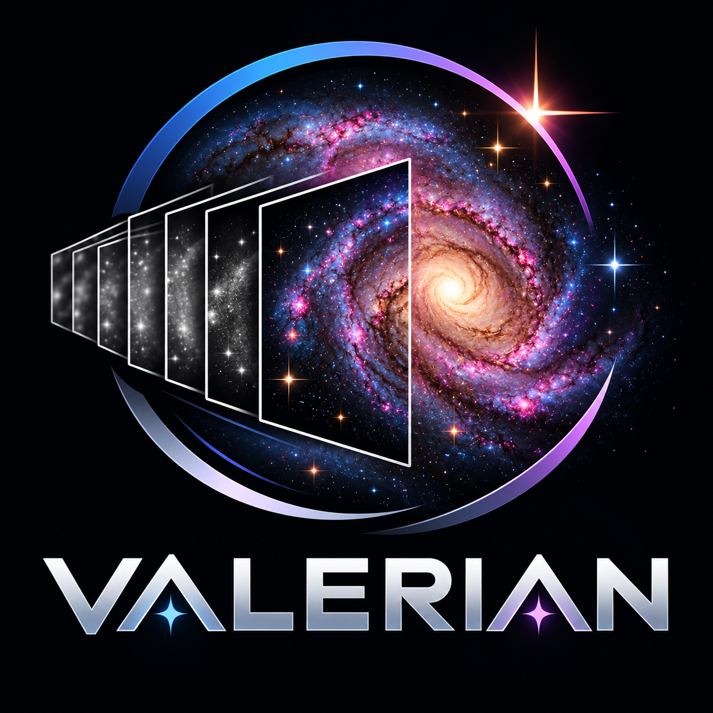

<p align="center">
  
</p>

# Valerian

Open-source, GPU-accelerated deep-sky image processing for every computer.

Valerian takes the subframes you capture of galaxies, nebulae and clusters and
turns them into a finished image: calibration, star registration, stacking with
outlier rejection, plate solving, gradient removal, photometric colour
calibration, stretching and star removal, on Linux, Windows and macOS, on
x86_64 and ARM.

## Dedication

Valerian is dedicated to my son Xaviar. His middle name is Valerian, because he
was a very sleepy child, which suits software made for the long, quiet hours of
the night sky.

## Its sister

Valerian is the deep-sky sibling of [Helia](https://github.com/qisback/helia),
the solar stacker. The two share their core: file formats, GPU acceleration,
the interface and the release pipeline, so an improvement to one lands in both.

## Get Valerian

Valerian is free software under the GPLv3 and the complete source is here. Two ways to get it:

* **Installers** for Windows, Debian and Ubuntu, Fedora and other Linux systems are sold on
  [12hobbies.studio](https://12hobbies.studio/projects/valerian/). That page is coming soon while the store
  is set up.
* **Build from source** on Windows, macOS or Linux (including Raspberry Pi). The full guide is the
  [Build from source](https://qisback.github.io/valerian/getting-started/build-from-source/) page of the
  documentation, and the short version is:

```sh
git clone https://github.com/qisback/valerian.git && cd valerian
cargo build --release --locked -p valerian-cli -p valerian-gui
target/release/valerian --help
```

It needs a current stable Rust (see `rust-version` in `Cargo.toml`), network access to github.com for
Helia's core crates on the first build, and, on Linux, a few development packages that the guide lists.
This repository's releases carry the source and the release notes only.

## Status

The latest pre-release is 0.5.0. See [Get Valerian](#get-valerian) above and
[Getting started](docs/book/src/getting-started/install.md).

Foundation milestone (V1-foundation): calibration, star registration and
stacking with outlier rejection work on the command line (`valerian calibrate`,
`register`, `stack`, `info`), `valerian stretch` and `valerian background`, and the
desktop app has the five steps of a session (calibrate, register, stack, process, export)
with stretching, star removal, plate solving, colour calibration, drizzle and the GPU
benchmark, a night-vision palette and the About page. See
`CONTRIBUTING.md` to build and test.

## Contributing

I develop Valerian on an internal repository with an extensive internal CI system, and everything is built and tested there before it reaches GitHub, which is a published mirror. For that reason I am not accepting contributions at the moment: a pull request would have to be pulled back internally, tested, then rebased and pushed out again. Bug reports and feature requests are welcome as GitHub issues. See [CONTRIBUTING.md](CONTRIBUTING.md).

## Copyright and licence

The Valerian logo is not covered by the GPL: all rights reserved, see
[LOGO-LICENCE.md](LOGO-LICENCE.md). Data files have their own licences: see
[Data and licences](#data-and-licences).

Copyright (C) 2026 Laurence Horrocks-Barlow.

Valerian is free software: you can redistribute it and/or modify it under the
terms of the GNU General Public License as published by the Free Software
Foundation, either version 3 of the License, or (at your option) any later
version. It is distributed in the hope that it will be useful, but WITHOUT ANY
WARRANTY; without even the implied warranty of MERCHANTABILITY or FITNESS FOR A
PARTICULAR PURPOSE. See [LICENSE](LICENSE) for details.

Additional terms apply under section 7 of the licence: the author attribution
and the dedication above must be kept in every copy and every modified
version, and modified versions must not be presented as the original. See
[ADDITIONAL-TERMS.md](ADDITIONAL-TERMS.md).

## Data and licences

The GPL covers Valerian's code. The data files and the logo that come with it have their own
licences, listed here and in the `NOTICE` files next to the data.

| Item | Licence | Attribution |
| --- | --- | --- |
| Gaia DR3 star file, `crates/valerian-core/data/gaia-dr3-g11.vcat` | CC BY-NC 3.0 IGO: non-commercial only | ESA/Gaia/DPAC |
| OpenNGC object list, `crates/valerian-science/data/objects.csv` | CC BY-SA 4.0 | Mattia Verga |
| IBM Plex fonts | SIL Open Font License 1.1 | IBM Corp. |
| Logo | All rights reserved, see [LOGO-LICENCE.md](LOGO-LICENCE.md) | Laurence Horrocks-Barlow |

* **Gaia DR3** (c) ESA/Gaia/DPAC. The star file is data that Valerian reads at run time; it is a
  separate file and not part of the GPL code. It is licensed CC BY-NC 3.0 IGO, so it is for
  non-commercial use, and commercial use needs ESA's authorisation. The acknowledgement and
  citations are in [packaging/gaia-notice.txt](packaging/gaia-notice.txt) and
  [crates/valerian-core/data/NOTICE](crates/valerian-core/data/NOTICE).
* **OpenNGC** by Mattia Verga (<https://github.com/mattiaverga/OpenNGC>), CC BY-SA 4.0. Attribution
  and share-alike apply to that file; see
  [crates/valerian-science/data/NOTICE](crates/valerian-science/data/NOTICE).
* **IBM Plex** fonts, (c) IBM Corp., under the SIL Open Font License 1.1.
* **The logo** is not covered by the GPL or by any other licence here.

## Author

Valerian is made by Laurence Horrocks-Barlow. If you are interested in anything
else I make, visit [12hobbies.studio](https://12hobbies.studio).
