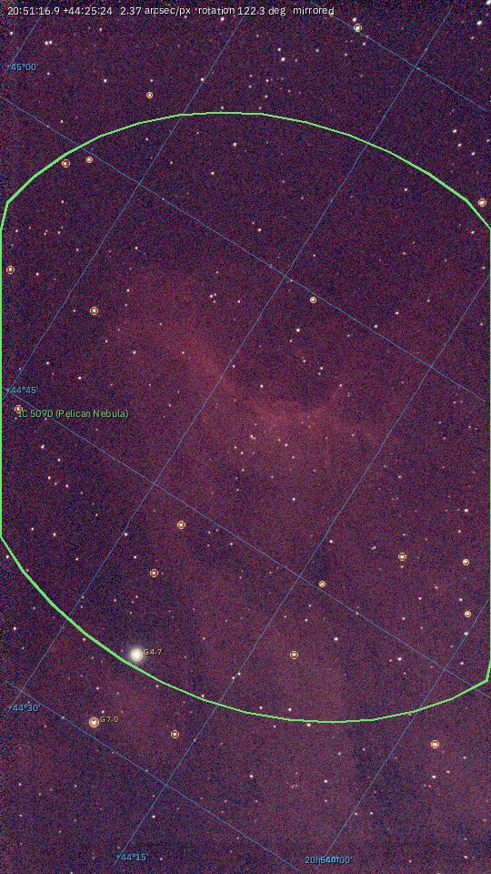
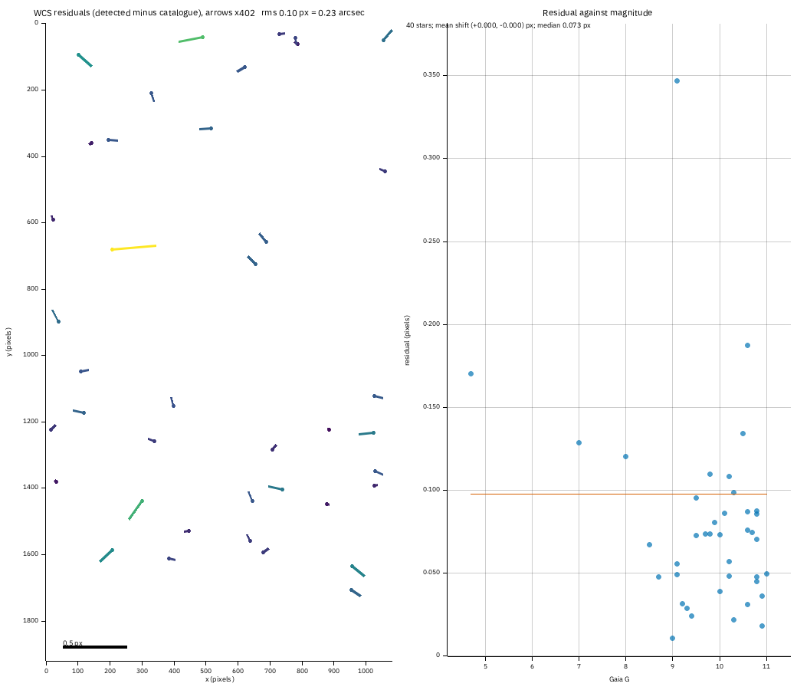
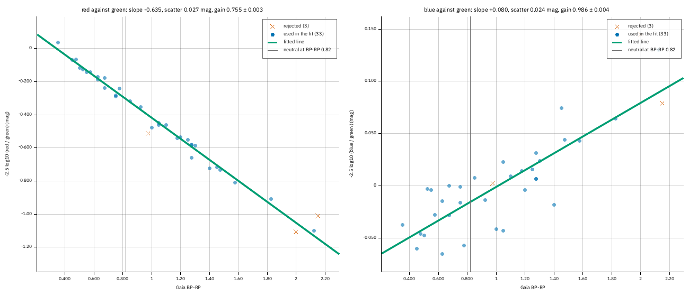
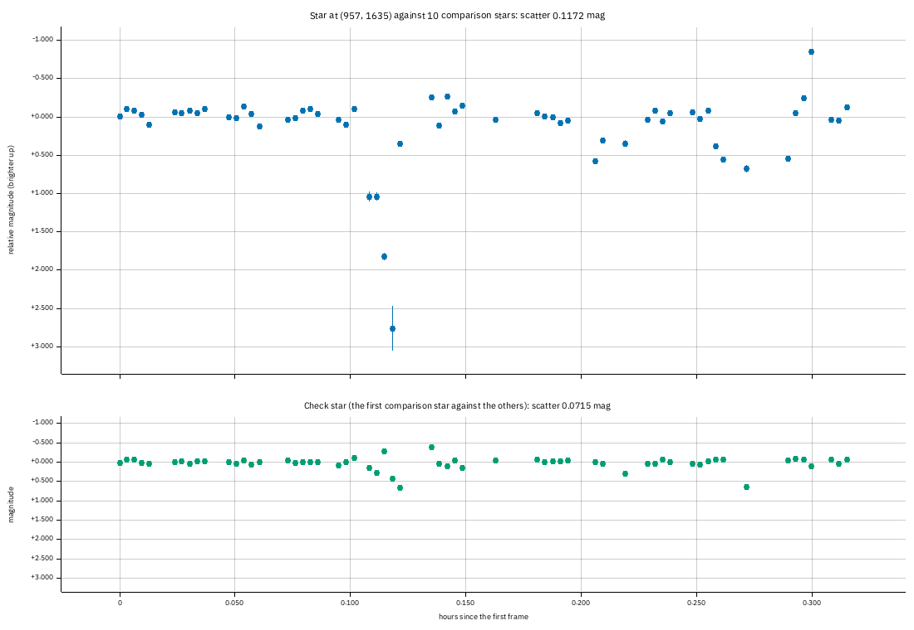
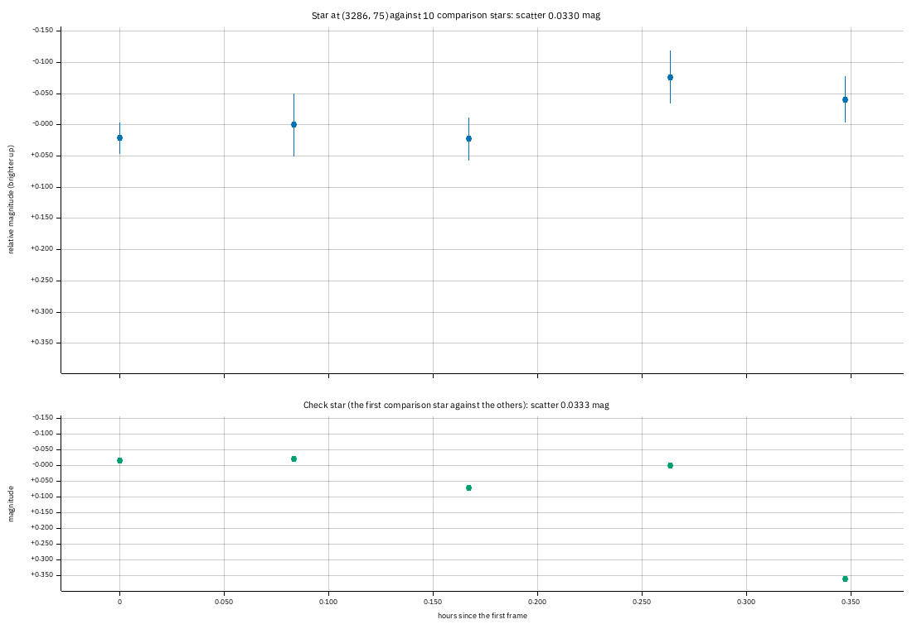
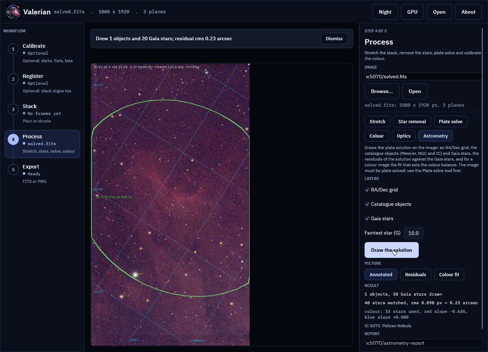
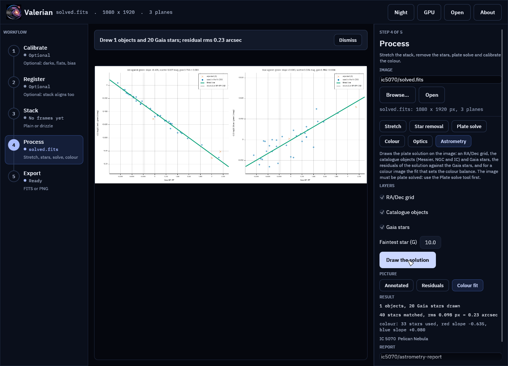
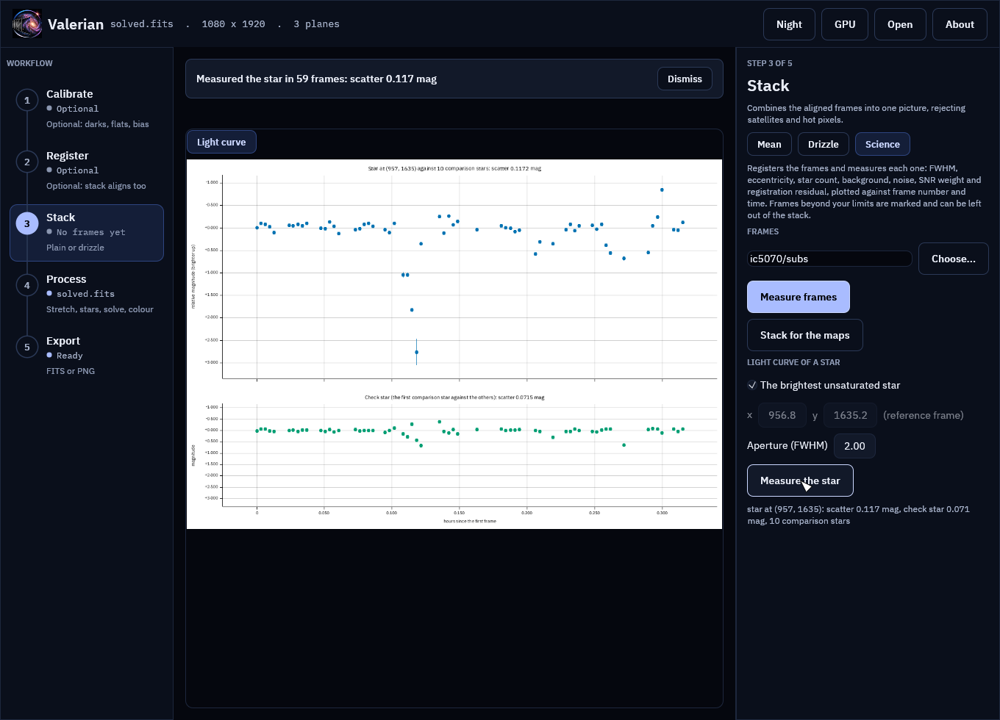

# Tutorial 15: Astrometry and photometry

**Goal:** see how good a plate solution is and what is in the field, check the fit behind the colour
balance, and follow one star through a night. You finish with the solved stack drawn with its RA/Dec
grid, catalogue objects and Gaia stars, the residuals of the solution, the scatter plot behind
`valerian photocal`, and a light curve with its table, for a star of the IC 5070 session.

**Data:** the 60-frame stack of [tutorial 4](stack.md) after [plate solving](plate-solve.md)
(`solved.fits`), the sixty frames in `lights/`, and the Gaia catalogue the solver uses. Section
"A mono set" uses the ASI1600MM H-alpha frames.

**What happens.** The solved image is drawn on with what the solution says is there; the stars of
the image are matched to Gaia to measure the solution's errors; the colour fit is drawn from the
same stars; and one star is measured in every frame against comparison stars. How each is made is
in [How the astrometry and photometry outputs work](../user-guide/astrometry.md).

## Step 1: Solve the stack

```sh
valerian solve stack.fits -o solved.fits
```

```text
solved: centre RA 20h51m16.9s Dec +44d25m25.2s (312.82029, +44.42366 deg)
scale 2.374 arcsec/pixel, field 0.71 x 1.27 deg, rotation 122.34 deg east of north, mirrored
41 of 400 detected stars matched, rms 0.23 arcsec (0.10 px), plain TAN
wrote solved.fits
```

(as in tutorial 8: the solution is in the header of `solved.fits`).

## Step 2: Draw the solution on the image

```sh
valerian annotate solved.fits --report astrometry
```

```text
1 objects and 20 Gaia stars in the field; grid every 15 arc minutes and 120 seconds of time
  IC 5070      Pelican Nebula         emission nebula          at (607, 916)
residuals: 40 stars, rms 0.098 px = 0.23 arcsec
wrote astrometry/annotated.png
wrote astrometry/annotated_objects.csv
wrote astrometry/annotated_stars.csv
wrote astrometry/wcs_residuals.png
wrote astrometry/wcs_residuals.csv
wrote astrometry/astrometry.json
wrote astrometry/report.html
```



The picture is the stack with the automatic stretch. The **blue lines** are the RA/Dec grid, drawn
through the solution (they are not parallel to the edges, because the field is rotated 122 degrees
and mirrored) and labelled where they enter: declinations at the left (`+44°45'`, `+44°30'`) and right
ascensions at the bottom (`20h54m00s`). The spacing is chosen for the field of 0.71 by 1.27 degrees:
every 15 arc minutes and 120 seconds of time. The **green ellipse** is the catalogued extent of
**IC 5070, the Pelican Nebula** (60 by 50 arc minutes), the one object of the bundled list in this field,
labelled with its name and common name. The **gold circles** are the 20 Gaia stars brighter than
G 10, the brightest labelled with their magnitude (`G 4.7`, `G 7.0`). The line at the top gives the
centre, the scale, the rotation and that the image is mirrored.

`annotated_objects.csv` lists the objects (name, common name, kind, position, size, magnitude) and
`annotated_stars.csv` the stars, with their pixel positions. Leave layers out with `--no-grid`,
`--no-objects` and `--no-stars`, make the picture bigger with `--max-side 2400`, and draw fainter
stars with `--star-mag 11`.

## Step 3: How good is the solution



Each of the 40 detected stars that match a Gaia star within 3 pixels gives a **vector**: where the star
is minus where the solution puts the catalogue star. The arrows are exaggerated 402 times (so the
longest ordinary one is a twentieth of the width; the bar is half a pixel at that factor) and coloured
by length. The picture says what you want to hear: short arrows pointing every way, with no pattern. The rms is **0.098 px = 0.23 arcsec**, the
median 0.073 px and the mean shift (+0.000, -0.000) px, so the solution is centred. On the right the length is
against Gaia magnitude: the faint stars (G 10 to 11) are the noisiest, and the few above the rest are
stars the centroid is poor for (a close double, a bright star with a bleed). If you saw a pattern, the
guide says what it means: a shift, a rotation, a scale error, distortion. The tutorial's TAN fit had no
distortion terms (`plain TAN`) and the field is small, so none was needed; a wide field or a fast lens
would show corner arrows pointing outward or inward, and `valerian solve --sip-order 3` would remove
them.

`wcs_residuals.csv` holds the table, and `valerian plot residuals solved.fits -o residuals.png` draws just
this sheet (with the data beside it).

## Step 4: The colour fit behind the colour balance

```sh
valerian photocal solved.fits --report colour
```

```text
36 Gaia stars measured, 33 used; aperture radius 5.1 px; neutral at BP-RP 0.82
  red against green: slope -0.635 mag per BP-RP, scatter 0.027 mag, gain 0.7547 +/- 0.0032
 blue against green: slope +0.080 mag per BP-RP, scatter 0.024 mag, gain 0.9860 +/- 0.0037
sky before 610.73 597.25 608.32, after 552.64 552.64 552.64 (offsets -91.74 44.61 47.13)
wrote colour/pcc.png
wrote colour/pcc.csv
wrote colour/pcc.json
wrote colour/report.html
```



Each dot is a Gaia star measured through the same aperture in red, green and blue: its **instrumental
colour** (`-2.5 log10` of red over green on the left, blue over green on the right) against its Gaia
BP-RP. Red falls steeply with BP-RP (slope -0.635: redder stars are far brighter in red against green) and blue rises gently (+0.080: the Seestar's blue
filter is close to its green). The green line is the fit through the blue dots (33 stars) with the
crosses (3) rejected as outliers; the grey line is the colour made neutral (BP-RP 0.82, a Sun-like
star); where the fitted line crosses it is the **zero point**, which sets the **gain**: 0.755 for red
(the red channel is 32 per cent too strong in this stack) and 0.986 for blue. The scatter about the line, 0.027 mag
in red and 0.024 in blue, is a measure of the photometry and the catalogue colours together; this is the
plot to look at when a colour calibration looks wrong: a cloud of points with no slope, or a slope the wrong way,
means the planes are in the wrong order or the image was stretched. The table `pcc.csv` and `pcc.json` hold
every star and the lines.

## Step 5: Follow one star through the night

```sh
valerian photometry lights/ --report photometry
```

```text
star: the brightest unsaturated one in frame 47 at (956.8, 1635.2); use --star X,Y to choose
target at (956.8, 1635.2): flux 123912 ADU, 30 comparison stars, aperture 4.3 px
59 frames measured; scatter 0.1172 mag, check star 0.0715 mag; aperture 4.3 px
```

The sixty frames are registered to the sharpest (47), and the brightest star that is not saturated and not at an edge is chosen: here at (956.8, 1635.2) in
that frame, 124 000 ADU above the sky. (The brightest star of all is clipped at 65535 ADU, so it is skipped:
you cannot measure a star whose top is cut off.) It is measured in every frame with an aperture of two FWHM
(4.3 px in the reference, more in the soft frames: 4.3 to 8.1 px) against 10 comparison stars (the table says
which). The last frame but five, 52, is thick cloud (44 stars, a sky of 830 ADU): a comparison star
cannot be measured in it, so it is marked `ok` 0 and left out. 59 of 60 frames make the curve.



The top panel is the star's **relative magnitude** (brighter up), against hours since the first frame.
Measured against the comparison stars, a dimming that affects every star alike drops out. Thick
cloud does not dim every star alike, though (it has a gradient, and the faint comparison stars fall into the
noise), and the picture shows it: the spikes of up to a magnitude at 0.10 to 0.14, 0.21 and 0.27 to 0.29 hours are the cloud
frames. The scatter over all 59 frames is 0.117 mag (a robust figure, 1.4826 MAD). The bottom panel is the
**check star**, the brightest comparison star measured against the others: it should be flat, and its
scatter, 0.072 mag, is the precision of the whole measurement. For the 46 frames the [subframe
analysis](subframe-analysis.md) approved (tutorial 12) the scatter is **0.092 mag for the star and 0.057
for the check star**; for the 13 it rejected it is 0.54 and 0.25: **leave poor frames out before you
trust a light curve.** The star is as steady as the check star, so there is nothing to report about
it: this is a measurement of the method, not a variable star. The error bars are the formal error from the sky
noise, 0.007 mag, an order of magnitude smaller than the real scatter. Do not trust them alone: the
check star is the honest figure. The rest of the scatter is scintillation in 10-second exposures,
the seeing (FWHM 2.2 to 4 px), the field rotation of an alt-az mount against an aperture of fixed size in
pixels and the demosaicing of a colour camera.

`photometry/lightcurve.csv` has one row per frame (position, aperture, flux, sky, S/N, the ensemble flux,
instrumental and relative magnitude, the error, the check magnitude and the flag), `lightcurve.json` the
same with the comparison positions. Use `--star X,Y` to measure another star (read its position in the
reference frame from the annotated picture), `--aperture 3` for a wider aperture
(which helps when the seeing varies, at the cost of more sky noise) and `--comparison 5` for fewer
comparison stars.

## A mono set

On five of the ASI1600MM H-alpha frames (20 to 24, 300 s, the sharp panel of the mosaic of
[tutorial 12](subframe-analysis.md)):

```sh
valerian photometry ha-panel/ --report photometry-ha
```

```text
target at (3286.2, 74.7): flux 168459 ADU, 30 comparison stars, aperture 3.8 px
star: the brightest unsaturated one in frame 3 at (3286.2, 74.7); use --star X,Y to choose
5 frames measured; scatter 0.0330 mag, check star 0.0333 mag; aperture 3.8 px
```



A monochrome camera with no demosaicing: the star and the check star agree to 0.033 mag over the
five frames. The fluxes were also measured with photutils (exact pixel overlap, the same positions
and apertures) and agree to 0.1 per cent in the median and 0.4 per cent at worst (the ratio runs from
0.9966 to 1.0021).

## Step 6: The same in the desktop app

Open `solved.fits`, choose the **Process** step and the **Astrometry** chip, and press **Draw the
solution**. The chips under Picture offer **Annotated**, **Residuals** and **Colour fit**.





The light curve is in the **Science** panel of the **Stack** step: choose the folder of frames and
press **Measure the star**.



Every control is in the [desktop app reference](../reference/gui.md#astrometry).

## Options used

All options are in the command line reference: [`annotate`](../reference/cli.md#valerian-annotate),
[`photometry`](../reference/cli.md#valerian-photometry), [`photocal`](../reference/cli.md#valerian-photocal).

| Option | What it does | Range or values | Default |
|---|---|---|---|
| `annotate IMAGE` | the solved FITS image | a file | required |
| `--report <DIR>` | folder for the outputs | a folder | `astrometry-report` |
| `--wcs`, `--catalogue` | another solution; another star catalogue | files | the image's own; the one beside the program |
| `--no-grid`, `--no-objects`, `--no-stars` | leave a layer out | | all drawn |
| `--star-mag`, `--label-mag` | faintest star drawn; stars brighter are labelled | G | 10 and 8 |
| `--max-side` | longest side of the picture | 200 to 6000 pixels | 1400 |
| `photocal --report <DIR>` | write the colour-fit scatter | a folder | not written |
| `photometry FRAMES` | frames to measure | files or folders | required |
| `--star <X,Y>` | the star in the reference frame | pixels | the brightest unsaturated star |
| `--aperture <FWHM>`, `--comparison <N>` | aperture radius; comparison stars at most | 1 to 5; 3 or more | 2.0 and 10 |

## How to tell it worked

* `annotate` prints the objects in the field and the residual rms; `astrometry/` holds the picture,
  the two lists, the residual sheet and its table, and `report.html`.
* The residual arrows have no pattern and the rms is a fraction of a pixel.
* The colour plot shows a tight line through the dots, red falling and blue rising.
* The light curve's check star is flat to a few hundredths of a magnitude, and `photometry` says
  how many frames it measured.

## Troubleshooting

**`has no world coordinate system (run `valerian solve` first)`.** The image is not solved and its header
has no position and scale for a quick solve. Run [`valerian solve`](plate-solve.md).

**`note: no star catalogue found, so no Gaia stars and no residuals`.** The catalogue is not beside the
program or in `VALERIAN_CATALOGUE`: give `--catalogue`. The grid and objects are still drawn.

**`only 6 stars match the catalogue within 3 px; is the image solved?`** The solution is wrong or the image
is a different field. Solve again, or check that the stack is linear and not cropped.

**The residual arrows turn or point outward.** A pattern is a fault: see
[How the astrometry and photometry outputs work](../user-guide/astrometry.md#the-residuals-of-the-solution).
Solve again with `--sip-order 3`.

**`only 1 usable comparison stars in the reference frame; need 3`.** The field has too few stars that are
isolated, unsaturated and away from the edges for this aperture. Use a smaller `--aperture`, or frames
with more stars.

**`the star cannot be measured in the reference frame (too near an edge?)`.** The position given is
outside the frame or too close to an edge for the sky annulus. Check the `--star` position in the
reference frame (the one the table calls reference), not in another frame.

**The curve is noisy and the check star is too.** That is the precision of the data: the check star has the same
scatter as the target. Improve it with a wider aperture, more comparison stars, longer exposures, or by
leaving out the poor frames with the [subframe analysis](subframe-analysis.md).

**A bright star is skipped as saturated.** It reaches the top of the range (60000 ADU or more in a 16-bit
frame) so its flux is clipped. Give another star with `--star`, or use shorter exposures.
