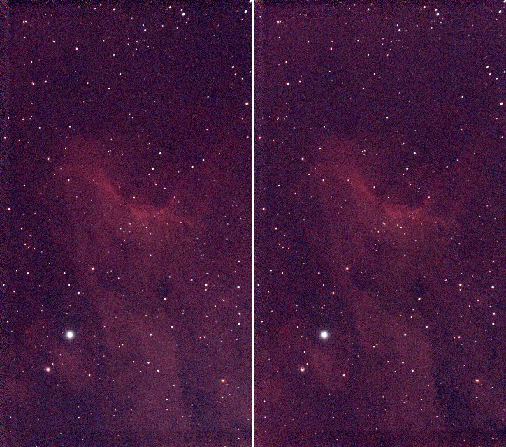
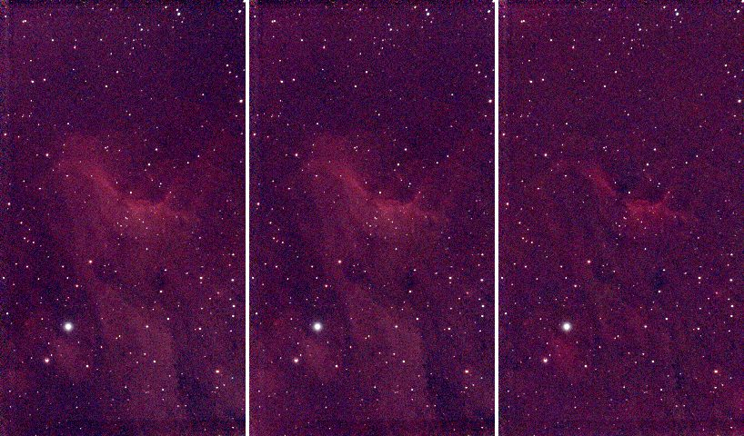
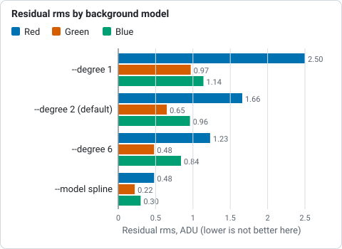
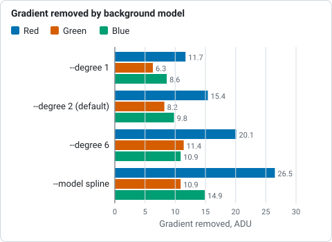

# Tutorial 5: Background extraction

**Goal:** take the smooth glow out of the sky (light pollution, moonlight, a gradient from the
horizon) without taking the nebula with it, and keep the average sky level where it was.

**Data:** `stack.fits`, the sixty-frame IC 5070 stack from [tutorial 4](stack.md): linear,
three planes, 1080 by 1920 pixels. It has a gradient: its glow differs by 15 ADU across the
frame in red, which is about 2.5 per cent of the sky level, and the nebula fills much of the
frame, which makes the job harder than on an empty field.

**When.** Do this on the **linear** stack, after stacking and before stretching, colour calibration
or star removal. The method (tiles, polynomial and spline fits, star masking, rounds of
refinement) is in [How background extraction works](../user-guide/background.md).

## Step 1: Remove the gradient

```sh
valerian background stack.fits -o flat.fits --degree 2 --save-model glow.fits
```

```text
plane 0: 1150 samples of 1258 tiles (33 px), 13.0% masked, residual rms 1.66, gradient removed 15.4
plane 1: 1173 samples of 1245 tiles (33 px), 11.7% masked, residual rms 0.65, gradient removed 8.2
plane 2: 1433 samples of 1470 tiles (33 px), 9.9% masked, residual rms 0.96, gradient removed 9.8
wrote flat.fits
wrote the background model glow.fits
```

The run takes under a second (0.43 s). One line per colour plane, because the three colours have
different glows:

* **`1150 samples of 1258 tiles (33 px)`.** The image is cut into square tiles (33 pixels: the
  default is a thirty-second of the short side, 1080 divided by 32, and at least 32). Each tile gives
  one measure of the sky, the median of its clear pixels. Of 1258 tiles, 1150 were
  kept as samples; the others were rejected as stars, nebulosity or the target.
* **`13.0% masked`.** The share of the pixels that were masked as stars before the fit (anything 3
  sigma above the surface, grown by 3 pixels).
* **`residual rms 1.66`.** How far the samples are from the fitted surface, in ADU. The sky noise of one
  33-pixel tile is a fraction of the pixel noise (12.5 here), so 1.66 is a good fit: the surface
  explains the samples.
* **`gradient removed 15.4`.** The size of the fitted surface from its lowest to its highest
  point, in ADU: how much glow was taken out. The red plane had 15.4 ADU of glow, the green 8.2
  and the blue 9.8: the glow is red, which is why the unprocessed stack has a colour cast.

Two files are written. `flat.fits` is the corrected stack. `glow.fits` is the model that was subtracted,
one plane per colour. Its range in `info --stats` is 600.5 to 615.9 ADU in red: the surface
is the sky level, brighter at one corner than the other. The glow is brightest towards the bottom right
of the frame:


## Step 2: Check the result

The level of the sky is kept (`--level preserve` is the default), so the numbers barely
change; the surface is flat:

```sh
valerian info flat.fits --stats
```

```text
flat.fits
  size: 1080 x 1920 pixels, 3 planes
  plane 0: min 526.3, sky 610.8, noise 11.93, max 74631.3 ADU
  plane 1: min -7.3, sky 597.3, noise 7.26, max 56987.6 ADU
  plane 2: min 139.8, sky 608.3, noise 9.92, max 70726.0 ADU
  stars: 521 (median FWHM 2.57 px, ellipticity 0.165)
```

The sky is 610.8, 597.3 and 608.3, against 610.7, 597.3 and 608.3 before: unchanged, which is the
point of `preserve`. The stars are unchanged (518 against 521: the detection sees
a flatter sky). The picture below is the stack (left) and the corrected image (right), both at
full size reduced three times and with one shared screen stretch. The darker left edge and the
lighter right and lower corner of the stack have evened out, and the nebula is intact.



## Step 3: Choose the model for your data

The surface is a polynomial of the `--degree` you choose, or a thin-plate spline. This target fills
the frame, so the choice matters. The same stack with three models, left to right: `--degree 1`
(a tilted plane), the `--degree 2` above, and `--model spline`:



| Command | Residual rms (R, G, B) | Gradient removed (R, G, B) | Result |
|---|---|---|---|
| `--degree 1` | 2.50, 0.97, 1.14 | 11.7, 6.3, 8.6 | keeps the nebula; leaves a little of the glow |
| `--degree 2` (default) | 1.66, 0.65, 0.96 | 15.4, 8.2, 9.8 | keeps the nebula; removes the glow |
| `--degree 6` | 1.23, 0.48, 0.84 | 20.1, 11.4, 10.9 | starts to follow the nebula |
| `--model spline` | 0.48, 0.22, 0.30 | 26.5, 10.9, 14.9 | **removes part of the nebula** |



*Residual rms of the fit per colour for four background models, from the table above: the spline fits the samples closest because it has learnt the nebula.*



*Gradient removed per colour for four background models, from the table above: the spline takes out the most, including part of the nebula.*

A lower residual is **not** better here: the more flexible the surface, the closer it gets to the
samples, and when the target fills the frame the samples include the nebula. A spline (or a high
degree) that reaches 0.48 residual has learnt the nebula as "background" and subtracted it,
which is the right-hand picture. Prefer the lowest degree that flattens your sky: 1 or 2 for a
gradient, more only for a field with clear sky all round. The spline is for a complex gradient on
an empty field. The correct check is to look at `glow.fits`: it must be smooth, with no
structure that looks like your target.

## Options used

All options are in the [command line reference](../reference/cli.md#valerian-background).

| Option | What it does | Range or values | Default |
|---|---|---|---|
| `<INPUT>` | the stacked FITS image, mono or colour planes (not a raw mosaic) | a file | required |
| `-o`, `--output <FILE>` | the corrected image | a file | required |
| `--save-model <FILE>` | also write the fitted background, one plane per input plane | a file | not written |
| `--model` | the surface | `polynomial`, `spline` | `polynomial` |
| `--degree <N>` | polynomial degree (1 is a plane) | 0 to 6 | 2 |
| `--smoothing <S>` | spline smoothing; larger tends to a plane | about 0.001 to 0.01 for a hundred tiles | 0.005 |
| `--mode` | subtract light pollution, or divide by vignetting and falloff | `subtract`, `divide` | `subtract` |
| `--level` | keep the mean level, or remove the whole surface | `preserve`, `zero` | `preserve` |
| `--tile <PX>` | tile size in pixels | 0 for automatic, else pixels | 0 (a thirty-second of the short side, at least 32) |
| `--star-sigma <SIGMA>` | mask pixels this many robust sigmas above the surface as stars | sigmas | 3 |
| `--mask-grow <PX>` | grow the star mask | pixels | 3 |
| `--clip-low <SIGMA>`, `--clip-high <SIGMA>` | reject tile samples this many sigmas below, above the fit | sigmas | 3 low, 2 high |
| `--rounds <N>` | rounds of mask refinement after the first fit | count | 3 |
| `--exclude-target` | leave out the bright central target, sized from the data | on or off | off |

Measured on this stack:

* `--level zero` removes the whole surface instead of keeping the mean: the sky goes from
  610.8 to 2.3 ADU in red (0.7 and 0.6 in green and blue). Use it if a later tool expects a sky
  at zero.
* `--tile 64` gives 290 tiles: 260 samples, residual rms 1.31, gradient removed 15.6: the same
  glow from fewer, larger samples. A smaller tile follows small features more; a larger
  one averages more stars out.
* `--degree 0` removes a constant only (gradient removed 0.0).
* `--mode divide` is for vignetting that multiplies the light; for a light pollution glow, which adds
  light, use the default `subtract`.
* The run took 0.43 s with a polynomial and 0.78 s with a spline.

## How to tell it worked

* One line per plane, with `gradient removed` of a few per cent of the sky level, not hundreds.
* The residual rms is of the order of the tile noise (a few ADU here).
* `glow.fits` is **smooth** and resembles a gradient, not your target.
* The nebula is still there in the corrected image, and the sky is flatter: no darker or lighter
  side.
* The sky level in `info --stats` is unchanged (with `preserve`).

## Troubleshooting

**The nebula got dimmer or has a dark halo.** The model is following your target: use a lower
`--degree`, or `--model polynomial` if you used the spline (shown above), or add
`--exclude-target`. On this stack `--exclude-target` is **declined** for a different reason, below.

**`background fit declined, plane left as it is: 62% of the image is star, nebula or target, so
there is no clear sky to measure a background from`.** Valerian measures a background from
clear sky, and with `--exclude-target` it found only 38 per cent of this image clear, which
is too little: it would have had to subtract the target. The plane is written as it was and the other planes
are unaffected. The command did not fail; look at the message. Run without `--exclude-target`
(a plane fits this frame well) or take a wider field.

**`valerian: lights/....fit is a raw colour mosaic; calibrate it with --debayer first`.** The
input is a raw Bayer frame. Background extraction works on stacks, or frames that have been
demosaiced; stack first ([tutorial 4](stack.md)), which demosaics the frames.

**`valerian: polynomial degree must be 0 to 6`.** Degree 9 was given. Use a spline for a more
complex surface.

**Bright rings or "bumps" around the brightest stars.** The star mask is too small for the
star's halo. Raise `--mask-grow` (3 pixels default) or lower `--star-sigma` (3 default) so more
of the star is masked, or raise `--rounds`.

**A coloured cast remains.** Background extraction removes the glow of each plane, not the
difference between the colours of the sky; the three planes' sky levels stay different
(610.8, 597.3, 608.3 here). Colour calibration sets them to a common level:
[tutorial 9](photometric-colour.md).

## The desktop app

Background extraction is not in the desktop app yet; the command line is the only way today. See [The desktop app](../user-guide/gui.md).

## Where next

`flat.fits` is the gradient-free linear stack. [Tutorial 6](stretch.md) turns it into a picture you
can see. The colour of the sky is still uncorrected: that needs a plate solution and comes in
[tutorials 8](plate-solve.md) and [9](photometric-colour.md), which start from `flat.fits` too.
