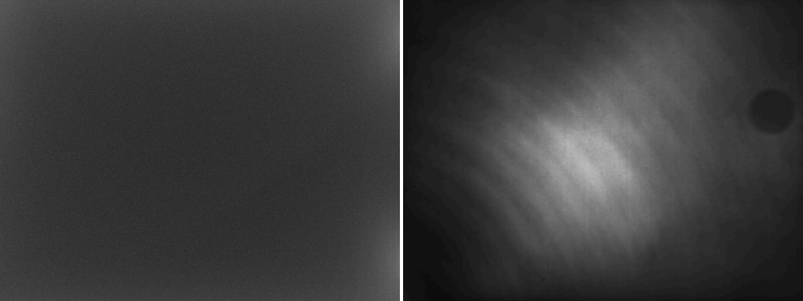
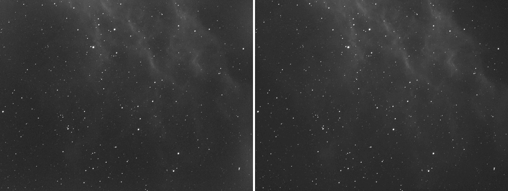
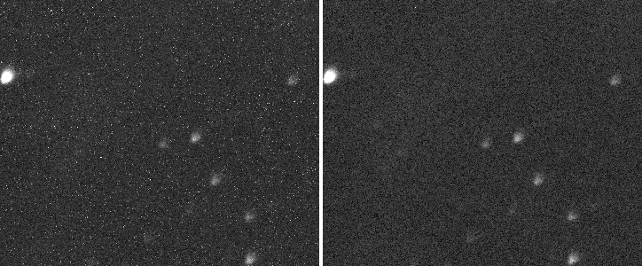

# Tutorial 2: Calibrate

**Goal:** turn raw light frames into calibrated ones: subtract the dark current and the
electronic offset, divide out vignetting and dust, and repair the hot pixels. You finish with
one calibrated frame per light and three master frames you can reuse.

**Data:** the ASI1600MM H-alpha capture of the California Nebula (see
[the two captures](index.md#the-two-captures)): 25 lights of 300 s, 10 darks of 300 s, 30 flats
of 2.04 s and 30 dark flats of 2.04 s, all at -10 C and gain 139. It is the one capture in
these tutorials with a full set of calibration frames. **If you have no darks or flats** (a
Seestar, or any camera that writes none), skip this tutorial: the raw frames go straight to
[tutorial 3](register.md).

**Why these frames.** The darks match the lights in exposure (300 s), temperature (-10 C) and
gain, so the dark can be subtracted as it is. The flats are short (2.04 s), so the thing to
subtract from them is a *dark flat* of the same 2.04 s, not the 300 s dark. If you have bias
frames instead of dark flats, pass them with `--bias`. For the method, see
[How calibration works](../user-guide/calibration.md).

## Step 1: Put the frames in folders

One folder per kind of frame:

```text
lights/        25 files   2023-01-25_20-43-49_Ha_-10.00_300.00s_0000.fits ...
darks/         10 files   2023-01-26_14-29-21_Ha_-10.00_300.00s_0000.fits ...
flats/         30 files   2023-01-25_17-55-32_Ha_-10.00_2.04s_0000.fits ...
dark-flats/    30 files   2023-01-25_18-21-01_Ha_-10.00_2.04s_0000.fits ...
```

Valerian does not read the file names to tell the kinds apart: it uses the option you give
each folder (`--dark`, `--flat`, ...). Check that a folder holds what you think with `info`:

```sh
valerian info darks/2023-01-26_14-29-21_Ha_-10.00_300.00s_0000.fits
```

```text
darks/2023-01-26_14-29-21_Ha_-10.00_300.00s_0000.fits
  IMAGETYP  DARK
  FILTER    Ha
  EXPTIME   300
  EXPOSURE  300
  CCD-TEMP  -10
  SET-TEMP  -10
  GAIN      139
  OFFSET    21
  XBINNING  1
  DATE-OBS  2023-01-26T14:29:21.050
  INSTRUME  ZWO ASI1600MM Pro
  TELESCOP  Starwatcher Esprit 1
  FOCALLEN  840
```

Compare `EXPTIME`, `CCD-TEMP`, `GAIN` and `OFFSET` with a light's: the darks must agree with
the lights, and the flats must agree with the dark flats.

## Step 2: Calibrate

```sh
valerian calibrate lights/ \
    --dark darks/ --flat flats/ --dark-flat dark-flats/ \
    -o calibrated --masters masters
```

```text
compute: CPU (the GPU is slower for this command; --backend gpu forces it)
dark: combined 10 frames with Winsorised { low: 3.0, high: 3.0 } in 1.1s
dark flat: combined 30 frames with LinearFit { low: 5.0, high: 2.5 } in 3.8s
flat: combined 30 frames with LinearFit { low: 5.0, high: 2.5 } in 4.6s
pixel map: 9925 hot, 22 cold, 0 dead
wrote masters/master_dark.fits
wrote masters/master_dark_flat.fits
wrote masters/master_flat.fits
lights/2023-01-25_20-43-49_Ha_-10.00_300.00s_0000.fits -> calibrated/2023-01-25_20-43-49_Ha_-10.00_300.00s_0000_cal.fits  dark x1.0000, 9947 pixels repaired, 247.2ms
lights/2023-01-25_20-49-13_Ha_-10.00_300.00s_0001.fits -> calibrated/2023-01-25_20-49-13_Ha_-10.00_300.00s_0001_cal.fits  dark x1.0000, 9947 pixels repaired, 153.7ms
...
lights/2023-01-26_00-02-41_Ha_-10.00_300.00s_0004.fits -> calibrated/2023-01-26_00-02-41_Ha_-10.00_300.00s_0004_cal.fits  dark x1.0000, 9947 pixels repaired, 106.9ms
```

The whole run took 14 s on the server, 25 lights of 4656 by 3520 pixels. Read the output line
by line:

* **`compute: CPU (...)`.** Calibration runs on the processor by default, because for one
  stage alone the copy to the graphics card costs more than the card saves
  ([tutorial 11](gpu.md) has the numbers). `--backend gpu` forces the card.
* **`dark: combined 10 frames with Winsorised {low: 3.0, high: 3.0}`.** The ten darks became one
  *master dark*. With fewer than 15 frames `--rejection auto` picks Winsorised sigma clipping,
  which copes with a few frames; the 30 flats get linear-fit clipping, which copes with a
  panel whose brightness drifts. Each master takes only the seconds shown.
* **`pixel map: 9925 hot, 22 cold, 0 dead`.** The defective pixels found in the master dark. At
  300 s this sensor has about 1 pixel in 1,600 hot (at the default 40-sigma limit).
* **`dark x1.0000`.** The dark was subtracted as it is (the dark scale is 1), which is the
  default (`--scale-dark off`) and right here because the darks and lights agree in exposure.
* **`9947 pixels repaired`.** The 9925 hot and 22 cold pixels, replaced in every light by the
  median of their good neighbours.

Three master frames are in `masters/` and 25 files in `calibrated/`, each light with `_cal`
added to its name and stored as a 32-bit float FITS file (65 MB each, so 25 lights is
1.6 GB: check you have the disk space).

## Step 3: Look at the result

Open `masters/master_flat.fits` in any FITS viewer, or look at the picture below, where the
master dark (left) and master flat (right) each have a screen stretch applied:



The flat is the sensor's response, normalised to a mean of one (`info --stats` gives the sky
as 1.0 and the brightest pixel as 1.1): brighter in the middle, dark in the corners (vignetting) and with a dust shadow at the top right. Dividing the light by it flattens
the sky. The ring is where dust sat on the sensor window; dust never moves between the flats
and the lights if you did not touch the camera, which is why flats are taken in the same
session.

Now one light, before and after (left: raw `lights/..._0000.fits`; right:
`calibrated/..._0000_cal.fits`; each with its own screen stretch, shown at 1000 pixels wide):



At this scale the difference is the flatter field. At full size, the hot pixels show. This is
a crop of 360 by 300 pixels at full resolution, raw on the left and calibrated on the right:



The numbers say the same thing. `valerian info --stats` on the raw and calibrated light:

```text
lights/2023-01-25_20-43-49_Ha_-10.00_300.00s_0000.fits
  size: 4656 x 3520 pixels, 1 plane
  IMAGETYP  LIGHT
  plane 0: min 16.0, sky 464.0, noise 71.16, max 65504.0 ADU
  stars: 1000 (median FWHM 8.28 px, ellipticity 0.241)
calibrated/2023-01-25_20-43-49_Ha_-10.00_300.00s_0000_cal.fits
  size: 4656 x 3520 pixels, 1 plane
  IMAGETYP  Calibrated Light
  plane 0: min -987.1, sky 84.4, noise 68.36, max 68358.3 ADU
  stars: 1000 (median FWHM 8.06 px, ellipticity 0.239)
```

The sky level fell from 464 to 84 ADU: the offset and dark current are gone, and what is left is
the sky glow plus the nebula. The `min` is now negative, as it should be for a frame with the
offset taken out (noise goes below zero). The star count is unchanged: calibration must not
change the stars.

## Step 4: Reuse the masters next time

`--masters masters` kept the three master frames. Next session you can skip combining the darks
and flats by passing the masters themselves:

```sh
valerian calibrate lights/ --dark masters/master_dark.fits --flat masters/master_flat.fits -o calibrated
```

```text
compute: CPU (the GPU is slower for this command; --backend gpu forces it)
dark: using the master masters/master_dark.fits
flat: using the master masters/master_flat.fits
pixel map: 9925 hot, 22 cold, 0 dead
```

A single file whose `IMAGETYP` says it is a master is used as it is. The pixel map is built
again from the master dark.

## Options used

All are in the [command line reference](../reference/cli.md#valerian-calibrate).

| Option | What it does | Range or values | Default |
|---|---|---|---|
| `<LIGHTS>...` | light frames: files or folders | one or more | required |
| `-o`, `--output <DIR>` | folder for the calibrated frames | a folder | required |
| `--dark`, `--flat`, `--bias`, `--dark-flat` `<PATH>` | calibration frames, or a master; each may be repeated | file or folder | none (at least one of bias, dark or flat is needed) |
| `--masters <DIR>` | also write the master frames here | a folder | not written |
| `--scale-dark` | how the dark is scaled to each light | `off`, `exposure`, `optimise` | `off` |
| `--rejection` | how calibration frames are combined | `auto`, `none`, `minmax`, `sigma`, `winsorised`, `linear-fit` | `auto` (Winsorised below 15 frames, sigma clipping to 30, linear fit above) |
| `--memory <MIB>` | memory used to combine calibration frames, read a band of rows at a time | MiB | 1024 |
| `--hot-sigma <SIGMA>` | a pixel this many sigmas above its neighbours in the master dark is hot | sigmas | 40 |
| `--cold-sigma <SIGMA>` | the same, below | sigmas | 12 |
| `--auto-cosmetic` | without a dark, find isolated hot and cold pixels in each light; enough on its own | on or off | off |
| `--flat-per-channel` | normalise the flat per Bayer colour: corrects vignetting and dust but not colour balance | on or off | off |
| `--debayer` | demosaic the calibrated frames | `auto`, `none`, `mhc`, `bilinear` | `none` here (a raw mosaic stays a mosaic) |
| `--backend` | the engine for the per-pixel stages | `auto`, `cpu`, `gpu` | `auto` (the CPU, for this command) |

## How to tell it worked

* The summary line reads `pixel map: N hot, M cold, K dead` with `N` in the thousands for a
  long exposure on a CMOS sensor, and every light line ends `pixels repaired` with the same
  figure.
* `dark x1.0000` appears on every light (with `--scale-dark off`).
* `calibrated/` holds as many `_cal.fits` files as you gave lights.
* In `info --stats` the `sky` falls to a small value (here 84 ADU against 464) and the star
  count is unchanged.
* The flat is smooth and the picture of the master flat shows the vignetting and the dust you
  know about, and nothing that looks like stars.

## Troubleshooting

**`valerian: nothing to calibrate with: give at least one of --bias, --dark and --flat`.**
You gave lights and no calibration frames and no `--auto-cosmetic`. On a Seestar capture
`valerian calibrate lights/ --auto-cosmetic -o calibrated` is enough: it runs a cosmetic-only
pass that repairs isolated hot and cold pixels in each light and subtracts nothing. With a flat but no dark,
add `--auto-cosmetic` to the flat: `valerian calibrate lights/ --flat flats/ --dark-flat
dark-flats/ --auto-cosmetic -o calibrated` ran and repaired 97,879 isolated pixels in the first
light, which is 0.6 per cent of the frame and shows how crude the heuristic is. A master dark
is better.

**`valerian: a master frame differs in size from the light`.** A calibration frame has a
different width or height than the lights: usually from another camera, another binning or
a sensor readout mode. It was reproduced by giving the ASI1600 flats to the Seestar lights.
Take the calibration frames in the same mode as the lights and check `size:` in `info`.

**`valerian: nonexist/ does not exist` or `valerian: tr/empty contains no FITS files`.** A
path is wrong or the folder holds no `.fits`, `.fit` or `.fts` files. Valerian checks every
path before it starts the long work.

**`valerian: dark scaling needs a master dark made with a master bias`.** You asked for
`--scale-dark exposure` or `optimise`, but the dark was made without a bias. Scaling needs the
bias taken out first so that only dark current is scaled: add `--bias`, or leave
`--scale-dark` at `off` and take darks at the lights' exposure.

**The flat made the picture worse (new bright or dark patches, or a gradient).** The flats were
taken in a different state: a camera rotated or refocused, dust that has moved, or flats that
were not exposed to about half full well. Retake them in the same session as the lights, with
the same optical train. Dividing by a bad flat adds a pattern instead of removing one.

**All 25 lights are calibrated, but registering them finds only some of them.** This is not a
calibration problem: the 25 lights are five mosaic panels. See
[Tutorial 3, troubleshooting](register.md#troubleshooting).

## The desktop app

In the desktop app this is step 1, **Calibrate**: fill in the Lights, Darks, Flats, Dark flats and Bias boxes and press **Calibrate lights**. The app's own walk-through is [the desktop tutorial](../user-guide/gui-tutorial.md#1-calibrate); every control is in the [desktop app reference](../reference/gui.md#calibrate).

## Where next

The calibrated frames are in `calibrated/`. For one panel of five of these
frames, [tutorial 3](register.md) registers them. The tutorial thread continues with the
Seestar capture, because that data set has sixty frames and a colour sensor, which shows more.
