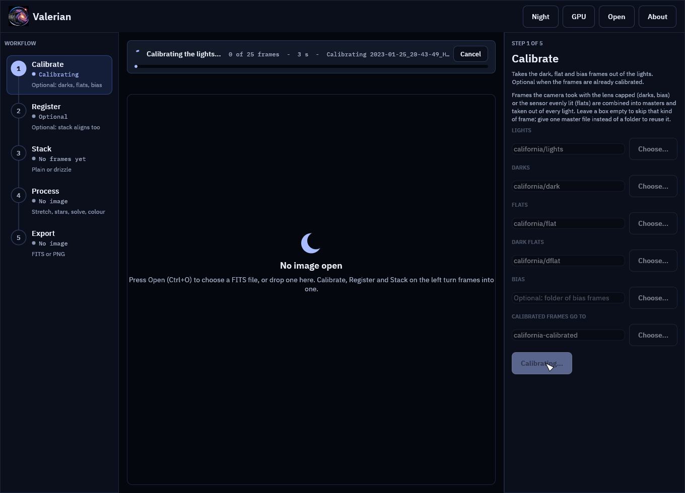
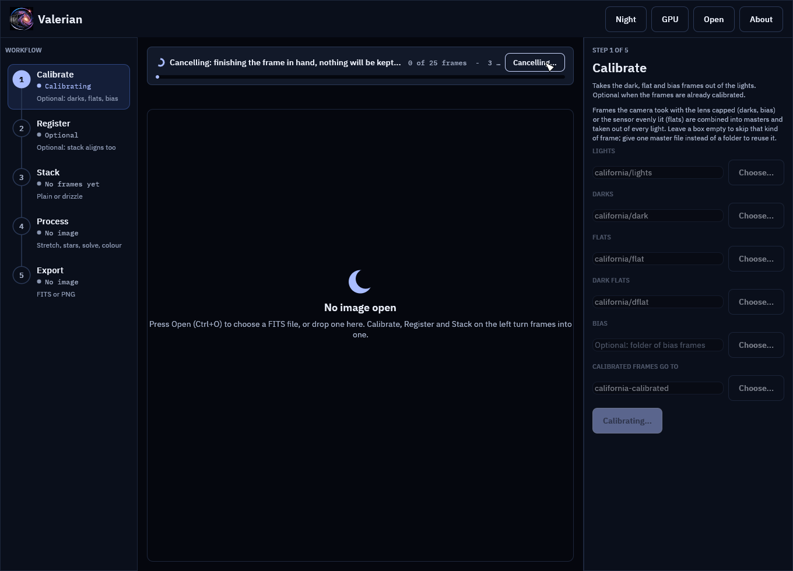
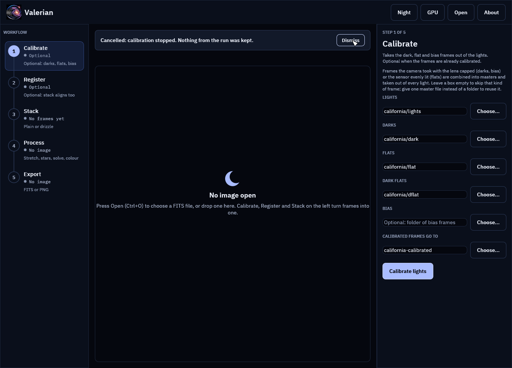
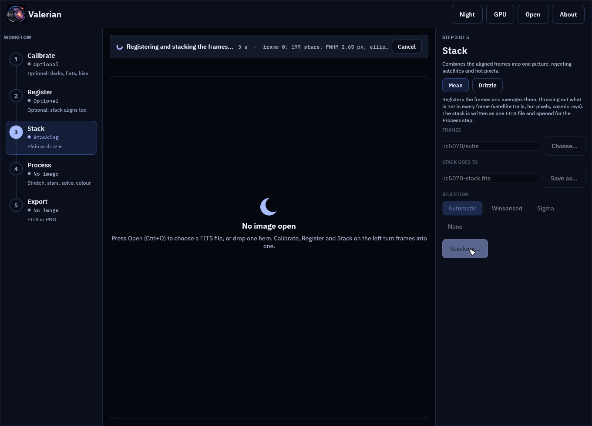
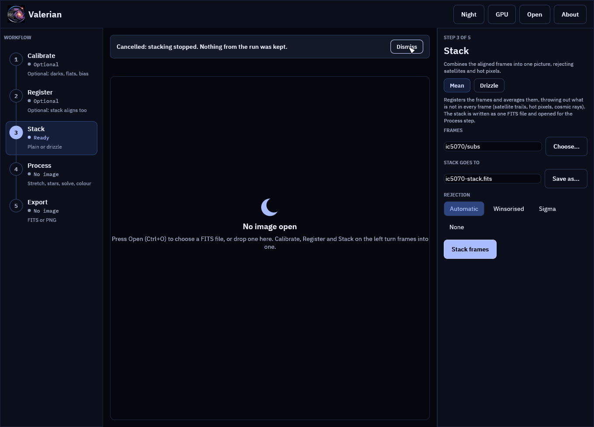

# Desktop app: cancelling a running step

**Goal:** stop a long step that you started by mistake (the wrong folder, a setting you meant
to change) without waiting for it, and be sure that nothing half-finished is left behind.

**Data:** the two captures of [the tutorials index](index.md#the-two-captures): the California
Nebula H-alpha session (25 lights of 300 s with darks, flats and dark flats) for Calibrate, and
the sixty Seestar subframes of IC 5070 for Stack. Any folders of FITS frames behave the same.

**Where this applies.** Calibrate, Register, Stack, Drizzle and the Process tools Star removal,
Plate solve and Colour. Writing a file (Save, Export) takes a moment and has no Cancel. The
command line is not changed: press Ctrl-C there as before.

## Step 1: Start a long step

Open the **Calibrate** step, fill in the five folders and press **Calibrate lights**. The notice
above the picture shows what the step is doing, and at its right end a **Cancel** button:

The notice reads "0 of 25 frames", the seconds taken and the line the step last reported. The
masters are combined first (bias, darks, dark flats, flats), then each light is calibrated, so
the counter stays at 0 until the first light is done.

## Step 2: Press Cancel (or Esc)

Press **Cancel**, or press **Esc** with the About page closed. The button changes to
"Cancelling..." and the headline to "Cancelling: finishing the frame in hand, nothing will be
kept...":

Cancel is cooperative. The step checks for it between files, between bands of a master frame,
between frames while registering and warping, between colour planes and between trial patches
of sky, so it stops within one frame or band, not instantly. On the 4656 by 3520 pixel frames
of this session that is the time one light takes to calibrate. Pressing Cancel again does
nothing.

## Step 3: Read the result

When the step has stopped, the notice says what happened, and it is a plain notice, not an
error:

"Cancelled: calibration stopped. Nothing from the run was kept." The Calibrate button is back,
the rail row no longer says "Calibrating", and **Dismiss** hides the message.

Look at the output folder: it is as it was before you pressed the button. Calibrate wrote the
masters and the calibrated lights into a hidden `.valerian-partial-<pid>` folder inside the
output folder, and moves them into place only when every light is done. A cancel (or any error)
deletes that folder, deletes an output folder the run had to create, and leaves files that were
already there untouched. So `california-calibrated` does not exist after the cancel above, and
if you had run the step before, the earlier frames are still there, unchanged.

## Step 4: The same for Stack

Open **Stack**, name the sixty subframes and press **Stack frames**. The notice carries the
registration lines (frame, stars found):

Press **Cancel**:

No `ic5070-stack.fits` is written, nothing is opened for the Process step and the panel is
ready to run again. Press **Stack frames** a second time and it runs to the end as if the
first run had not happened.

## What you can expect

| Step | Stops between | Left behind after a cancel |
|---|---|---|
| Calibrate | files read, bands of a master, lights | nothing; the output folder is as it was |
| Register | files read, detection of each frame, each frame warped, each frame written | nothing |
| Stack | files read, detection, each frame warped, each colour plane combined | nothing |
| Drizzle | files read, detection, each frame dropped | nothing (the drizzle is saved only by Save drizzled) |
| Star removal | detection, mask, each colour plane | nothing; the image and an earlier result are as they were |
| Plate solve | detection, each trial patch of sky | nothing; an earlier solution is kept |
| Colour | measurement, fit | nothing; an earlier calibration is kept |

## Troubleshooting

**The button says "Cancelling..." for a long time.** The frame or band in hand has to finish.
A very large stack plane (a colour drizzle of big frames, say) takes as long as one plane
takes. The step stops at the next check. If it is wedged, close the window, which stops
everything, and delete a stray `.valerian-partial-*` folder from the output folder.

**The step finished instead of stopping.** Cancel was pressed after the last check, so the run
completed and its result is kept as usual.

**A `.valerian-partial-<pid>` folder is left in the output folder.** It only stays if the program
was killed in the middle of a run (power loss, task manager). It is safe to delete; the frames
in it were never moved into place.

**Esc does nothing.** Esc closes the About page first if it is open. Press Esc again, or use
the button.

For every control see the [desktop app reference](../reference/gui.md#cancelling-a-step).
