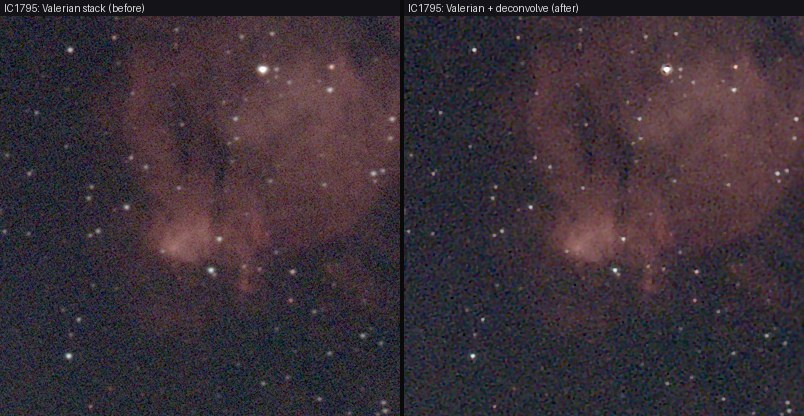
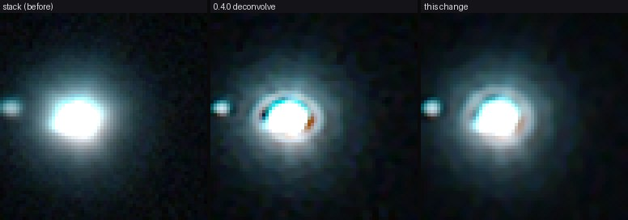

# Tutorial 16: Deconvolution

**Goal:** make the stars of a stack narrower and rounder. You finish with `sharp.fits` and a table of the
PSF measured in every tile of the picture.

**Data:** a stack of 380 ten-second frames of IC 1795 from a Seestar S50 (1080 by 1920 pixels, three
planes), made with `valerian stack` as in [tutorial 4](stack.md) and flattened with `valerian background`.
Its stars are 3.56 pixels wide (8.5 arc seconds) and elongated (eccentricity 0.158, measured by
`valerian optics`); the Seestar's own stack of the same frames has 2.45 pixels and 0.062. The method is
in [How deconvolution works](../user-guide/deconvolution.md).

## Step 1: Deconvolve

```sh
valerian deconvolve bg.fits -o sharp.fits --report psf-tiles.csv
```

```text
1000 stars detected, 281 fit to measure a PSF (median FWHM 3.67 px)
deconvolving to round stars of FWHM 2.65 px
12 tile(s) of about 360 x 480 px; PSF FWHM 3.19 to 4.20 px, ellipticity 0.014 to 0.232
deconvolved 3 plane(s), 20 iterations, 12 tile(s), 9.4s
stars deconvolved to round, FWHM 2.65 px
wrote sharp.fits
wrote psf-tiles.csv
```

281 of the 1,000 detected stars were bright, unsaturated and isolated enough to measure a PSF. The twelve
tiles show the blur changing over the field: the PSF is rounder in the left-hand tiles (ellipticity 0.01
to 0.06) and more elongated at the right (0.18 to 0.23). The target, 0.7 of the narrowest axis, is 2.65
pixels. It took 9 seconds on a shared 24-core server.

## Step 2: Check it

Measure the stars before and after:

```sh
valerian optics bg.fits --report before
valerian optics sharp.fits --report after
```

On the same stars, measured by one tool on both: FWHM 3.56 to 2.91 pixels, eccentricity 0.158 to 0.133,
and the sky noise (the robust sigma of an empty patch) 4.6 to 4.4, 3.1 to 2.1 and 4.0 to 3.3 ADU in the
three planes. The picture shows the stack (left) and `sharp.fits` (right) at the same stretch:



## Step 3: Choose roundness or sharpness

`--roundness` sets how far the elongation is evened out before the stars are sharpened. The same stack
at three settings:

| `--roundness` | FWHM, eccentricity |
|---|---|
| 0 (sharpest) | 2.64 px, 0.164 |
| 0.5 (default) | 2.91 px, 0.133 |
| 1 (roundest) | 3.06 px, 0.118 |

At 0 the stars are as sharp as before, and no rounder than the stack (0.158). The roundest setting costs
half a pixel of width against the sharpest.

## Step 4: Bright and clipped stars

A saturated star is flat on top in every frame, so the stack's core is lower than the star's real
core and a plain Richardson-Lucy fit digs a dark ring round it, with black crescents inside the ring. `valerian deconvolve` finds the clipped level from the pile-up of the
brightest peaks, takes those pixels out of the fit and rebuilds the core from the wings. It says so:

```text
clipped stars found: clip level none / none / 68849; the clipped cores are rebuilt from the wings
```

The M 42 session has that. The picture is a clipped star of the stack (left), after version 0.4.0
(middle) and now (right), at one stretch:



If the log does not say so but one or two stars are clipped, give the level: `--saturation 65000`
(in the pixel units of the file). The thin coloured arcs at the edge of a rebuilt core remain: each
colour plane is rebuilt from its own wings.

## Step 5: Stretch it

```sh
valerian stretch sharp.fits -o sharp_stretch.fits --preview sharp.png
```

## Settings that matter

* More iterations or a lower `--target-ratio` are sharper and noisier.
* `--roundness 1` for the roundest stars, `--roundness 0` for the sharpest.
* `--mode full` is the sharpest of all and leaves more elongation.
* Fewer than eight usable stars: give the blur with `--psf-fwhm`.

## Troubleshooting

* **"only N stars are fit to measure a PSF"**: lower `--psf-min-snr` or `--threshold`, or give `--psf-fwhm`.
* **Rings round the brightest stars**: check the log for the clipped-star line, give `--saturation`, or raise
  `--tv` to 0.005 (the stars come out about 4 per cent wider) or `--target-ratio` toward 1.
* **Faint stars did not sharpen**: the damping held them; lower `--tv` (0.001).
* **Grainy sky**: raise `--tv`.
* **The stars are not round enough**: raise `--roundness` toward 1.

## What four test stacks gave

Star FWHM in pixels and eccentricity, `valerian optics` on every image, 2026-10-25:

| Target | Valerian stack | 0.4.0 `deconvolve` | Now (default) | `--roundness 1` | `--roundness 0` |
|---|---|---|---|---|---|
| M 34 (184 frames) | 2.77, 0.104 | 2.11, 0.062 | 2.22, 0.065 | 2.29, 0.044 | 2.09, 0.061 |
| IC 1795 (380) | 3.56, 0.158 | 2.65, 0.161 | 2.91, 0.133 | 3.06, 0.118 | 2.64, 0.164 |
| C 39 (162) | 3.19, 0.143 | 2.45, 0.142 | 2.64, 0.116 | 2.75, 0.101 | 2.44, 0.140 |
| M 42 (123) | 3.83, 0.236 | 2.78, 0.197 | 3.09, 0.114 | 3.27, 0.093 | 2.77, 0.192 |

The Seestar's own stacks of the same frames measure 2.26, 0.042 (M 34), 2.45, 0.062 (IC 1795), 2.88, 0.076
(C 39) and 3.27, 0.093 (M 42), so the default is narrower than theirs on M 34, C 39 and M 42, wider on IC 1795, and
rounder than the stack but not as round as theirs. The eccentricity quoted in version 0.4.0 for IC 1795
after deconvolution (0.116) did not reproduce: version 0.4.0 gives 0.161 on this stack, and 0.162 when
the stack is not flattened first.

Of the 30 brightest stars of each stack, the number with a pixel more than eight sigma below the sky
within nine pixels of the star (the dark ring and black core): M 34 2 with 0.4.0 and 0 now; IC 1795 8 and
0; C 39 6 and 0; M 42 16 and 1. The worst such pixel was 15.6, 30.1, 23.2 and 36.1 sigma below the sky with
0.4.0 and is now 0 (above the sky), 2.7, 2.0 and 15.1 (one M 42 star). A faint dark halo is still there round the
very brightest stars; `--tv 0.005` calms it further for about 4 per cent in width.
