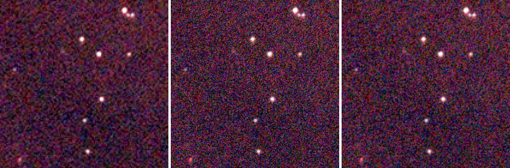
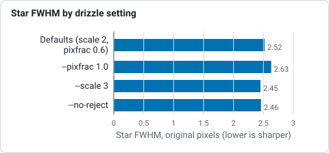
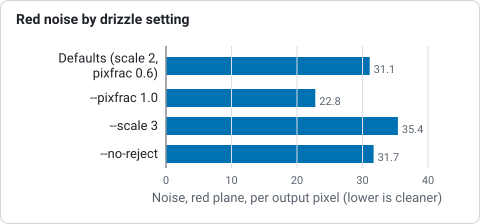

# Tutorial 10: Drizzle

**Goal:** make an image with twice the pixels in each direction from dithered frames, with crisper
stars than a plain stack, instead of just a bigger copy of the stack. You finish with `drizzled.fits`
(2160 by 3840 pixels from the 1080 by 1920 frames) and a map of how much data reached each pixel.

**Data:** the sixty IC 5070 Seestar lights in `lights/`, as **raw mosaics**, the same as
[tutorial 4](stack.md). The Seestar's stars are only about 2.5 pixels wide (an undersampled image),
it dithers between frames (the shifts in [tutorial 3](register.md) run up to about 70 pixels) and
its one-shot-colour sensor samples red and blue at every second pixel: the case drizzle is for. Give
`drizzle` the frames themselves, not the stack and not the demosaiced `registered/` copies: it drops each raw
pixel into its own colour plane without interpolating them, and registers the frames by itself,
the way `stack` does. If you calibrated, give it the calibrated frames of [tutorial 2](calibrate.md) written
**without** `--debayer`. How it works, and what the resolution gain is, is in
[How drizzle works](../user-guide/drizzle.md).

**What happens.** Each input pixel is shrunk to a "drop" `--pixfrac` of its side, laid onto an output grid
`--scale` times finer (using the registration), and spread over the output pixels it overlaps in proportion to the
overlap, weighted by the noise and star width of its frame. A second pass rejects input pixels more than
`--reject` sigma from the first result (cosmic rays, hot pixels, satellite trails) and drizzles again.

## Step 1: Drizzle

```sh
valerian drizzle lights/ -o drizzled.fits --scale 2 --pixfrac 0.6 \
    --report drizzle-report.txt --weight-map drizzle-weight.fits
```

```text
read 60 frames in 308.4ms
registering through demosaiced copies of the mosaics
reference candidate frame 47: 59 of 59 other frames register
reference: frame 47 (FWHM 2.16 px)
drizzling 60 frames onto 2160 x 3840 (scale 2, pixfrac 0.6), raw Grbg mosaics dropped without interpolation
second pass: rejecting input pixels more than 4 sigma from the first result
   #  frame                         stars   FWHM  ellip      sky    noise   flux x rms px weight  reject  status
...
60 of 60 frames drizzled to 2160 x 3840 (scale 2, pixfrac 0.6), reference frame 47 (Light_IC 5070_10.0s_LP_20260728-224223.fit), 0.28 % of the input samples rejected, 0.015 % of the output without data, 6.8s
wrote drizzled.fits
wrote drizzle-weight.fits
wrote drizzle-report.txt
```

(The values of `--scale 2 --pixfrac 0.6` are the defaults; they are written out to show the settings.)
It took 6.8 s. Reading it:

* **`registering through demosaiced copies of the mosaics`.** Registration needs to find stars, so the frames are
  demosaiced in memory for that; the drops themselves use the raw pixels. Registration is the same as in
  tutorials 3 and 4 (reference frame 47).
* **`drizzling 60 frames onto 2160 x 3840 (scale 2, pixfrac 0.6), raw Grbg mosaics dropped without
  interpolation`.** The output grid is twice the size, and each raw pixel goes to its colour's plane. `Grbg` is the
  filter layout (green-red / blue-green) the header gives.
* **`second pass: rejecting input pixels more than 4 sigma from the first result`.** The default `--reject 4`.
* **The table** is the per-frame table of `stack` with the weights used.
* **`0.28 % of the input samples rejected`.** Cosmic rays, hot pixels and trails, as in `stack`.
* **`0.015 % of the output without data`.** The output pixels no drop reached: one in about 6,700. They are NaN in the file;
  the weight map shows where they are. 0.015 per cent is a good fill; see the troubleshooting for what to do when it is
  not.

`drizzled.fits` is 99.5 MB (2160 by 3840 by 3 planes of 32-bit floats), the weight map is a single plane of the
same size, and the report is the table. The weight map's values, from `info --stats`: median 5.2 and maximum 11.4:
the coverage is not uniform because the frames are dithered and weighted.

## Step 2: Look at the result

`valerian info drizzled.fits --stats`:

```text
drizzled.fits
  size: 2160 x 3840 pixels, 3 planes
  plane 0: min -107.7, sky 612.9, noise 31.11, max 69238.7 ADU
  stars: 605 (median FWHM 5.04 px, ellipticity 0.187)
```

The stars have a median FWHM of **5.04 drizzled pixels, or 2.52 original pixels**, against 2.57 pixels in the
stack (`info stack.fits --stats`): 2 per cent sharper at this setting. That is a small gain, because the 10-second
frames are limited by the seeing and the optics (the stars are 2.5 pixels wide) more than by the pixels. Where it
shows is in close stars: the pair at the top right of
the crop below is better separated in the drizzled images than in the stack.

The picture is a 140 by 140 pixel crop of the stack (enlarged twice by repeating its pixels, left), the same
patch of the drizzle with `--pixfrac 0.6` (middle, 280 by 280 pixels) and with `--pixfrac 1.0` (right). All three
have the same screen stretch (black point at the sky minus 2.8 sigma, white point at the 99.9th percentile of the
stack, the sky at 20 per cent grey). The drizzled image is not colour calibrated and not background corrected
here, as the stack was not.



The drizzle with `--pixfrac 0.6` has the sharper stars and more grain; with `--pixfrac 1.0` they are slightly softer and
the picture smoother. That is the trade: a smaller drop is sharper and noisier, because each output pixel is made of
fewer drops.

## Step 3: What comes next

Drizzle removes the world coordinate system (the grid is different). To colour calibrate the drizzled image, solve
it and run `photocal`, as in tutorials 8 and 9:

```sh
valerian solve drizzled.fits -o drizzled-solved.fits
valerian photocal drizzled-solved.fits -o drizzled-calibrated.fits
```

Background extraction and stretching work on `drizzled.fits` as on a stack. Open `drizzled.fits` at full size next to
`stack.fits` to compare: any picture on a web page is reduced.

## Options used

All options are in the [command line reference](../reference/cli.md#valerian-drizzle).

| Option | What it does | Range or values | Default |
|---|---|---|---|
| `<FRAMES>...` | frames: files or folders (calibrated; raw mosaics are fine) | one or more | required |
| `-o`, `--output <FILE>` | the drizzled FITS file | a file | required |
| `--scale <FACTOR>` | output pixels per input pixel, linear | 0.25 to 8 | 2 |
| `--pixfrac <FRACTION>` | side of a drop as a fraction of an input pixel | above 0, at most 1 | 0.6 |
| `--reject <SIGMA>` | reject input pixels this many sigma from the first-pass result | sigmas | 4 |
| `--no-reject` | drizzle every pixel, with no rejection pass | on or off | off |
| `--weight-map <FILE>` | also write the weight map (coverage) | a file | not written |
| `--report <FILE>` | also write the per-frame table | a file | not written |
| `--weights` | frame weights | `equal`, `noise`, `fwhm`, `noise-fwhm` | `noise-fwhm` |
| `--normalisation` | level matching | `none`, `additive`, `additive-scaling` | `additive-scaling` |
| `--reference <N>` | the reference frame (from 0, sorted) | frame number | the sharpest |
| `--model` | the transform to fit | `similarity`, `affine`, `homography` | `similarity` |
| `--threshold <SIGMA>` | detection threshold in sigmas of the smoothed noise | sigmas | 5 |
| `--min-stars <N>` | leave out frames with fewer stars | count | 20 |
| `--max-fwhm-ratio <RATIO>` | leave out frames whose FWHM is more than this multiple of the reference's | ratio | no limit |

(`drizzle` has no `--backend`: it runs on the processor. The star-finding options are those of
[register](register.md#options-used).)

Measured on the same sixty frames (the times are for the whole command on the shared server):

| Command differs by | Output | Without data | Rejected | Star FWHM (original pixels) | Noise (red) | Time |
|---|---|---|---|---|---|---|
| nothing (`--scale 2 --pixfrac 0.6`) | 2160 x 3840 | 0.015 % | 0.28 % | 2.52 | 31.1 | 7.1 s |
| `--pixfrac 1.0` | 2160 x 3840 | 0.000 % | 0.32 % | 2.63 | 22.8 | 8.9 s |
| `--scale 3` | 3240 x 5760 | 0.024 % | 0.23 % | 2.45 | 35.4 | 9.0 s |
| `--no-reject` | 2160 x 3840 | 0.015 % | 0.00 % | 2.46 | 31.7 | 4.3 s |



*Star FWHM in original pixels for four drizzle settings on the same sixty frames, from the table above.*



*Noise in the red plane per output pixel for four drizzle settings, from the table above.*

The noise is per output pixel; neighbouring output pixels share drops, so it falls less than in a stack when the
pixels are averaged down. The rows show the trade-offs: `--pixfrac 1.0` fills every pixel and is smoother (22.8
against 31.1) but 4 per cent softer; `--scale 3` is the sharpest and the noisiest, and makes an image of 224 MB; with
`--no-reject` the second pass is skipped, which is faster (4.3 s against 7.1 s) but leaves in the 0.28 per cent of
samples that were cosmic rays, hot pixels or trails.

## How to tell it worked

* The summary line says `60 of 60 frames drizzled to 2160 x 3840`.
* `of the output without data` is small: under 1 per cent, and ideally near 0.
* `of the input samples rejected` is under a few per cent.
* The stars are at least as sharp as in the stack (here 2.52 against 2.57 pixels) and a close pair is split.
* The weight map is smooth, with no large empty areas inside the field.

## Troubleshooting

**Large holes: `9.263 % of the output without data`.** There are too few frames, or too little dither, for a 2x grid.
The same command on the first 8 of these frames (`valerian drizzle` of a folder of 8) gave `8 of 8 frames drizzled to
2160 x 3840 (scale 2, pixfrac 0.6), ... 9.263 % of the output without data` and a noise of 51.9 against 31.1. The
documentation says: a dither of a pixel or more between frames and a dozen or more of them to fill a 2x grid. With
fewer frames use a larger `--pixfrac` or a smaller `--scale`: with `--scale 1 --pixfrac 1`, the 8 frames left
0.233 % without data. Otherwise take more frames, dithered.

**`valerian: drizzling failed: pixfrac must be above 0 and at most 1 (the drop is that fraction of a pixel)`.** `--pixfrac
1.5` was given. Use a value from just above 0 to 1.

**`valerian: drizzling failed: the drizzle scale must be 0.25 to 8`.** `--scale 0` was given; the range is 0.25 to 8.

**`valerian: drizzling failed: registration failed: fewer than two frames registered; nothing to stack`.** One frame, or
frames that do not register. Drizzle needs a series of frames of one field.

**The result looks noisier than the stack.** It has four times as many pixels from the same photons: each output pixel has
less signal. Compare the stars, not the noise; or smooth: `--pixfrac 1.0` reduces it, a stretch or a gentle denoise after
drizzle does the rest. If you only want a clean picture, the plain stack is the better product; use the drizzle when
you want resolution.

**The colour is soft.** Drizzle drops raw mosaics pixel by pixel into their own colour plane. Frames that were demosaiced first
(for example the `registered/` copies) have the interpolation already in them, which defeats the point. The command's help says
to give the calibrated frames from `valerian calibrate` without `--debayer`, or the raw frames.

**It uses a lot of memory and disk.** The output is `scale` squared times the frame: `--scale 3` is nine times the
pixels (3240 by 5760 by 3 floats, 224 MB). Use `--scale 2` unless you have a reason.

## The desktop app

In the desktop app this is the **Drizzle** chip of step 3, Stack: see the [reference](../reference/gui.md#drizzle).

## Where next

You have drizzled the frames. [Tutorial 11](gpu.md) is about the graphics card: which of these steps use it, how to check it,
and what it gains.
