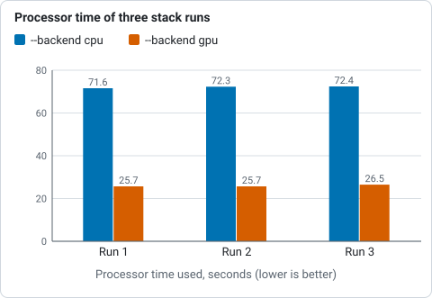
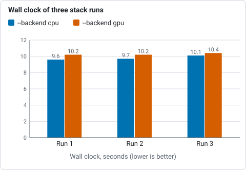
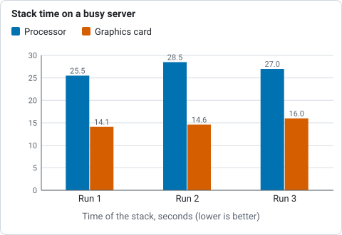

# Tutorial 11: The GPU

**Goal:** find out whether Valerian can see your graphics card, which steps use it, how much time it
saves on your machine, and what happens when there is no card. You finish with three commands you can
run on any computer to check and to measure.

**Data:** the sixty IC 5070 lights of [tutorial 4](stack.md), for the real-data run; the built-in
benchmark `valerian bench`, which needs no data, for the stage-by-stage numbers. How the kernels work
and how well they agree with the processor code is in [The GPU kernels](../user-guide/gpu.md).

## Step 1: Check the adapter

```sh
valerian info --gpu
```

```text
valerian 0.5.0
commit: a8ff9c25
built: 2026-10-20 19:35 UTC
profile: release
target: x86_64-unknown-linux-gnu
rust: rustc 1.99.1 (58cf8f9c3 2026-10-13)
wgpu: 30.0.1
catalogue: ~/valerian/crates/valerian-core/data/gaia-dr3-g11.vcat (1247240 stars)
gpu: NVIDIA A100 80GB PCIe (Vulkan, DiscreteGpu)
```

The last line is the answer: the adapter's name, the graphics interface it was opened through (Vulkan,
or Dx12 on Windows, or Metal on a Mac) and its type. `DiscreteGpu` is a graphics card (`IntegratedGpu` is the
graphics of the processor chip, and also real). A type of `Cpu` is a software adapter that runs on the processor.
The Windows 11 laptop in [tutorial 1](install.md) said `gpu: NVIDIA GeForce RTX 3050 Ti Laptop GPU (Vulkan,
DiscreteGpu)`. With `--software`, the software adapter is opened instead, which is how you find out whether it is there:

```sh
valerian info --gpu --software
```

```text
gpu: llvmpipe (LLVM 19.1.7, 256 bits) (Vulkan, Cpu)
```

(on Windows: `Microsoft Basic Render Driver (Dx12, Cpu)`). The software adapter is for testing: it is slower than
Valerian's processor code and is not used unless you ask for it with `--backend gpu`.

## Step 2: See what is accelerated

Calibration, the registration warp and the per-pixel combine of a stack run as GPU kernels. Star detection, the
registration fit, plate solving, drizzle, background extraction, stretch and star removal run on the processor.
The table is from [The GPU kernels](../user-guide/gpu.md#what-runs-where):

| Stage | Processor | Graphics card | `--backend` option |
|---|---|---|---|
| Calibration (bias, dark, flat, pixel map) | yes | yes | `calibrate --backend` |
| Registration warp | yes | yes | `register --backend`, `stack --backend` |
| Per-pixel combine (none, min/max, sigma, Winsorised, linear fit), up to 128 frames | yes | yes | `stack --backend` |
| Everything else | yes | no | none |

`--backend` takes three values: `auto` (the default), `cpu` and `gpu`. `cpu` never opens the card. `gpu` uses
the real card or fails. `auto` uses a real card **only for `stack`**, where the frames stay on the card from the warp to the
combine, and the processor for `calibrate` and `register`, where one stage alone is slower on the card because the data
has to cross the bus both ways. The log says what happened: `compute: CPU (the GPU is slower for this command; --backend
gpu forces it)` or `compute: GPU: NVIDIA A100 80GB PCIe (Vulkan, DiscreteGpu)`.

## Step 3: Measure the stages with the benchmark

```sh
valerian bench
```

```text
adapter: NVIDIA A100 80GB PCIe (Vulkan, DiscreteGpu)
frames of 4096 x 3072, 20 frames in the combine, median of 3 runs
stage                                       CPU ms    GPU ms speed-up up / kernel / down ms worst diff    > 1e-4
calibrate (bias, dark, flat, pixel map)       28.9      77.7     0.4x            4 / 5 / 69    4.24e-7     0.0e0
warp (bicubic)                                34.5      90.3     0.4x           20 / 5 / 68    4.85e-5     0.0e0
combine (sigma clip)                         206.2     335.5     0.6x         169 / 83 / 79    3.18e-4    9.9e-8
combine (winsorised)                         399.9     259.8     1.5x         144 / 44 / 35    3.16e-4    3.0e-7
combine (linear fit)                         337.1     486.9     0.7x         223 / 125 / 93    5.65e-4    2.4e-6
stack plane (warp + combine)                1244.3     532.3     2.3x         141 / 304 / 76    4.96e-2    2.0e-5
```

It runs each stage on made-up frames of the size you give (`--width 4096 --height 3072 --frames 20` by default, three
timed repeats of each, after a warm-up) on the processor and on the card and compares the results. Read the columns:

* **CPU ms, GPU ms, speed-up.** The median time of each, and the ratio. Under 1x means the card is slower.
* **up / kernel / down ms.** Of the card's time, the part spent copying the data to the card, running the kernels, and
  copying back. In `calibrate`, 69 of the 78 ms is the copy back: the kernel itself took 5 ms against the processor's 29 ms.
* **worst diff.** The largest difference between the two results as a fraction of the data range. 4.24e-7 for calibration is
  rounding. The whole stack plane is 4.96e-2 at its worst pixel, which comes from a sample that falls on the other side of
  a clipping limit in single precision; the next column says it is 2.0e-5 of the pixels.
* **> 1e-4.** The share of pixels that differ by more than 1e-4 of the range (or that only one result has data for).

The lesson of the table is the one in the last row: for a single stage the card gains little or loses, because of the bus,
and only a whole stack, which uploads the frames once and keeps them on the card from the warp to the combine, wins (2.3x here).
Run the benchmark twice on a machine with other jobs and you will see different ratios: the card's time is steady and the
processor's is not. The same command on the earlier busier run of this server gave 2.2x, 3.8x and 2.5x for the three combines and
**4.5x** for the stack plane (the processor took 2.87 s instead of 1.24 s, with the card at 0.63 s). On the Windows 11
laptop (an RTX 3050 Ti Laptop GPU and an i7-11800H processor, run with the same command) the stack plane gained **5.7x** (3.47 s
against 0.61 s), the combines 1.6x, 2.7x and 3.1x, calibration 0.8x and the warp 1.5x.
On an Apple M1 Mac mini (Metal, 8 GB shared between the processor and the GPU, macOS 26) the stack plane gained
**2.2x** (1.75 s against 0.81 s), the warp 2.6x, the combines 1.0x, 1.2x and 1.2x and calibration 0.7x. The worst
differences are the same as on the NVIDIA cards to three figures (4.96e-2 for the stack plane, 5.65e-4 for the linear
fit), so the shaders compiled by Metal agree with the processor as the others do.

## Step 4: Measure a real stack

Compare the two backends on the sixty IC 5070 frames, alternately, on the same server and the same quiet period:

```sh
valerian stack lights/ -o stack-cpu.fits --backend cpu
valerian stack lights/ -o stack-gpu.fits --backend gpu
```

```text
compute: CPU
60 of 60 frames stacked with LinearFit { low: 5.0, high: 2.5 }, reference frame 47 (...), 9.0s

compute: GPU: NVIDIA A100 80GB PCIe (Vulkan, DiscreteGpu)
GPU: 3 calls ran on the device
60 of 60 frames stacked with LinearFit { low: 5.0, high: 2.5 }, reference frame 47 (...), 9.1s
```

Three runs of each, timed with the shell (wall-clock time, then processor time used by the command):

| Backend | Wall clock | Processor time used |
|---|---|---|
| `--backend cpu` | 9.6, 9.7, 10.1 s | 71.6, 72.3, 72.4 s |
| `--backend gpu` | 10.2, 10.2, 10.4 s | 25.7, 25.7, 26.5 s |



*Processor time used by three runs of the stack on the processor and on the card, from the table above: the card needs about a third.*



*Wall-clock time of three runs of the stack on the processor and on the card, from the table above: no faster on this data.*

The honest result: **on this data the card does not make the stack faster, but it uses a third of the processor time.** The wall
clock is the same, because star detection and registration, which stay on the processor, are most of a stack of small
frames, and the processor part of the work is parallel on 24 cores. What changes is how much of the machine
the command needs: 72 s of processor time fall to 26 s, which a busy machine can spend on other work. When the same server was
busy with other jobs (load average over 13), the processor stack took 25.5, 28.5 and 27.0 s and the card's 14.1, 14.6 and 16.0 s, a
**1.8x** speed-up, because the card's time was steady while the processor's was not. A larger gain needs larger frames or more
of them: the combine and warp costs grow with pixels times frames.



*Time of three stack runs on the processor and on the card while the server was busy (load average over 13), from the paragraph below the table.*

The two stacks agree: the largest difference of any pixel is 103 ADU, which is 0.14 per cent of the data range; the median
difference is 0.0004 ADU; and 2.0e-5 of the pixels differ by more than 1e-4 of the range.

## Step 5: The fall-backs

Valerian never fails because there is no graphics card, unless you insist on one:

* **No adapter at all.** With the Vulkan drivers hidden (`VK_DRIVER_FILES=/nonexistent`), `valerian info --gpu` prints
  `gpu: unavailable (could not open GPU device: Parent device is lost)`, and `valerian stack lights/ -o s.fits` runs on the
  processor and says `compute: CPU (no GPU: could not open GPU device: Parent device is lost)`. The result is the same.
  `valerian stack lights/ -o s.fits --backend gpu` stops: `valerian: --backend gpu: no suitable GPU adapter found (Software:
  No suitable graphics adapter found; ...)`.
* **More than 128 frames.** One combine kernel holds 128 frames. 130 frames (the 60 lights repeated, as 130 symbolic links)
  ran as `GPU: 387 calls ran on the device, 6 fell back to the CPU (130 frames is more than the 128 the kernel holds)` and
  `130 of 130 frames stacked`, in 22.3 s. The fall-back is counted and reported, not silent.
* **A software adapter only** (the card hidden but the software one present, with
  `VK_DRIVER_FILES=/usr/share/vulkan/icd.d/lvp_icd.json`). `--backend gpu` uses it (`compute: GPU: llvmpipe (...) (Vulkan, Cpu)`) and
  took 43.2 s for the sixty frames, slower than the processor's 25 to 28 s on the same busy server. `--backend auto` used to choose it, and a
  stack took 32.7 s; it now runs on the CPU and the `compute:`
  line says `CPU (only a software adapter, llvmpipe ..., which is slower than the CPU; --backend gpu forces it)`. `--backend gpu` still uses
  it and adds `[software adapter, slower than the CPU code ...]` to the line.

## Options used

| Option | What it does | Values | Default |
|---|---|---|---|
| `calibrate`, `register`, `stack` `--backend` | the engine for the per-pixel stages | `auto`, `cpu`, `gpu` | `auto` |
| `info --gpu` | open the adapter and report it | on or off | off |
| `info --software` | with `--gpu`, the software (fallback) adapter | on or off | off |
| `bench --adapter` | the adapter for the benchmark | `hardware`, `software` | `hardware` |
| `bench --width <PIXELS>`, `--height <PIXELS>` | frame size | pixels | 4096, 3072 |
| `bench --frames <N>` | frames in the combine | 3 to 128 | 20 |
| `bench --repeats <N>` | timed repeats of each stage (the median is shown) | count | 3 |

All options are in the [command line reference](../reference/cli.md#valerian-bench). Environment variables that steer the Vulkan loader
(`VK_DRIVER_FILES`, as used above) are the Vulkan loader's, not Valerian's.

## How to tell it worked

* `valerian info --gpu` ends with a `gpu:` line naming your card and its type `DiscreteGpu` or `IntegratedGpu`.
* `stack --backend gpu` prints `compute: GPU: <your card>` and `GPU: N calls ran on the device`.
* `valerian bench` shows a speed-up above 1 for the stack plane and a `worst diff` of 1e-3 or less for each stage.
* The stack from `--backend gpu` agrees with the one from `--backend cpu` (0.14 per cent of the range at the worst pixel here).

## Troubleshooting

**`gpu: unavailable (could not open GPU device: ...)` or `no suitable GPU adapter found`.** No usable Vulkan (Windows: DirectX 12) driver.
Install or update the vendor's graphics driver. On Linux check `vulkaninfo --summary`; in a container or over SSH the card may not be
visible: pass it through. The commands still run on the processor with `--backend auto` or `cpu`.

**`gpu: llvmpipe (...) (Vulkan, Cpu)`.** Only the software adapter is available: no real card is visible to Vulkan. `--backend auto` already uses
the CPU in that case (see the fall-backs above); `--backend gpu` forces the software adapter, with a note.

**The GPU is slower than the CPU.** For `calibrate` and `register` alone that is expected (the bus; the table above). For a stack it
means few or small frames, or a processor with many cores; the benchmark tells you which. Use `--backend cpu`.

**Results differ slightly from the processor's.** The kernels use single precision where the processor code uses double in the
linear-fit regression and the weighted mean, so a few pixels (here 2 in 100,000) differ by more than 1e-4 of the data range. That
is by design and is tested; see [The GPU kernels](../user-guide/gpu.md#how-well-they-agree).

**`valerian: --frames must be 3 to 128`.** `valerian bench --frames 2` (or 200) was given; the combine kernel holds 3 to 128 frames.

**The benchmark and the real stack disagree.** The benchmark uses 12.6 megapixel frames and 20 of them; the real stack here is sixty
frames of 2 megapixels, in which detection dominates. Use the real stack to decide for your data.

## The desktop app

In the desktop app the **GPU** button in the top bar opens an adapter and runs the same benchmark: see the [reference](../reference/gui.md#gpu).

## Where next

That is the end of the thread. Each tutorial's "Options used" table lists the options of its command; the
[command line reference](../reference/cli.md) has them all, and the
[user guide](../user-guide/quick-start.md) explains the methods.
