# Tutorial 14: Integration diagnostics

**Goal:** see what the combine did to your stack. Where did it throw samples away, how many frames
and how much weight did each pixel get, how much quieter is the stack than a single frame
against what the square root of the number of frames promises, and what do the histograms of
the channels look like, before and after stretching. You finish with a folder of maps (PNG,
FITS and CSV), a noise curve, histograms and a one-file HTML report, for a stack and for a
drizzle.

**Data:** the sixty IC 5070 Seestar lights of [tutorial 4](stack.md), in `lights/`.

**What happens.** The stack is made on the CPU with the per-pixel books kept, and the
noise is measured from split halves of the registered frames. How each output is made is in
[How the integration diagnostics work](../user-guide/integration.md).

## Step 1: Stack with the report

```sh
valerian stack lights/ -o stack.fits --science-report integration
```

```text
read 60 frames in 123.1ms
compute: CPU (the rejection maps and the noise curve need the CPU combiner)
reference candidate frame 47: 59 of 59 other frames register
reference: frame 47 (FWHM 2.16 px)
combining 60 frames with LinearFit { low: 5.0, high: 2.5 }, weights NoiseFwhm
...
60 of 60 frames stacked with LinearFit { low: 5.0, high: 2.5 }, reference frame 47 (Light_IC 5070_10.0s_LP_20260728-224223.fit), 15.5s
wrote stack.fits
wrote integration/subframes.csv
...
wrote integration/rejection_low.png
wrote integration/rejection_low.fits
wrote integration/rejection_low.csv
wrote integration/rejection_high.png
...
wrote integration/weight_map.fits
wrote integration/histogram.png
wrote integration/histogram.csv
wrote integration/noise.png
wrote integration/noise.csv
wrote integration/integration.json
wrote integration/report.html
```

It took 15.5 s on the 24-core server (the graphics-card stack of tutorial 4 took 12.2 s; the maps
need the CPU combiner, so `--backend` has no effect here). The report folder also holds the
[subframe analysis](subframe-analysis.md) of the same frames, on the same `report.html`.

## Step 2: Where were samples thrown away

Open `integration/rejection_high.png`.

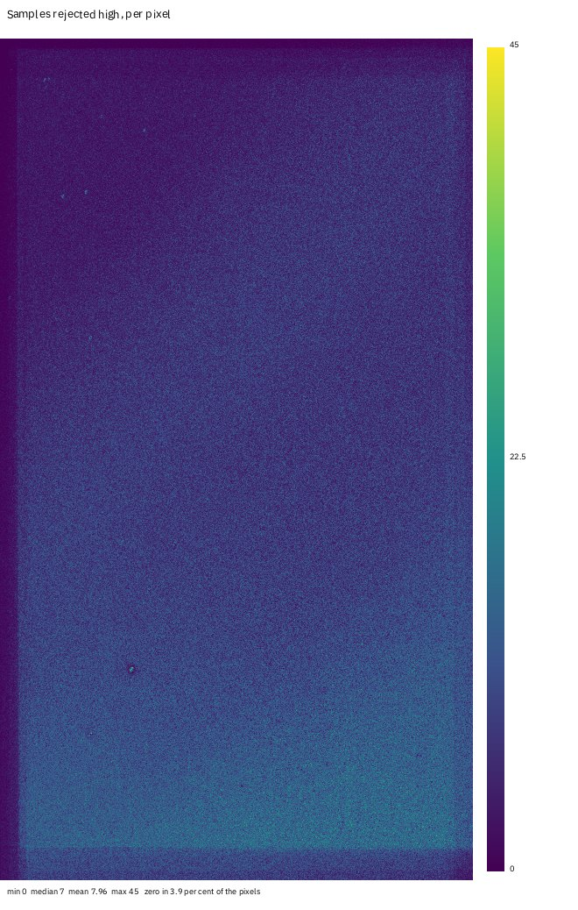

Every pixel is a stack of 60 samples; each map pixel is how many of them the linear-fit
clipping threw out for being **above** the centre (summed over red, green and blue, so the three
planes can add up to more than 60). The colour bar runs from 0 to 45; the median is 7 and the mean
7.96 per pixel, and 3.9 per cent of the pixels lost none. The rejection is a salt of noise, as it
should be for a stack with a rejection limit of 2.5 sigma on the high side. Three things are
not noise:

* the **dark stripe along the left edge** and the lighter band along the top and bottom: few frames
  cover those pixels, so there is little to reject;
* the **brighter band along the bottom**: the sky is brighter there (a gradient), the frames
  disagree more about it and the high-side clipping removes more;
* a few **bright dots**: stars or defects the frames disagree on (a variable star, a hot pixel that
  moved with the dither, a satellite).

The low side is gentler (limit 5 sigma):

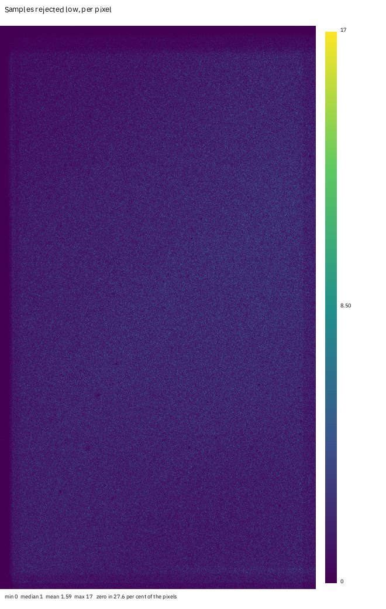

Mean 1.59 samples per pixel, at most 17, and 27.6 per cent of the pixels lost none. The maps have
a CSV each (`rejection_high.csv`) with how many pixels have each count, so you can read the
distribution: for the high map it peaks at 5 rejections (7.9 per cent of the pixels) and is
Poisson-like around it.

If a map showed a bright streak, a satellite trail that crossed some frames, you would see it
here as a line of rejections along its path; if it showed a bright ring, a dust shadow that moved
between frames. A map with a hot region over the target means the frames disagree about the
target itself (guiding trouble, or a change of focus), and the rejection is eating real signal.

## Step 3: How many frames, how much weight

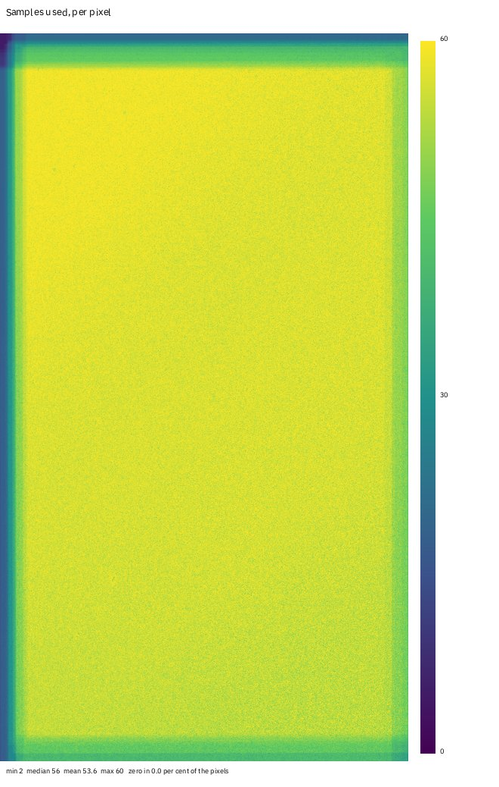

The **pixel count** map is the samples used per pixel: the frames that had data minus the ones
rejected. Minimum 2 (a corner covered by two frames), median 56, mean 53.6, maximum 60, and no pixel
without data. The pattern at the edges is the dither: the sixty frames are shifted by up to 100
pixels, and the border of the stack, a hundred pixels at most, has fewer frames. This is where
the stack is noisier and where to crop.

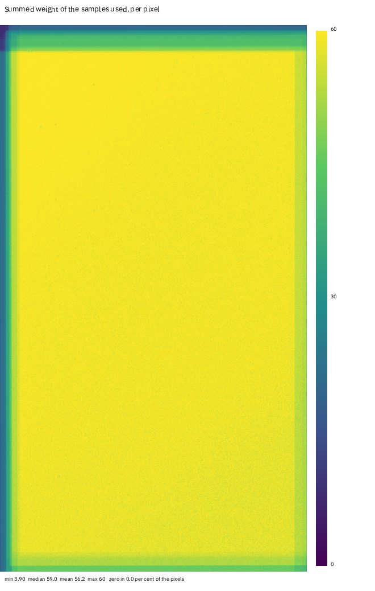

The **weight map** is the sum of the weights of the samples used. The weights have a mean of 1
across the frames, so it is near the count where the frames are alike (median 59.03, maximum 60,
minimum 3.90). Where it is *low while the count is high*, the heavy frames were the ones rejected
or missing, so the pixel is made of the poorer frames: that is the map to crop by.

## Step 4: How much quieter than the square root

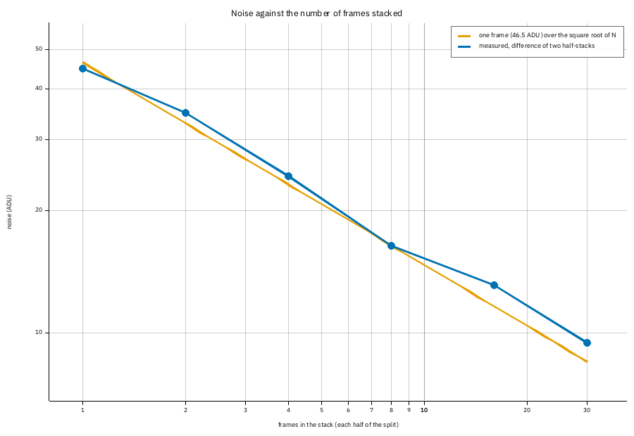

`integration/noise.csv`:

```text
frames_per_half,noise_adu,sqrt_n_expectation_adu,measured_over_expected,reduction,sqrt_n
1,45.001,46.522,0.9673,1.034,1.000
2,34.877,32.896,1.0602,1.334,1.414
4,24.351,23.261,1.0468,1.911,2.000
8,16.405,16.448,0.9974,2.836,2.828
16,13.139,11.630,1.1297,3.541,4.000
30,9.439,8.494,1.1114,4.928,5.477
```

One frame has 46.5 ADU of noise (in the middle plane, the green). The blue line is the noise of
a mean of 1, 2, 4, 8, 16 and 30 frames; the orange line is 46.5 over the square root of the number
of frames. Up to 8 frames the measurement sits on the line (ratio 0.97 to 1.06; at 8 it is 0.997), as
independent equal frames should. Past 8 it drifts above: at 30 frames the stack has 9.44 ADU
against the 8.49 the law promises, a reduction of **4.93 against 5.48**, 90 per cent of the
theoretical. The frames are not equal: the cloud frames (23 to 30, 40, 41, 51, 52) have 10 to 40
per cent more noise than the good ones (47 to 55 ADU against 61 to 69), and the weights cannot make
up for all of it. The frames come in time order, so the first 8 are the good ones and the later
halves hold the cloud. That is the lesson of the curve: the square-root law is an upper limit that
only frames of one quality reach. Leaving out the poor frames ([tutorial 12](subframe-analysis.md))
moves the curve closer to the line, at the price of fewer frames.

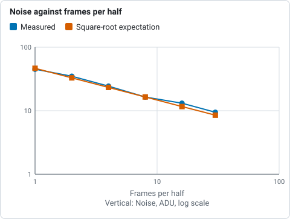

*Measured noise of the mean of 1 to 30 frames against the square-root expectation, from the integration/noise.csv listing: the curve drifts above the line past 8 frames.*

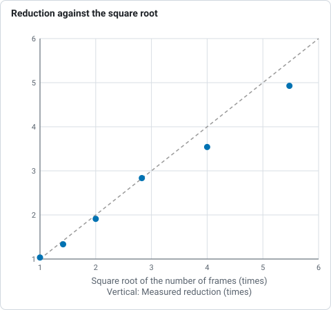

*Noise reduction of the stack against the square root of the number of frames, from the noise.csv listing: the dashed line is the law, and the points leave it past 8 frames.*

(The measurement is on the weighted mean of the registered frames without rejection, in the green
plane. It is not the noise of `stack.fits`; it is how a stack of that many of these frames behaves.)

## Step 5: The histograms

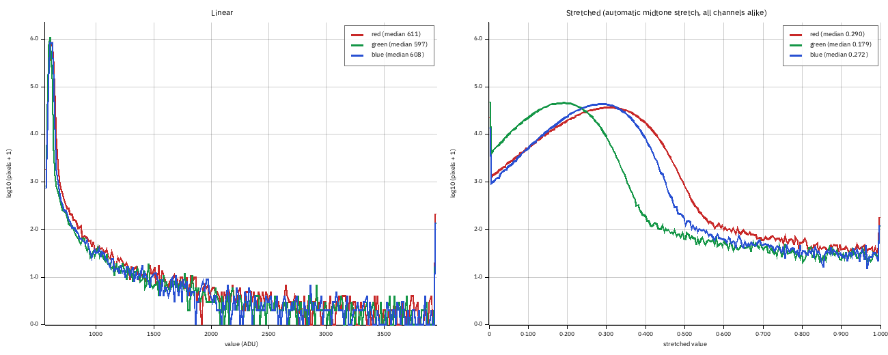

On the left, the linear histograms (256 bins from the 0.01th to the 99.99th percentile, 555 to
3957 ADU, on a logarithmic count axis): the sky is the tall peak at about 600 ADU in all three
channels, and its width is the noise (robust sigma 12.6 red, 7.6 green, 10.2 blue). The long tail to
the right is the stars and the nebula. On the right, the same after the automatic midtone stretch
(black point 581.8 ADU, white point 5635.9, midtone balance 0.0139) applied to all three alike: the
sky medians are 0.29 red, 0.18 green and 0.27 blue, which is the colour cast of the linear stack
(the green sky sits lower than the red and the blue) made visible; a neutral stack would have the
three peaks on top of one another. `integration.json` gives the fractions clipped: 1.03 per cent
of the red pixels and 2.10 per cent of the green are at or below the black point, 0.006 per cent
at or above the white point. The next tutorials fix the colour cast
([tutorial 9](photometric-colour.md)).

## Step 6: The same for a drizzle

```sh
valerian drizzle lights/ -o drizzle.fits --science-report integration-drizzle
```

It took 11.8 s and writes `drizzle_weight_map`, `drizzle_pixel_count`, `drizzle_rejected` (PNG and
FITS, with a CSV of the counts for the last two), `drizzle_histogram` and
`drizzle_integration.json` (2160 by 3840, scale 2, pixfrac 0.6).

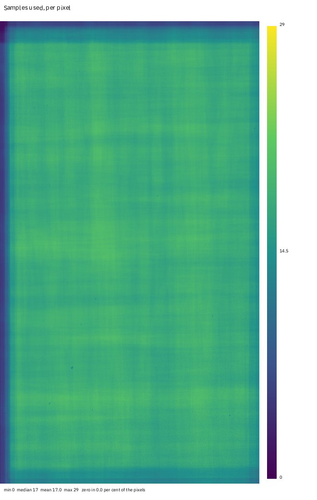

The pixel count is the number of input pixels that reached each output pixel: median 17, at most 29,
mean 17.0, and 0.015 per cent of the output has none (holes). A drizzle of a raw Seestar mosaic
drops each pixel into its own colour plane, so this is the count of **red** drops. The **weight
map** (median 5.19, maximum 11.36) is the overlap area times the frame weight, and shows the same
dither pattern. The **rejected** map is the second pass, which throws out input pixels more than 4
sigma from the first result: mean 0.0335 per output pixel, at most 5, and 96.8 per cent of the pixels
lost none.

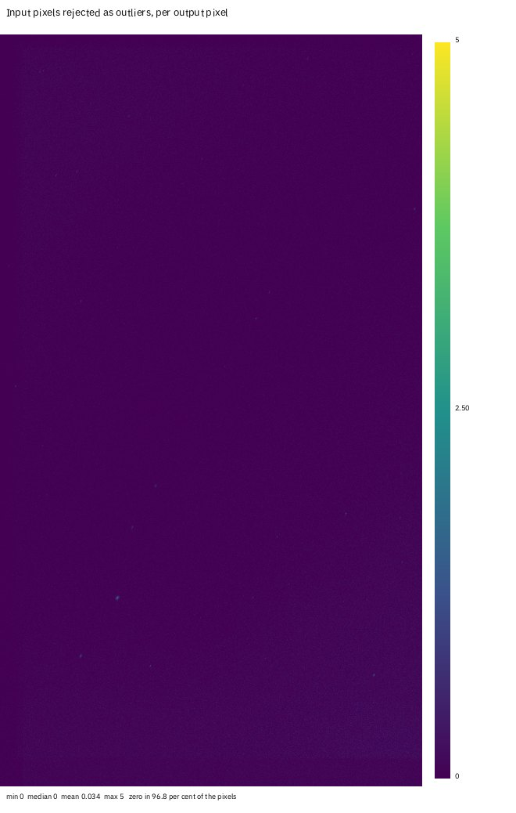

Holes are the reason to look at the count: a drizzle with too small a pixfrac or too few frames has
output pixels no drop reached, which appear as black in the weight and count maps and as NaN in
the image. See [tutorial 10](drizzle.md).

## Step 7: One output at a time

```sh
valerian plot rejection-high lights/ -o rejected-high.png
valerian plot count-map lights/ -o count.png
valerian plot weight-map lights/ -o weight.png
valerian plot noise lights/ -o noise.png
valerian plot histogram stack.fits -o histogram.png
```

The four that need frames stack them on the CPU with the default settings; each writes the PNG and
its data beside it (the map as `.fits`, the counts and the curve as `.csv`). `valerian plot
histogram` reads any FITS image: a stack, a stretched picture, a single frame, and prints the
median, sigma and clipped fractions of each channel:

```text
red    median 610.8  sigma 12.64  black-clipped 1.031 %  white-clipped 0.006 %
green  median 597.3  sigma 7.55  black-clipped 2.103 %  white-clipped 0.004 %
blue   median 608.4  sigma 10.22  black-clipped 0.618 %  white-clipped 0.004 %
```

For the maps of a stack made with other settings (a different rejection or weights), use
`valerian stack ... --science-report`, which takes all the stack options.

## Step 8: The same in the desktop app

Open the **Stack** step, choose the **Science** chip, give the folder of frames and press **Stack
for the maps**. It stacks on the CPU with progress and Cancel; then **Rejected low**, **Rejected
high**, **Pixel count**, **Weight**, **Noise** and **Histogram** appear above the viewer next to
**Subframes**.

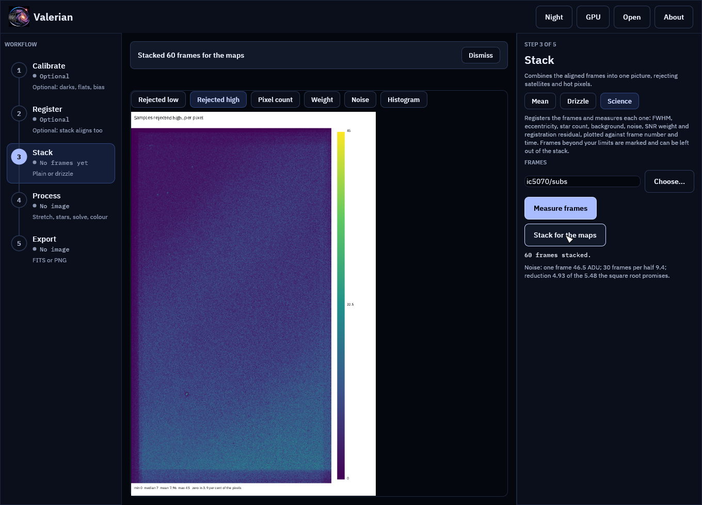

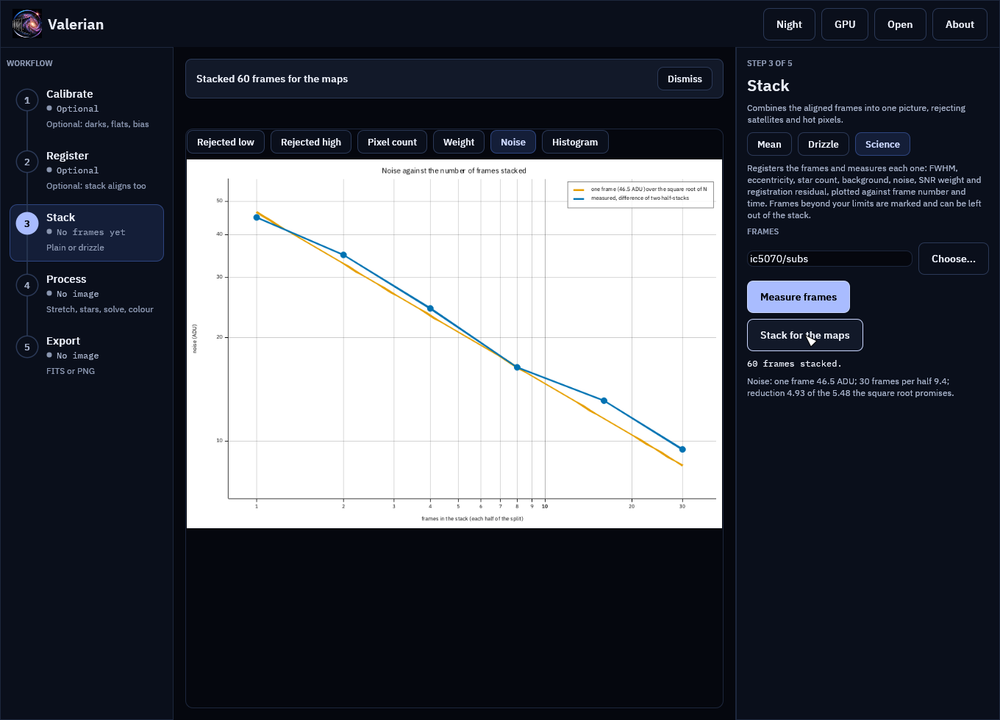

This stack is for looking at: it is not saved, and it does not replace the **Mean** stack. Every
control is in the [desktop app reference](../reference/gui.md#science).

## Options used

All options are in the [command line reference](../reference/cli.md#valerian-stack).

| Option | What it does | Default |
|---|---|---|
| `valerian stack --science-report <DIR>` | writes the subframe analysis and the integration diagnostics of the stack to a folder; stacks on the CPU | not written |
| `valerian drizzle --science-report <DIR>` | writes the weight, pixel-count and rejection maps, and the histograms, of the drizzle | not written |
| `valerian plot rejection-low\|rejection-high\|weight-map\|count-map\|noise FRAMES -o FILE` | one map or the noise curve, from frames | |
| `valerian plot histogram IMAGE -o FILE` | the histograms of any FITS image | |
| `--threshold <SIGMA>` | detection threshold of the registration for `plot` | 5 |

## How to tell it worked

* The report folder holds the maps, `noise.png`, `histogram.png`, `integration.json` and
  `report.html`.
* `pixel_count.fits` has a maximum equal to the number of frames and a minimum of the frames
  that cover the corner; its median is a little under the number of frames (the rejections).
* The noise table's first row has a reduction of 1.0 and the last has a reduction close to the
  square root of its frames (90 per cent here).
* The histograms have one tall sky peak per channel.

## Troubleshooting

**`the noise curve needs at least 4 registered frames`.** Fewer than four frames registered, so
there are no halves to compare. Stack more frames.

**The maps are all zero.** The rejection was off (`--rejection none`) or `--rejection minmax` with
nothing to reject at that depth. The count map is still there.

**The noise stays above the line.** The frames are unequal (clouds, a changing sky: see the
[subframe analysis](subframe-analysis.md)) or not independent (the same hot pixels or pattern noise
in every frame, which averaging cannot remove: calibrate the frames, [tutorial 2](calibrate.md)).
A curve that flattens as frames are added means a shared pattern.

**The histogram of one channel is cut off at the left.** Pixels are at or below the black point
of the stretch; `integration.json` gives the fraction. Run the background extraction and colour
calibration ([tutorials 5 and 9](background.md)) before judging the balance.

**It takes longer than the stack alone.** The maps and the noise curve are made on the CPU. Make
the stack on the graphics card first (`valerian stack`), and the diagnostics only when you need
them.
