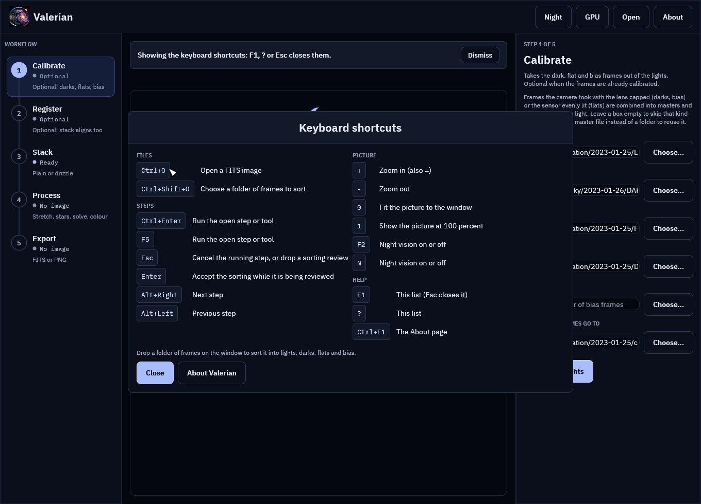

# Desktop tutorial: work from the keyboard

**Goal:** run a whole session in the desktop app with your hands on the keyboard, which is what you
want at the telescope with gloves on, or when a long run needs nothing but a start and a check.

**Data:** the two captures of [the tutorials](index.md#the-two-captures). The keys are the same
for any data.

**Before you start.** This follows [sorting a folder of frames](sort-and-sessions.md): the boxes
of Calibrate, Register and Stack are filled in.

## Step 1: Find the keys

Press **F1** or **?** (the key that types a question mark on your keyboard). The list of every
shortcut opens over the window.

Press **Esc**, **F1** or **?** again, or the **Close** button, to put it away. **About Valerian**
in the list opens the About page, which **Ctrl+F1** also opens. The notice behind the list says
what you did: **Showing the keyboard shortcuts: F1, ? or Esc closes them.** Every shortcut says
what it did in that notice, so you never have to guess whether a key press registered.

## Step 2: Open things

* **Ctrl+O** opens the file dialog for a FITS image. The notice says **Choose a FITS image to open
  in the dialog.**
* **Ctrl+Shift+O** opens the folder dialog for [sorting](sort-and-sessions.md). The review follows
  when you choose a folder. **Enter** accepts it and **Esc** drops it.

If a dialog is already open the notice says **A file dialog is already open.**

## Step 3: Run a step

**Ctrl+Enter** (or **F5**) presses the open step's main button: **Calibrate lights**, **Register
frames**, **Stack frames**, **Drizzle frames**, and in Process the open tool's own button
(**Apply and save**, **Remove stars**, **Solve**, **Calibrate colour**), **Export picture** in
Export. The step's own notice appears as if you had clicked: **Calibrating the lights...**, the
frame count, the bar and the seconds.

If it cannot run it says why, in the error colour: **Open an image first (Ctrl+O).**, **Name a
folder of FITS frames first.**, **Something is already running: Esc cancels it.**

## Step 4: Move on

**Alt+Right** goes to the next step and **Alt+Left** to the one before. The notice says where you
are: **Step 2 of 5: Register**. At the ends it says **Already at the last step: Export.** or
**Already at the first step: Calibrate.** The GPU benchmark is not a step: from there, click a
step on the rail.

A whole session is then: Ctrl+Shift+O, choose the folder, Enter, Ctrl+Enter, Alt+Right,
Ctrl+Enter, Alt+Right, Ctrl+Enter. When Stack finishes it opens the stack for Process.

## Step 5: Stop a run

**Esc** does what the **Cancel** button in the notice does: it asks the running step (or the
reading and gathering of a dropped folder) to stop. The notice says **Cancelling: finishing the
frame in hand, nothing will be kept...** and then **Cancelled: calibration stopped. Nothing from the
run was kept.** What a cancel leaves behind, and why, is in [Cancelling a running
step](cancel.md).

**Esc** with nothing to cancel does nothing, and says nothing.

## Step 6: Look at the picture

With an image open, and no text box holding the keyboard:

| Key | Notice |
|---|---|
| **+** (or **=**) | **Zoom 125 percent**, and so on, by 25 percent a press |
| **-** | the smaller zoom |
| **0** | **Fitted the picture to the window** |
| **1** | **Zoom 100 percent** (of the preview) |
| **F2** or **N** | **Night vision on (F2 or N turns it off).** |

With no image open, the zoom keys say **Open an image to zoom it.**

## A note on typing

The path boxes are text boxes. While one has the keyboard, plain keys (**N**, **?**, **+**, **-**,
**0**, **1**, **Enter**) type into it as they should, and only the function keys and the chords
(Ctrl, Alt) act. Click outside the box to give the keyboard back.

## If it does not go as expected

**A key does nothing.** The About page or the shortcut list is open and covers the window: only
help, About and **Esc** work then. Close it. Or a text box has the keyboard and the key is a plain
one: see the note above.

**Alt+arrows change nothing in the window of your desktop.** Some Linux desktops use Alt+arrows
for their own shortcuts and never pass them on. Click the steps on the rail instead; every
shortcut has a button.

**F1 opens the shortcuts, not the About page.** Since this release it does: the About page is
Ctrl+F1, or the logo, the name or **About** in the top bar. Every control and shortcut is in the
[reference](../reference/gui.md#keyboard-shortcuts).
