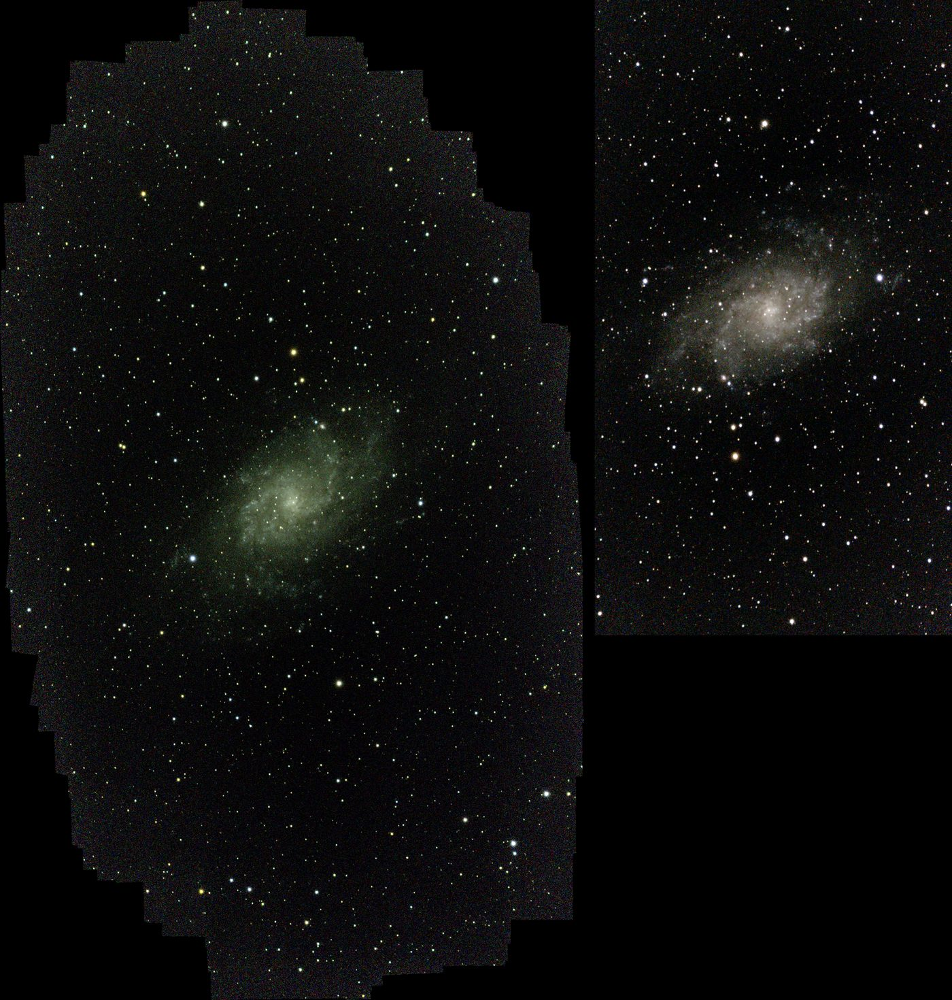
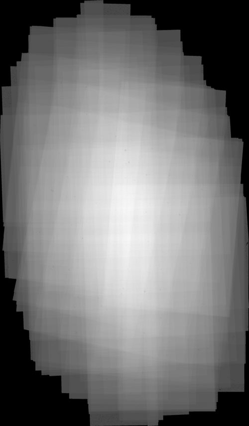
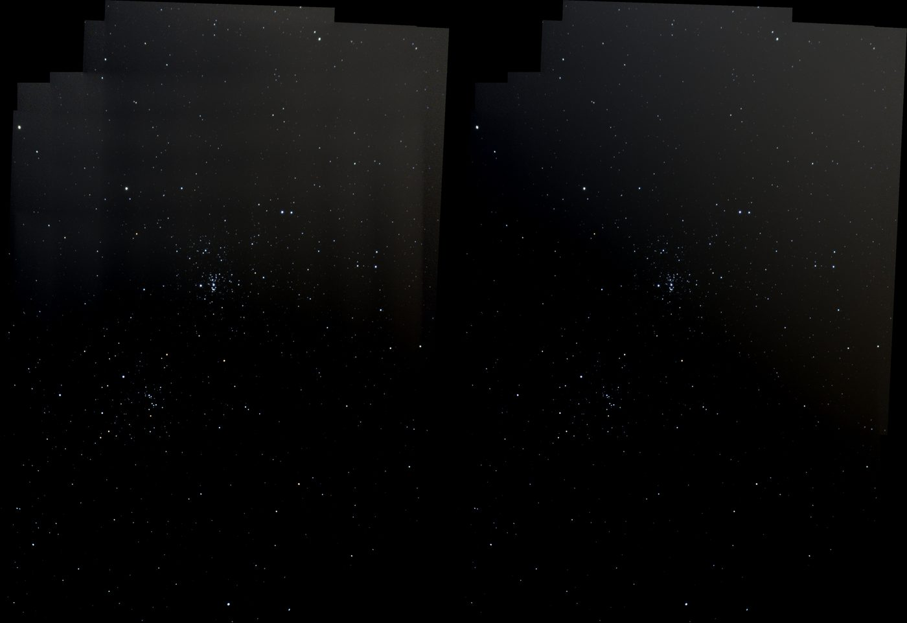

# Tutorial 17: Stack a mosaic

**Goal:** turn a Seestar "mosaic mode" folder, where the camera visited several overlapping
parts of the target, into one image of the whole target, not just the part inside one frame.
You finish with `mosaic.fits` (colour, on a canvas larger than one frame), a coverage map and a
plate solution that proves the panes line up.

**Data:** the 167 raw 10-second S50 sub-frames of M 33 in a `_mosaic_sub` folder (IRCUT filter,
1080 x 1920 pixels, 2.376 arc seconds per pixel). Any folder of raw or debayered frames taken at
several pointings works. For how it works see [How mosaics work](../user-guide/mosaic.md).

## Step 1: See the problem

```sh
valerian stack M33_mosaic_sub/ -o plain.fits
```

```text
...
note: 27 of 167 frames did not register to the reference. If they are other panes of a mosaic, stack with --mosaic to build one canvas.
140 of 167 frames stacked with LinearFit { low: 5.0, high: 2.5 }, reference frame 58 ...
```

A plain stack keeps one frame's grid: 1080 x 1920 pixels, the target cut off at a corner, and
27 frames dropped because they see another part of the sky.

## Step 2: Stack as a mosaic

```sh
valerian stack M33_mosaic_sub/ --mosaic --mosaic-min-coverage 12 \
    --scratch-dir /big/disk -o mosaic.fits --coverage coverage.fits --report frames.txt
```

```text
mosaic round 1: 27 frames placed, 14 anchors (one per pane)
mosaic: 16 panes found (anchors), 167 of 167 frames placed
mosaic canvas 2568 x 4390 pixels (1080 x 1920 for one frame), feather 120 px
mosaic levels matched: largest correction 3.5 ADU
combining 167 frames with LinearFit { low: 5.0, high: 2.5 }, weights NoiseFwhm on ... (28 GiB staged)
mosaic: cut to 2118 x 3627 pixels where at least 12 frames reach
167 of 167 frames stacked ...
```

Reading it:

* **`27 frames placed, 14 anchors`.** The 27 frames that failed against the reference matched
  frames at neighbouring pointings. "Panes" here are pointings: this session drifted through 16
  of them (the Seestar dithers between frames), not two or three tiles.
* **`canvas 2568 x 4390`.** The bounding box of all 167 frames. More than twice one frame in
  each direction.
* **`levels matched: largest correction 3.5 ADU`.** The additive level fitted to the worst
  frame. NGC 869 in the next section needed 1,450 ADU.
* **`cut to 2118 x 3627`.** Pixels that fewer than 12 frames reach are dropped and the canvas
  is trimmed; the depth ranged from 1 to 144 frames.

The run took 196 s and 2.9 GiB of memory on a shared 24-core machine (load 12 to 70, so an
upper bound), plus about 30 GB of scratch disk that is removed when the run ends.

## Step 3: Look at it

```sh
valerian stretch mosaic.fits --unlinked -o stretch.fits --preview preview.png
```



Left: Valerian, the whole 2118 x 3627 canvas. Right: the Seestar's own 1296 x 2304 stack of the
same 167 frames, at the same scale and the same stretch. The Seestar keeps the deep middle; the
Valerian canvas shows the same galaxy, the same stars in the same places and a wider field.
Valerian's edge is ragged because the rim is where only a dozen or so frames overlap. The
coverage map shows why:



## Step 4: Check the registration

```sh
valerian solve mosaic.fits -o solved.fits
```

```text
solved: centre RA 01h33m52.8s Dec +30d39m30.8s (23.46982, +30.65857 deg)
scale 2.374 arcsec/pixel, field 1.40 x 2.39 deg, rotation -108.64 deg east of north, mirrored
61 of 400 detected stars matched, rms 0.46 arcsec (0.19 px), plain TAN
```

A single plain TAN projection fits the whole 2118 x 3627 canvas to 0.19 pixel rms. A frame
placed wrongly would show as a double star and raise that figure. Then `valerian background`,
`photocal` and the rest of the chain work on the mosaic as on any stack.

## Step 5: A mosaic with uneven panes

NGC 869, 46 frames of 20 s at six pointings, evening sky brightening and fading:

```sh
valerian stack NGC869_mosaic_sub/ --mosaic -o ngc869.fits
valerian stack NGC869_mosaic_sub/ --mosaic --no-mosaic-level-match -o ngc869_nolevel.fits
```



Without level matching (left) each pane keeps the level the usual normalisation gives it and
vertical steps show where panes meet. With it (right) the steps are gone; the smooth glow that
remains is a real sky gradient inside the panes and is the job of `valerian background`.

## Options used

| Option | Meaning | Default |
|---|---|---|
| `--mosaic` | Register every pane onto one canvas | off |
| `--mosaic-feather PIXELS` | Width of the ramp at each frame edge (0 gives hard edges) | 120 |
| `--mosaic-min-coverage FRAMES` | Keep only pixels this many frames reach, trim the canvas | 1 |
| `--no-mosaic-level-match` | Skip the per-frame level fit | level fit on |
| `--scratch-dir DIR` | Where the staging file goes | system temporary directory |

## How to tell it worked

* The log says `N of N frames placed`, and `valerian solve` has an rms under about half a pixel.
* The stars are round at the panes' overlaps. Doubled stars mean a bad registration.
* No bright or dark steps along straight lines that run across the canvas.

## Troubleshooting

* **`the mosaic canvas would be ... a registration put a frame in the wrong place`.** Some frame
  matched wrongly. Look at `--report` for frames with an odd shift, remove them (or use
  `valerian subframes` and `--approve`) and rerun.
* **A frame is skipped with "no pane it overlaps either".** It overlaps no other pane by 10
  matched stars or more, usually because it is blurred or has few stars. That is normal for a
  few frames.
* **`No space left on device`.** The staging file is large (about 30 GB here); use `--scratch-dir`.
* **A faint seam remains.** Run `valerian background` on the result; raise `--mosaic-feather`
  to blend over a wider zone.
* **Sky outside the covered area is blank (NaN).** That is "no data", as at the edge of any
  stack, not a black pixel.

## Where next

[Tutorial 5: Background extraction](background.md), then
[Tutorial 8: Plate solve](plate-solve.md) and [Tutorial 9: Photometric colour](photometric-colour.md).
