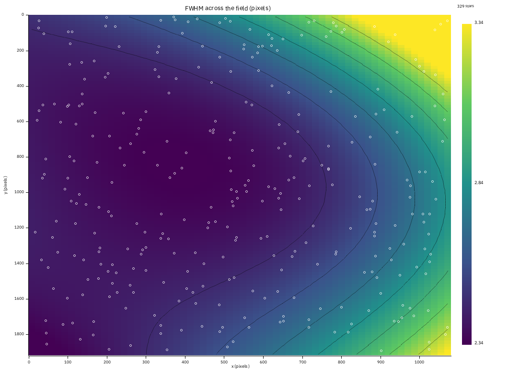
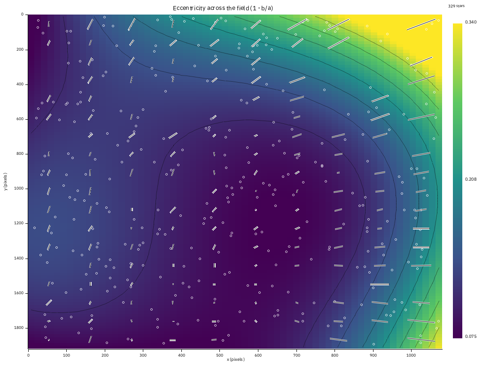
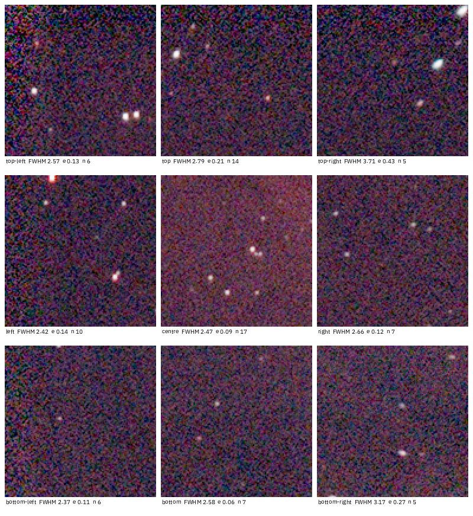
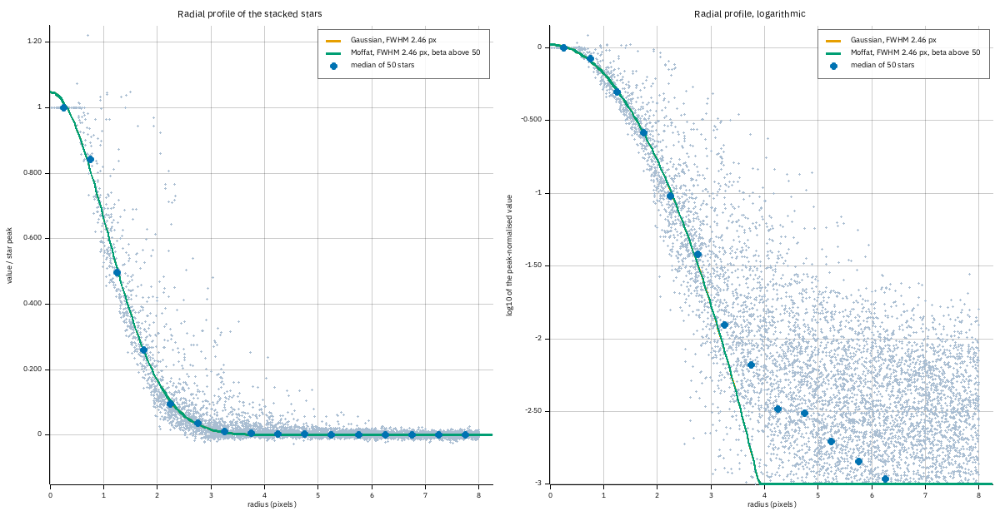
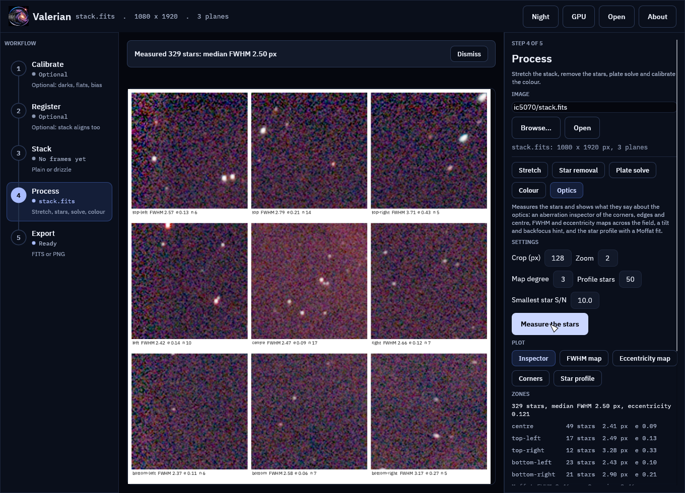
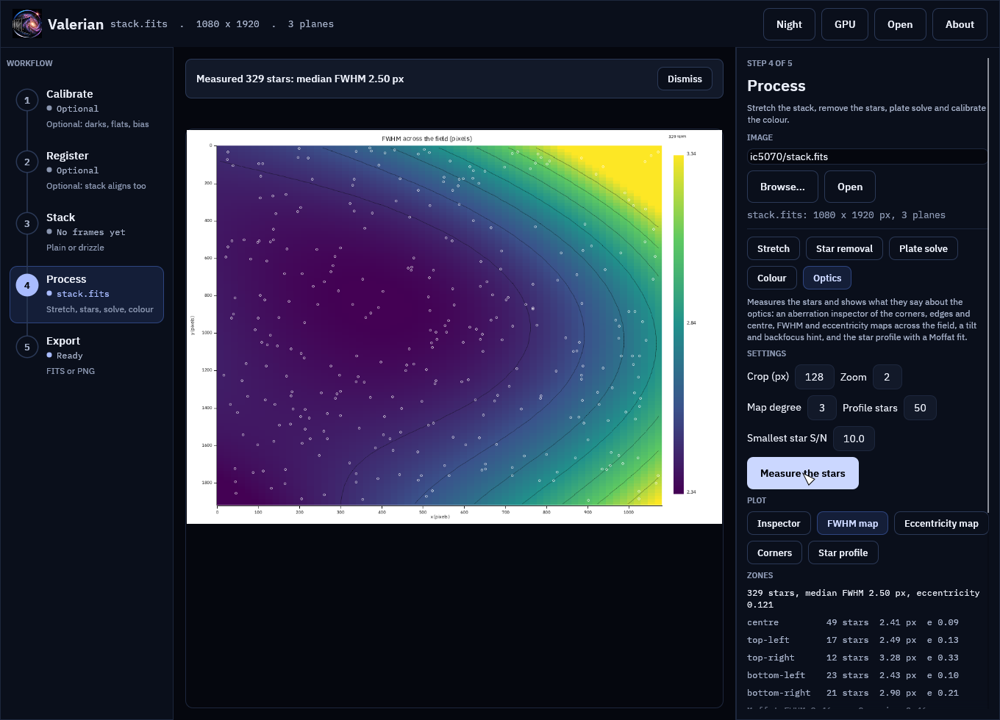
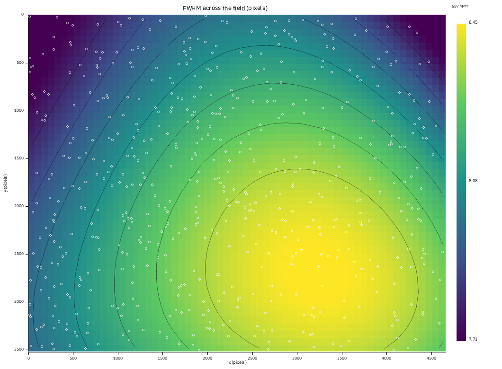

# Tutorial 13: Optics

**Goal:** read what the stars of one picture say about the telescope: are the corners as sharp
as the centre, is the sensor tilted, are the stars round, and what does a star's profile look
like. You finish with an aberration inspector, a FWHM map and an eccentricity map of the
field, a tilt and backfocus hint in words, a star profile with a Moffat fit, and a one-file
HTML report. This is what the AberrationInspector and FWHMEccentricity tools of PixInsight
show; here it is `valerian optics`, and the **Optics** tool of the desktop app.

**Data:** `stack.fits`, the 60-frame IC 5070 stack of [tutorial 4](stack.md) (Seestar S50,
250 mm, 1080 by 1920 pixels), and one of its single frames, the sharpest, for comparison. Section
"A second telescope" uses the five-frame ASI1600MM H-alpha stack. Use a linear image: a
stretched one does not change where the stars are, but the stars' profiles are no longer linear.

**What happens.** Valerian measures the stars, fits a smooth surface to their FWHM and
eccentricity, compares the corners with the centre and stacks the brightest isolated stars
into one radial profile. How each plot is made is in [How the optics plots
work](../user-guide/optics.md).

## Step 1: Run it

```sh
valerian optics stack.fits --report optics
```

```text
329 usable stars: median FWHM 2.50 px, eccentricity 0.121
zone           stars  FWHM px    ecc
centre            49     2.41  0.086
top-left          17     2.49  0.135
top-right         12     3.28  0.327
bottom-left       23     2.43  0.104
bottom-right      21     2.90  0.212
* The corners are 15 per cent softer than the centre: field curvature, or the distance from the flattener or reducer to the sensor (the backfocus) is wrong. The sign cannot be read from one image: change the spacing by a small step (0.1 to 0.2 mm), take another image and see whether the corners improve.
* The corners differ by 31 per cent of their mean, softest at the top-right: this is what a tilt of the sensor or focuser (or decentred optics) towards that side looks like; a tilt adjuster or shims on the opposite side move it. A corrector with an offset sensor can look the same.
* Stars in the outer field are elongated along the radius (index +0.06): the pattern is of coma or a spacing error rather than of tracking or tilt.
wrote optics/aberration_inspector.png
wrote optics/fwhm_map.png
...
wrote optics/report.html
```

It takes under a second. 329 stars are used (stars that are saturated, or whose peak is under ten
times the noise, are left out). The table gives the median FWHM and eccentricity of
the centre and the four corners (the outer quarter of the width and the height). The picture
is already clear: the centre and the left side are sharp (2.4 px), the **top-right corner is
soft and oval** (3.28 px, eccentricity 0.33).

## Step 2: The FWHM map

Open `optics/fwhm_map.png`.



A smooth surface (a polynomial of degree 3, fitted to the 329 stars with 3-sigma rejection)
is drawn as an image: dark is sharp and bright is soft (2.34 to 3.34 px here), the black lines
are contours, and the white circles are the stars, so you can see where the surface is
measured and where it is only continued. The sharp region sits left of the middle and the
softness grows to the right, fastest in the top-right corner: a **tilt** across the field, not a
bowl around the centre. If the corners were all alike the contours would be rings.

## Step 3: The eccentricity map



The same surface for the eccentricity (`1 - b/a`, 0 is a round star), with a **whisker** at each
point of a coarse grid showing which way the stars there are elongated and how much. Round stars
in the middle and the left (0.08 to 0.15), elongation up to 0.34 in the top-right corner, and
the whiskers there lie along the line from the centre: elongation along the radius, the pattern
of coma or of a spacing error; trailing from poor tracking would instead show whiskers all
parallel, whatever the position.

## Step 4: The tilt and backfocus hint

`optics/tilt.png` is the bar chart of the five zones, and the three lines of the hint say the
same in words. Three numbers matter:

* **Curvature** is the mean corner FWHM over the centre's, minus 1: +15 per cent here (the
  corners are softer than the centre). Above +12 per cent the hint names field curvature or
  the spacing of the flattener or reducer.
* **Tilt** is the spread of the corners over their mean: 31 per cent, softest at the top-right.
  Above 10 per cent the hint names a tilt of the sensor or focuser towards that side.
* **Radial elongation** is +0.06: slightly along the radius.

The hints say what the pattern is **consistent with**. One picture cannot tell a tilted sensor
from a decentred optical element, and cannot say which way to move a spacer; so the advice is to
change one thing by a small step (0.1 to 0.2 mm of spacing, or one tilt adjustment) and measure
again with the same command. Compare the two `optics.json` files.

Is it the stack? A stack's corners are made from fewer frames, so check the sharpest single
frame:

```sh
valerian optics lights/Light_IC\ 5070_10.0s_LP_20260728-224223.fit --report optics-frame
```

```text
130 usable stars: median FWHM 2.10 px, eccentricity 0.171
zone           stars  FWHM px    ecc
centre            21     2.04  0.162
top-left          10     2.09  0.192
top-right          5     3.31  0.412
bottom-left        6     1.96  0.142
bottom-right       6     2.45  0.337
```

The same pattern, from a frame that no registration touched: the top-right corner is 3.31 px
against 2.04 in the centre. The telescope, not the stack, is soft there. (With 5 or 6 stars per
corner the single frame's numbers are rough, which is why the stack is the better picture.)

## Step 5: The aberration inspector



Nine crops of 128 pixels, shown at twice their size and stretched alike (one automatic stretch
of the whole picture, so a soft corner looks soft and not just dim), at the corners, the middle
of each edge and the centre. Each is labelled with its place, the median FWHM and eccentricity of
the stars within one crop of it and their number. The star shapes confirm the map: the
top-right panel shows oval stars. `--crop 192 --zoom 3` makes larger panels; with a fainter field
increase `--crop` so each holds enough stars (three are needed for the label's numbers).

## Step 6: The star profile



The 50 brightest isolated stars are stacked into one radial profile: the pale dots are every
pixel of every star (distance from the star's centroid against its value over the star's peak),
the blue dots the median of each half-pixel ring, and the curves are a Moffat and a Gaussian
fitted to the rings. Left is linear, right logarithmic, which shows the wings.

```text
Moffat FWHM 2.46 px, beta 3654.42; Gaussian FWHM 2.46 px
```

The two curves are one: the Moffat's `beta` has run off to infinity, which is the Gaussian.
Resampling and averaging smooth the wings of the stars of a stack, which a Gaussian describes
well. A single frame is no different at this sampling:

```sh
valerian plot psf lights/Light_IC\ 5070_10.0s_LP_20260728-224223.fit -o psf47.png
```

```text
Moffat FWHM 2.08 px, beta 28.99; Gaussian FWHM 2.09 px
```

Both fits agree to 0.01 px: the stars of this telescope, at 2 pixels FWHM, are Gaussian to
within the noise. A beta of a few (2.5 to 5 is typical of seeing-limited stars) appears when
the wings are really broader than a Gaussian's, and then the logarithmic panel shows the
profile lying above the Gaussian curve out in the wings. In the report the beta is shown as
"above 50" when it runs away.

## Step 7: One plot at a time, and the report

```sh
valerian plot fwhm-map stack.fits -o fwhm.png --order 2
valerian plot tilt stack.fits -o tilt.png
valerian plot aberration stack.fits -o inspector.png --crop 192 --zoom 3
valerian plot psf stack.fits -o psf.png --psf-stars 100
valerian plot eccentricity-map stack.fits -o ecc.png
```

Each writes the PNG and its data beside it (`fwhm.csv` and `fwhm.stars.csv`, `tilt.json`,
`inspector.json`, `psf.csv` and `psf.json`). `--order 2` fits a bowl and a tilt only: the map is
smoother but cannot show a feature that is not a bowl or a plane. `optics/report.html` holds
all the plots, the zone table and the hints in one file with the images inside it. A folder
that already holds a [subframe analysis](subframe-analysis.md) gets the optics section added to
the same page.

## Step 8: The same in the desktop app

Open `stack.fits`, choose the **Process** step and the **Optics** chip, and press **Measure the
stars**. The viewer shows the plot chosen by the chips under Plot (**Inspector**, **FWHM map**,
**Eccentricity map**, **Corners**, **Star profile**) and the panel gives the zone table and the
hint.



The plot for the FWHM map in the same window:



**Save report** writes the same folder as the command line. Every control is in the [desktop
app reference](../reference/gui.md#optics).

## A second telescope

The five-frame ASI1600MM H-alpha stack (tutorial 2 data, 840 mm, defocused: stars of 8 px):

```sh
valerian optics ha/stack.fits --report optics-ha
```

```text
587 usable stars: median FWHM 8.21 px, eccentricity 0.203
zone           stars  FWHM px    ecc
centre            86     8.39  0.202
top-left          41     7.80  0.210
top-right         19     7.97  0.219
bottom-left       49     8.12  0.192
bottom-right      24     8.36  0.215
* The field is flat: the corners are within 4 per cent of the centre.
* The corners agree to 7 per cent: no tilt to speak of.
```

A flat field and round stars: the contrast with IC 5070 is the point. The corners are within 7
per cent of one another and of the centre, and the map has no pattern.



## Options used

All options are in the [command line reference](../reference/cli.md#valerian-optics).

| Option | What it does | Range or values | Default |
|---|---|---|---|
| `<IMAGE>` | the FITS image | a file | required |
| `--report <DIR>` | folder for the plots, CSV, JSON and `report.html` | a folder | `optics-report` |
| `--threshold <SIGMA>` | star detection threshold | above 0 | 5 |
| `--min-snr <RATIO>` | smallest peak-to-noise of a measured star | above 0 | 10 |
| `--crop <PIXELS>` | side of an inspector crop | 32 to 512, even | 128 |
| `--zoom <FACTOR>` | enlargement of an inspector crop | 1 to 6 | 2 |
| `--order <DEGREE>` | degree of the surface of the maps | 1 to 4 | 3 |
| `--psf-stars <N>` | stars stacked in the profile | 8 or more | 50 |

`valerian plot` takes the kind (`aberration`, `fwhm-map`, `eccentricity-map`, `tilt` or `psf`),
one image, `-o <FILE>` and the same options.

## How to tell it worked

* The first line says how many stars were used (at least 30) and their median FWHM.
* `optics/` holds the five PNGs, `fwhm_map.csv`, `eccentricity_map.csv`, `field_stars.csv`,
  `psf.csv`, `optics.json` and `report.html`.
* The map has dark and bright regions with contours; the circles lie over most of the picture.
* A change of the optics shows as a change in the zone table: run the command again after each
  adjustment and compare.

## Troubleshooting

**`only 12 usable stars were found; the optics plots need at least 30`.** The image has too few
unsaturated stars with a good peak. Lower `--threshold` (3 or 4) or `--min-snr` (5), use a
longer exposure or a stack, or a field with more stars. A frame of a nebula that fills the sky
may have none.

**The map has bright patches in corners with no circles.** The surface is continued there from
the stars that exist: do not read it. Use `--order 2`, or take a sharper image with stars in the
corners.

**A zone shows `-` and the hint says too few stars in the corners.** Fewer than 5 stars in a
corner or the centre. Use a stack, or lower `--min-snr`.

**The profile plot is missing.** Fewer than 8 isolated stars (no neighbour within the window
radius). The other plots are still written, and `psf.png` is left out of the report.

**The Moffat beta says "above 50".** The profile is Gaussian: a stack, a drizzle, or a very
well-sampled frame. It is not a failure.

**The FWHM is larger than another program's.** Valerian measures second moments in a window,
which weight the wings; against Gaussian fits it reads 1 to 6 per cent higher (see the checks in
[How the optics plots work](../user-guide/optics.md#checked-against-astropy-and-numpy)). Compare
zones with zones, not programs with programs.
