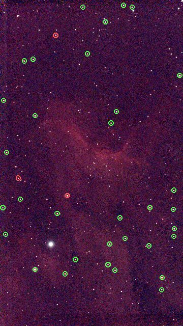
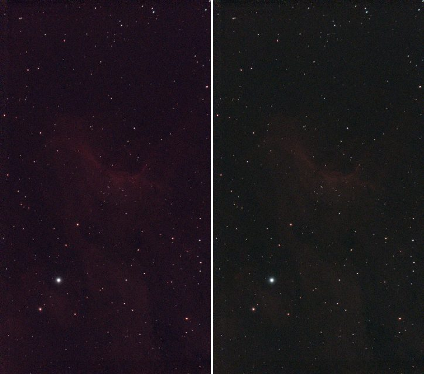
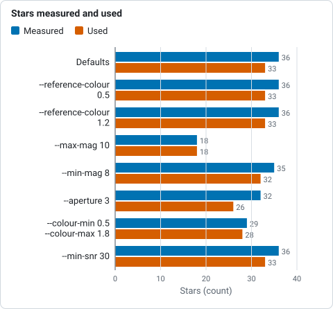

# Tutorial 9: Photometric colour calibration

**Goal:** set the colour balance of the picture from the stars in it, so that a star the colour of
the Sun is neutral and the sky is a neutral grey. You finish with `calibrated.fits`, a table of the
stars used (`stars.csv`) and a stretched picture with the cast gone.

**Data:** `solved.fits`, the plate-solved IC 5070 image from [tutorial 8](plate-solve.md): linear, colour, with
a world coordinate system. It also needs the Gaia catalogue, because it takes the **colours** of
catalogue stars from it (the BP-RP colour, which is the difference between Gaia's blue and red
magnitudes: about 0.8 for the Sun, 0.3 for a hot blue star, 2 for a cool red one).

**What happens.** The solved positions are used to find Gaia stars in the image; each star is measured
through the same aperture in red, green and blue; a line of instrumental colour against true
colour is fitted for red against green and for blue against green; and the gains that make a star of
BP-RP 0.82 (like the Sun) neutral are found. Then the sky of the three planes is brought to one level.
The method is in [How colour calibration works](../user-guide/colour-calibration.md).

**When.** On a **linear** image, after background extraction and plate solving, before stretching.

## Step 1: Calibrate

```sh
valerian photocal solved.fits -o calibrated.fits --stars-out stars.csv
```

```text
36 Gaia stars measured, 33 used; aperture radius 5.1 px; neutral at BP-RP 0.82
  red against green: slope -0.635 mag per BP-RP, scatter 0.027 mag, gain 0.7547 +/- 0.0032
 blue against green: slope +0.080 mag per BP-RP, scatter 0.024 mag, gain 0.9860 +/- 0.0037
sky before 610.76 597.29 608.32, after 552.68 552.68 552.68 (offsets -91.76 44.61 47.15)
wrote the star table stars.csv
wrote calibrated.fits
```

The command took 0.34 s. Reading it:

* **`36 Gaia stars measured, 33 used; aperture radius 5.1 px`.** 36 catalogue stars in the field
  were bright enough to measure (Gaia G between 6 and 11, with enough signal in every colour) and 33 were kept
  after rejecting outliers. The measuring aperture is 2 times the median FWHM of the stars (2.56 pixels).
  At least 15 stars are needed (`--min-stars`).
* **`neutral at BP-RP 0.82`.** The colour made neutral: a G2 dwarf like the Sun, `--reference-colour`.
* **`red against green: slope -0.635 mag per BP-RP, scatter 0.027 mag, gain 0.7547 +/- 0.0032`.** For each
  star the instrumental red-minus-green magnitude is plotted against its true BP-RP. The points lie on a
  line with a slope of -0.635 mag per unit of BP-RP, within 0.027 mag. The gain is the factor
  that puts a BP-RP 0.82 star on zero: the **red plane is multiplied by 0.7547**. Its uncertainty is
  0.0032, 0.4 per cent.
* **`blue against green: ... gain 0.9860 +/- 0.0037`.** The same for blue: the blue plane is multiplied
  by 0.9860. Green is the reference and stays at 1, so the brightness is kept.
* **`sky before 610.76 597.29 608.32, after 552.68 552.68 552.68 (offsets -91.76 44.61 47.15)`.** After
  the gains, a constant is added to each plane so the sky has one level (552.68) in all three, which
  makes the background a neutral grey. The offsets are the constants (red is pulled down by 91.76
  ADU, green and blue lifted by 44.61 and 47.15).

`calibrated.fits` has the gains and the offsets in its header: `PCCGAINR` 0.7547, `PCCGAING` 1.0,
`PCCGAINB` 0.9860, `PCCOFFR` -91.76, `PCCOFFG` 44.61 and `PCCOFFB` 47.15. `stars.csv` has one line per star
measured: its pixel position (`x`, `y`), Gaia magnitude `g` and colour `bp_rp`, the fluxes in red, green and
blue and `used` (1 if it went into the fit). Here it has 36 stars, 33 used, with `g` from 7.0 to 11.0 and
`bp_rp` from 0.35 to 2.15, a good spread of colours, which is what makes the fit reliable.

```text
x,y,g,bp_rp,flux_r,flux_g,flux_b,used
206.029,1586.533,7.000,1.000,571262.861,367588.606,382001.901,1
956.491,1635.028,8.000,2.125,209667.817,76182.253,67570.169,1
```

The stars it measured, over a screen-stretched picture of the same image: green circles are the 33 used, red
circles the 3 that were rejected as outliers.



## Step 2: See the difference

The sky and the stars are the proof. Left: `flat.fits` stretched (`stretched.fits`, [tutorial 6](stretch.md)),
which has the cast of the data: the sky is a dark purple. Right:
`calibrated.fits` with the same automatic stretch (`valerian stretch calibrated.fits -o cstretched.fits`). Both are
Valerian's stretched output at one third of the size.



```sh
valerian stretch calibrated.fits -o cstretched.fits --preview cstretched.png
```

```text
black 532.4390, white 5099.4653, Mtf { midtone: 0.0385596760748138 }
plane 0: median 552.7506 -> 0.1002
plane 1: median 552.7175 -> 0.1001
plane 2: median 552.7233 -> 0.1001
wrote cstretched.fits
wrote preview cstretched.png
```

Now the three planes' sky medians land on 0.1002, 0.1001 and 0.1001: the sky is neutral grey. Before the
calibration they were 0.1209, 0.0663 and 0.1113, tutorial 6's log. The sky has lost its tint. The nebula looks fainter, because the
red gain of 0.75 turns the red down: a harder stretch brings it back.

`valerian info calibrated.fits --stats` gives the sky of every plane as 552.7. The image, linear, ready to
stretch to taste or to remove the stars from ([tutorial 7](star-removal.md) on `calibrated.fits` works the same way).

## Options used

All options are in the [command line reference](../reference/cli.md#valerian-photocal).

| Option | What it does | Range or values | Default |
|---|---|---|---|
| `<INPUT>` | the linear colour FITS image (three planes) | a file | required |
| `-o`, `--output <FILE>` | write the calibrated image | a file | the result is only printed |
| `--wcs <FILE>` | take the plate solution from this FITS file's header instead of the image's | a file | the image's own WCS, or a quick solve from the header |
| `--catalogue <FILE>` | the star catalogue (it must carry colours) | a `.vcat` file | `gaia-dr3-g11.vcat` beside the program, or `VALERIAN_CATALOGUE` |
| `--stars-out <FILE>` | write every star measured to a CSV file | a file | not written |
| `--reference-colour <BP-RP>` | the colour to make neutral; 0.82 is a G2V star like the Sun | BP-RP | 0.82 |
| `--min-mag <MAG>`, `--max-mag <MAG>` | the brightest and faintest star used, Gaia G | magnitude | 6 and 11 |
| `--colour-min <BP-RP>`, `--colour-max <BP-RP>` | the bluest and reddest BP-RP used in the fit | BP-RP | 0.3 and 2.5 |
| `--aperture <FWHM>` | aperture radius as a multiple of the median FWHM | multiple | 2 |
| `--min-snr <SNR>` | least signal-to-noise of a star in each colour | ratio | 15 |
| `--min-stars <N>` | the fewest stars the fit may rest on | count | 15 |
| `--no-neutralise` | leave the background levels of the planes as they are | on or off | off |

What the options changed on this image (the gains are red and blue; the sky is "after"):

| Command differs by | Stars measured, used | Gains R, B | Sky after |
|---|---|---|---|
| nothing (defaults) | 36, 33 | 0.7547, 0.9860 | 552.68 in all three |
| `--reference-colour 0.5` | 36, 33 | 0.9099, 0.9629 | 579.60 in all three |
| `--reference-colour 1.2` | 36, 33 | 0.6043, 1.0142 | 527.78 in all three |
| `--max-mag 10` | 18, 18 | 0.7440, 0.9852 | 550.33 |
| `--min-mag 8` | 35, 32 | 0.7559, 0.9872 | 553.17 |
| `--aperture 3` | 32, 26 | 0.7410, 0.9895 | 550.60 |
| `--colour-min 0.5 --colour-max 1.8` | 29, 28 | 0.7527, 0.9872 | 552.51 |
| `--min-snr 30` | 36, 33 | 0.7547, 0.9860 | 552.68 |
| `--no-neutralise` | 36, 33 | 0.7547, 0.9860 | 460.92, 597.29, 599.83 (offsets 0) |


*Red and blue gains for each option on the same image, from the table above: the reference colour moves the red gain most.*



*Stars measured and stars used in the fit for each option, from the table above.*

The gains are stable: dropping the fainter stars (`--max-mag 10`, half the stars), the brightest (`--min-mag 8`),
changing the aperture or restricting the colour range moves the gains by less than 0.02. That stability, not the
size of the scatter, is what tells you the calibration is sound. A different `--reference-colour` shifts the whole
balance: a redder reference (1.2) lowers the red gain to 0.60, because the stars it makes neutral are red.
`--min-snr 30` changed nothing: every star already had a signal-to-noise above 30.
`--no-neutralise` applies the gains but not the offsets: the planes' skies stay at their own levels
(red 460.92, green 597.29, blue 599.83), and the sky is not grey.

## How to tell it worked

* `N Gaia stars measured, M used` with `M` at least 15 (here 33).
* `scatter` is a few hundredths of a magnitude (0.027 and 0.024), and the gain's `+/-` is under 1 per cent.
* The gains are not extreme (here 0.75 and 0.99). As a rule of thumb, a gain far from 1, say below 0.5 or above 2, deserves a look
  at `stars.csv`.
* The after sky is one number in all planes.
* `stars.csv` has stars of different colours (here BP-RP 0.35 to 2.15) and mostly `used` 1.
* The stretched picture has a neutral dark sky.
* Changing the options a little (magnitude limits, aperture) leaves the gains within 2 per cent.

## Troubleshooting

**`valerian: this image has been stretched; colour calibration works on the linear image`.** You gave a
stretched file (here `stretched.fits`). Run `photocal` on the linear one, after the background extraction and before
the stretch.

**`valerian: master_dark.fits has no world coordinate system and the header lacks a position and scale
to solve one: run `valerian solve` first`.** The image has no WCS and no `RA`, `DEC` and scale to solve one
from (here a mono master dark, which is not a colour image anyway). Plate solve first
([tutorial 8](plate-solve.md)), or give the solution with `--wcs`. If the header has a position and scale `photocal`
solves for itself: `valerian photocal flat.fits` printed `no WCS in the image: solving it from the header first` and gave the
same result.

**`valerian: colour calibration needs at least 40 usable stars and found 36 of 36 measured: the field is sparse for the
catalogue, or the stars are too faint for --min-snr ...`.** `--min-stars 40` was given and the field has 36 stars the
catalogue can offer. Fewer stars means a less certain fit. A field narrower than about half a degree has too few
stars brighter than G = 11: use a deeper catalogue (see [tutorial 8](plate-solve.md#troubleshooting)), or lower `--min-stars`
if you accept a less certain gain (the `+/-` tells you how much).

**The scatter is large (0.1 mag or more) or the gains have large `+/-`.** The stars are measured badly:
saturated bright stars (raise `--min-mag`), faint noisy ones (raise `--min-snr`, lower `--max-mag`), or crowded ones
in a nebula (a smaller `--aperture`). The `used` column of `stars.csv` and the red circles in the picture show
which stars were rejected.

**The sky is still tinted, or the nebula has lost its colour.** `photocal` balances the sky and the
stars; the nebula's colour is whatever is left. If the sky has gradients in colour, run
[background extraction](background.md) first (it is per plane); if the data was stretched before, it cannot be
fixed.

**The result looks too blue or too red.** The reference is the Sun, BP-RP 0.82. For a different taste, change `--reference-colour` (0.5 gave red and blue gains of 0.91 and
0.96, 1.2 gave 0.60 and 1.01).

**The input has one plane.** `photocal` needs red, green and blue planes; a mono image has no colour to calibrate.

## The desktop app

In the desktop app this is the **Colour** tool of step 4, Process: see the [reference](../reference/gui.md#colour).

## Where next

`calibrated.fits` is the finished linear colour image. Stretch it to taste ([tutorial 6](stretch.md)),
or take the stars out ([tutorial 7](star-removal.md)). [Tutorial 10](drizzle.md) shows how to get more resolution
from the same frames.
