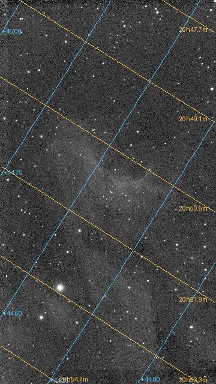

# Tutorial 8: Plate solve

**Goal:** find out exactly where in the sky the picture points, and write that into the file as a
world coordinate system (WCS), so that every pixel has a right ascension and a declination. You
finish with `solved.fits`, a copy of the image with the WCS in its header, and you will know what
the numbers mean and what to do when a solve fails. Colour calibration, the next tutorial, needs it.

**Data:** `flat.fits`, the gradient-free IC 5070 stack from [tutorial 5](background.md), and the Gaia
star catalogue `gaia-dr3-g11-v2.vcat`. The catalogue is the `gaia-dr3-g11.vcat` that ships with
every Valerian package (the same file: 9,978,676 bytes, Gaia DR3 stars brighter than magnitude 11,
1,247,240 of them, with their BP-RP colours); see [Install](install.md#step-4-check-it-runs) for where
Valerian looks for it. Here it was given with `VALERIAN_CATALOGUE` because Valerian was built from
source:

```sh
export VALERIAN_CATALOGUE=/path/to/gaia-dr3-g11-v2.vcat
```

**What happens.** Valerian detects the stars in the image, takes the catalogue stars of the patch of
sky the header names, matches the two sets by the triangles they form (the way registration
does) and fits a TAN projection, with optional SIP distortion terms, to every star that agrees. The
method is in [How plate solving works](../user-guide/plate-solving.md).

## Step 1: Solve

```sh
valerian solve flat.fits -o solved.fits
```

```text
looking within 1.00 deg of RA 313.0583 Dec +44.5044, scale 2.03 to 2.75 arcsec/pixel
solved: centre RA 20h51m16.9s Dec +44d25m25.2s (312.82029, +44.42366 deg)
scale 2.374 arcsec/pixel, field 0.71 x 1.27 deg, rotation 122.34 deg east of north, mirrored
41 of 400 detected stars matched, rms 0.23 arcsec (0.10 px), plain TAN
wrote solved.fits
```

It takes 0.29 s. The first line is what Valerian started from, taken from the header:

* **`RA 313.0583 Dec +44.5044`.** The `RA` and `DEC` keywords of the file (here the position the Seestar was
  told to aim at). They only need to be near: Valerian looks `--radius` degrees around them, 1 by default.
* **`scale 2.03 to 2.75 arcsec/pixel`.** The scale from `FOCALLEN` (250 mm) and `XPIXSZ` (2.9 micron
  pixels), 2.39 arcseconds per pixel, searched within 15 per cent either way.

Then the answer:

* **`centre RA 20h51m16.9s Dec +44d25m25.2s`.** The centre of the image, 0.2 degrees from where the
  telescope was told to point.
* **`scale 2.374 arcsec/pixel, field 0.71 x 1.27 deg`.** The fitted pixel scale and the size of the
  field.
* **`rotation 122.34 deg east of north, mirrored`.** The angle of the image's up direction from north, and a
  note that the pixel grid has the opposite handedness to a sky chart (the determinant of the CD matrix is
  positive). The WCS describes it exactly, so you do not have to do anything about it.
* **`41 of 400 detected stars matched, rms 0.23 arcsec (0.10 px), plain TAN`.** 400 stars were detected
  and 41 of them agree with catalogue stars, and they land within 0.23 arcsec of
  where the fit puts them, a tenth of a pixel. `plain TAN` says no distortion terms were needed
  (`--sip-order auto`).

`solved.fits` is a copy of the image with the WCS added to the header; the input is never changed.
The WCS cards are `CTYPE1 RA---TAN`, `CTYPE2 DEC--TAN`, `CRVAL1 312.82029`, `CRVAL2 44.42366`,
`CRPIX1 540.5`, `CRPIX2 960.5` and the `CD` matrix (`CD1_1 -0.000353`, `CD1_2 0.000557`, ...), with
`RADESYS ICRS` and `EQUINOX 2000`, and a `HISTORY` card with the summary above. Any program that reads
FITS WCS will use them.

## Step 2: See what the solution means

The picture shows the solved image (linear, with a screen stretch) with lines of constant declination (blue,
every 0.25 degrees) and of constant right ascension (orange, every 0.25 degrees of arc, about 1.4 minutes
of time) drawn from the WCS. The labels are the values. The lines are straight and parallel, as they should be for a
field this small, and they run at 122 degrees to the pixel columns, the rotation the solve reported.



Check the result against something you know: a named star, or the position the target is listed at in an
atlas.

## Step 3: When the header has no position, or is wrong

By default the position and scale come from the header. You can give or override either:

```sh
valerian solve flat.fits --ra 20:51:00 --dec +44:30:00 -o solved.fits
valerian solve flat.fits --blind --scale-range 2 3 -o solved.fits
```

The first gives a position (degrees, or hours as `hh:mm:ss` for the right ascension and `dd:mm:ss` for the
declination); the log then says `looking within 1.00 deg of RA 312.7500 Dec +44.5000` and the answer
is identical. The second searches the **whole sky**: with `--blind` Valerian ignores the position in
the header, and it needs a scale (here `--scale-range`, or `--scale`) to bound the search. It took
3.1 s on this field with `--scale-range 2 3` (8.2 s with `--blind` alone, which searches the scale
the header gives), against 0.29 s with the header's position, and gave exactly the same centre.
Use it when the header has no position, or an untrustworthy one.

## Options used

All options are in the [command line reference](../reference/cli.md#valerian-solve).

| Option | What it does | Range or values | Default |
|---|---|---|---|
| `<INPUT>` | the FITS image (mono or colour planes, not a raw mosaic) | a file | required |
| `-o`, `--output <FILE>` | write a copy of the image with the WCS | a file | the solution is only printed |
| `--catalogue <FILE>` | the star catalogue | a `.vcat` file | `gaia-dr3-g11.vcat` beside the program, or `VALERIAN_CATALOGUE` |
| `--ra <RA>`, `--dec <DEC>` | field centre | degrees, or `hh:mm:ss` and `dd:mm:ss` | from the header (`RA`, `DEC`, `OBJCTRA`, `OBJCTDEC`, or an existing WCS) |
| `--radius <DEGREES>` | how far the true centre may be from the position | degrees | 1 |
| `--scale <ARCSEC>` | pixel scale, searched within 15 per cent either way | arcseconds per pixel | from `FOCALLEN` and `XPIXSZ` |
| `--scale-range <LOW> <HIGH>` | range of the pixel scale | arcseconds per pixel | |
| `--blind` | search the whole sky even if the header names a position | on or off | off |
| `--sip-order <ORDER>` | SIP distortion order, `0` for none, or `auto` | 0, 2, 3, ... or `auto` | `auto` (used when it clearly helps) |
| `--min-matches <N>` | the fewest stars that must agree | count | 10 |
| `--threshold <SIGMA>` | detection threshold in sigmas of the smoothed noise | sigmas | 6 |

What the options changed on this image:

* `--sip-order 2` and `3` fitted distortion terms (`SIP order 2`, `SIP order 3`) and lowered the rms from
  0.23 to 0.21 and 0.19 arcsec (0.09 and 0.08 pixel); the centre moved by 0.2 arcsecond at most.
  `auto` judged the gain not worth it and kept `plain TAN`. Distortion matters for a wide field or a
  fast lens; for this 250 mm field it is below the noise.
* `--threshold 10` detected 355 stars instead of 400, and matched the same 41: the match is set by the
  catalogue stars bright enough to be in the image, not by the faint ones.
* `--radius 3` and `--radius 0.1` (with a good position) gave the same answer; a smaller radius is faster
  and a larger one forgives a bad position.
* `--min-matches 30` still solved (41 stars agree); `--min-matches 60` failed (below).

## How to tell it worked

* The log says `solved:` and writes the file; without a solve nothing is written.
* The matched stars are at least a few tens (here 41) and the rms is a fraction of a pixel (0.10).
* The centre is where the target is, near the position the header gave.
* The scale is close to the scale you expected (2.374 against 2.39 from the optics).
* The picture with the grid shows lines that run through the sky as they should, and a catalogue star
  you know is where it should be.

## Troubleshooting

**`valerian: registration failed: no match in 9 patches of sky: the field is not where the hint says, the scale
is outside 2.03 to 2.75 arc seconds per pixel, or there are too few catalogue stars in the field (this
catalogue goes to G = 11)`.** The solve failed. This message is what `--ra 10 --dec -30` (a wrong position)
gave: the log says how many patches of sky were tried. Check, in this order: the position (or use `--blind`);
the scale (`--scale 5` gave `no match in 1 patch of sky` with a scale range of 4.25 to 5.75; the true
scale is 2.37); the catalogue depth. A field narrower than about half a degree has too few stars brighter
than G = 11: build a deeper catalogue with `scripts/build_catalogue.py --mag 13` and give it with
`--catalogue`, as [How plate solving works](../user-guide/plate-solving.md#the-catalogue) describes.

**`valerian: registration failed: only 2 stars were detected; at least 10 are needed`.** The image has too few
stars to solve: here it was a dark frame. Check you gave the right file (not a master dark or a mask) and that it is
a light or a stack of lights. Lower `--threshold` to find fainter stars, or give a longer exposure.

**`valerian: registration failed: no match ...` after `--min-matches 60`.** The solve found 41 agreeing stars and
refused them as too few: `--min-matches` is a lower bound. Lower it, or leave the default of 10. 

**`valerian: no star catalogue found; looked for gaia-dr3-g11.vcat in: ...`** or
**`valerian: cannot read /nonexistent.vcat: No such file or directory`.** The catalogue is missing or the path is
wrong: see [Install](install.md#troubleshooting).

**The solution is right but my program shows the picture flipped.** The WCS is `mirrored`
(a positive CD determinant): programs that follow the FITS convention display it correctly; a program that
ignores the WCS shows the pixels as stored. It is the image that is stored that way, not the solution that is wrong.

**The solve works on the stack but not on a single frame.** One 10-second frame has few stars; the stack has
many more. Solve the stack, or lower `--threshold` for the frame.

**A raw frame is refused.** `solve` needs mono or colour planes, not a raw mosaic: stack first.

## The desktop app

In the desktop app this is the **Plate solve** tool of step 4, Process, which circles the matched stars: see the [reference](../reference/gui.md#plate-solve).

## Where next

`solved.fits` has a world coordinate system, which [tutorial 9](photometric-colour.md) uses to find the stars whose colour
Gaia knows.
