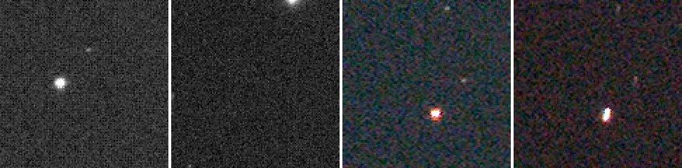

# Tutorial 3: Register

**Goal:** line the sixty frames up on one another, so the same star sits on the same pixel in
every one of them. You finish with sixty registered frames and a table that tells you which
frames are good.

**Data:** the IC 5070 capture from the Seestar S50: sixty 10-second lights, raw Bayer mosaics
(1080 by 1920 pixels, GRBG), in a folder called `lights/`. A Seestar writes no darks or flats,
so there is nothing to calibrate and the raw lights go straight in; `register` demosaics the
raw frames itself. (If you followed [tutorial 2](calibrate.md) with your own data, give
`register` the `calibrated/` folder instead.)

**Why register on its own?** The next step, [`stack`](stack.md), registers by itself, so you
do not need to run `register` first. Run it when you want to look at the alignment, want to
check the frames before spending time on the stack, or want registered frames for another
program. Registering also shows you which frames Valerian thinks are poor.

For the method (star detection, triangle matching, the transform models) see
[How registration works](../user-guide/registration.md).

## Step 1: Register

```sh
valerian register lights/ -o registered
```

```text
read 60 frames in 342.5ms
compute: CPU (the GPU is slower for this command; --backend gpu forces it)
frame 0: 199 stars, FWHM 2.65 px, ellipticity 0.300, sky 662.0, noise 54.61
frame 1: 194 stars, FWHM 2.67 px, ellipticity 0.313, sky 663.5, noise 54.78
...
frame 59: 117 stars, FWHM 3.84 px, ellipticity 0.514, sky 640.0, noise 52.05
reference candidate frame 47: 59 of 59 other frames register
reference: frame 47 (FWHM 2.16 px)
frame 0: registered, 172 stars matched, rms 0.351 px, shift (19.20, 22.52), rotation -0.1567 deg, flux x1.0000
frame 1: registered, 166 stars matched, rms 0.323 px, shift (16.65, 23.80), rotation -0.1513 deg, flux x1.0000
...
   #  frame                         stars   FWHM  ellip      sky    noise   flux x rms px weight  reject  status
   0  Light_IC 5070_10.0s_LP_20260    199   2.65  0.300    662.0    54.61   1.0000  0.351   0.00   0.00%  stacked
   1  Light_IC 5070_10.0s_LP_20260    194   2.67  0.313    663.5    54.78   1.0000  0.323   0.00   0.00%  stacked
...
  23  Light_IC 5070_10.0s_LP_20260     77   3.23  0.420    739.8    61.48   1.0000  0.482   0.00   0.00%  stacked
...
  47  Light_IC 5070_10.0s_LP_20260    208   2.16  0.206    606.1    48.15   1.0000  0.000   0.00   0.00%  reference
...
  59  Light_IC 5070_10.0s_LP_20260    117   3.84  0.514    640.0    52.05   1.0000  0.484   0.00   0.00%  stacked
registered 60 of 60 frames to frame 47; wrote them to registered
```

It took 19 s on the server (the work is on the processor: see [tutorial 11](gpu.md)). The
output has four parts.

**1. Star detection, one line per frame.** `199 stars, FWHM 2.65 px, ellipticity 0.300`: how
many stars Valerian found (up to 1000), the median width of the stars (the full width at half
maximum) and how elongated they are (0 round, 1 a line). `sky` and `noise` are the background
level and its scatter in ADU. These numbers are what picks the reference and, later, the
weights.

**2. The reference.** `reference candidate frame 47: 59 of 59 other frames register` says
the sharpest frame, number 47, is registrable to all 59 others, so it is the reference (FWHM
2.16 pixels, against 2.65 for frame 0). The other frames are moved onto frame 47's pixel grid.
Counting is from 0, in sorted file name order. To choose your own, `--reference 0`.

**3. The fit, one line per frame.** `172 stars matched, rms 0.351 px, shift (19.20, 22.52),
rotation -0.1567 deg`: the transform found for frame 0 uses 172 matched stars, which land
within 0.351 pixel (rms) of their places in frame 47; to line it up, frame 0 moves by 19.20 and
22.52 pixels and rotates by -0.16 degrees. Over all 59 frames the rms is between 0.300 and
0.585 pixel and between 20 and 182 stars match. Seestar frames drift and are dithered: the
shifts here go up to about 70 pixels, which is why aligning is needed at all. `flux x1.0000` is 1
because `register` does not match the levels of the frames; `stack` measures and applies it
([tutorial 4](stack.md)).

**4. The table.** One row per frame with the detection figures, the fit residual (`rms px`),
and a `status`: `reference`, `stacked` (it registered and would be used) or `skipped` with a
reason. `weight` and `reject` are filled in by `stack`; here they are 0.

The sixty files are in `registered/`, each with `_reg` added to its name: for example
`registered/Light_IC 5070_10.0s_LP_20260728-222713_reg.fits`. They are 32-bit float,
**three planes** (red, green and blue), because `--debayer auto` demosaiced the raw mosaics
with the Malvar-He-Cutler method before registering, and the header says
`HISTORY demosaiced by Valerian`. Sixty frames of 1080 by 1920 by 3 floats are 1.4 GB: check
the disk space.

## Step 2: Check the alignment

The proof of registration is a star that stays put. Left to right: the same 120 by 120
pixel patch around a bright star, shown at twice its size, from raw frame 0 and raw frame 59,
and from registered frame 0 and registered frame 59. The raw frames are mosaics, so they are
shown in grey with the checkerboard of the colour filters; the registered ones are the
demosaiced colour. A screen stretch with the same black and white point is used on all four.



In the raw frames the bright star is at different places. After registration it is at the same
place in both (the centre of the patch) and the sky around it fills in. Frame 59 is a worse
frame: its star is stretched (ellipticity 0.514 in the table), which registration does not
fix. That is information for the next step, which gives such a frame a low weight.

Registered frames are on the reference grid, so pixels the frame did not cover are **NaN**
(not a number), not zero. Registered frame 0, moved by 19 by 23 pixels, has 3.1 per cent of its
pixels as NaN; the reference has none. `stack` reads NaN as "no data".

## Options used

All options are in the [command line reference](../reference/cli.md#valerian-register).

| Option | What it does | Range or values | Default |
|---|---|---|---|
| `<FRAMES>...` | frames to register: files or folders | one or more | required |
| `-o`, `--output <DIR>` | folder for the registered frames | a folder | required |
| `--reference <N>` | the reference frame, counted from 0 in sorted order | 0 to frames minus 1 | the sharpest |
| `--model` | the transform to fit | `similarity` (4 parameters: rotation, scale, shift), `affine` (6), `homography` (8) | `similarity` |
| `--interpolation` | how pixels are resampled | `bilinear`, `bicubic`, `lanczos3` | `bicubic` |
| `--debayer` | demosaic raw Bayer frames | `auto` (Malvar-He-Cutler for Bayer data), `none`, `mhc`, `bilinear` | `auto` |
| `--threshold <SIGMA>` | star detection threshold in sigmas of the smoothed noise | sigmas | 5 |
| `--backend` | the engine for the resampling | `auto` (the CPU, for this command), `cpu`, `gpu` | `auto` |

What the options change, measured on eight of the frames (the 8 first files, which Valerian
registers to their sharpest, frame 4):

* `--threshold`: 3 finds the maximum of 1000 stars in frame 0 and matches 178 of them
  (rms 0.372 px); the default 5 finds 199 and matches 150 (rms 0.326 px); 10 finds 112 and
  matches 87 (rms 0.210 px). A lower threshold finds fainter stars, including noise, so
  the fit uses more but worse stars. The shifts agree to 0.05 pixel in all three, so
  the default is robust; change it only for frames with very few or very many stars.
* `--model`: on this data `similarity`, `affine` and `homography` give the same shifts to
  0.1 pixel and the same rms to 0.01 pixel. Keep `similarity`: the extra freedom only helps
  with field rotation, or with wide fields and many stars.
* `--interpolation`: the registration is the same for all three; the whole command on the eight frames
  took 1.4 s with `bilinear`, 1.6 s with `bicubic` and 2.0 s with `lanczos3`. `lanczos3` is the
  sharpest and can ring around bright stars; `bilinear` is smooth and slightly blurs.
* `--reference 0` makes frame 0 the reference. The shifts then reverse sign relative to
  frame 4, as expected.

## How to tell it worked

* The last line says `registered 60 of 60 frames to frame 47`. A smaller first number means
  some frames were skipped: look for `skipped` in the `status` column.
* `rms px` is below about 0.6 for every frame (here 0.300 to 0.585). A frame whose rms is
  1 pixel or more has a poor fit even though it registered.
* The stars in the picture above stay put.
* `registered/` has one file per registered frame.

## Troubleshooting

**`registered 10 of 25 frames to frame 13`, with `skipped: registration failed: best
hypothesis matches only 3 stars (need 6)`.** The frames do not share a field. This is the
25-light ASI1600MM set from [tutorial 2](calibrate.md): it is five panels of five (the
header `RA` and `DEC` differ by up to about two degrees between panels), and the panels overlap too little for
their stars to match. The output says so:

```text
reference candidate frame 13: 9 of 24 other frames register
...
no frame registers with most of the others (several fields?); using frame 13, which 9 register to
reference: frame 13 (FWHM 6.66 px)
...
  10  2023-01-25_21-57-02_Ha_-10.0   1000   7.66  0.265     67.2    57.29   1.0000  0.385   0.00   0.00%  stacked
...
registered 10 of 25 frames to frame 13; wrote them to registered
```

Register one panel at a time (put each panel in its own folder), or register everything and
treat `skipped` as the list of frames from other panels. Mosaics are not stitched yet.

**`valerian: registration failed: frame 25 has 3 planes, the first has 1`.** You mixed
mono and colour frames in one command (here the 25 mono ASI1600 frames and the 60 colour
Seestar frames). Run each camera separately.

**`valerian: registration failed: fewer than two frames registered; nothing to stack`.** There
is only one frame, or none of the others matched it. A single frame gives `reference candidate
frame 0: 0 of 0 other frames register`. Give it at least two frames of the same field, taken
with the same camera and focal length.

**Frames are skipped with `only N stars` or `registration failed`.** Cloud, bad focus,
tracking trouble or a short exposure leave too few stars. The limit is `--min-stars` (default
20) for `stack`; `register` reports any frame whose stars it cannot match. Lowering
`--threshold` finds fainter stars and can rescue a thin frame, at the cost of a noisier fit.

**The output folder is full.** `registered/` is about 1.4 GB for sixty Seestar frames and
65 MB per ASI1600 frame. Point `-o` at a disk with room, or skip `register` and run
`stack` straight from the calibrated frames, which needs no registered copies.

## The desktop app

In the desktop app this is step 2, **Register**; see [the desktop tutorial](../user-guide/gui-tutorial.md#2-register) and the [reference](../reference/gui.md#register).

## Where next

[Tutorial 4](stack.md) combines the frames. It registers them again from the originals (it does
not read `registered/`), so you can delete `registered/` now.
