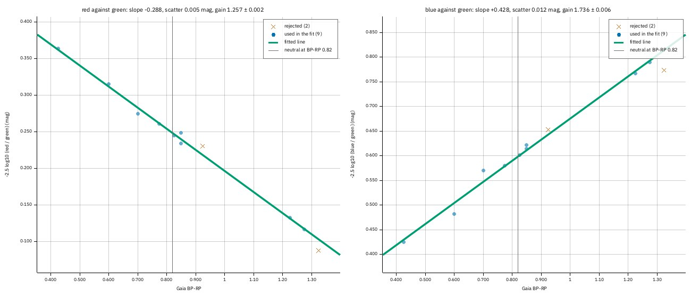
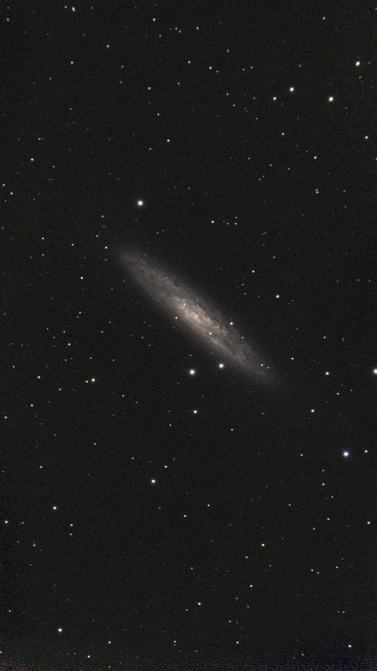
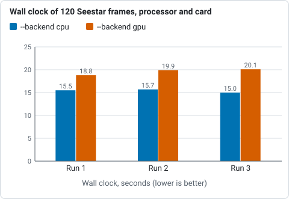
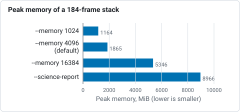

# Tutorial 19: A faint field, and the GPU

**Goal:** run the chain of [tutorial 18](seestar-session.md) on a field that gives it less to hold on to, a
galaxy with few bright stars. You meet the one message that stops that chain, `photocal` on a sparse
field, and fix it. Then you find out what the graphics card and the memory setting do to the stack, with
measured times and memory, so you can choose for your own computer.

**Data:** 411 sub-frames of NGC 253, the Sculptor Galaxy, from a Seestar S50 (10 s, IR-cut filter, gain 80,
1080 by 1920 pixels, taken on 2025-09-23), in `lights/`. Only about 150 stars a frame are bright enough to
use, against 1,000 in the M 34 frames of tutorial 18. For the GPU runs, the 184 frames of M 34 and a set of
120 of them (frames 10 to 129, which leaves out the six dusk frames) in `lights120/`.

## Step 1: Stack, flatten and solve

```sh
valerian stack lights/ -o stack.fits --report frames.txt --coverage coverage.fits
valerian background stack.fits -o background.fits
valerian solve background.fits -o solved.fits
```

```text
compute: GPU: NVIDIA A100 80GB PCIe (Vulkan, DiscreteGpu)
frame 0: 122 stars, FWHM 4.09 px, ellipticity 0.509, sky 682.5, noise 50.75
...
reference candidate frame 90: 410 of 410 other frames register
reference: frame 90 (FWHM 2.15 px)
combining 411 frames with LinearFit { low: 5.0, high: 2.5 }, weights NoiseFwhm on GPU: NVIDIA A100 80GB PCIe (Vulkan, DiscreteGpu), streamed in bands, budget 4.0 GiB (9.5 GiB staged)
GPU: 1230 calls ran on the device, 6 fell back to the CPU (411 frames is more than the 128 the kernel holds)
...
411 of 411 frames stacked with LinearFit { low: 5.0, high: 2.5 }, reference frame 90 (Light_NGC 253_10.0s_IRCUT_20250923-021302.fit), 92.1s
wrote stack.fits
wrote coverage.fits
wrote frames.txt
plane 0: 1199 samples of 1247 tiles (33 px), 13.0% masked, residual rms 0.26, gradient removed 6.4
plane 1: 1302 samples of 1345 tiles (33 px), 13.3% masked, residual rms 0.28, gradient removed 7.5
plane 2: 1393 samples of 1419 tiles (33 px), 11.9% masked, residual rms 0.28, gradient removed 4.3
wrote background.fits
looking within 1.00 deg of RA 12.2208 Dec -25.1489, scale 2.03 to 2.75 arcsec/pixel
solved: centre RA 00h47m37.3s Dec -25d19m34.8s (11.90548, -25.32633 deg)
scale 2.375 arcsec/pixel, field 0.71 x 1.27 deg, rotation -177.79 deg east of north, mirrored
12 of 400 detected stars matched, rms 0.56 arcsec (0.24 px), plain TAN
wrote solved.fits
```

All 411 frames registered and were stacked in 92 s with a peak of 2.6 GB of memory (on a shared 24-core machine at a load of 31).
Compare the plate solve with M 34's: **12 stars matched instead of 72**, and an rms of 0.56 arc seconds
instead of 0.11. The solution is still good, a quarter of a pixel, but the field has few catalogue stars
that are bright enough to see here. That is the thing to watch in the next step.

## Step 2: The colour calibration that stops

```sh
valerian photocal solved.fits -o pcc.fits --stars-out pcc_stars.csv --report photocal-report
```

```text
valerian: colour calibration needs at least 15 usable stars and found 11 of 11 measured: the field is sparse for the catalogue, or the stars are too faint for --min-snr 15. Lower --min-stars or --min-snr, or build a deeper catalogue
```

The command exits with status 1 and writes nothing. Read the message in this order:

* **`found 11 of 11 measured`.** Valerian measured 11 stars in the picture that Gaia has colours for, and
  all 11 had a clean enough signal.
* **`needs at least 15 usable stars`.** The defaults, `--min-stars 15` and `--min-snr 15`, ask for 15 stars of
  signal-to-noise 15 or better, so that the fit of colour against star colour has something to stand on.
* **`colour calibration needs`.** It is the colour fit that has too few stars, not the stack or the plate
  solve, which both worked. (Older builds worded this as `registration failed`, which was misleading.)

A galaxy field with few bright stars is the usual cause. Two options lower the bars; give each a value that
leaves a fit you can still believe (a line through 9 stars is fine when they scatter by 0.005 magnitudes):

```sh
valerian photocal solved.fits -o pcc.fits --min-stars 8 --min-snr 8 --stars-out pcc_stars.csv --report photocal-report
```

```text
11 Gaia stars measured, 9 used; aperture radius 5.5 px; neutral at BP-RP 0.82
  red against green: slope -0.288 mag per BP-RP, scatter 0.005 mag, gain 1.2569 +/- 0.0018
 blue against green: slope +0.428 mag per BP-RP, scatter 0.012 mag, gain 1.7357 +/- 0.0062
sky before 630.66 696.55 626.89, after 859.10 859.10 859.10 (offsets -66.44 -162.55 228.99)
wrote photocal-report/pcc.png
wrote photocal-report/pcc.csv
wrote photocal-report/pcc.json
wrote photocal-report/report.html
wrote the star table pcc_stars.csv
wrote pcc.fits
```

Nine of the eleven stars went into the fit, and the two lines it drew, red against green and blue against
green, pass through them within 0.005 and 0.012 magnitudes. That is as tight as the 22 stars of tutorial 18
(0.012 and 0.016), so the fit can be trusted even with fewer stars. `photocal-report/pcc.png`:



*Each point is a star: Gaia colour (BP-RP) along, the star's red-to-green and blue-to-green brightness up.
The lines are the fits; a cross is a star left out. The vertical line is where a neutral star falls.*

How far to lower the numbers is your call: the scatter figures and `pcc.png` say whether the line still
passes through the stars. Without any colour calibration, `valerian stretch --unlinked` gives a neutral sky
quickly ([tutorial 6](stretch.md#step-3-linked-or-unlinked)), though it also removes real colour.

```sh
valerian stretch pcc.fits -o stretched.fits --preview stretched.png --preview-size 1200
```



## Step 3: What the graphics card does

```sh
valerian info --gpu
```

```text
gpu: NVIDIA A100 80GB PCIe (Vulkan, DiscreteGpu)
```

(The last line of the output, after the version lines of tutorial 18.) This is the card that `stack` uses by
default (`--backend auto`). To find out whether it helps *your* stack, run it both ways on the same frames.
Here are 120 frames of M 34, three runs each, with the machine's load average at the time:

```sh
valerian stack lights120/ -o stack_cpu.fits --backend cpu
valerian stack lights120/ -o stack_gpu.fits --backend gpu
```

```text
compute: CPU
120 of 120 frames stacked with LinearFit { low: 5.0, high: 2.5 }, reference frame 19 (Light_M 34_10.0s_IRCUT_20250925-020913.fit), 15.5s
```

```text
compute: GPU: NVIDIA A100 80GB PCIe (Vulkan, DiscreteGpu)
combining 120 frames with LinearFit { low: 5.0, high: 2.5 }, weights NoiseFwhm on GPU: NVIDIA A100 80GB PCIe (Vulkan, DiscreteGpu), staged in memory (2.8 GiB staged)
GPU: 360 calls ran on the device
120 of 120 frames stacked with LinearFit { low: 5.0, high: 2.5 }, reference frame 19 (Light_M 34_10.0s_IRCUT_20250925-020913.fit), 18.8s
```

| Run | `--backend cpu` | `--backend gpu` | Load average (cpu, gpu) |
|---|---|---|---|
| 1 | 15.5 s | 18.8 s | 17.4, 17.8 |
| 2 | 15.7 s | 19.9 s | 17.5, 15.0 |
| 3 | 15.0 s | 20.1 s | 19.5, 16.9 |



*The same 120 frames of M 34 stacked three times on the processor and on the card, from the table above.*

On this computer, with these small frames, **the card is about 25 per cent slower than the processor**
(15.4 s on average against 19.6 s): the frames have to be uploaded to the card and the result brought back,
and a Seestar frame is only two million pixels, too few to repay it. The two results agree
closely: 99.9 per cent of the 6.2 million samples differ by less than 0.03 ADU, 4,826 (0.08 per cent) by
more than 0.1 and 35 by more than 10, all in star cores, where a pixel that sits on the rejection limit is
kept by one engine and thrown out by the other (see [The GPU kernels](../user-guide/gpu.md)). That is a measurement of one machine, a
shared 24-core server with an A100. A computer with a slower processor, or frames from a larger sensor,
may well come out the other way: that is what [tutorial 11](gpu.md) shows on the frames of a different
session. Run the two commands above on your own frames and keep the faster; `--backend auto` (the default)
uses the card whenever there is one, and falls back to the processor when there is none.

**More than 128 frames.** The card combines at most 128 frames at once. With 184 frames of M 34 the
output says so, and the stack still completes on the processor for the extra frames:

```sh
valerian stack lights/ -o stack_auto.fits --backend auto
```

```text
combining 184 frames with LinearFit { low: 5.0, high: 2.5 }, weights NoiseFwhm on GPU: NVIDIA A100 80GB PCIe (Vulkan, DiscreteGpu), streamed in bands, budget 4.0 GiB (4.3 GiB staged)
GPU: 549 calls ran on the device, 3 fell back to the CPU (184 frames is more than the 128 the kernel holds)
184 of 184 frames stacked with LinearFit { low: 5.0, high: 2.5 }, reference frame 29 (Light_M 34_10.0s_IRCUT_20250925-020913.fit), 41.5s
```

That is not an error. The three runs on 184 frames took 44.4 s on the processor and 43.0 s and 41.5 s with
the card (load 24 to 30), no measurable difference.

## Step 4: How much memory

A stack no longer needs all its frames in memory at once. The frames are resampled into a staging file on disk and
combined a band of rows at a time, and `--memory` (default 4096 MiB) sets how much memory to use. Here
are the 184 frames of M 34 on the processor:

```sh
valerian stack lights/ -o mem.fits --backend cpu --memory 1024
```

```text
combining 184 frames with LinearFit { low: 5.0, high: 2.5 }, weights NoiseFwhm on CPU, streamed in bands, budget 1.0 GiB (4.3 GiB staged)
184 of 184 frames stacked with LinearFit { low: 5.0, high: 2.5 }, reference frame 29 (Light_M 34_10.0s_IRCUT_20250925-020913.fit), 37.8s
```

| Setting | Combined | Peak memory | Wall clock |
|---|---|---|---|
| `--memory 1024` | in bands, 1.0 GiB budget | 1,164 MiB | 37.9 s |
| `--memory 4096` (default) | in bands, 4.0 GiB budget | 1,865 MiB | 33.7 s |
| `--memory 16384` | in memory, 4.3 GiB staged | 5,346 MiB | 29.6 s |
| `--science-report sci/` | every frame held, processor only | 8,966 MiB | 62.3 s |



*Peak memory of the same 184-frame stack with each setting, from the table above.*

Memory follows the setting and not the number of frames. 1 GiB costs 12 per cent more time than the
default and uses 62 per cent of its memory; 16 GiB saves 12 per cent of the time and uses nearly three
times as much. Put `--scratch-dir` on a fast disk with room for the staging file (4.3 GiB
here, frames x width x height x planes x 4 bytes) when the system's temporary folder is small. A stack
with `--science-report` holds every frame for the plots, so it takes the most memory and says so:

```text
compute: CPU (the rejection maps and the noise curve need the CPU combiner)
```

If the stack runs out of memory, run it without `--science-report` and make the plots in a separate
`valerian subframes` run ([tutorial 12](subframe-analysis.md)).

## Options used

All are in the [command line reference](../reference/cli.md).

| Option | What it does | Default |
|---|---|---|
| `photocal --min-stars <N>` | the fewest stars the colour fit may rest on | 15 |
| `photocal --min-snr <SNR>` | the least signal-to-noise of a star in each colour | 15 |
| `stack --backend` | `auto`, `cpu` or `gpu` for the resampling and the combine | `auto` |
| `stack --memory <MIB>` | memory for the stack; the peak follows it, not the number of frames | 4096 |
| `stack --scratch-dir <DIR>` | where the staging file goes | the system temporary folder |

## How to tell it worked

* `photocal` prints `N Gaia stars measured, M used` and a gain for red and blue, and the two scatters are
  well under 0.05 magnitudes.
* The three planes have the same sky level after it (`after 859.10 859.10 859.10`).
* A GPU stack says `GPU: N calls ran on the device`. If it also says some fell back to the CPU, it
  is the 128-frame limit: it is a note, not a failure.

## Troubleshooting

* **`colour calibration needs at least 15 usable stars and found 11 of 11 measured`.** A sparse field:
  `--min-stars 8 --min-snr 8`, as in Step 2.
* **`--backend gpu` is slower than `--backend cpu`.** Normal for frames this small. Use `cpu`, or leave `auto`.
* **`no suitable GPU adapter found`.** There is no graphics driver: see
  [GPU in the troubleshooting page](../reference/troubleshooting.md#gpu). Everything still runs on the
  processor.
* **The stack takes too much memory.** Lower `--memory` or leave `--science-report` out.

## Where next

[Tutorial 17](mosaic.md) stacks a session whose frames are several panes of a mosaic, the other
way a Seestar folder can stop the chain.
