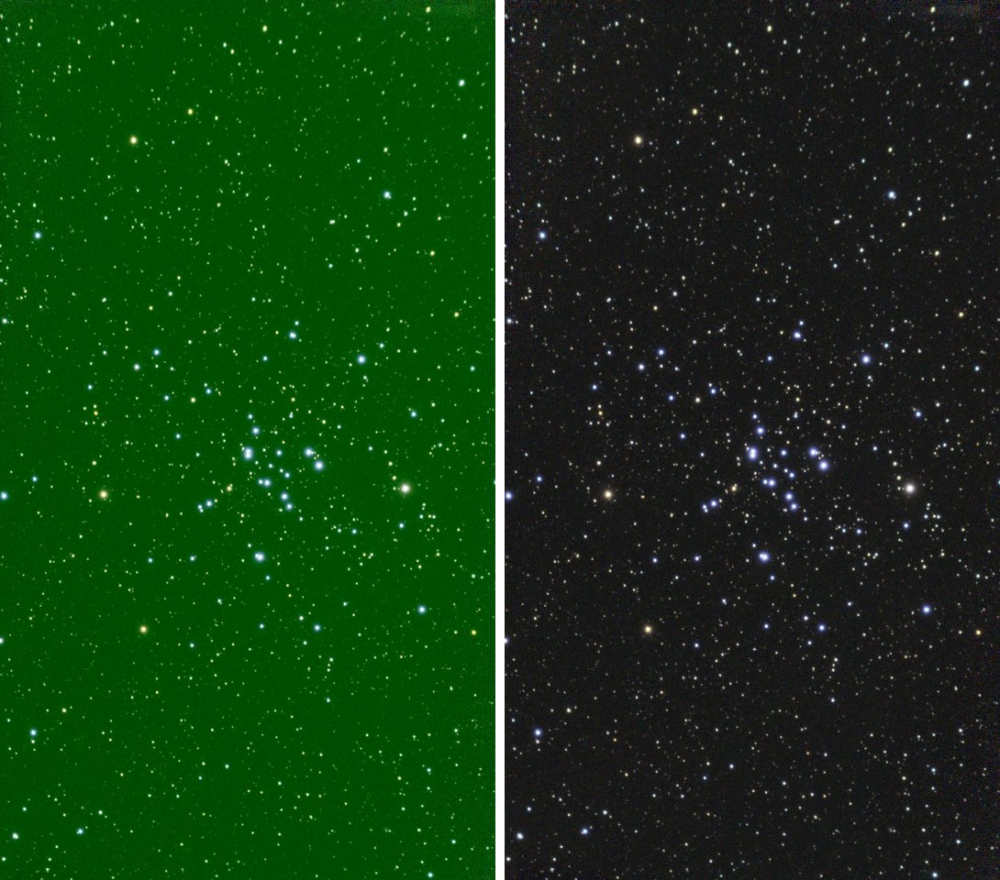
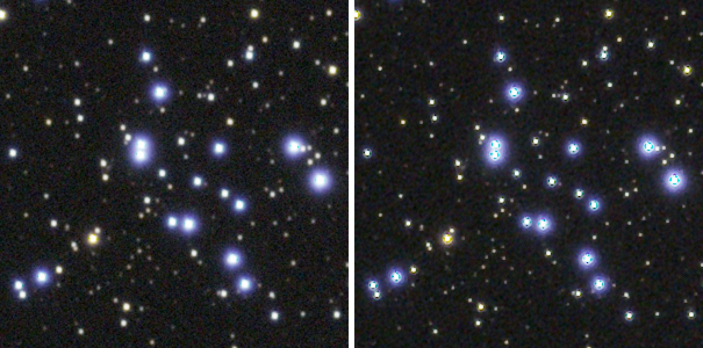
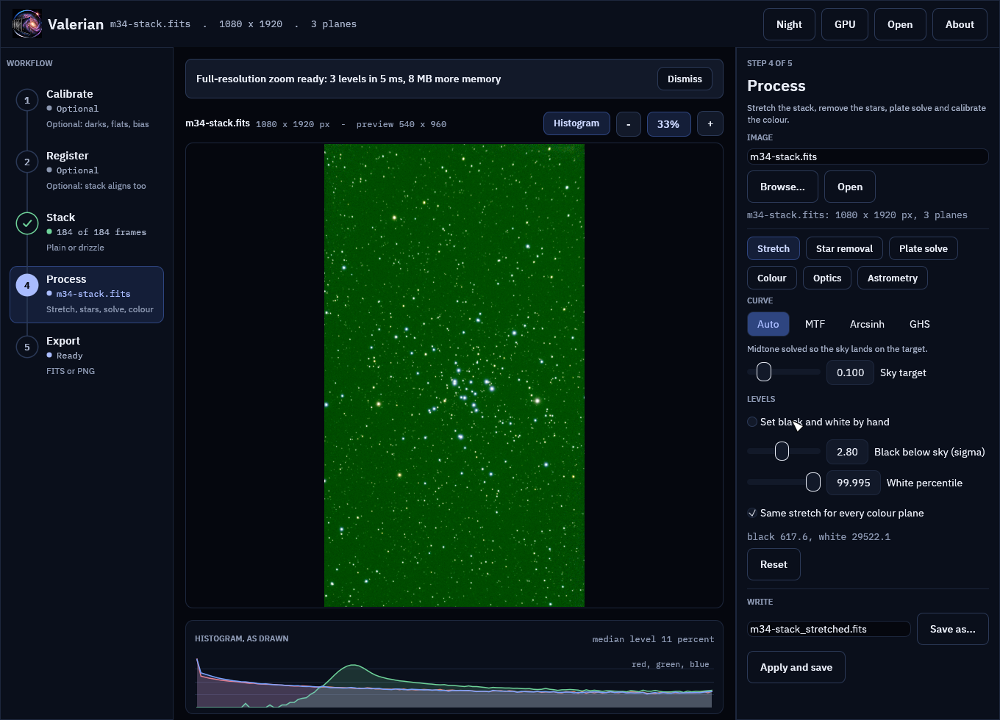
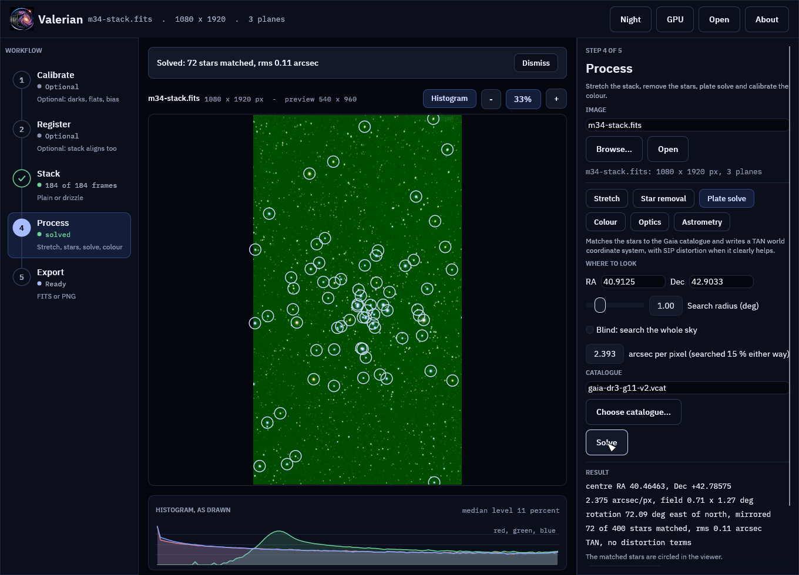
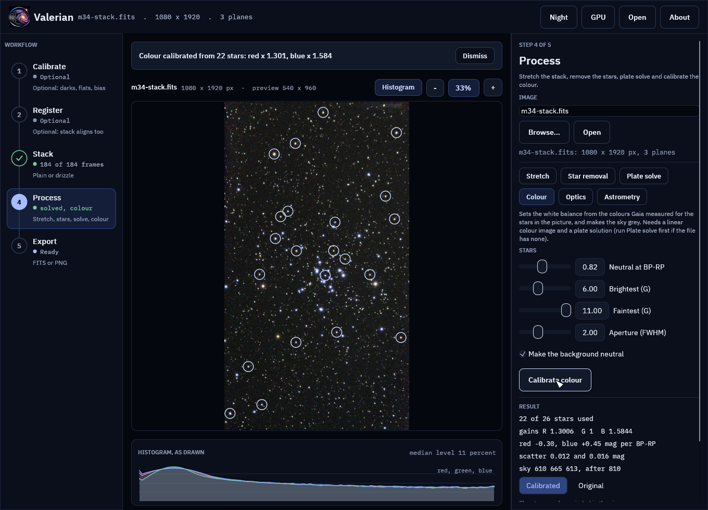
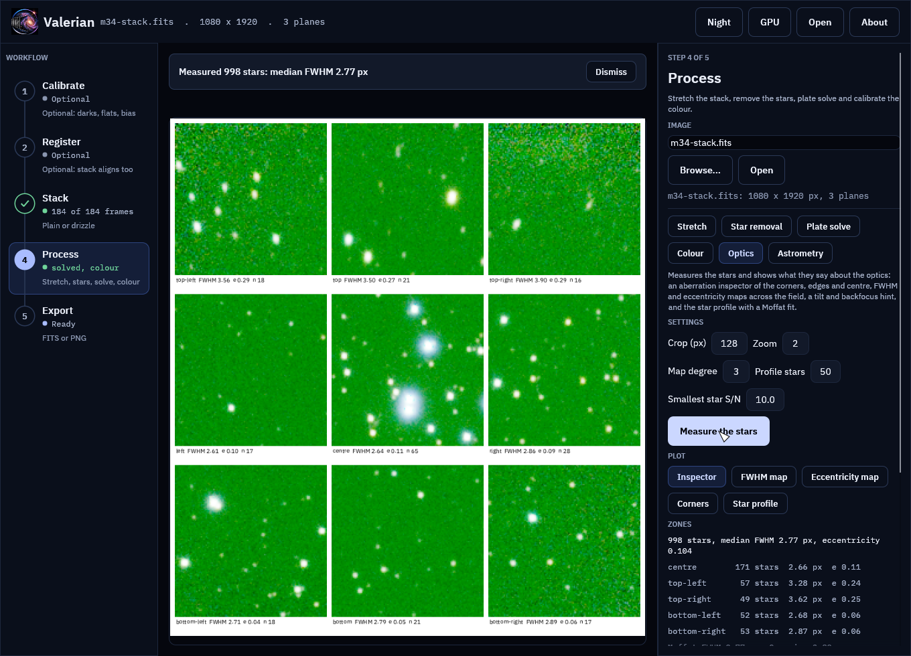

# Tutorial 18: A Seestar S50 session, from install to a finished picture

**Goal:** take 184 raw sub-frames from a Seestar S50 to a stacked, flattened, plate-solved,
colour-calibrated, stretched and sharpened picture of the open cluster M 34, with every command
run once and every number below pasted from that run. It is the whole chain of tutorials 3 to 9 and
16 on one fresh capture, so you can see what a normal session looks like before you meet a
difficult one in [tutorial 19](seestar-faint-field-gpu.md).

**Data:** 184 sub-frames of M 34 (10 s, IR-cut filter, gain 80) from one night, 1080 by 1920
pixels, raw Bayer data in GRBG order, 2.375 arc seconds per pixel. They sit in a folder called
`lights/`, exactly as the Seestar wrote them: each `.fit` file has a `.jpg` and a `_thn.jpg` beside
it, and Valerian ignores the pictures. A Seestar writes no darks, flats or bias frames, so there is
nothing to calibrate and the chain starts at the stack.

## Step 1: Check the install

```sh
valerian info
```

```text
valerian 0.4.0
commit: 69f25de3
built: 2026-10-25 20:06 UTC
profile: release
target: x86_64-unknown-linux-gnu
rust: rustc 1.99.1 (58cf8f9c3 2026-10-13)
wgpu: 30.0.1
catalogue: ~/valerian/gaia-dr3-g11.vcat (1247240 stars)
```

The `catalogue:` line must name a file: plate solving and colour calibration need it. If it says
`not found`, see [tutorial 1](install.md) and the
[troubleshooting page](../reference/troubleshooting.md#install-and-start-up).

## Step 2: Look at one frame

```sh
valerian info "lights/Light_M 34_10.0s_IRCUT_20250925-020117.fit" --stats
```

```text
lights/Light_M 34_10.0s_IRCUT_20250925-020117.fit
  size: 1080 x 1920 pixels, 1 plane (raw Bayer mosaic)
  OBJECT    M 34
  IMAGETYP  Light
  FILTER    IRCUT
  EXPTIME   10
  EXPOSURE  10
  CCD-TEMP  27.0625
  GAIN      80
  XBINNING  1
  BAYERPAT  GRBG
  DATE-OBS  2025-09-24T23:01:02.269863
  INSTRUME  Seestar S50
  TELESCOP  S50_xxxxxxxx
  FOCALLEN  250
  plane 0: min 497.0, sky 4904.0, noise 1576.01, max 65535.0 ADU
  stars: 121 (median FWHM 3.60 px, ellipticity 0.556)
```

* **`1 plane (raw Bayer mosaic)` and `BAYERPAT GRBG`.** The frame is the sensor's raw mosaic: one number
  per pixel, with the colour filters in a green-red / blue-green pattern. `stack` demosaics it for you
  (the choices are in [tutorial 3](register.md#options-used)); you do not convert anything first.
* **`sky 4904`.** This is the very first frame of the night and the sky is still twilight-bright. The
  stack of Step 3 shows the same thing: a sky level of 4,550 for the first frames and 630 later on, and
  a tiny weight for the bright ones.
* **`TELESCOP`.** The frame carries a code that is different for every telescope; it is shown here as
  `xxxxxxxx`. Valerian removes it, and the observing site, from every file it writes (see
  [Privacy](../user-guide/privacy.md)).

## Step 3: The first stack

```sh
valerian stack lights/ -o stack.fits --report frames.txt --coverage coverage.fits
```

```text
compute: GPU: NVIDIA A100 80GB PCIe (Vulkan, DiscreteGpu)
frame 0: 336 stars, FWHM 3.76 px, ellipticity 0.526, sky 4549.8, noise 212.91
frame 1: 353 stars, FWHM 3.05 px, ellipticity 0.398, sky 4548.7, noise 213.79
...
frame 29: 1000 stars, FWHM 2.20 px, ellipticity 0.176, sky 632.6, noise 45.61
...
reference: frame 29 (FWHM 2.20 px)
combining 184 frames with LinearFit { low: 5.0, high: 2.5 }, weights NoiseFwhm on GPU: NVIDIA A100 80GB PCIe (Vulkan, DiscreteGpu), streamed in bands, budget 4.0 GiB (4.3 GiB staged)
GPU: 549 calls ran on the device, 3 fell back to the CPU (184 frames is more than the 128 the kernel holds)
   #  frame                         stars   FWHM  ellip      sky    noise   flux x rms px weight  reject  status
   0  .._IRCUT_20250925-020117.fit    336   3.76  0.526   4549.8   212.91   0.8975  0.369   0.04  80.50%  stacked
   5  .._IRCUT_20250925-020222.fit    565   2.58  0.278   1705.0   117.06   0.9741  0.311   0.22  54.41%  stacked
   6  .._IRCUT_20250925-020233.fit   1000   2.31  0.190    643.8    46.86   1.0074  0.285   1.61   5.38%  stacked
  29  .._IRCUT_20250925-020913.fit   1000   2.20  0.176    632.6    45.61   1.0000  0.000   1.90   6.74%  reference
  30  .._IRCUT_20250925-020925.fit   1000   2.84  0.294    632.9    45.68   0.9726  0.341   1.20   4.18%  stacked
...
 183  .._IRCUT_20250925-025950.fit   1000   2.44  0.194    629.6    45.36   1.0104  0.290   1.53   5.00%  stacked
184 of 184 frames stacked with LinearFit { low: 5.0, high: 2.5 }, reference frame 29 (Light_M 34_10.0s_IRCUT_20250925-020913.fit), 35.1s
wrote stack.fits
wrote coverage.fits
wrote frames.txt
```

The table in `frames.txt` has all 184 rows; the lines above are the ones worth reading. This run took
33 s of wall clock and 2.1 GB of memory at its peak, on a shared 24-core machine with a load of 18 to 19;
your time depends on your computer ([tutorial 19](seestar-faint-field-gpu.md) times the stack on the
processor, on the graphics card and with different memory limits).

* **Frames 0 to 5 are dusk frames.** Their sky is 4,550 and 1,705 ADU where the rest is 630 to 645, so the
  stacker gave them weights of 0.04 to 0.22 (the typical frame is about 1) and the rejection threw out
  54 to 82 per cent of their pixels. Nothing was left out by hand: a bright sky is noise, and the weights
  already say so. The frame limits (`--min-snr-weight` and the others, in
  [tutorial 12](subframe-analysis.md)) leave such frames out altogether.
* **The reference is frame 29.** It is the sharpest frame that the others register against (FWHM 2.20
  pixels, and 1,000 stars, the most the detector keeps).
* **`3 fell back to the CPU (184 frames is more than the 128 the kernel holds)`.** The graphics card
  combines at most 128 frames at once. With more, it does what it can and the processor does the rest;
  the result is the same.

```sh
valerian info stack.fits --stats
```

```text
stack.fits
  size: 1080 x 1920 pixels, 3 planes
  OBJECT    M 34
  IMAGETYP  Master Light
  FILTER    IRCUT
  EXPTIME   10
  EXPOSURE  10
  CCD-TEMP  28.5
  GAIN      80
  XBINNING  1
  DATE-OBS  2025-09-24T23:08:58.552260
  INSTRUME  Seestar S50
  TELESCOP  S50
  FOCALLEN  250
  NCOMBINE  184
  EXPTOTAL  1840
  plane 0: min 450.6, sky 610.4, noise 5.08, max 70969.2 ADU
  plane 1: min 602.5, sky 665.4, noise 4.87, max 74961.2 ADU
  plane 2: min 89.4, sky 612.8, noise 4.99, max 72013.4 ADU
  stars: 1000 (median FWHM 2.77 px, ellipticity 0.104)
```

Three planes (red, green, blue), 184 frames and 1,840 s of light. The noise is 4.9 to 5.1 ADU in each
plane where the reference frame has 45.6: about nine times less (the square root of 184 would give 13.6;
the weights, the dusk frames and the resampling account for the difference). The stack is linear. Shown
with a plain automatic stretch it is green, because the sensor has twice as many green pixels and the
three planes have different sky levels.

## Step 4: Take out the sky gradient

```sh
valerian background stack.fits -o background.fits --save-model model.fits
```

```text
plane 0: 1135 samples of 1193 tiles (33 px), 24.5% masked, residual rms 0.35, gradient removed 3.9
plane 1: 1034 samples of 1093 tiles (33 px), 26.2% masked, residual rms 0.32, gradient removed 4.1
plane 2: 1045 samples of 1071 tiles (33 px), 22.6% masked, residual rms 0.33, gradient removed 2.4
wrote background.fits
wrote the background model model.fits
```

The model fits the clear sky between the stars (about a quarter of the tiles were masked as star or
cluster) and takes it away: 3.9, 4.1 and 2.4 ADU of gradient across the picture, in a fit whose
residual is 0.3 ADU. It ran in half a second. The models and the pictures are in
[tutorial 5](background.md).

## Step 5: Plate solve

```sh
valerian solve background.fits -o solved.fits
```

```text
looking within 1.00 deg of RA 40.9125 Dec +42.9033, scale 2.03 to 2.75 arcsec/pixel
solved: centre RA 02h41m51.5s Dec +42d47m08.7s (40.46463, +42.78575 deg)
scale 2.375 arcsec/pixel, field 0.71 x 1.27 deg, rotation 72.09 deg east of north, mirrored
72 of 400 detected stars matched, rms 0.11 arcsec (0.05 px), plain TAN
wrote solved.fits
```

The hint (where the telescope said it was pointing, and its pixel scale) came from the header, so no
blind search was needed. 72 of the 400 brightest stars matched Gaia stars, to 0.11 arc seconds rms,
a twentieth of a pixel. The solution is written into `solved.fits` as a world coordinate system. See
[tutorial 8](plate-solve.md).

## Step 6: Colour calibration

```sh
valerian photocal solved.fits -o pcc.fits --stars-out pcc_stars.csv --report photocal-report
```

```text
26 Gaia stars measured, 22 used; aperture radius 5.6 px; neutral at BP-RP 0.82
  red against green: slope -0.303 mag per BP-RP, scatter 0.012 mag, gain 1.3006 +/- 0.0031
 blue against green: slope +0.451 mag per BP-RP, scatter 0.016 mag, gain 1.5844 +/- 0.0051
sky before 610.40 665.35 612.84, after 810.08 810.08 810.08 (offsets -16.17 -144.72 160.89)
wrote photocal-report/pcc.png
wrote photocal-report/pcc.csv
wrote photocal-report/pcc.json
wrote photocal-report/report.html
wrote the star table pcc_stars.csv
wrote pcc.fits
```

Valerian measured 26 stars that Gaia has colours for, used the 22 that were clean, and fitted how much
brighter red and blue should be against green for a star of each colour. The gains, 1.30 for red and
1.58 for blue, are what turn the green stack into a colour-true one, and the sky of all three planes now
sits at the same 810 ADU. The scatter, 0.012 and 0.016 magnitudes, is how far the 22 stars lie from the
fitted line. How the fit works, and what its plots show, is [tutorial 9](photometric-colour.md). A field
with far fewer stars needs two settings changed: that is the first thing in
[tutorial 19](seestar-faint-field-gpu.md).

## Step 7: Stretch

```sh
valerian stretch pcc.fits -o stretched.fits --preview stretched.png --preview-size 1200
```

```text
black 794.7897, white 37255.4414, Mtf { midtone: 0.003803931359042682 }
plane 0: median 810.3948 -> 0.1008
plane 1: median 810.3635 -> 0.1006
plane 2: median 810.4302 -> 0.1010
wrote stretched.fits
wrote preview stretched.png
```

The automatic stretch put the sky at a tenth of full brightness in all three planes. On the left, the
stack of Step 3 given the same kind of automatic stretch but none of Steps 4 to 6; on the right,
`stretched.png`:



*Left: `stack.fits` stretched with `valerian stretch`. Right: `stretched.png`. The same 184 frames.*

The stars are now the colours of their spectral types: the blue of the hot cluster members and the
orange of the field giants. See [tutorial 6](stretch.md) for the curves.

## Step 8: Sharpen the stars

`deconvolve` runs on a linear image, so it takes `pcc.fits`, before the stretch:

```sh
valerian deconvolve pcc.fits -o sharp.fits --report psf-tiles.csv
```

```text
1000 stars detected, 859 fit to measure a PSF (median FWHM 2.75 px)
deconvolving to round stars of FWHM 2.03 px
12 tile(s) of about 360 x 480 px; PSF FWHM 2.57 to 3.08 px, ellipticity 0.050 to 0.188
deconvolved 3 plane(s), 20 iterations, 12 tile(s), 14.0s
stars deconvolved to round, FWHM 2.03 px
wrote sharp.fits
wrote psf-tiles.csv
```

859 of the 1,000 stars were clean enough to measure a point spread function (PSF) in each of twelve
tiles. The PSF is narrower in the middle (2.57 pixels) than in the corners (3.08) and more elongated
towards the edge (ellipticity up to 0.19). Measure the stars before and after with the same tool:

```sh
valerian optics pcc.fits --report optics-before
valerian optics sharp.fits --report optics-after
```

```text
998 usable stars: median FWHM 2.75 px, eccentricity 0.106
999 usable stars: median FWHM 2.09 px, eccentricity 0.063
```

(The first line of each; the zone tables and maps are in `optics-before/` and `optics-after/`.) The
median star went from 2.75 to 2.09 pixels, 6.5 to 5.0 arc seconds, and from 0.106 to 0.063 in
eccentricity. The Seestar's own stack of the same 184 frames, measured the same way, is 5.4 arc seconds
and 0.042: the stars come out a little narrower than the Seestar's and not as round. The same stretch
of the centre of the cluster, magnified twofold, before (left) and after (right):



Look at the brightest stars on the right: they have a dark, cyan-tinged core. That is what
deconvolving bright, nearly saturated stars does, and the default 20 iterations show it most. With
`--iterations 8` the median star is 2.20 pixels and 0.075 (instead of 2.09 and 0.063), the run takes
6.4 s instead of 14.0 s, and the cores are slightly shallower. Choose by eye on your own picture; if
the bright stars matter more than the faint ones, take the shorter run. [Tutorial 16](deconvolution.md)
has the settings.

## The desktop app

The desktop app does Steps 3, 5, 6 and 7 and the measurement of Step 8 (the Optics tool of the Process
step) on the same frames. There is no panel for `background` or `deconvolve` yet, so those two stay on the
command line. The pictures are of the app working on the same 184 frames: it ran the stack itself.



*Step 3, Stack, finished: "184 of 184 frames" in the step list, and the stack open in the Process step with its automatic stretch.*



*Plate solve: the same 72 stars, 0.11 arc seconds, and the same centre and rotation as `valerian solve` printed.*



*Colour: 22 of 26 stars, gains 1.3006 and 1.5844 as on the command line. The circled stars are the ones the fit used.*



*Optics: 998 stars, median FWHM 2.77 pixels and eccentricity 0.104, the same as `valerian info` and `optics` report for the stack. This is the measurement of Step 8; sharpening itself is command line only.*

The reference for each panel is [the app reference](../reference/gui.md). The pictures were made by the
app's own test harness driving the real program on these frames (`real_data_shots_seestar_m34`).

## What you have

| File | What it is |
|---|---|
| `stack.fits`, `coverage.fits`, `frames.txt` | the linear stack, the frames per pixel, the per-frame table |
| `background.fits`, `model.fits` | the stack with the gradient out, and the gradient |
| `solved.fits` | the same with its sky coordinates |
| `pcc.fits`, `pcc_stars.csv`, `photocal-report/` | the colour-calibrated linear picture and the star fit |
| `stretched.fits`, `stretched.png` | the picture to look at |
| `sharp.fits`, `psf-tiles.csv` | the deconvolved linear picture and the PSF of each tile |

## Troubleshooting

Every message you can meet in this chain, with its cause, is on the
[troubleshooting page](../reference/troubleshooting.md), by stage. The ones a Seestar user meets
most are the colour calibration of a sparse field ([tutorial 19](seestar-faint-field-gpu.md)), a
mosaic folder ([tutorial 17](mosaic.md)), and `plate solving needs a demosaiced image, this one is a raw
colour mosaic`, which `solve` and `photocal` print when given a raw sub-frame: stack first.

## Where next

[Tutorial 19](seestar-faint-field-gpu.md) runs the chain on a faint galaxy, fixes the colour calibration
of a sparse field, and times the stack on the graphics card, on the processor and with different memory
limits.
