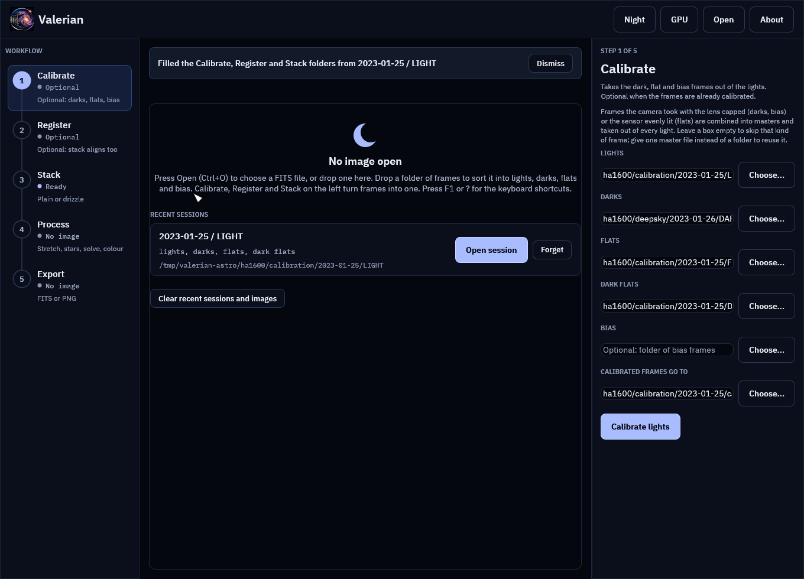
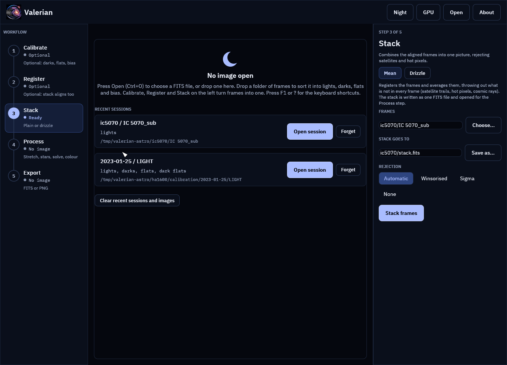
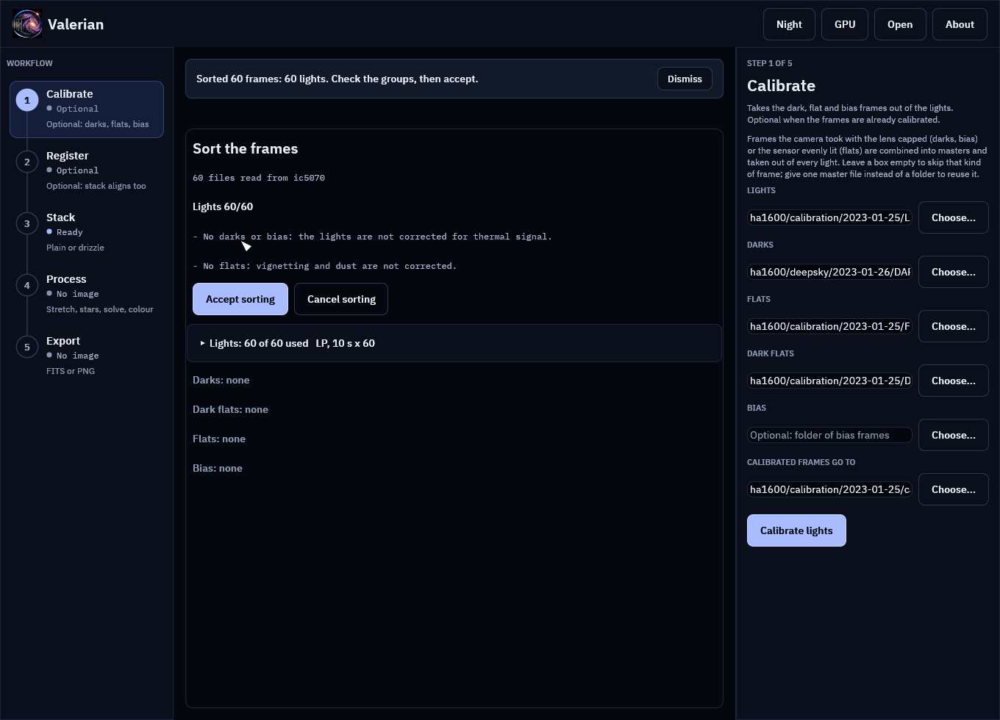

# Desktop tutorial: sort a folder of frames, and pick a session up again

**Goal:** go from one folder of mixed frames to filled-in Calibrate, Register and Stack boxes
without typing a path, and come back to the same session another night in one click.

**Data:** two real captures, the same ones as [the tutorials](index.md#the-two-captures).
The ASI1600MM H-alpha session of the California Nebula has its frames in separate folders
(`LIGHT`, `DARK`, `FLAT` and `DARKFLAT`, 95 files in all), and the Seestar S50 session of
IC 5070 has 60 lights and nothing else. Any folder of FITS frames from your own camera works the
same way.

**What it replaces.** Without this you would press **Choose...** beside each of the Lights, Darks,
Flats, Dark flats and Bias boxes in turn. Dropping the folder reads the headers once and does it
for you, and shows you what it decided before it changes anything.

## Step 1: Drop the folder on the window

Drag the folder that holds the session (here `ha1600`, which has the calibration and deep-sky
folders in it) from your file manager onto the Valerian window. Anywhere in the window will do:
while you drag, the picture area says **Drop a folder of frames to sort it, or a FITS file to
open it**. You can also press **Ctrl+Shift+O** and choose the folder in the file dialog.

The notice above the picture says **Reading the headers to sort the frames...** with a count and a
bar while it works. Only the header of each file is read, not the pixels, so it is quick on a local
disk and slower on a network share; **Esc** cancels the scan.

Dropping a **single FITS file** does what it always did and opens it as an image. Dropping
**several files**, or any folder, sorts them.

## Step 2: Read the review

The notice now says **Sorted 95 frames: 25 lights, 10 darks, 30 dark flats, 30 flats. Check the
groups, then accept.** and the middle of the window shows the review. Nothing in the Calibrate
panel has changed yet.

* The line under the title counts each group: `Lights 25/25  Darks 10/10  Dark flats 30/30
  Flats 30/30` is frames used out of frames found.
* Each group has a header with the filter and exposure it holds. Lights: `Ha, 300 s x 25`.
  Darks: `Ha, 300 s x 10`. Flats and dark flats: `Ha, 2.04 s x 30`. This is the check that
  matters most: **the darks must match the lights' exposure, and the dark flats must match the
  flats'**.
* Open a group to see its files. Each row says where its type came from: **from the header**
  here, because this camera software writes `IMAGETYP` as `LIGHT`, `DARK`, `FLAT` and
  `DARKFLAT`.
* Lines starting with a dash above the buttons are notes: what is missing (no bias is fine when
  you have dark flats) and anything odd.

How a frame is classified is in the [reference](../reference/gui.md#sorting-dropped-frames):
the `IMAGETYP` header first (`Light Frame`, `Dark Frame`, `Flat Field`, `Bias Frame`, `Master
Dark` and the like all work), then the file name, then the name of the folder it is in.

## Step 3: Correct it if it needs correcting

Everything in the review can be changed.

* **Leave a frame out**: untick it. A group header's **Leave all out** and **Use all** do a
  whole group.
* **Move a frame**: use the group list at the end of its row (Lights, Darks, Dark flats, Flats,
  Bias or Leave unsorted). **Move all to** moves a whole group, for a camera whose software
  writes `Dark` for its dark flats or `Light` for everything.
* **Unsorted** frames (no `IMAGETYP`, and no hint in the file or folder name) are left out until
  you assign them. A folder of lights from a camera that writes nothing lands here: open the
  group and press **Move all to** Lights.

Valerian also makes some choices for you, and explains each in the last column of the row:

* A dark whose exposure is the flats' exposure, and not the lights', is a **dark flat** even when
  it says `Dark`.
* Darks of an exposure that no light has are left out, because a dark of another exposure does
  not match.
* If the lights use two filters, the filter with most frames is kept and the other is left out
  (a run calibrates and stacks one filter). Flats of a filter no kept light uses are left out.
* If a kind has single frames and a master, the master is left out; with only masters, the first
  is used.

Frames with no `FILTER` or `EXPTIME` key are never left out for lack of it.

## Step 4: Accept

Press **Accept sorting** (or **Enter**). The Calibrate boxes are filled, Calibrate opens, and the
Register and Stack boxes are filled behind it, ready for when you get there.

Here every group is a whole folder (`LIGHT` has 25 files and all 25 are lights), so the boxes
point straight at the folders in place: `ha1600/calibration/2023-01-25/LIGHT` for the lights,
`.../DARK` for the darks and so on, and the output is `calibrated` beside the lights.

When a group is **only part of a folder**, or comes from several, Valerian gathers it first.
Suppose you had left out three bad lights: the lights are then gathered into
`valerian-sorted/lights/` beside the dropped folder, as links (hard links, or copies on another
disk), and the Lights box points there. Your files are not moved or changed. Gathering again
replaces the links. The notice says **Selections were gathered as links in valerian-sorted**
when this happened.

Press **Calibrate lights**, or **Ctrl+Enter**. With this data set it writes 25 calibrated frames
and the three masters, as in [tutorial 2](calibrate.md).

## Step 5: Come back to it

The session is remembered as soon as you accept the sorting, and again whenever you start
Calibrate, Register or Stack. With no image open the start screen lists the last eight:

Each shows its lights folder and the kinds of frame it has. **Open session** fills the
Calibrate, Register and Stack boxes again and opens Calibrate (or Stack for a session without
calibration frames, like the Seestar one above). **Forget** removes one from the list, and
**Clear recent sessions and images** empties the lists; neither touches a file on disk.

## Step 6: What a missing folder looks like

Drives get unplugged and folders get renamed. A session whose folders have gone says so in the
error colour (**Not found: darks, flats**). **Open session** still works if the lights are there:
it fills in what exists, leaves the rest out and says which in the notice (**Filled the
Calibrate, Register and Stack folders from ... (not found, left out: flats)**). If the lights
folder itself is gone the button is greyed out and you can only **Forget** the session. A recent
image that has gone is marked **Not found** in the same way.

## The Seestar folder

Drop the Seestar `IC 5070_sub` folder. Its 60 files have `IMAGETYP` `Light` and an exposure of
10 s, so the review shows `Lights 60/60`, and the notes say **No darks or bias: the lights are not
corrected for thermal signal** and **No flats: vignetting and dust are not corrected**. That is
true, and expected: this camera writes no darks or flats (see [the two
captures](index.md#the-two-captures)), so just accept.

With lights only, Register and Stack read the folder directly, the Stack panel opens
(there is nothing to calibrate), and `stack.fits` beside the lights is its output.

## If it does not go as expected

**It says "No FITS files (.fit, .fits, .fts) were found there."** The folder holds other file
types. Valerian reads FITS only; convert RAW or XISF files first. Links to folders are not
followed, and hidden folders and folders deeper than 6 levels are skipped.

**Everything is "Unsorted".** The frames have no `IMAGETYP` and their names and folders say
nothing. Use **Move all to** on the Unsorted group.

**A dark flat group is empty and the darks are mixed.** The darks and dark flats are told apart by
exposure, so both need an `EXPTIME` (or `EXPOSURE`) card. Without one, move the short ones by
hand.

**Frames are left out and you want them.** Read the last column of the row for the reason, and
tick the frame. The sorting only suggests; what you accept is what is used.

**"Wait for the running step to finish, or cancel it (Esc), before dropping frames."** A step is
running; the review would otherwise start under it.

**"N FITS files could not be read".** Their headers are damaged or cut short; they are left out
and counted in the notes.

## The settings used

None: the sorting has no options. Every rule and limit (6 folders deep, 50 000 files, 1 percent
or 10 ms for "the same exposure") is in the
[reference](../reference/gui.md#sorting-dropped-frames), and the classifier is unit tested on
header values from several capture programs (`crates/valerian-gui/src/sorter.rs`).

## Where next

[Work from the keyboard](keyboard.md) runs the whole chain without the mouse.
