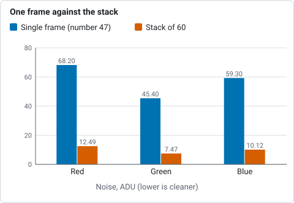
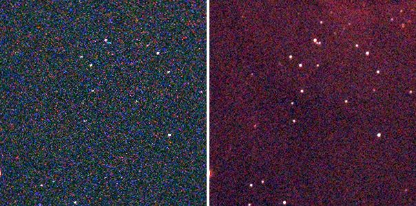
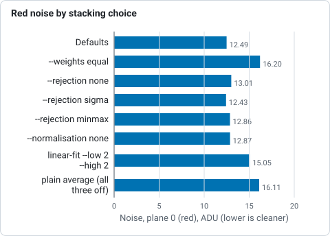

# Tutorial 4: Stack

**Goal:** combine sixty 10-second frames into one image with much lower noise, throwing away
cosmic rays and satellite trails and giving the frames that are sharp and quiet more say than
the poor ones. You finish with `stack.fits`, a report that explains how each frame was treated
and a map of how many frames contributed to each pixel.

**Data:** the same sixty IC 5070 Seestar lights as [tutorial 3](register.md), in `lights/`.
`stack` registers the frames itself, so it needs the original files and not the `registered/`
folder.

**What happens.** Valerian finds the stars, picks the sharpest frame as the reference,
registers all the others to it, matches their sky levels and their transparency, weights
each frame by how noisy and how sharp it is, and combines the frames pixel by pixel with
outlier rejection. For the method see [How stacking works](../user-guide/stacking.md).

## Step 1: Stack

```sh
valerian stack lights/ -o stack.fits --report report.txt --coverage coverage.fits
```

```text
read 60 frames in 196.9ms
compute: GPU: NVIDIA A100 80GB PCIe (Vulkan, DiscreteGpu)
frame 0: 199 stars, FWHM 2.65 px, ellipticity 0.300, sky 662.0, noise 54.61
...
reference candidate frame 47: 59 of 59 other frames register
reference: frame 47 (FWHM 2.16 px)
...
combining 60 frames with LinearFit { low: 5.0, high: 2.5 }, weights NoiseFwhm on GPU: NVIDIA A100 80GB PCIe (Vulkan, DiscreteGpu)
   #  frame                         stars   FWHM  ellip      sky    noise   flux x rms px weight  reject  status
   0  Light_IC 5070_10.0s_LP_20260    199   2.65  0.300    662.0    54.61   0.9541  0.351   1.18   0.83%  stacked
...
  13  Light_IC 5070_10.0s_LP_20260    213   2.17  0.183    639.5    52.08   0.9904  0.300   1.80   0.79%  stacked
...
  23  Light_IC 5070_10.0s_LP_20260     77   3.23  0.420    739.8    61.48   2.0532  0.482   0.14  16.85%  stacked
...
  28  Light_IC 5070_10.0s_LP_20260     53   2.72  0.244    743.7    61.40   4.0757  0.411   0.05  41.87%  stacked
...
  47  Light_IC 5070_10.0s_LP_20260    208   2.16  0.206    606.1    48.15   1.0000  0.000   2.07   0.92%  reference
...
  59  Light_IC 5070_10.0s_LP_20260    117   3.84  0.514    640.0    52.05   1.4967  0.484   0.25   6.43%  stacked
60 of 60 frames stacked with LinearFit { low: 5.0, high: 2.5 }, reference frame 47 (Light_IC 5070_10.0s_LP_20260728-224223.fit), 12.2s
wrote stack.fits
wrote coverage.fits
wrote report.txt
```

The stack took 12.2 s on the A100 (the same run on the processor alone took 25 to 28 s: see
[tutorial 11](gpu.md)). With no usable graphics card the second line reads `compute: CPU` and
the result is the same to within the GPU tolerance.

Reading it:

* **The first block** is registration, as in tutorial 3, and is the same.
* **`combining 60 frames with LinearFit {low: 5.0, high: 2.5}, weights NoiseFwhm`.** `--rejection
  auto` chose **linear-fit clipping** for a stack of more than 30 frames (Winsorised sigma
  clipping for fewer than 15, plain sigma clipping up to 30). Linear fit copes with frames whose
  level changes during the night, as these do (`sky` runs from 600 to 830). The limits are in
  sigmas: a pixel more than 5 sigma below, or 2.5 sigma above, the line fitted through its
  stack of values is thrown out. so a bright outlier is rejected more readily than a dim one.
* **`weights NoiseFwhm`.** The weight of a frame is one over (its noise squared times its star
  FWHM squared): the weighting that gives the best signal-to-noise for stars.
* **`flux x`.** The brightness scale matched to the reference, from the stars the two frames
  share. Frame 28 needed 4.08 times: it caught a quarter of the reference's light (cloud or dew are the
  usual causes). Frame 23 needed 2.05.
* **`weight`.** The result: frame 47, the reference, has 2.07; the typical good frame about 1;
  frame 23 with its cloud and 77 stars only 0.14; frame 28 with 53 stars 0.05; frame 59, with
  elongated stars (ellipticity 0.514), 0.25.
* **`reject`.** The share of that frame's pixels that the rejection threw out: 0.8 per cent
  for a normal frame, and **41.87 per cent for frame 28**. A high figure is the signature of a
  frame that was bad as a whole (cloud, wind, a bump); here it is also why its weight is
  so small. The reference and good frames lose under 1 per cent.
* **`status`.** `stacked` means used. A frame that could not be used says `skipped: ...` and is
  left out of the sum (see the troubleshooting below).

## Step 2: Look at what you have

```sh
valerian info stack.fits --stats
```

```text
stack.fits
  size: 1080 x 1920 pixels, 3 planes
  OBJECT    IC 5070
  IMAGETYP  Master Light
  FILTER    LP
  EXPTIME   10
  EXPOSURE  10
  CCD-TEMP  29.125
  GAIN      80
  XBINNING  1
  DATE-OBS  2026-07-28T21:41:58.801919
  INSTRUME  Seestar S50
  TELESCOP  S50_xxxxxxxx
  FOCALLEN  250
  NCOMBINE  60
  EXPTOTAL  600
  plane 0: min 521.4, sky 610.7, noise 12.49, max 74630.9 ADU
  plane 1: min -7.4, sky 597.3, noise 7.47, max 56987.8 ADU
  plane 2: min 139.8, sky 608.3, noise 10.12, max 70726.4 ADU
  stars: 518 (median FWHM 2.57 px, ellipticity 0.165)
```

* **Three planes**, red, green and blue, because the raw mosaics were demosaiced on the way in.
* `NCOMBINE 60` and `EXPTOTAL 600`: sixty frames of 10 s, 600 s of light in total. The header
  also carries `STACKREF 47` and `STACKALG` (the rejection and the weights), for the record.
* **Noise** per plane is 12.49, 7.47 and 10.12 ADU. A single registered frame (number 47, the
  sharpest) measured with the same tool has 68.20, 45.40 and 59.30. The stack has 5.5 times
  less noise in red, 6.1 times in green and 5.9 times in blue. Averaging 60 equal frames would
  give 7.7 times (the square root of 60); the weights, the poorer frames and the smoothing of
  resampling account for the difference, and the weighting is a good trade: see the table
  below.
* **Stars** found: 518 in the stack against 208 in the best single frame; the faint ones
  have come out of the noise. Median FWHM 2.57 pixels (the average of the sharp and the soft
  frames, weighted).
* **Sky** 610.7, 597.3, 608.3: the three planes are not balanced, and a sky gradient is
  still in the picture. That is the job of the next two tutorials.



*Noise per colour in the sharpest single frame and in the stack of sixty, from the list above: 5.5 to 6.1 times less, against 7.7 for the square root of 60.*

The linear stack looks almost black when displayed. This picture is a 300 by 300 pixel crop at
full size of registered frame 0 (left) and of the stack (right), each with a screen stretch
applied (black point at the sky minus 2.8 sigma, white point at the 99.9th percentile, midtone
solved to put the sky at 20 per cent). The stack is much cleaner, shows more stars and the
red nebulosity.



The coverage map says how many frames each pixel got: `valerian info coverage.fits --stats`
gives min 2, median (`sky`) 57 and max 60. The edges, where the dithered frames do not overlap,
have a few frames; the middle has them all, and the stack is therefore a little noisier at the
border. You can crop the border or ignore it.

## Step 3: Try the other settings

The stack above uses the defaults. Here is what each choice does to the noise on the same
sixty frames (plane 0, red; lower is cleaner; each is a full rerun of `stack`):

| Command differs by | Noise, plane 0 | Remark |
|---|---|---|
| nothing (defaults) | 12.49 | linear fit, noise-and-FWHM weights, sky and flux matched |
| `--weights equal` | 16.20 | every frame counts the same: the cloudy and soft frames drag it |
| `--rejection none` | 13.01 | nothing is rejected: satellite trails and cosmic rays stay in |
| `--rejection sigma` | 12.43 | plain sigma clipping, 3 and 3: as good here |
| `--rejection minmax` | 12.86 | drops the highest and lowest value of each pixel only |
| `--normalisation none` | 12.87 | levels not matched: the sky is 631 instead of 611 |
| `--rejection linear-fit --low 2 --high 2` | 15.05 | limits too tight: good data thrown away |
| `--weights equal --rejection none --normalisation none` | 16.11 | a plain average |



*Noise in plane 0 (red) for each stacking choice on the same sixty frames, from the table above.*

The defaults are within half a per cent of the best here. The numbers are specific to this data; the pattern
(weights matter most, rejection matters to the cosmic rays more than to the noise figure) is
general. Note that `--low` and `--high` apply to whichever scheme is in use: with the default
`auto` they change the limits of the scheme auto picks for the frame count (linear fit for these
60 frames). Older builds ignored them without `--rejection`; current builds honour them.
With `none` or `minmax` the command prints a note that they have no effect.

## Options used

All options are in the [command line reference](../reference/cli.md#valerian-stack). Those
shared with register (`--reference`, `--model`, `--interpolation`, `--debayer`, `--threshold`)
are in [tutorial 3](register.md#options-used).

| Option | What it does | Range or values | Default |
|---|---|---|---|
| `<FRAMES>...` | frames to stack: files or folders | one or more | required |
| `-o`, `--output <FILE>` | the stacked FITS file | a file | required |
| `--report <FILE>` | also write the per-frame table to a text file | a file | not written |
| `--coverage <FILE>` | also write the per-pixel count of frames used | a file | not written |
| `--rejection` | rejection scheme | `auto`, `none`, `minmax`, `sigma`, `winsorised`, `linear-fit` | `auto` |
| `--low`, `--high <SIGMA>` | rejection limits in sigmas, where the scheme has them (with `--rejection auto` they change the limits of the scheme auto picks) | sigmas | the scheme's own: 3 and 3 for sigma and Winsorised, 5 and 2.5 for linear fit |
| `--weights` | frame weights | `equal`, `noise`, `fwhm`, `noise-fwhm` | `noise-fwhm` |
| `--normalisation` | level matching | `none`, `additive`, `additive-scaling` | `additive-scaling` (sky level and the flux ratio of matched stars) |
| `--min-stars <N>` | leave out frames with fewer stars | count | 20 |
| `--max-fwhm-ratio <RATIO>` | leave out frames whose FWHM is more than this multiple of the reference's | ratio of 1 or more | no limit |
| `--max-fwhm <PIXELS>`, `--max-ellipticity <E>`, `--min-star-count <N>`, `--max-noise <ADU>`, `--min-snr-weight <W>`, `--max-residual <PIXELS>`, `--outlier-sigma <SIGMA>` | leave out the frames that fail the limit; they are registered and judged first, then the rest are stacked again | above 0 (ellipticity 0 to 1) | no limit |
| `--backend` | the engine for the resampling and combine | `auto` (a real graphics card if there is one), `cpu`, `gpu` | `auto` |

## How to tell it worked

* The last line says `60 of 60 frames stacked` (or says how many were left out, and the table
  says why).
* `NCOMBINE` and `EXPTOTAL` in the header say the number of frames and the total seconds.
* Noise is much lower than in one frame (here 5.5 to 6.1 times) and stars you could not see in a
  single frame are there.
* The weights are bigger for the sharp, quiet frames and small for the poor ones, and the
  `reject` column is small (under a few per cent) except for frames you know were bad.
* The coverage map's median is close to the number of frames.

## Troubleshooting

**`frame 23: skipped, only 77 stars`.** `--min-stars 150` was given: any frame with fewer
stars is left out. The default is 20, so by default these frames are in and given a small
weight. Frames with few stars are usually clouded; leaving them out costs little. With
`--max-fwhm-ratio 1.3`, frames 12, 19, 20 and 21 (FWHM 3.59 to 4.02 px against 2.16 for the
reference) were left out as `skipped, FWHM 3.59 px is too soft`.

**`59 of 60 frames stacked` with a different reference, and a frame `skipped: only 18 stars`.** With
`--threshold 12` (a high detection threshold) a frame with few bright stars drops below the
minimum and the sharpest remaining frame (13, not 47) becomes the reference. If the
reference changes unexpectedly, the detection settings changed: look at the `stars` column.

**`valerian: stacking failed: registration failed: fewer than two frames registered; nothing to
stack`.** There is one frame, or the others did not match it (a different field or camera).

**`valerian: stacking failed: reference frame 99 out of range (60 frames)`.** `--reference`
counts from 0 in sorted file name order, so the largest valid value is the number of frames minus
one.

**The stack is darker, or its edge is noisier or has a visible border.** The edges are covered
by fewer frames (`coverage.fits` min 2, here). Crop the border. If a whole frame was wrongly
bright, check its `flux x` and `reject` columns: a frame that needed `flux x` of 4 was
heavily dimmed.

**A satellite trail or hot pixels are still in the stack.** The rejection scheme was `none`
or the limits were too wide (`--high 5` and above). The defaults remove them. With few frames
(under about 10) rejection has little to work with: take more frames, and dither.

**`stack` is slow or runs out of memory.** The peak follows `--memory` (default 4096 MiB), not the
number of frames: the frames are resampled into a staging file and combined a band of rows at a
time. Lower `--memory`, put `--scratch-dir` on a disk with room, and leave out `--science-report`,
which holds every frame. [Tutorial 19](seestar-faint-field-gpu.md#step-4-how-much-memory) measures
184 Seestar frames at four settings.

## The desktop app

In the desktop app this is step 3, **Stack**, which opens the result in the Process step; see [the desktop tutorial](../user-guide/gui-tutorial.md#3-stack) and the [reference](../reference/gui.md#stack).

## Where next

`stack.fits` is linear and has a sky gradient. [Tutorial 5](background.md) takes it out, starting
from `stack.fits`.
