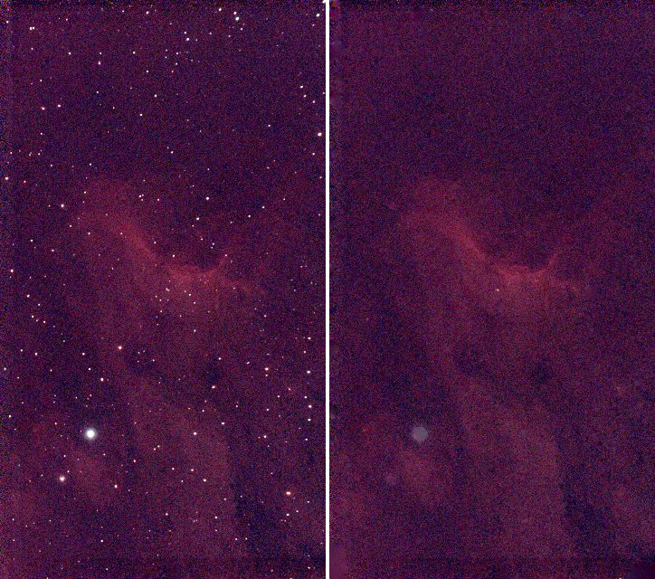
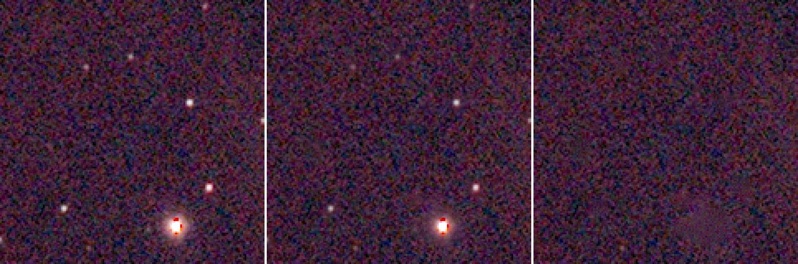
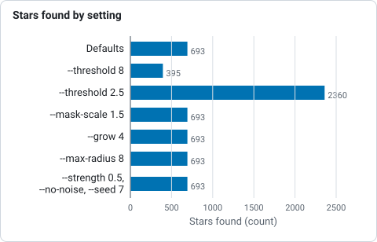
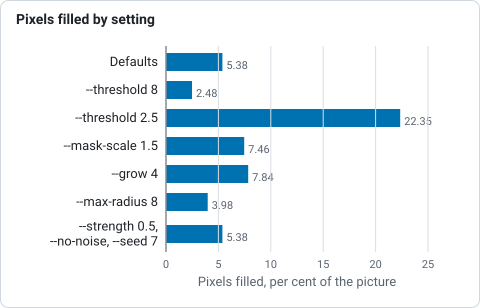

# Tutorial 7: Star removal

**Goal:** separate the stars from the nebula: a starless image to stretch hard and bring out the
nebula, and a stars-only image to put back later. You finish with `starless.fits`, `stars-only.fits`
and a star mask, and you will know how to take only part of each star away.

**Data:** `flat.fits`, the gradient-free linear stack from [tutorial 5](background.md), 1080 by 1920
pixels, three planes. Star removal works on a linear image or on a stretched one; the
linear one keeps the stars' true brightness in the stars-only file, which is what you want when
you add them back. The method is in [How star removal works](../user-guide/star-removal.md). It is a
classical method with no learned model: stars are found, a disc is drawn over each one and the discs are
filled by diffusion from their surroundings, with noise added so the patches do not show.

## Step 1: Remove the stars

```sh
valerian starless flat.fits -o starless.fits --stars-out stars-only.fits \
    --mask-out mask.fits --preview starless.png
```

```text
693 stars found, 5.38 % of the pixels filled
wrote starless.fits
wrote stars-only.fits
wrote mask.fits
wrote preview starless.png
```

The command took 0.4 s. `693 stars found, 5.38 % of the pixels filled`: 693 stars were detected on
the luminance and a mask disc was drawn over each, sized from its brightness and width; the discs
together cover 5.38 per cent of the picture, and those pixels were replaced. Four files are written:

* `starless.fits`: the image with the stars filled in.
* `stars-only.fits`: what was taken out, the original minus the starless image. Adding it back
  to `starless.fits` gives the original (the largest difference over every pixel and plane was 0.00001 ADU).
* `mask.fits`: 1 where pixels were filled, one plane.
* `starless.png`: the original (left) and the starless image (right), both on the same automatic stretch
  of the original, for looking at.

The picture shows the stack (left) and the starless image (right), each at one third of its size
with one shared screen stretch:



## Step 2: Check it

```sh
valerian info starless.fits --stats
```

```text
starless.fits
  size: 1080 x 1920 pixels, 3 planes
  plane 0: min 530.4, sky 610.7, noise 11.63, max 836.9 ADU
  plane 1: min 545.0, sky 597.2, noise 7.14, max 778.1 ADU
  plane 2: min 530.2, sky 608.3, noise 9.72, max 819.1 ADU
  stars: 7 (median FWHM 6.37 px, ellipticity 0.184)
```

The brightest pixel of the starless red plane is 836.9 ADU, against 74,631 in the stack: the stars
have gone. The sky level is unchanged (610.7, 597.2, 608.3) and the noise is nearly the same (11.63
against 11.93), which is the added noise doing its job: a patch that is smoother than the sky around it
shows. The detector still finds 7 star-like features in what is left.

A closer look, at three times the size: a patch with a bright star and fainter ones. Left to right: the original,
`--strength 0.5` and the default of removing the whole star. The mid panel keeps every star at half its
light; the right panel has no stars, though the brightest star leaves a faint smudge, which is its halo:



The stars-only image is not a picture of stars only: it holds the difference, which has negative values
where the filled patch is darker than the star's surroundings (the minimum of the red plane is
-98 ADU) and no noise to speak of. To put the stars back, add `stars-only.fits` to the (stretched) starless image in a pixel maths
tool; Valerian has no command for that yet. For a gentler result use `--strength`, next.

## Step 3: Reduce instead of remove

Many people prefer to reduce stars rather than remove them: removal can leave smudges, and a nebula
reads better with small stars. `--strength` is the fraction of each star removed:

```sh
valerian starless flat.fits -o half.fits --strength 0.5
```

The result has 352 stars of median FWHM 2.54 pixels (the original had 521) and the brightest pixel in the
red plane is 37,626 ADU, half of 74,631 (the middle panel above).

## Options used

All options are in the [command line reference](../reference/cli.md#valerian-starless).

| Option | What it does | Range or values | Default |
|---|---|---|---|
| `<INPUT>` | the FITS image (mono or colour planes, not a raw mosaic) | a file | required |
| `-o`, `--output <FILE>` | the starless image | a file | required unless `--preview` is given |
| `--stars-out <FILE>` | also write what was removed (original minus starless) | a file | not written |
| `--mask-out <FILE>` | also write the star mask (1 where pixels were filled) | a file | not written |
| `--preview <PNG>` | also write a PNG of the original and the starless image side by side | a file | not written |
| `--preview-size <PIXELS>` | longest side of each half of the preview | pixels | 900 |
| `--strength <FRACTION>` | fraction of each star to remove; below 1 reduces the stars | 0 to 1 | 1 |
| `--threshold <SIGMA>` | detection threshold in sigmas of the smoothed noise; lower finds fainter stars | sigmas | 4 |
| `--mask-scale <FACTOR>` | multiplier of every mask radius | greater than 0 | 1 |
| `--grow <PIXELS>` | pixels added to every mask radius | pixels | 1.5 |
| `--max-radius <PIXELS>` | largest mask radius | pixels | 60 |
| `--no-noise` | fill with the smooth diffusion result and add no noise | on or off | off (noise added) |
| `--seed <N>` | seed of the added noise | integer | 1 |

Measured on `flat.fits` (the numbers are from the log line `N stars found, P % of the pixels filled`):

| Command differs by | Stars found | Pixels filled | Remark |
|---|---|---|---|
| nothing (defaults) | 693 | 5.38 % | |
| `--threshold 8` | 395 | 2.48 % | only the brightest stars: many small ones stay |
| `--threshold 2.5` | 2360 | 22.35 % | noise peaks are taken for stars: a large part of the picture is filled |
| `--mask-scale 1.5` | 693 | 7.46 % | bigger discs: removes more of each halo |
| `--grow 4` | 693 | 7.84 % | the same idea, as a fixed width |
| `--max-radius 8` | 693 | 3.98 % | the discs of the brightest stars are cut: halos stay |
| `--strength 0.5`, `--no-noise`, `--seed 7` | 693 | 5.38 % | the same discs; only the fill changes |



*Stars found on flat.fits for each setting, from the table above.*



*Share of the pixels filled on flat.fits for each setting, from the table above.*

The same seed gives the same file (two runs with `--seed 1` were byte for byte identical), so
a result is repeatable. `--no-noise` gives a smooth fill: the patches may show on close inspection
against the noisy sky.

## How to tell it worked

* The log gives `stars found` in the hundreds for a field like this, and the filled share is a few
  per cent. A filled share of 20 per cent or more means the threshold is picking up noise.
* The brightest pixel of the starless image is a small fraction of the original's (here 837 against
  74,631 ADU).
* No bright points are left in the starless picture and the patches do not show as flat discs.
* The sky level is unchanged and the noise is of the same size.
* The nebula's structure is intact outside the discs.

## Troubleshooting

**Dark or smooth patches where the stars were.** The fill is smoother than the sky around: keep the
noise on (it is by default; do not use `--no-noise`). In a very bright halo the fill can differ from the
real nebula: the smudge in the picture above, where the bright star was, is that. Reduce the stars
with `--strength` below 1 instead.

**Rings or the rest of a halo remain around bright stars.** The discs are too small for the halo. Raise
`--mask-scale` (1.5 filled 7.46 per cent instead of 5.38) or `--grow`. A cap of `--max-radius 8` makes it
worse: it left 3.98 per cent.

**The nebula has holes or has been eaten.** The threshold is too low: at 2.5 sigma, 22.35 per cent of
the picture was filled, because noise peaks were taken for stars. Raise `--threshold` to 4 or above.

**Faint stars are still there.** They are below the threshold (the star count at `--threshold 8` falls to
395). Lower `--threshold` a little (3 to 3.5) or accept the faint stars: they are below the detection limit and
hard to remove cleanly.

**`valerian: lights/....fit is a raw colour mosaic; calibrate it with --debayer first`** (or the same for a
raw frame). The input is a raw Bayer image. Stack first.

**Diffraction spikes stay.** They are not stars: the method masks discs only. The user guide says so:
[How star removal works](../user-guide/star-removal.md).

**The command writes nothing and the error mentions `Broken pipe`.** The output was piped to `head`
or `less`: an older build; update Valerian. Current builds end quietly, but a command stopped by a closed pipe may not have written its file, so do not pipe a command whose output file you need.

## The desktop app

In the desktop app this is the **Star removal** tool of step 4, Process: see the [reference](../reference/gui.md#star-removal).

## Where next

You have `starless.fits` and `stars-only.fits`. [Tutorial 8](plate-solve.md) goes back to `flat.fits` to
find out where in the sky it points.
