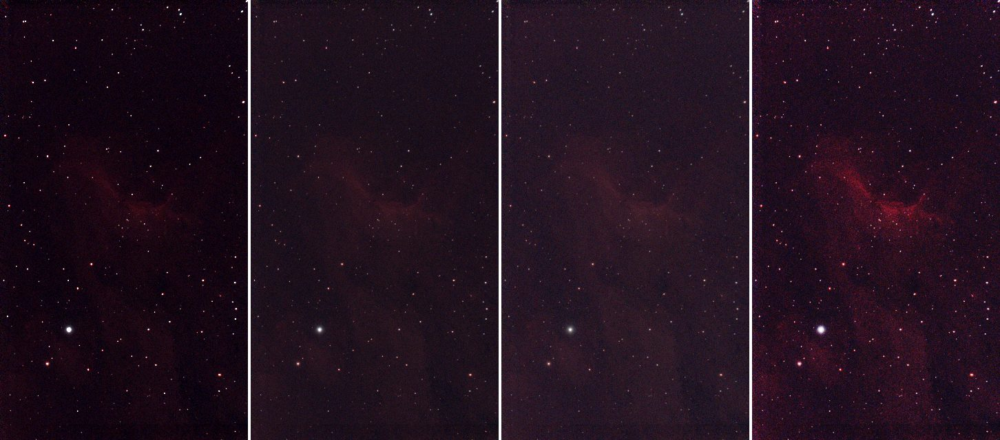
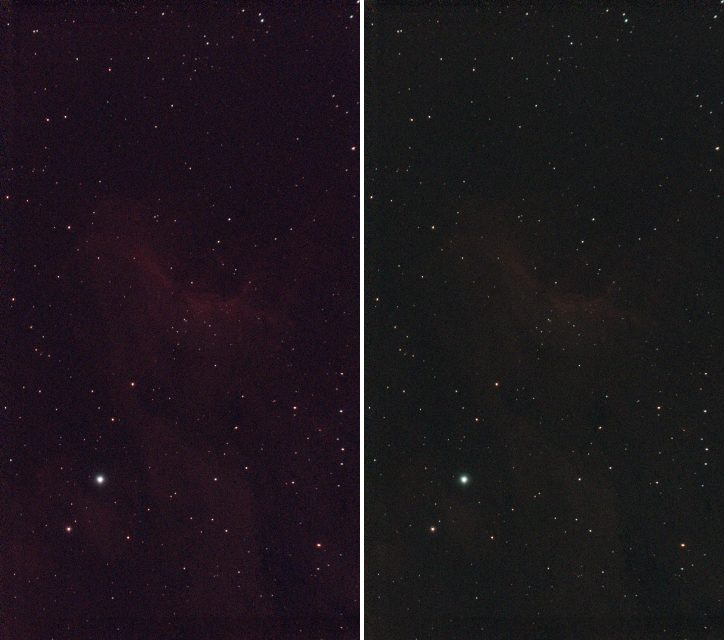

# Tutorial 6: Stretch

**Goal:** turn the linear data, which looks black on a screen, into a picture. You finish with a
stretched FITS file (values from 0 to 1) and a PNG you can open anywhere, and you will know
how to pick between the three curves and how to undo a stretch.

**Data:** `flat.fits`, the gradient-free stack from [tutorial 5](background.md). The data is
**linear**: a pixel's value is proportional to the light that fell on it. The sky is at about 600
ADU and the brightest star at 74,000, so on a screen that shows 0 to 65,535 as black to white,
everything except the stars is nearly black. A stretch bends the range so the faint things become
visible. The curves (midtone transfer function, arcsinh and generalised hyperbolic stretch) are
explained in [How stretching works](../user-guide/stretching.md).

**When.** Stretching is the last step for the picture and the first thing you lose information
with: do it after the steps that need linear data (calibration, stacking, background extraction,
colour calibration), and keep the linear files.

## Step 1: The automatic stretch

```sh
valerian stretch flat.fits -o stretched.fits --preview stretched.png
```

```text
black 582.8132, white 5636.6763, Mtf { midtone: 0.03898123292416554 }
plane 0: median 610.8596 -> 0.1209
plane 1: median 597.3273 -> 0.0663
plane 2: median 608.3698 -> 0.1113
wrote stretched.fits
wrote preview stretched.png
```

What the first line says:

* **black 582.8132.** Values at or below this become 0. By default it is placed 2.8 robust
  sigma below the sky (`--shadow-sigma 2.8`), so the sky's noise is not cut off.
* **white 5636.6763.** Values at or above this become 1. By default it is the 99.995th percentile
  of the pixels (`--white-percentile 99.995`), so only the brightest few stars clip.
* **Mtf {midtone: 0.0390}.** The curve between them is a midtone transfer function, solved so the sky
  lands at the `--target` level, 0.1 by default.

The next three lines say where each plane's sky median went. They are **not** all 0.1: red 0.1209,
green 0.0663, blue 0.1113, because by default the three planes share one stretch (they are
"linked") and the sky levels of the planes differ (610.9, 597.3 and 608.4 ADU). The unequal
result is the colour cast of the sky, kept, not removed. Colour calibration, in
[tutorial 9](photometric-colour.md), is what balances it.

`stretched.fits` is a 32-bit float image in 0 to 1. The stretch is recorded in its header.
`stretched.png` is an 8-bit PNG you can open in any viewer. It is reduced to fit `--preview-size`
(the longest side, 1600 pixels by default): here the 1080 by 1920 image became 540 by 960.

## Step 2: Try the curves

The same `flat.fits`, left to right: the linear data with only a black and white point (no curve),
the automatic stretch above, `--curve arcsinh --beta 200`, and a generalised hyperbolic stretch
(`--curve ghs --ghs-stretch 5 --ghs-b 1 --ghs-sp 0.01 --ghs-hp 0.9`). Each is reduced three times.
The first picture is the linear data with a screen black and white point so it can be seen at
all; the other three are Valerian's output as it is.



```sh
valerian stretch flat.fits -o arcsinh.fits --curve arcsinh --beta 200
valerian stretch flat.fits -o ghs.fits --curve ghs --ghs-stretch 5 --ghs-b 1 --ghs-sp 0.01 --ghs-hp 0.9
```

The sky medians in the log were 0.1597, 0.0913 and 0.1484 (arcsinh) and 0.1256, 0.0525 and
0.1097 (GHS), against 0.1209, 0.0663 and 0.1113. What the curves do:

| Curve | Behaviour | Use it for |
|---|---|---|
| `auto` (the default) | an MTF that puts the sky at `--target` | a first look; usually good |
| `mtf` | an MTF with the midtone you give (below 0.5 brightens) | a repeatable stretch, or one you want to tweak by hand |
| `arcsinh` | `asinh(beta x) / asinh(beta)`: brightens the faint parts and keeps star colour | colour images, with bright stars that you do not want bleached |
| `ghs` | a generalised hyperbolic stretch: you choose where it works hardest (`--ghs-sp`) and how the shadows and highlights are protected | careful work on a target of one brightness: here it lifts the nebula the most |

On this image the GHS shows the nebula best, the arcsinh and auto are close to each other, and
the plain linear picture on the left is what you start from. Stretching is a matter of taste: the
files are cheap, so make several and compare.

## Step 3: Linked or unlinked

By default the three planes share the black point, white point and curve, so the colour balance
of the data is kept. `--unlinked` stretches each plane on its own:

```sh
valerian stretch flat.fits -o unlinked.fits --unlinked
```

```text
each plane stretched on its own (see the HISTORY cards)
plane 0: median 610.8596 -> 0.1000
plane 1: median 597.3273 -> 0.1000
plane 2: median 608.3698 -> 0.1000
```

Now every plane's sky is at exactly 0.1: the colour cast is gone in the picture (left: linked,
right: unlinked). It is a quick way to a neutral sky, but it also removes real colour (a red
nebula is stretched as hard in blue as in red) and the stars' colours change. A proper white
balance is [colour calibration](photometric-colour.md); use `--unlinked` for a quick
look or for mono data processed one plane at a time.



## Step 4: Undo a stretch

The FITS file records the stretch, so `--invert` reverses it:

```sh
valerian stretch stretched.fits --invert -o linear.fits
```

```text
stretched.fits: stretch undone
wrote linear.fits
```

`valerian info linear.fits --stats` gives a sky of 610.7, 597.3 and 608.3 ADU, the same as before,
but the `min` of every plane is 582.8 and the `max` 5636.7: the black and white points. That is
what "undo on the data that was not clipped" means: everything below the black point and above the
white point was clipped by the stretch and cannot be brought back. Keep `flat.fits`: it is the
real linear data.

## Options used

All options are in the [command line reference](../reference/cli.md#valerian-stretch).

| Option | What it does | Range or values | Default |
|---|---|---|---|
| `<INPUT>` | the linear FITS image to stretch | a file | required |
| `-o`, `--output <FILE>` | the stretched FITS file | a file | required unless `--preview` is given |
| `--preview <PNG>` | also write an 8-bit PNG | a file | not written |
| `--preview-size <PIXELS>` | longest side of the PNG | pixels | 1600 |
| `--invert` | undo the stretch recorded in the input's header | on or off | off |
| `--curve` | the tone curve | `auto`, `mtf`, `arcsinh`, `ghs` | `auto` |
| `--target <LEVEL>` | sky level after the stretch (`auto`, and `mtf` without `--midtone`) | 0 to 1 | 0.1 |
| `--midtone <M>` | midtone balance of the MTF; below 0.5 brightens | 0 to 1 | solved for `--target` |
| `--beta <BETA>` | strength of the arcsinh stretch | greater than 0 | 50 |
| `--ghs-stretch <S>` | GHS stretch factor; 0 changes nothing; D is e to this power minus one | 0 or more | 3 |
| `--ghs-b <B>` | GHS local intensity: -1 logarithmic, 0 exponential, above 0 hyperbolic | number | 0 |
| `--ghs-sp <SP>` | GHS symmetry point: the brightness stretched hardest | 0 to 1 | 0 |
| `--ghs-lp <LP>` | GHS shadow protection point (at most the symmetry point) | 0 to 1 | 0 |
| `--ghs-hp <HP>` | GHS highlight protection point (at least the symmetry point) | 0 to 1 | 1 |
| `--black <ADU>`, `--white <ADU>` | set the black and white points by hand, in the image's units (give both) | ADU | automatic |
| `--shadow-sigma <SIGMA>` | automatic black point: this many robust sigmas below the sky | sigmas | 2.8 |
| `--white-percentile <PERCENT>` | automatic white point: this percentile of the pixels | percent | 99.995 |
| `--unlinked` | stretch each colour plane on its own | on or off | off (planes linked) |

Measured on `flat.fits` (red plane's sky median after the stretch, in the log):

* `--target 0.2` brightens: 0.2364 (red), 0.1378 (green) with the default curve. The target is the
  sky level the curve is solved for on the luminance, so a linked plane with a higher sky lands higher.
* `--curve mtf --midtone 0.05` gives 0.0959, and the automatic stretch solved a midtone of 0.039 for 0.1.
  The lower the midtone, the brighter the result.
* `--shadow-sigma 1 --white-percentile 99.9` moves the black point to 597.4 and the white point
  to 809.1 (the default: 582.8 and 5636.7). That clips the nebula's brighter parts and most star
  cores to white, and the midtone becomes 0.26: a harder, flatter picture with less depth.
  A tighter black point makes a darker sky; a lower white percentile makes more stars burn out.
* `--black 580 --white 5600` alone is refused (see below).

## How to tell it worked

* The log's sky medians are near the `--target` (0.1) in every plane (exactly 0.1 with
  `--unlinked`).
* The picture shows the nebula and the faint stars, and the sky is dark grey, not black
  and not bright.
* The brightest stars are white but not all stars are: a handful of clipped pixels are normal
  (the white point is a percentile).
* `valerian stretch stretched.fits --invert` reports `stretch undone`.

## Troubleshooting

**The picture is still almost black.** The sky is below the target because the black point is high
or the white point is far too high (a satellite, a bright star or a hot pixel can drag the percentile
up). Raise `--target` (0.2 gave 0.24 here), lower `--midtone`, or use arcsinh with a larger
`--beta`. Check that the input is linear: `info --stats` should give a sky of hundreds of ADU, not
0.1.

**The picture is washed out, grey, with no black.** The input was already stretched. The
stretch does not know: stretching `stretched.fits` again ran without a warning (`black 0.0092,
white 0.9944, Mtf {midtone: 0.474...}`) and gave a different picture. Start from the linear file.
(`photocal`, by contrast, refuses a stretched image, as [tutorial 9](photometric-colour.md) shows.)

**`valerian: --black and --white need a curve with its own parameters: give --midtone, or use --curve
arcsinh or ghs`.** The automatic curve is solved from the black and white points it chose itself, so
it cannot take yours. Add `--curve mtf --midtone 0.05` (or arcsinh or ghs).

**`valerian: the image records no stretch (no STRETCH keyword)`.** `--invert` was run on a file that
was not made by `valerian stretch` (here the linear `stack.fits`). There is nothing to undo.

**The sky has a colour cast.** The planes are linked, so the cast in the data is kept. Balance it with
colour calibration ([tutorial 9](photometric-colour.md)), or for a quick look use `--unlinked`.

**The stars are bloated or the faint nebula is lost in the noise.** The curve is too strong. Lower
`--beta` (arcsinh), `--ghs-stretch` (GHS) or raise the midtone. A stretch cannot add signal: if the
noise is the problem, stack more frames.

**The command ends with "Broken pipe" when its output is piped to `head`.** That was a panic in
older builds: it stopped the command
before it wrote the file, as happened when this tutorial was made. Current builds end quietly, but
still stop at the closed pipe, so do not pipe a command whose output file you need.

## The desktop app

In the desktop app this is the **Stretch** tool of step 4, Process: see the [reference](../reference/gui.md#stretch) for its controls.

## Where next

`stretched.fits` is a picture. [Tutorial 7](star-removal.md) takes the stars out of an image.
