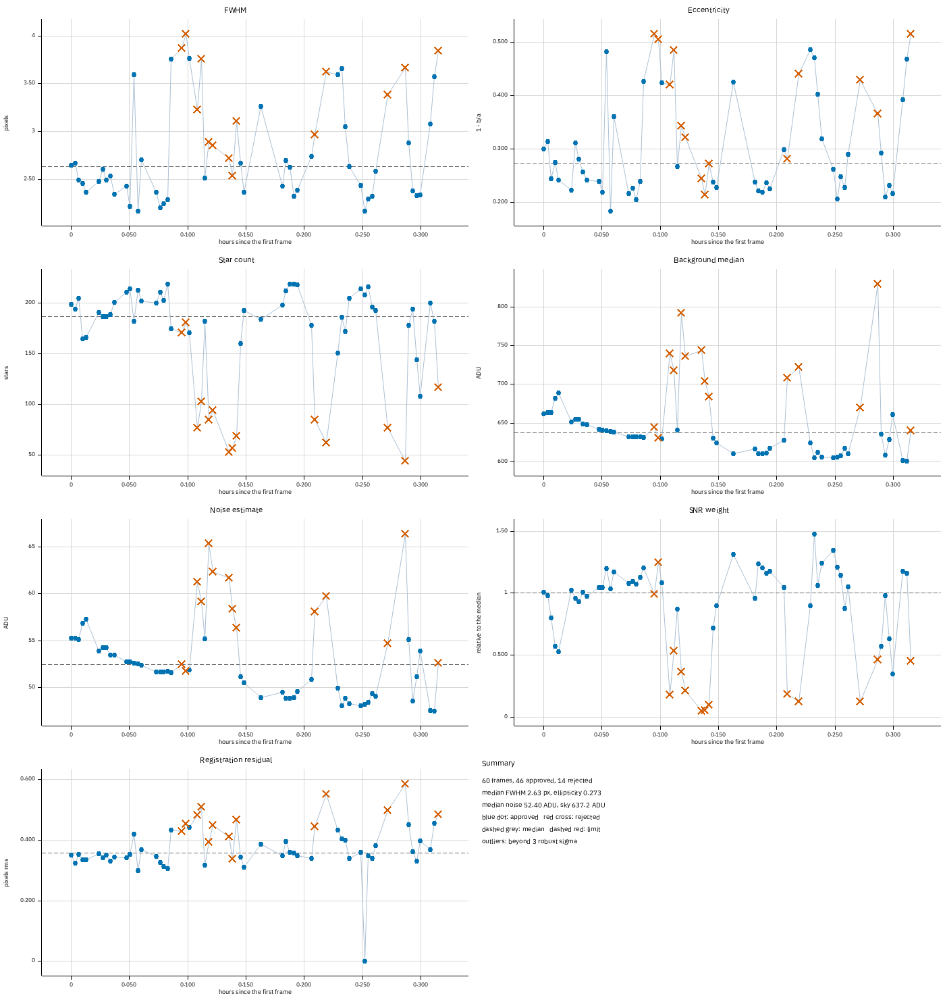
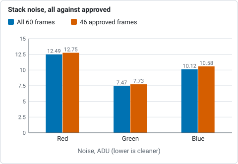
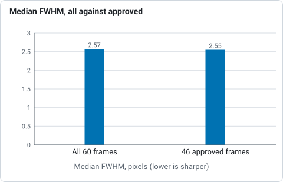
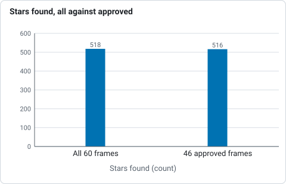
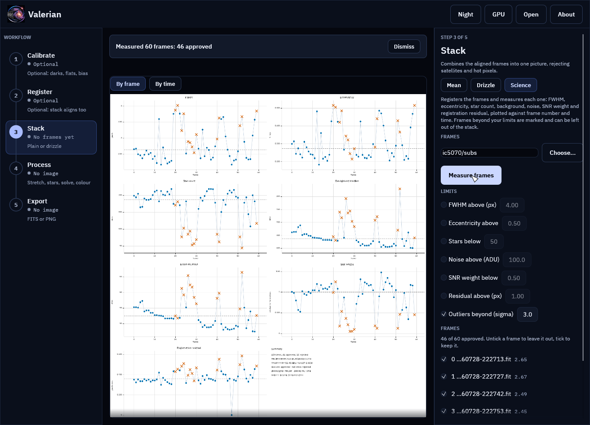
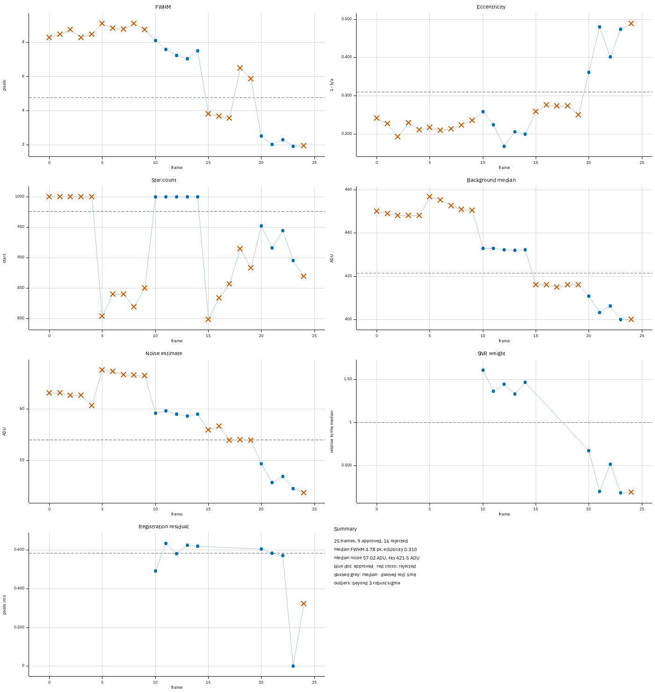

# Tutorial 12: Subframe analysis

**Goal:** measure every frame of a session (sharpness, roundness, star count, sky level,
noise, weight and how well it registers), plot the measurements against frame number and
against time, decide which frames are not worth stacking, and stack without them. This is
what the SubframeSelector process does in PixInsight; here it is `valerian subframes`, and the
**Science** panel of the desktop app. You finish with a folder holding the plots, the
approve/reject table as CSV and JSON, and a one-file HTML report, and with a stack made from
the approved frames only.

**Data:** the sixty IC 5070 Seestar lights of [tutorial 3](register.md), in `lights/`. They
were taken through a night of passing cloud and wind, so they have plenty to find. Section
"A mixed set" at the end uses the twenty-five ASI1600MM H-alpha lights of
[tutorial 2](calibrate.md).

**What happens.** Valerian finds the stars in every frame, registers the frames to the
sharpest one and measures each frame. Frames beyond the limits you give are marked. How each
number is measured is in [How subframe analysis works](../user-guide/subframes.md).

## Step 1: Measure and plot

```sh
valerian subframes lights/ --report science --outlier-sigma 3
```

```text
read 60 frames in 367.7ms
reference candidate frame 47: 59 of 59 other frames register
reference: frame 47 (FWHM 2.16 px)
   #  frame                           stars   FWHM    ecc      sky    noise  SNR wt  reg px  verdict
   0  Light_IC 5070_10.0s_LP_2026072    199   2.65  0.300    662.0    55.22   1.009   0.351  approved
...
  20  Light_IC 5070_10.0s_LP_2026072    171   3.87  0.515    644.2    52.47   0.994   0.429  REJECTED: ellipticity 3.3 sigma from the median
  21  Light_IC 5070_10.0s_LP_2026072    181   4.02  0.504    630.8    51.73   1.249   0.454  REJECTED: FWHM 3.2 sigma from the median; ellipticity 3.2 sigma from the median
...
  23  Light_IC 5070_10.0s_LP_2026072     77   3.23  0.420    739.8    61.27   0.177   0.482  REJECTED: star count 3.8 sigma from the median; SNR weight 3.1 sigma from the median
...
  28  Light_IC 5070_10.0s_LP_2026072     53   2.72  0.244    743.7    61.72   0.044   0.411  REJECTED: star count 4.6 sigma from the median; SNR weight 3.6 sigma from the median
...
  52  Light_IC 5070_10.0s_LP_2026072     44   3.67  0.365    829.6    66.44   0.461   0.585  REJECTED: noise 3.3 sigma from the median; registration residual 4.6 sigma from the median; star count 4.9 sigma from the median; sky level 5.4 sigma from the median
...
46 of 60 frames approved
wrote science/subframes.csv
wrote science/subframes.json
wrote science/subframes_index.png
wrote science/subframes_time.png
wrote science/report.html
```

It took 13.7 s on the 24-core server (reading and registering the sixty frames dominates). With `--outlier-sigma 3` a frame is
rejected when any measurement is more than three robust sigmas from the typical frame, in its
bad direction. Fourteen of the sixty frames are.

## Step 2: Read the plots

Open `science/subframes_time.png`. Each panel is one measurement against the hours since the
first frame; a blue dot is an approved frame, a red cross a rejected one, the dashed line the
median.



What the picture says about the night:

* **Star count and noise.** Around 0.10 to 0.15 h and again at 0.21, 0.22, 0.27 and 0.29 h
  the star count falls from about 200 to under 100 and the noise rises from 48 to 66 ADU: thin
  cloud, which lets through less starlight and more sky glow. The **background median** rises
  at the same moments (from 610 to 830 ADU). These frames are the ones with a SNR weight under
  0.5.
* **FWHM and eccentricity.** At 0.09 to 0.12 h, and at the end of the run, the stars are wider
  (up to 4 px against a median of 2.6) and elongated (eccentricity 0.5): wind or poor tracking.
  The cloud frames are not the soft ones: frame 28 has a normal 2.7 px FWHM and 53 stars, so
  both problems have to be looked for.
* **SNR weight.** The weight combines the noise and the transparency, so it is the single
  plot that says how much a frame is worth: frames near 1 are typical, 1.2 to 1.5 are the best
  ones, and under 0.3 the frame adds almost nothing to a mean.
* **Registration residual.** Most frames register to 0.30 to 0.40 px rms; the poor frames,
  with fewer and softer stars, to 0.45 to 0.58. The zero is the reference frame (47).

The same sheet against frame number is `subframes_index.png`. The time plot is the better
one for hunting a cause (cloud, the Moon rising, a meridian flip); the frame plot is the one to
read against the file names.

## Step 3: Read the table, and change your mind

`science/subframes.csv` is the table the plots came from, with the verdict and the reasons:

```text
index,name,time_utc,stars,fwhm_px,ellipticity,sky_adu,noise_adu,snr_weight,registration_rms_px,approved,reasons
0,Light_IC 5070_10.0s_LP_20260728-222713.fit,2026-07-28T21:26:53,199,2.647,0.3001,662.03,55.223,1.0094,0.3505,yes,
20,Light_IC 5070_10.0s_LP_20260728-223256.fit,2026-07-28T21:32:34,171,3.869,0.5153,644.16,52.470,0.9935,0.4294,no,ellipticity 3.3 sigma from the median
```

Open it in a spreadsheet or a text editor and change the `approved` column if you disagree: a
frame the limits rejected may be fine for what you want (frame 20 has the elongated stars of a
wind gust but a good weight), and a frame they approved may be one you saw a satellite cross.
`subframes.json` holds the same, with the limits used and the median and spread of each
measurement. `science/report.html` shows the plots and the table (rejected rows shaded) in one
page that needs nothing else, so you can mail it or keep it with the session.

To try other limits, run the command again with them (it registers the frames again; the desktop
app judges again at once). Fixed limits are an alternative to the sigma rule, for example frames with
a FWHM above 3.5 pixels or fewer than 120 stars:

```sh
valerian subframes lights/ --report science-strict --max-fwhm 3.5 --min-star-count 120
```

```text
...
39 of 60 frames approved
```

## Step 4: Stack the approved frames

```sh
valerian stack lights/ -o stack-approved.fits --approve science/subframes.csv
```

```text
approve table science/subframes.csv: 46 of 60 frames kept (14 rejected)
reference candidate frame 36: 45 of 45 other frames register
reference: frame 36 (FWHM 2.16 px)
combining 46 frames with LinearFit { low: 5.0, high: 2.5 }, weights NoiseFwhm on CPU
...
46 of 46 frames stacked with LinearFit { low: 5.0, high: 2.5 }, reference frame 36 (Light_IC 5070_10.0s_LP_20260728-224223.fit), 42.3s
wrote stack-approved.fits
```

Frame numbers (such as `--reference` and the `reference frame` of the last line) count
positions in the list that is left, so frame 36 here is the sharpest frame, number 47 of the
sixty. Frames are matched by file name; any frame the table does not mention is kept, and the
command says how many. Compare the two stacks (`valerian info ... --stats`, both made on the
CPU):

| Stack | `NCOMBINE` | `EXPTOTAL` | Noise, red, green, blue (ADU) | Stars | Median FWHM |
|---|---|---|---|---|---|
| all 60 frames | 60 | 600 s | 12.49, 7.47, 10.12 | 518 | 2.57 px |
| 46 approved frames | 46 | 460 s | 12.75, 7.73, 10.58 | 516 | 2.55 px |



*Noise per colour in the stack of all sixty frames and of the 46 approved frames, from the table above: leaving frames out made it slightly noisier.*



*Median star FWHM of the stack of all sixty frames and of the 46 approved frames, from the table above.*



*Stars found in the stack of all sixty frames and of the 46 approved frames, from the table above.*

Leaving out the fourteen frames made the stack 2 to 4 per cent *noisier* (12.75 against 12.49
in red), and the star profile a hair sharper (2.55 against 2.57 px). That is the honest
result, and it is the usual one: the stack already gives the cloud frames small weights (0.05 to
0.3 in tutorial 4) and rejects their pixels, so they cost it little and add a little. Leaving
frames out pays when they would do harm that weights do not undo (a frame with a satellite
trail across the target, a frame out of focus that the weights still let in, a different field),
when you want the `EXPTOTAL` to be the exposure of frames that earned it, or when you want the
stack to be quicker. Check with both before deciding; the table is the tool for that.

## Step 5: One plot on its own

```sh
valerian plot subframes science/subframes.json -o fwhm-time.png --x time
```

draws the sheet from the saved table without measuring anything again, and writes
`fwhm-time.csv` and `fwhm-time.json` beside it. Give it frames instead of a JSON to measure
and plot in one go.

## Step 6: The same in the desktop app

Open the **Stack** step, choose the **Science** chip, give the folder of frames and press
**Measure frames**. The plots appear in the viewer, with **By frame** and **By time** above
them; the limits are the seven boxes on the left, and the list under them has a tick for every
frame (ticked is approved). Click a tick to override a verdict.



**Use for stacking** tells the next **Mean** stack to leave out the rejected frames (the Mean
panel says how many, with **Use all** to take it back), and **Save report** writes the same
folder as the command line. Every control is described in the [desktop app
reference](../reference/gui.md#science).

## A mixed set

The H-alpha lights of tutorial 2 are five panels of five frames, so they cannot all register to
one reference:

```sh
valerian subframes ha/lights/ --report ha-science --outlier-sigma 3
```

```text
 10  2023-01-25_21-57-02_Ha_-10.00_   1000   8.11  0.259    432.9    59.58   1.610   0.492  approved
 ...
 15  2023-01-25_22-32-08_Ha_-10.00_    798   3.82  0.258    416.0    57.98     NaN   0.000  REJECTED: registration failed: best hypothesis matches only 4 stars (need 6)
 ...
 23  2023-01-25_23-57-40_Ha_-10.00_    895   1.90  0.474    400.0    52.32   0.180   0.000  approved
9 of 25 frames approved
```

Frames 20 to 24 (the reference, 23, is the sharpest) and 10 to 14 registered; the others show
`registration failed` and an empty SNR weight, because their stars do not match the reference's:
they are a different panel of the mosaic, and the plots show it as steps in the background
level and the FWHM at every fifth frame. Measure each panel on its own, as it is the
registration to a common reference that is failing and not the frames.



## Options used

All options are in the [command line reference](../reference/cli.md#valerian-subframes).

| Option | What it does | Range or values | Default |
|---|---|---|---|
| `<FRAMES>...` | frames to measure: files or folders | one or more | required |
| `--report <DIR>` | folder for the plots, CSV, JSON and `report.html` | a folder | `subframes-report` |
| `--max-fwhm <PIXELS>` | reject frames with a larger FWHM | above 0 | no limit |
| `--max-ellipticity <E>` | reject frames with a larger eccentricity | 0 to 1 | no limit |
| `--min-star-count <N>` | reject frames with fewer stars | count | no limit |
| `--max-noise <ADU>` | reject frames with more noise | above 0 | no limit |
| `--min-snr-weight <W>` | reject frames with a lower SNR weight | above 0 | no limit |
| `--max-residual <PIXELS>` | reject frames with a larger registration residual | above 0 | no limit |
| `--outlier-sigma <SIGMA>` | reject frames this many robust sigmas from the median | above 0 | off |
| `--reference <N>`, `--model`, `--debayer`, `--threshold` | as for [register](register.md#options-used) | | the sharpest frame, `similarity`, `auto`, 5 |

`valerian plot subframes` takes frames or a `subframes.json`, `-o <FILE>` (the PNG), `--x index`
or `--x time` and the same limits. `valerian stack` takes `--approve <FILE>` and
`--science-report <DIR>` (with the same limits).

If your frames are raw subs from a Seestar S50, `valerian subframes` and `valerian stack` also
take the optional `--grade`, which scores each sub with a neural network and rejects the poor ones; see
[How the Seestar sub grader works](../user-guide/grading.md).

## How to tell it worked

* The table has one line per frame and the last line says how many were approved.
* `science/` holds `subframes.csv`, `subframes.json`, `subframes_index.png`,
  `subframes_time.png` and `report.html`.
* The rejected frames are the ones you can see are poor in the plots: a cloud shows as a drop
  in stars with a rise in sky and noise, a gust as a rise in FWHM and eccentricity.
* `stack --approve` says how many frames it kept, and the stack's `NCOMBINE` is that number.

## Troubleshooting

**`registration failed: best hypothesis matches only 4 stars (need 6)`.** The frame does not
register to the reference: it is another field, or too soft or too empty to match. It is
rejected and its SNR weight is empty. If many frames fail, the reference (the sharpest frame)
may be from another panel: give `--reference N` the index of a typical frame.

**`--x time needs DATE-OBS in every frame`.** Some frame has no time stamp. Use `--x index`;
the report then has only the frame plot.

**All frames are rejected, or none are.** With `--outlier-sigma` a frame is judged against the
spread of the rest, so a very uniform set can reject frames for tiny differences: raise the
sigma (4 is rarely wrong). Fixed limits have no such problem but need numbers: read the median
of each quantity from the summary in the plot, or from the `fwhm`, `stars` and `noise` entries
of `subframes.json`.

**`the approve table leaves fewer than two frames to stack`.** The limits were too strict.
Loosen them, or edit the `approved` column.

**A frame is not found by `--approve`.** Names are matched exactly, so the table must have been
made from files of the same names. Renaming files after the analysis keeps them all.

**The noise is lower than the sensor's read noise.** For colour cameras the frame is
demosaiced first, and interpolation smooths the noise. The figure is for comparing frames of one
session, not for comparing cameras.
