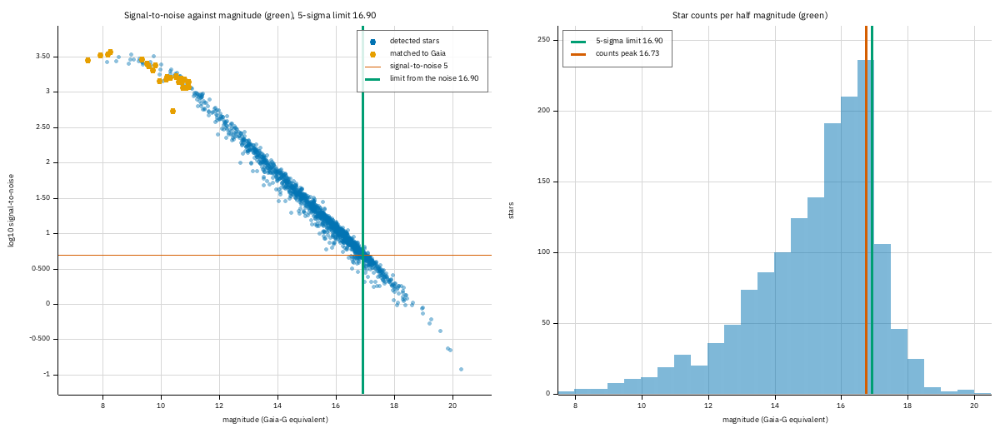
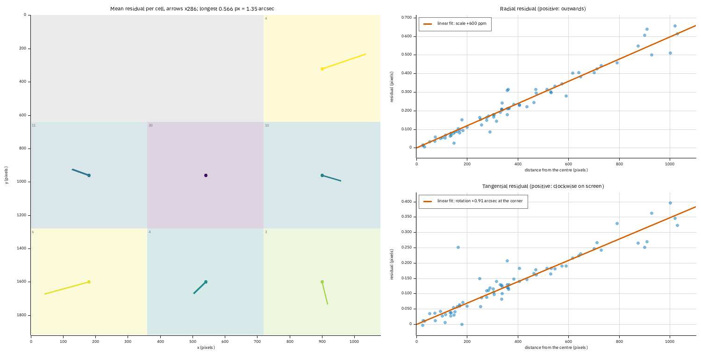
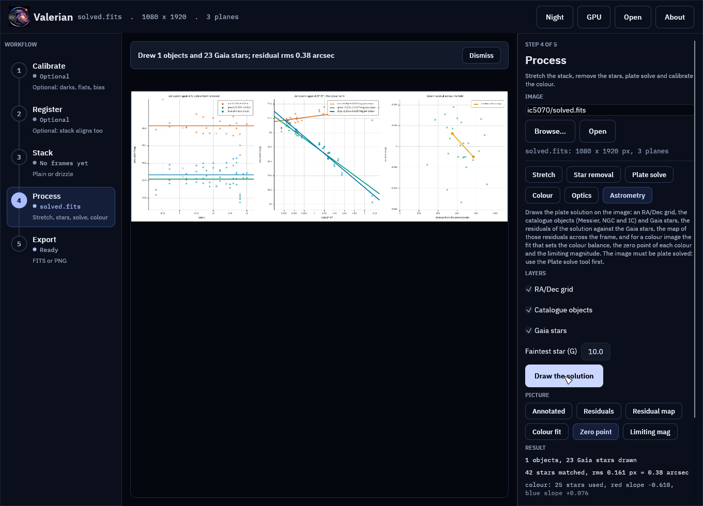
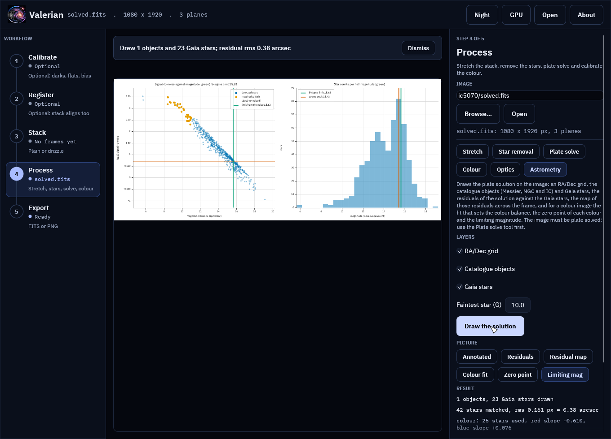
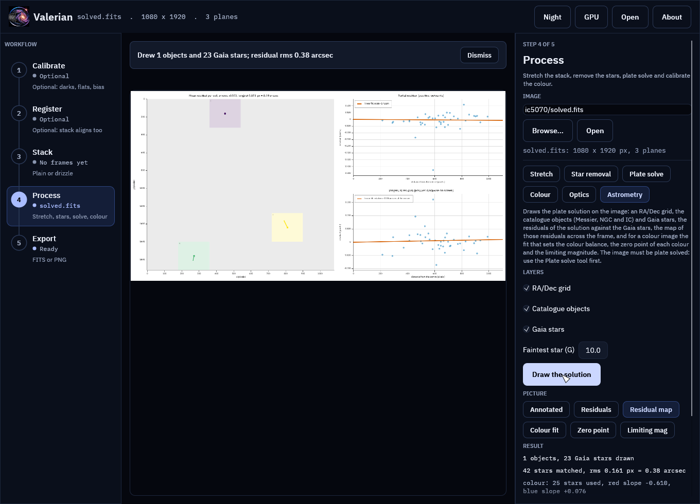

# Tutorial 20: Zero point, star magnitudes and the limiting magnitude

**Goal:** turn a plate-solved colour stack into numbers you can trust: the **zero point** and
**colour term** of each colour (the constants that turn a flux into a magnitude), a **catalogue of
every star in the picture** with a calibrated magnitude and an error, the **limiting magnitude** (how
faint the stack goes), and a **map of the plate solution's errors** across the frame. You finish
with `photocal-report/` (three sheets of plots with their data and a `report.html`),
`calibrated_stars.csv` and two residual maps, one of a good solution and one of a deliberately wrong one.

**Data:** the 184 raw Seestar S50 sub-frames of M 34 of [tutorial 18](seestar-session.md) (10 s,
IR-cut filter, 1080 by 1920 pixels, 2.375 arc seconds per pixel), taken through Steps 3 to 5 of that
tutorial: stack, background extraction and plate solve. The Gaia catalogue file is needed, as for
[tutorial 9](photometric-colour.md). Nothing here needs the graphics card.

**What happens.** The colour calibration of tutorial 9 already measures Gaia stars of G 6 to 11 in the
red, green and blue planes. Here the same measurements give the absolute scale: each Gaia star says
what flux a star of its magnitude gives in each plane, and a straight line in Gaia's BP-RP colour
holds the difference between your camera's colours and Gaia's. Every other star detected in the
picture is then measured the same way and given a magnitude. How it works, and what each number means,
is in [How the astrometry and photometry outputs work](../user-guide/astrometry.md).

**When.** On a **linear** image, plate solved, after background extraction. Calibrate the colour at the
same time: the zero point is for the pixel values the image has when `photocal` reads it.

## Step 1: The solved stack

These are the commands of [tutorial 18](seestar-session.md) that make `solved.fits`. If you have that
file, skip this step.

```sh
valerian stack lights/ -o stack.fits
valerian background stack.fits -o background.fits --save-model model.fits
valerian solve background.fits -o solved.fits
```

```text
solved: centre RA 02h41m51.5s Dec +42d47m08.7s (40.46463, +42.78575 deg)
scale 2.375 arcsec/pixel, field 0.71 x 1.27 deg, rotation 72.09 deg east of north, mirrored
72 of 400 detected stars matched, rms 0.11 arcsec (0.05 px), plain TAN
wrote solved.fits
```

The last line of the solve is worth reading now: 72 stars matched Gaia and the solution is good to
0.05 pixel. Step 6 draws that number.

## Step 2: The zero point and the catalogue

```sh
valerian photocal solved.fits -o pcc.fits --stars-out pcc_stars.csv --calibrated-stars calibrated_stars.csv --report photocal-report
```

```text
26 Gaia stars measured, 22 used; aperture radius 5.6 px; neutral at BP-RP 0.82
  red against green: slope -0.303 mag per BP-RP, scatter 0.012 mag, gain 1.3006 +/- 0.0031
 blue against green: slope +0.451 mag per BP-RP, scatter 0.016 mag, gain 1.5844 +/- 0.0051
sky before 610.40 665.35 612.84, after 810.08 810.08 810.08 (offsets -16.17 -144.72 160.89)
wrote photocal-report/pcc.png
wrote photocal-report/pcc.csv
wrote photocal-report/pcc.json
wrote photocal-report/report.html
  red zero point 22.633 +/- 0.009 (after the gain 22.918), colour term +0.019 +/- 0.018 mag per BP-RP, scatter 0.035 mag, 21 stars
green zero point 22.918 +/- 0.008 (after the gain 22.918), colour term -0.284 +/- 0.016 mag per BP-RP, scatter 0.031 mag, 21 stars
 blue zero point 22.420 +/- 0.009 (after the gain 22.920), colour term -0.737 +/- 0.018 mag per BP-RP, scatter 0.036 mag, 21 stars
3051 stars in the calibrated catalogue; 5-sigma limiting magnitude 16.90 (red 16.55, blue 16.35); faintest star at that level 17.08; counts peak 16.73
wrote photocal-report/zeropoint.png
wrote photocal-report/zeropoint.csv
wrote photocal-report/zeropoint.json
wrote photocal-report/limiting_magnitude.png
wrote photocal-report/calibrated_stars.csv
wrote photocal-report/report.html
wrote the calibrated star catalogue calibrated_stars.csv
wrote the star table pcc_stars.csv
wrote pcc.fits
```

The command took 0.93 s on a shared 24-core machine. The first six lines are the colour calibration
of tutorial 9 and are unchanged (this is the same run as Step 6 of tutorial 18). The new ones:

* **`green zero point 22.918 +/- 0.008`.** For a star of BP-RP 0.82, the Sun's colour, a magnitude is
  `22.918 - 2.5 log10 (flux)`, with the flux in the pixel units of this stack (the sum of the aperture
  above the sky). The `+/- 0.008` is the standard error of the zero point: the 21 stars agree on it
  well, so the scale of the whole picture is known to about 0.01 mag. Green is the plane that stays
  where it is when the colour is calibrated, and its zero point is Gaia G.
* **`red zero point 22.633`, `blue zero point 22.420`.** The same for the other two planes before the
  gains. The planes differ because the camera sees red and blue differently from the way it sees green.
  `(after the gain 22.918)`, `22.920`: once `pcc.fits` has the gains of 1.3006 and 1.5844 applied, red and
  blue have the green value to within 0.002 mag, which is what the colour calibration is for.
* **`colour term -0.284 +/- 0.016 mag per BP-RP`** for green. A star one magnitude redder in BP-RP
  looks 0.28 mag brighter in the camera's green than Gaia's G says, so the camera's green is a redder
  band than Gaia's G (a Seestar's IR-cut filter lets in the red and the near infrared). Red has a
  colour term of +0.02, almost none: red is nearly Gaia's G in colour response. Blue is -0.74.
* **`scatter 0.031 mag`.** How far one calibration star lies from the line. It is the real precision of a
  single bright star's magnitude, and it is bigger than the standard error because it is the scatter of
  21 stars, not the uncertainty of their mean.
* **`3051 stars in the calibrated catalogue`.** Every star detected at 5 sigma or more in the picture,
  not only Gaia's: the catalogue of Step 4.
* **`5-sigma limiting magnitude 16.90 (red 16.55, blue 16.35)`.** How faint a star can be and still be
  measured at five times the noise of the aperture. Step 5 draws it. The red and blue limits are
  shallower because those planes are noisier here.

## Step 3: The zero point sheet

Open `photocal-report/zeropoint.png`, or make it on its own with
`valerian plot zeropoint solved.fits -o zeropoint.png`.


*The zero point sheet of the M 34 stack.*

* **Left: the zero point against G, the colour term removed.** Each plane is a cloud of dots about a
  horizontal line: red at 22.633, green at 22.918, blue at 22.420. A flat line says the camera is
  **linear**: a star ten times fainter gives a flux ten times smaller, as the magnitude says. The grey crosses
  are Gaia stars the colour fit did not keep (a blend, a variable, or a saturated bright star). The
  three brightest crosses, at G 7.1 to 8.2, lie well off the line: the stack's brightest stars are
  partly saturated. They were left out of the fit, and the catalogue flags every star brighter than the
  brightest calibrator with `B`. There is no drift across the 21 kept stars: `trend_with_g` in the JSON
  is -0.011 mag per mag of G for green, which is -0.03 mag over the 2.7 mag of G they cover, well under the 0.1 mag that raises a warning.
* **Middle: the zero point against BP-RP.** This is the colour response of the camera. The blue line
  falls steeply (-0.737), green falls gently (-0.284) and red is flat (+0.019). Without this
  correction a red star would be 0.3 mag too bright in green and a blue star too faint, and
  the catalogue of Step 4 uses the lines to remove exactly that.
* **Right: the green residual across the field.** The scatter about the fit against the distance from
  the centre of the frame, with the median of five rings in orange. A flat orange line would be a flat
  field without vignetting. Here it wanders within 0.02 mag, which with so few stars (21) is noise.
  A line that fell steadily towards the edge would mean the flat field left vignetting in the
  picture and stars at the edge read too faint by that much.

`photocal-report/zeropoint.csv` has the 26 Gaia stars measured (`x`, `y`, `g`, `bp_rp`, the
zero point of each plane, the three residuals and `kept_rgb`: `111` kept in all planes, `000` rejected).
`zeropoint.json` has the numbers above with their errors.

## Step 4: The calibrated star catalogue

```sh
head -4 calibrated_stars.csv
```

```text
id,x,y,ra_deg,dec_deg,mag_g,mag_g_err,mag_r,mag_r_err,mag_b,mag_b_err,snr_g,flux_g,bp_rp,bp_rp_err,gaia_g,mag_g_minus_gaia_g,fwhm_px,flags
1,883.42,1065.00,40.649344,42.591145,7.484,0.008,7.426,0.009,7.209,0.009,2852.4,1385826.49,1.10,0.00,7.10,0.384,3.65,GB
2,225.44,1078.11,40.479279,43.006934,7.912,0.008,7.851,0.009,7.715,0.009,3329.7,842043.36,1.50,0.00,7.70,0.212,2.96,GB
3,695.12,1014.87,40.554870,42.699274,8.140,0.008,8.058,0.009,7.986,0.009,2683.0,954902.98,0.22,0.00,,,3.10,B
```

One line per star, brightest first. `mag_g` is the star's magnitude on the Gaia G scale, with its error
`mag_g_err`; `mag_r` and `mag_b` are the same for the red and blue planes. For a star of the
reference colour the three agree; here they differ by 0.1 to 0.3 mag because stars 1 and 2 are red
and star 3 is blue. `bp_rp` is the colour the colour term used: Gaia's for a Gaia star (`G` in the flags,
and `gaia_g` and the difference `mag_g_minus_gaia_g` are filled), otherwise **estimated from the star's
own red, green and blue** with the lines of the colour fit. Star 3 has no Gaia match and an estimated
BP-RP of 0.22, a hot blue star.

The three brightest lines show the saturation of Step 3: stars 1 and 2 are 0.38 and 0.21 mag fainter than
Gaia says, and the `B` flag says they are brighter than any star the zero point was fitted on. Use the
file with the flags in mind:

```sh
awk -F, 'NR>1 && $19 !~ /[SCNB]/ && $6 < 16' calibrated_stars.csv | wc -l
```

```text
910
```

That is the **clean** catalogue brighter than G 16: 910 stars with no saturation (`S`), no neighbour in the
aperture or sky ring (`C`), no empty plane (`N`) and not brighter than the calibrators (`B`). Of the 3051
lines, 1499 are `C` (a Seestar stack of an open cluster is crowded), 1728 have `E`, a colour that was
assumed to be 0.82 because the star was too faint for its own colour to be measured, 176 have `N`,
and 26 are matched to Gaia (`G`).

The error column is worth plotting against magnitude. For the clean stars the median `mag_g_err` is:

| G range | clean stars | median error (mag) |
|---|---|---|
| 10 to 12 | 79 | 0.008 |
| 12 to 14 | 247 | 0.014 |
| 14 to 16 | 559 | 0.067 |
| 16 to 17 | 418 | 0.186 |
| 17 to 18 | 128 | 0.319 |

Below G 12 the error is the floor set by the zero point (0.008) and the colour term. From G 14 on
the stars' own noise takes over, and at the limiting magnitude of 16.9 the error is about 0.2 mag, which is
what a 5-sigma detection means (`1.0857 / 5 = 0.22`). **The catalogue's error does not include the 0.031 mag
scatter of the calibrators**, which is real but small next to the faint-star errors; add it in quadrature if
you quote a bright star's magnitude.

A check against Gaia: the 21 Gaia stars the fit kept come out of the catalogue with `mag_g_minus_gaia_g`
of median +0.001 and rms 0.032 mag, the same as the scatter above. That is a consistency check, not an
independent one, as the same stars set the zero point. The independent check is the next step.

**Checked against photutils.** `scripts/compare_python_astrometry.py zeropoint` measures the same stars
with photutils (aperture and sigma-clipped annulus) and refits with numpy:

```text
21 Gaia stars kept in green
zero point: valerian 22.9180 +/- 0.0081, numpy on photutils fluxes 22.9178; difference -0.0002 mag
colour term: valerian -0.2838, numpy on photutils fluxes -0.2838; difference +0.0000
scatter: valerian 0.0315, numpy 0.0315 mag
catalogue green flux, valerian / photutils over 300 clean stars: median 1.00012, min 0.99860, max 1.01218
```

## Step 5: The limiting magnitude

Open `photocal-report/limiting_magnitude.png` (or `valerian plot limiting-mag solved.fits -o limit.png`).



*The limiting magnitude sheet of the M 34 stack.*

* **Left.** Every clean star's signal-to-noise (log scale) against its magnitude. The points fall on a
  straight line, one factor of ten in signal-to-noise for 2.5 magnitudes, which is what a noise that does not depend on
  the star predicts. The line meets the horizontal red line at signal-to-noise 5 at magnitude **16.90**,
  the green vertical line. The orange dots are the Gaia stars, at the bright end of the line. The scatter of the points
  about the line (a few tenths of a dex) is the difference in the local sky noise from place to place.
* **Right.** How many stars there are at each magnitude, in half-magnitude bins. The counts rise by a
  factor of about 1.5 per magnitude, as star counts do, until the detection runs out: the peak is at **16.73**,
  0.17 mag brighter than the limit from the noise. The two measure different things (one from the sky
  noise, the other from where stars stop being found), so their agreement to 0.2 mag is a sign
  the limit is real for this stack.

The numbers are in `zeropoint.json`:

```text
"from_noise": [16.55, 16.90, 16.35]      (5 sigma, red, green, blue)
"green_at_3_and_10": [17.46, 16.15]      (3 sigma, 10 sigma)
"faintest_measured": 17.08
"counts_peak": 16.73
```

`from_noise` is `22.918 - 2.5 log10 (5 x 50.9)`: the zero point less 2.5 log10 of five times the median sky-noise
error of an aperture, 50.9 ADU. `faintest_measured` is the faintest star whose own signal-to-noise
reached 5: it is 0.18 mag fainter than the limit, because the signal-to-noise of one faint star scatters and the
faintest of 1,500 sits a little past the line.

`--limit-snr 3` (or any other value) changes the signal-to-noise the limit is quoted at. Note
the limit is **extrapolated**: the bundled Gaia catalogue stops at G 11, so no catalogue star
confirms the faint end. The straight line of the left panel is the evidence that the extrapolation is
sound for a stack like this one, and a stack with a gradient, a nebula or a different noise at the edges
will have a shallower limit in those places than this one number says.

## Step 6: The residual map of the plate solution

The plate solve of Step 1 matched 72 stars to 0.05 pixel. `valerian annotate` draws where the remaining
error is, and `--map-grid` sets the cells (72 stars are enough for 3 by 3, about five stars a cell):

```sh
valerian annotate solved.fits --report astrometry-report --map-grid 3
```

```text
1 objects and 37 Gaia stars in the field; grid every 15 arc minutes and 120 seconds of time
  M34                                 open cluster             at (619, 1011)
residuals: 72 stars, rms 0.047 px = 0.11 arcsec
wrote astrometry-report/annotated.png
wrote astrometry-report/annotated_objects.csv
wrote astrometry-report/annotated_stars.csv
wrote astrometry-report/wcs_residuals.png
wrote astrometry-report/wcs_residuals.csv
wrote astrometry-report/astrometry.json
residual map: scale 0 ppm, rotation 0.00 arcsec at the corner, rms 0.047 px before and 0.047 px after the linear terms
wrote astrometry-report/residual_map.png
wrote astrometry-report/residual_map.csv
wrote astrometry-report/residual_map.json
wrote astrometry-report/report.html
```

It took 0.56 s. The **residual map line** is the one to read: the stars' average error is 0.047 pixel (0.11
arc seconds), and the best linear fit to the pattern explains none of it: **scale 0 ppm, rotation 0.00 arcsec**,
and the same rms 0.047 px after taking the linear terms out. The solution is as good as the stars' positions
allow, and what is left is noise.

To see what a fault looks like, a copy of the solution with a known error was made: the scale multiplied by 1.0006
and the solution turned by 0.02 degrees (the FITS header's `CD` matrix, nothing else changed; the file is
`solved_off.fits`):

```sh
valerian annotate solved_off.fits --report astrometry-off --map-grid 3
```

```text
residuals: 72 stars, rms 0.325 px = 0.77 arcsec
residual map: scale +600 ppm, rotation +0.91 arcsec at the corner, rms 0.325 px before and 0.047 px after the linear terms
```



*The residual map of `solved_off.fits`. The arrows are 286 times the real residual.*

* **The fit recovers what was put in.** Scale **+600 ppm** (the 1.0006 that was applied) and a
  rotation that gives **+0.91 arcsec at the corner**: 0.02 degrees is 3.49e-4 radians, times the 1100 pixels from the centre to
  the corner, times 2.375 arc seconds a pixel, is 0.91. The residual rms falls from 0.325 pixel back to
  0.047 pixel, the value of the good solution, once the two terms are taken out, so nothing is left that is not linear.
* **The right-hand plots** show the same thing star by star: the radial residual grows in a straight line with the
  distance from the centre (a scale error) and so does the tangential one (a rotation), and the red line is the fit.
* **numpy agrees:** `scripts/compare_python_astrometry.py residual-map` refits the 72 stars with
  `numpy.linalg.lstsq` and finds a scale of +599.70 ppm, the same as Valerian's, with the six
  coefficients within 4.4e-6 of each other (the table has four decimals).

```text
72 stars
a (valerian): [0.0001254, 0.0005997, -0.0003489]  numpy: [0.0001299, 0.0005997, -0.0003488]
b (valerian): [0.0004743, 0.0003489, 0.0005997]  numpy: [0.0004727, 0.0003489, 0.0005997]
scale: valerian +599.70 ppm, numpy +599.70 ppm; max coefficient difference 4.44e-06
```

A real fault is rarely this clean. When the rms after the linear terms is still well above the
good value (0.05 px here), the rest is distortion that a plain TAN solution cannot hold: solve again
with SIP (`valerian solve --sip-order 3`) and compare the two maps.

## A second field: IC 5070

The same commands on the 552 Seestar frames of IC 5070 (the Pelican Nebula; the stack and solve are the same
chain as above):

```text
30 Gaia stars measured, 25 used; aperture radius 6.1 px; neutral at BP-RP 0.82
  red zero point 21.215 +/- 0.013 (after the gain 20.909), colour term +0.094 +/- 0.027 mag per BP-RP, scatter 0.059 mag, 25 stars
green zero point 20.909 +/- 0.012 (after the gain 20.909), colour term -0.516 +/- 0.027 mag per BP-RP, scatter 0.057 mag, 25 stars
 blue zero point 20.933 +/- 0.013 (after the gain 20.909), colour term -0.592 +/- 0.028 mag per BP-RP, scatter 0.060 mag, 25 stars
846 stars in the calibrated catalogue; 5-sigma limiting magnitude 15.62 (red 15.34, blue 15.29); faintest star at that level 15.73; counts peak 15.43
residual map: scale -14 ppm, rotation +0.05 arcsec at the corner, rms 0.161 px before and 0.159 px after the linear terms
```

The numbers differ from M 34's, and the header says why: the IC 5070 frames were taken through the Seestar's
**LP filter** (`FILTER LP`, the dual-band light-pollution filter that passes the nebula's emission lines and
little else) and M 34's through the IR-cut filter. The LP filter lets through far less starlight, so the
**zero point is 2.0 mag lower** (20.909 against 22.918: a star of the same G gives a sixth of the flux), the
**limit is 1.3 mag shallower, 15.62**, although the stack has three times the frames, and **846 stars** are
measured against 3051. The colour terms are different too (green -0.52 against -0.28, and red +0.09 and blue
-0.59 are much closer together): a narrow-band filter sees a star's colour through two lines, not a continuum. A zero
point belongs to one stack, one filter and one set of pixel values; never carry it to another. The plate
solution is 0.16 pixel against 0.05 pixel, and its linear terms are -14 ppm and 0.05 arc seconds: nothing the map
would call a fault.

## The same in the desktop app

Open `solved.fits` in the desktop app, choose **Process**, then the **Astrometry** tool and press **Draw the
solution**. When it has finished, the chips under Picture include **Residual map**, **Zero point** and
**Limiting mag** (the last two only for a linear colour image). The result lines under them give the
scale and rotation of the map, and the green zero point with its error and the 5-sigma limit. **Save report** writes the
residual map, the three sheets and `calibrated_stars.csv` into the report folder, as the commands above do.



*The zero point sheet in the Astrometry tool, on the IC 5070 stack.*



*The limiting magnitude sheet, on the IC 5070 stack.*



*The residual map, on the IC 5070 stack.*

## What each setting does

| Setting | Does | Try |
|---|---|---|
| `--calibrated-stars FILE` | writes the catalogue of every star | `calibrated_stars.csv` |
| `--limit-snr SNR` | the signal-to-noise the limit is quoted at | 3 for the faintest detectable, 10 for a measurement that is worth quoting |
| `--field-threshold SIGMA` | how bright a star must be to enter the catalogue | 5 (default); raise to 8 to drop the faintest noise detections |
| `--max-field-stars N` | the most stars kept, the brightest | 5000 (default) |
| `--map-grid N` (`annotate`), `--grid N` (`plot residual-map`) | cells a side of the residual map | the number that gives five stars a cell |
| `--min-mag`, `--max-mag`, `--min-snr`, `--min-stars` | as for the colour fit: which Gaia stars set the zero point | `--max-mag 11` is the catalogue's limit |

Every option of the three commands is in the [reference](../reference/cli.md) and the
[user guide](../user-guide/astrometry.md).

## If something goes wrong

* **`only 5 Gaia stars were kept by the colour fit; the zero point needs at least 8`.** The colour fit
  found too few clean stars. Lower `--min-snr` (try 8) and widen `--min-mag` and `--max-mag`, as in
  [tutorial 19](seestar-faint-field-gpu.md#step-2-the-colour-calibration-that-stops). A sparse
  field (a galaxy) needs this.
* **`note: no zero point: ...`.** `photocal` still wrote the colour calibration; the note says why the
  zero point was not made. With `--calibrated-stars` the same cause is an error, as the file you asked for cannot be written.
* **A warning that the zero point "drifts across the G measured".** The brightest Gaia stars are
  saturated, or the image is not linear (stretched, or still has a gradient): fit on fainter stars
  with `--min-mag 8`, and check that the image is linear.
* **The zero-point scatter is above 0.15 mag.** Blended or variable Gaia stars, or a nonlinear image.
  Look at the grey crosses of the sheet.
* **A limit much shallower than the stack looks.** The aperture noise is measured around the stars, so a
  bright nebula raises it, and a narrow-band filter lowers the zero point, as IC 5070 shows. That is the
  limit there; it is not a fault.
* **`plot zeropoint` says the image needs red, green and blue.** A monochrome image has no colour
  to calibrate against Gaia's, so the zero point of a mono image is not made by this release.
* **Every magnitude is empty.** The star had no positive flux in a plane (`N` flag): faint stars on a
  background that was over-subtracted. Check `valerian background` did not go too far.
