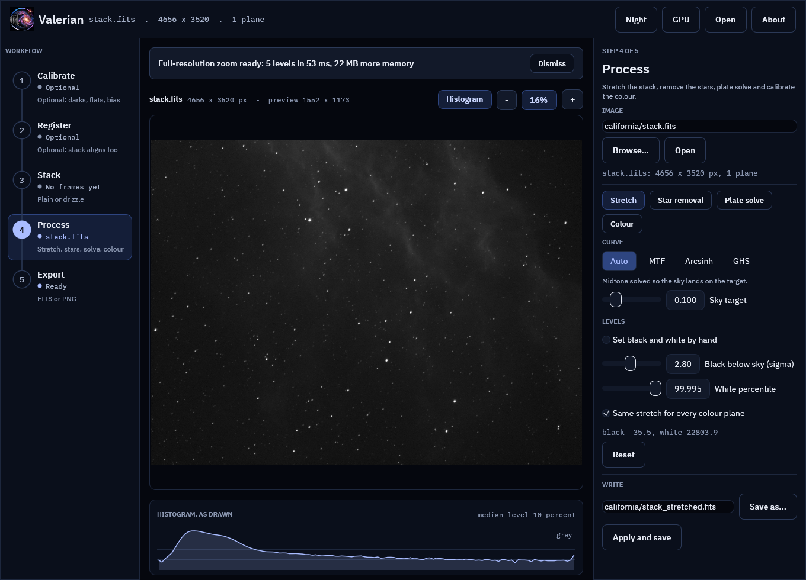
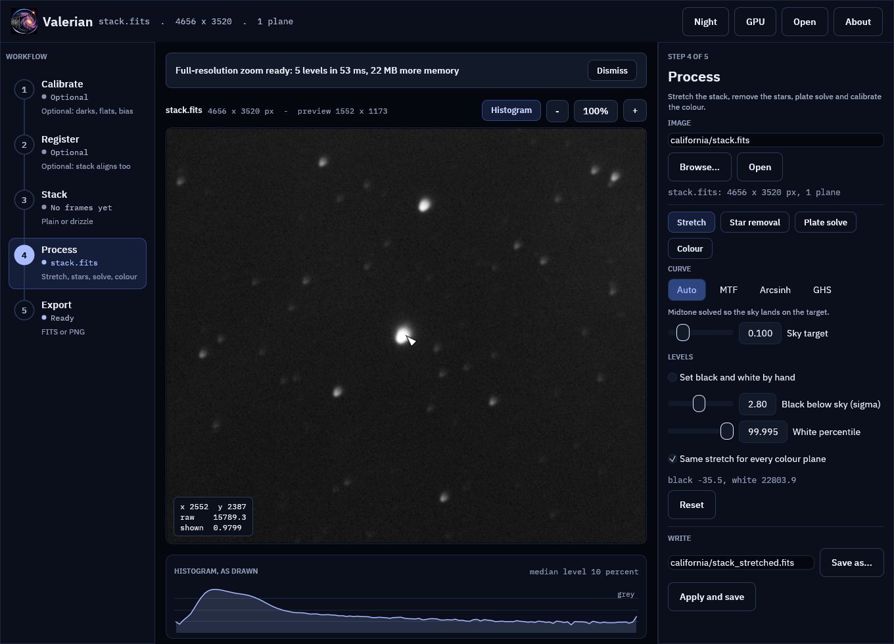
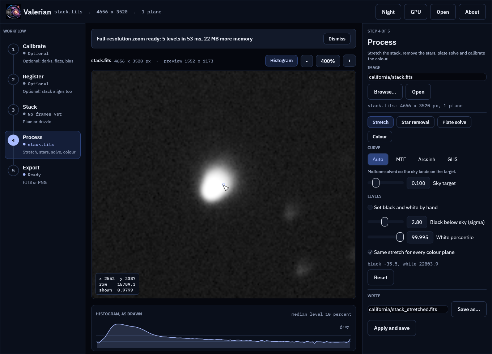
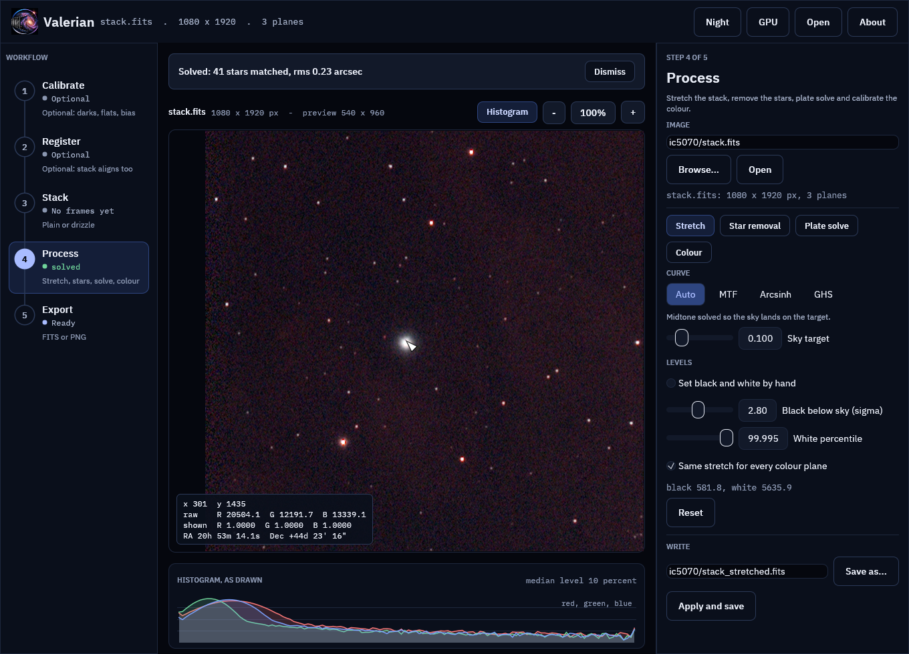
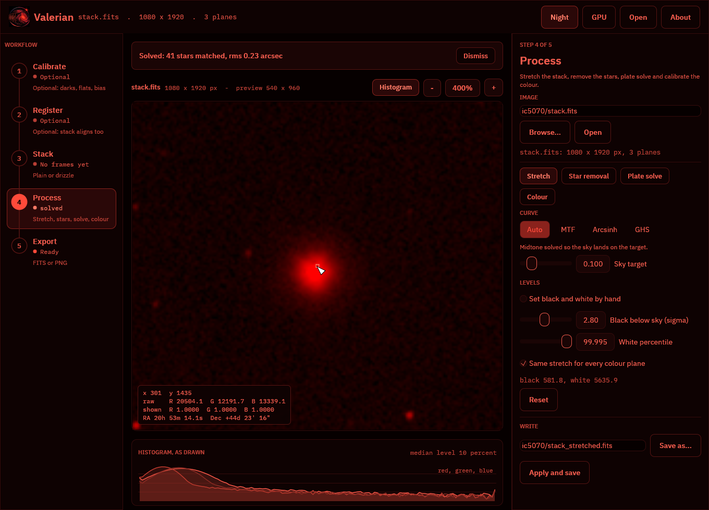

# Tutorial: Zoom to the real pixels

**Goal:** look at a stack at full resolution in the desktop app: see the real pixels at 1:1 and
4:1, read the value of any pixel (and its sky position when the picture is plate solved), and
know what the app is doing while it does so.

**Data:** the stack from [tutorial 2](calibrate.md) (the California Nebula in H-alpha,
4656 by 3520 pixels, mono) and the IC 5070 stack (1080 by 1920 pixels, three colour planes,
plate solved in the app) from [the two captures](index.md#the-two-captures). Any FITS image
works; the pictures below are of these two. **The viewer needs the desktop app** (`valerian-gui`);
there is no command line equivalent, because the question is how a picture is shown.

**Why this exists.** The window cannot show 16 million pixels at once, so the app first draws
a reduced copy (at most 1600 pixels on its long side). That is right for judging the picture
as a whole and for moving a slider and seeing the stretch change at once. It is wrong for
looking at a star: at 400 % of a reduced copy you are looking at a smooth enlargement, not
at your data. The viewer therefore also keeps an **image pyramid** of the open image and, once
the zoom needs more detail than the reduced copy has, draws the real pixels from it. How that
works is in [How it works](#how-it-works) below.

## Step 1: Open the stack

Press **Open** (Ctrl+O), choose `stack.fits`, or start the app with the file:

```sh
valerian-gui california/stack.fits
```

The picture appears at once, fitted to the window, drawn from the reduced copy. For an image
larger than 1600 pixels the strip above the picture says:

```text
Building the zoom levels for full-resolution viewing...
```

with a spinner and the seconds it has taken. The window stays usable while it builds. On the
4656 by 3520 stack it takes a few hundredths of a second on a 24-core server, so you will
hardly see it; a 100-megapixel mosaic on a laptop takes a noticeable fraction of a second. When it
finishes, the strip says what it made and what it cost:

```text
Full-resolution zoom ready: 5 levels in 12 ms, 22 MB more memory
```

Press **Dismiss** to hide it. Nothing else changes: you are still looking at the reduced copy.



## Step 2: Zoom in

Scroll up over the picture. The zoom is now counted in screen pixels per pixel **of the open
image**: the percentage button reads 100 % when one screen pixel shows one image pixel, 400 % at
four, and 25 % when four image pixels share a screen pixel. Until the zoom passes what the reduced
copy holds, nothing changes in how the picture is drawn. Past that, tiles of the real image
appear on top of the reduced copy, a few per frame, middle of the window first. On a fast
computer you will not see them arrive; on a slow one the soft reduced copy is sharpened a tile
at a time.

Press **1** to go to exactly 1:1 from wherever you are (**0** fits the picture again).



## Step 3: Read a pixel

With the pointer over the picture, a box at the bottom left of it gives the pixel under the
pointer:

```text
x 2552  y 2387
raw    15789.3
shown  0.9799
```

* **x, y** are image pixels, counted from 0 at the top left (the same numbers the plate
  solver and the star finder use).
* **raw** is the value in the file, in the file's units (here ADU of the stack, so it is
  large; a file already scaled to 0 to 1 shows 0 to 1). A colour image shows one value per
  plane: `R`, `G` and `B`.
* **shown** is what the current stretch makes of that value, from 0 (black) to 1 (white), per
  plane. This is the same maths the picture is drawn with. At or near 1 the pixel is white on
  screen; to look inside a bright star, raise the white point in the Stretch tool.
* **RA, Dec** appear when the image carries a sky solution (a plate-solved file, or an image
  you have just plate solved in the app): right ascension in hours, minutes and seconds,
  declination in degrees, arcminutes and arcseconds, of the centre of that pixel.

From 400 % up the pixel under the pointer is outlined.

## Step 4: 4:1 and the sky position

Scroll in to 400 %. Each image pixel is now a 4 by 4 square: the noise of the stack, the
shape of the star and the pixel grid are all visible, and the outlined pixel is the one the
readout describes.



On the IC 5070 stack, after Plate solve in the Process step (tutorial 8), the same readout has
the sky position:



## Step 5: Night vision

Press **F2** (or **Night**). The tiles are drawn again in red only, like the rest of the
picture, so the view does not spoil dark-adapted eyes.



## How it works

The method is the one map viewers and astronomy viewers share: a mipmap pyramid with tiles.

1. **Levels.** Level 0 is the image. Level 1 averages every 2 by 2 block into one pixel (the
   mean of the finite pixels, so NaNs and infinities do not spread), level 2 averages level 1,
   and so on until a level fits in one 512 by 512 tile. The extra levels cost a third of the
   image's memory (1/4 + 1/16 + ...). They are built on a worker thread when the image is
   opened.
2. **Level from zoom.** At a zoom of `z` screen pixels per image pixel the viewer draws the
   coarsest level whose pixels are still at least one screen pixel across: level
   `floor(log2(1/z))`, and level 0 from 100 % up. A picture is therefore never drawn from less
   detail than the screen can show, and never from far more than it needs.
3. **Tiles.** The part of that level the window shows is cut into 512 by 512 tiles (smaller at
   the right and bottom edges). Each tile is stretched with the live stretch, tinted when night
   vision is on, and uploaded as a texture. Stretching a tile gives the same values as
   stretching the whole image and cutting the tile out (a test checks this), because the
   stretch works pixel by pixel on levels measured once on the full frame.
4. **Cache.** Tiles are kept in a least-recently-used cache limited to 256 MiB of textures
   (about 250 full tiles, several screens of 4K), so memory stays bounded however far you pan.
   Changing the stretch, the curve, the sky target or the palette throws the tiles away and the
   visible ones are made again.
5. **No stall.** The reduced copy is always drawn first. A frame spends at most about 12 ms
   making tiles and asks for another frame when more are needed, so panning and zooming stay
   smooth and sharpen as the tiles arrive.

The code is `valerian_core::pyramid` (levels, level choice, tile geometry, cache; unit tested
without a window) and `crates/valerian-gui/src/tiles.rs` (the drawing).

## What to expect

On a 24-core shared build server (so the times move around from run to run), for the two stacks above,
over three runs: building the pyramid took 7 to 46 ms for the 4656 by 3520 stack (5 levels,
22 MB of extra memory on 66 MB of pixels) and 10 to 19 ms for the 1080 by 1920 colour stack
(3 levels, 8 MB on 25 MB). Stretching and converting a 512 by 512 tile took 3.0 to 4.1 ms, so a
1920 by 1080 window at 1:1 (at most 20 tiles) is sharp within about 80 ms of the first frame,
spread over a handful of frames. The
[CHANGELOG](https://github.com/qisback/valerian/blob/main/CHANGELOG.md) records the
same measurements.

## If it does not work

* **The picture is soft at 400 %.** Tiles are drawn for the stretched open image only. The
  star-removal layers, the colour-calibrated view and the pictures of the folder steps
  (calibrated frame, reference frame, drizzle result) are drawn from reduced copies and stay
  soft when enlarged. Switch the Process tool back to Stretch to see the real pixels.
* **Tiles arrive slowly.** The first tile of each frame is always made, so the view always
  moves on; a slow computer makes fewer per frame. Zoom out one step: the level is chosen from
  the zoom, and a coarser level has far fewer tiles to make.
* **There is no "zoom ready" message.** Images of 1600 pixels or fewer on the long side are
  prepared at once, with nothing to wait for.
* **The readout does not show.** It is drawn only while the pointer is over the picture.
* **No RA and Dec.** The image has no sky solution. Plate solve it (the Process step), or open
  a file that was solved earlier.

Reference: [the View section of the desktop app reference](../reference/gui.md#view).
