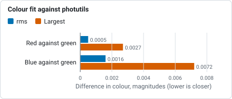

# How the astrometry and photometry outputs work

These outputs show how good a plate solution is and what the stars say about the picture and
the night: the **annotated image** (an RA/Dec grid, catalogue objects and Gaia stars drawn on the
picture), the **residual vectors** of the solution and their **map** across the frame, the
**colour-calibration scatter** of `valerian photocal`, the **zero point and colour term** of each
colour plane, a **calibrated star catalogue** with magnitudes and errors, the **limiting
magnitude**, and the **light curve** of one star across frames. `valerian annotate`,
`valerian photocal --report`, `valerian photometry` and `valerian plot` make them; the desktop
app has them in the **Astrometry** tool of the Process step and in the **Science** panel of the
Stack step. For a worked example start with [tutorial 15](../tutorials/astrometry.md), and
[tutorial 20](../tutorials/zero-point-and-limit.md) for the magnitudes; this page says what each
output is, how it is made and what every option and control does.

## The annotated image

`valerian annotate IMAGE --report DIR` needs a plate solution: the image's own (written by
`valerian solve`), the one in `--wcs FILE`'s header, or, when the image has none, one found
by a quick solve from the header's position and scale (it says so). The picture is the image
stretched by the automatic midtone stretch (sky at 25 per cent), reduced by block means to
`--max-side` pixels, with:

* **A grid.** The spacing of the declination lines is the smallest of 0.25, 0.5, 1, 2, 5, 10, 15,
  20, 30 arc minutes and 1, 2, 5, 10, 15, 20 or 30 degrees that gives at most six lines across the
  field; the right-ascension lines the smallest of 1, 2, 5, 10, 15, 30 seconds of time, 1, 2, 5, 10,
  15, 30 minutes and 1, 2, 4, 6, 12 hours likewise. Each line is followed through the solution
  (so it curves with SIP distortion and near the poles) and labelled where it enters the picture:
  declinations at the left, right ascensions at the bottom. The title line gives the centre in
  `hh:mm:ss.s +dd:mm:ss`, the scale, the rotation and whether the image is mirrored.
* **Catalogue objects.** The bundled list holds every Messier object and the NGC and IC
  galaxies, clusters, planetary and other nebulae and supernova remnants that are bright (V 11.5
  or brighter, or B 12.5) or large (8 arc minutes or more): 1613 objects, and a CSV of them
  is the file `crates/valerian-science/data/objects.csv`. An object with a catalogued size is
  drawn as an ellipse of that major and minor axis at its position angle (carried through the
  solution, so it turns with the image), with semi-axes of at least 5 and 4 pixels; one without as a small
  circle. The colour says the kind (galaxies orange, clusters yellow, planetary nebulae
  aquamarine, supernova remnants pink, other nebulae green). The 40 largest are labelled with
  their name and common name.
* **Gaia stars.** The catalogue stars brighter than `--star-mag` (G 10 by default) in the field,
  as circles that grow with brightness, labelled with their G magnitude when brighter than
  `--label-mag` (8).

`--no-grid`, `--no-objects` and `--no-stars` leave a layer out. Without the star catalogue
there are no Gaia stars and no residuals, and it says so.

The bundled object list is a subset of **OpenNGC** by Mattia Verga
(<https://github.com/mattiaverga/OpenNGC>), made by `scripts/build_objects.py`. OpenNGC is
licensed **CC BY-SA 4.0**; the subset keeps that licence (the file is annotated in `REUSE.toml`
and the licence text is in `LICENSES/CC-BY-SA-4.0.txt`), which is compatible with the GPL for a
program that carries the data. If you redistribute Valerian, the data file and its licence travel
with it.

## The residuals of the solution

The stars of the image are detected (as for `valerian solve`) and each is matched to the nearest
unclaimed Gaia star within 3 pixels of where the solution puts it, brightest detections first.
The **residual** of a star is the detected position minus the projected catalogue position
(`dx`, `dy`, pixels; times the scale, arc seconds). At least 10 stars must match. The sheet shows

* the **vector field**: an arrow from every matched star along its residual, exaggerated so that
  the 90th percentile arrow is about a twentieth of the short side of the frame (the factor is in
  the title, a bar shows half a pixel at that factor), coloured by length. A solution that is as
  good as the data shows short arrows pointing every way. A pattern is a fault: arrows all alike
  are a shift (the centre of the solution is off), arrows that turn round a point are a rotation, arrows
  that point to or from the middle are a scale error, and arrows that curve towards the corners are
  distortion the TAN model without SIP cannot fit (solve with SIP, `valerian solve --sip-order`);
* the **residual length against magnitude**, with the rms as a line: the faint stars are noisier,
  and a bright star far above the rest is a double star or a bad match.

`wcs_residuals.csv` lists every star (`x`, `y`, `ra_deg`, `dec_deg`, `g`, `dx_px`, `dy_px`,
`length_px`, `length_arcsec`), and `astrometry.json` has the rms, the median, the mean shift and
the list.

## The colour-calibration scatter

`valerian photocal --report DIR` (and `valerian plot pcc`) draw what the colour fit rests on: for
every Gaia star measured, its **instrumental colour** `-2.5 log10 (F_red / F_green)` (and the same
for blue) against its Gaia **BP-RP**, with the fitted line
`instrumental colour = zero + slope x (BP-RP - reference)`, the stars the fit used as blue dots
and the ones it rejected as red crosses, and a vertical line at the BP-RP that is made neutral
(0.82 by default). The title of each panel has the slope, the scatter about the line and the gain
the fit gives; the gain is `10^(0.4 x zero)`. A healthy fit is a tight line through the cloud, red
sloping down (redder stars are relatively brighter in red) and blue up. `pcc.csv` has every star's
position, G, BP-RP, both colours, both residuals and whether it was used; `pcc.json` the lines, the
gains with their uncertainties, the offsets and the warnings. The options of the fit are those of
`valerian photocal` (see [How colour calibration works](colour-calibration.md)).

## The astrometric residual map

The residual vectors of a few hundred stars are hard to read as a picture; the **map** bins them.
`valerian annotate --report DIR` writes it as `residual_map.png`, `.csv` and `.json` (and
`valerian plot residual-map IMAGE -o FILE.png` makes it on its own). The frame is cut into
`--map-grid` cells a side (6 by default, 2 to 24; pick it so that a cell holds five stars or more,
which is `floor(sqrt(stars / 5))` for stars spread evenly: 3 for the 72 stars of tutorial 20, 6 for
about 180). A cell with at least 3 matched stars is drawn
as an arrow along the **mean** residual of its stars, coloured by length, with the number of
stars in its corner; a thinner cell is left grey. Averaging cancels the star-to-star scatter, so
a fault of a tenth of a pixel that the single vectors hide shows as a smooth pattern.

The map also fits the linear part of the pattern. With `u` and `v` the offsets in pixels from the
frame centre, `dx = a0 + a1 u + a2 v` and `dy = b0 + b1 u + b2 v` are fitted to every star's
residual by least squares, and read as

* **scale**, `(a1 + b2) / 2`, in parts per million. Positive means the stars lie farther from the
  centre than the solution says, so the solution's scale is a little small. A scale error of 500 ppm
  moves a star 1118 pixels from the centre (the corner of a 2000 by 1000 frame) by 0.56 pixels;
* **rotation**, `(b1 - a2) / 2` times the half-diagonal times the pixel scale, in arc seconds
  at the corner of the frame. Positive is stars turned from the +x axis towards +y (clockwise on
  the screen, because y runs down);
* **anisotropy**, `(a1 - b2) / 2`, and **shear**, `(a2 + b1) / 2`, in ppm: unequal scales along x
  and y, and a skew between the axes. Both should be near zero for a camera with square pixels;
* **rms before and after**: the residual rms with and without the linear terms. If the second is
  far below the first, the solution has a simple fault that a better fit would remove. If they are
  close, what is left is not linear: distortion the TAN projection cannot hold (solve with SIP,
  `valerian solve --sip-order`), or noise.

The right side of the sheet plots every star's **radial** residual (along the line from the
centre) and **tangential** residual (across it) against its distance from the centre, with the
linear fit as a line. Optical distortion is radial and grows as a power of the radius, so a
curve in the radial plot that the straight line misses is the distortion. A rotation is purely
tangential and a scale error purely radial, which is why the two plots are kept apart.
`residual_map.csv` has a line per cell (`ix`, `iy`, the centre `x`, `y`, `stars`, `mean_dx_px`,
`mean_dy_px`, `mean_length_px`, `mean_length_arcsec`, `scatter_px`); `residual_map.json` the cells,
the linear terms and the mean radial and tangential residual in five rings from the centre
(empty cells and rings are `null`). The linear fit needs stars spread over the frame: if they lie on a
line it says so and writes no map.

## The zero point and colour term

`valerian photocal IMAGE --report DIR` (and `valerian plot zeropoint IMAGE -o FILE.png`) turn the
Gaia stars of the colour fit into the **photometric zero point** of each colour plane. A star of Gaia
magnitude `G` that gives a flux `F` (the sum over the aperture less the sky, in the pixel units
of the image) has `zp = G + 2.5 log10 F` in that plane. The zero point turns a flux into a
magnitude, `m = zp - 2.5 log10 F`. The stars do not all give the same `zp`, because the camera's
red, green and blue do not match Gaia's G band: a redder star is relatively brighter in the red plane.
The difference is a straight line in the Gaia colour BP-RP, the **colour equation** of photometry
(Stetson 2000):

`zp = Z + k (BP-RP - 0.82)`

`Z` is the **zero point** of a star of the reference colour (0.82, the Sun, `--reference-colour`),
`k` the **colour term** in magnitudes per magnitude of BP-RP. The fit is least squares on the stars the
colour fit kept, with 3-sigma clipping (at least 8 stars must remain). The sheet has three panels:

* the **zero point against G with the colour term removed** for each plane, with the fitted `Z` as
  a horizontal line. It is flat for a linear camera. A tilt means the bright stars are saturated or
  the response is not linear (a warning says so when the drift across the measured range exceeds
  0.1 mag), and the trend is `trend_with_g` in the JSON;
* the **zero point against BP-RP** for each plane, with the colour-term lines: this is the picture
  of the colour response of your camera and filter. Red slopes up and blue down, by an amount that
  depends on the filter and sensor (the Seestar S50 stack of [tutorial 20](../tutorials/zero-point-and-limit.md) gives red +0.02, green -0.28 and blue -0.74 mag per BP-RP);
* the **residual of the green plane across the field**, against the distance from the centre, with the
  median in five rings. A flat line is a flat field and no vignetting; a fall at the corners is
  vignetting the flats did not remove, and a magnitude measured there is that much too faint.

The title and legend give `Z` with its **standard error** (the error of the intercept of the
fit), `k` with its error, and the **scatter** of the stars about the line (the rms of the residuals).
The scatter is the real precision of one star's magnitude; the error of `Z` is how well the whole
scale is known. `zeropoint.json` has, per plane, `zero`, `zero_error`, `colour_term`,
`colour_term_error`, `scatter`, `stars` (kept), `trend_with_g` and `zero_after_gain`, the zero point of
the image after the gains of the colour calibration are applied (`Z + 2.5 log10 gain`: red and blue
land on the green value by construction); `zeropoint.csv` has every Gaia star measured (`x`, `y`,
`g`, `bp_rp`, `zp_r`, `zp_g`, `zp_b`, the three residuals and `kept_rgb`, three digits for the planes
that kept it). The zero point is for the pixel values the image had when it was measured, which
is the image given to `photocal` before the gains; magnitudes from the catalogue below are the same
before and after the gains.

## The calibrated star catalogue

`valerian photocal IMAGE --calibrated-stars FILE.csv` (and `--report DIR`, which writes
`calibrated_stars.csv`) lists **every star detected in the image**, not only Gaia's, with a
magnitude in each plane. Stars are found as for the colour fit but down to `--field-threshold`
sigma (5 by default; the brightest `--max-field-stars`, 5000, are kept) and measured in the same
aperture and sky annulus as the Gaia stars. For each star:

1. **Colour.** A star with a Gaia match (within half a pixel of a star the fit used) takes its Gaia
   BP-RP, flag `G`. Any other star has its BP-RP **estimated** from its own colours by inverting the
   two lines of the colour fit (`instrumental colour = zero + slope (BP-RP - 0.82)`), red against green
   and blue against green, each weighted by the inverse of its variance; it needs a signal-to-noise
   ratio of 10 in all three planes and a positive flux in each. A star too faint for that is given the
   reference colour 0.82 with an error of 0.4 and flag `E`, which is about the spread of star colours.
2. **Magnitude.** `m = Z + k (BP-RP - 0.82) - 2.5 log10 F` in each plane: a **Gaia-G equivalent**
   magnitude, which is what Gaia's G of that star would be if the star's colour were as estimated. For a
   star of the reference colour all three planes agree; the difference between planes is the
   measure of how wrong the colour is.
3. **Error.** The three parts add in quadrature: the photon and sky noise of the aperture,
   `1.0857 / SNR` (the first-order error of `-2.5 log10 F`, Howell 1989), the standard error of `Z`,
   and `|k|` times the error of the colour. The scatter of the stars about the colour line is not
   in the error: it is what the calibration stars show of the true error at the bright end, and it is in
   `zeropoint.json`.

`calibrated_stars.csv` columns: `id` (1 is the brightest in green), `x`, `y`, `ra_deg`, `dec_deg`,
`mag_g`, `mag_g_err`, `mag_r`, `mag_r_err`, `mag_b`, `mag_b_err`, `snr_g`, `flux_g`, `bp_rp`,
`bp_rp_err`, `gaia_g` and `mag_g_minus_gaia_g` (for Gaia stars: a direct check of the calibration),
`fwhm_px` and `flags`: `S` saturated (the magnitude is too faint), `C` crowded (another star in the
aperture or annulus), `E` colour assumed, `N` a plane has no positive flux (its magnitude is
empty), `B` brighter than every Gaia star the zero point was fitted on (unverified, and probably
partly saturated: the three brightest Gaia stars of tutorial 20 come out 0.2 to 0.4 mag too faint),
`G` matched to Gaia. Leave out `S`, `C`, `N` and `B` rows when you use the table.

The catalogue contains only measurements from your image and the Gaia values already in the
catalogue file you supply; Valerian adds no star data of its own to it.

## The limiting magnitude

The same run reports how faint the image goes, at `--limit-snr` (5 by default), as a **point-source
limit**: the magnitude of a star whose aperture flux is that many times the noise of one aperture
(Newberry 1991),

`m_lim = Z - 2.5 log10 (S sigma_ap)`

where `sigma_ap` is the **median** sky-noise error of the apertures of the catalogue stars that are
neither saturated nor crowded, `flux / SNR` for each (the error from the sky scatter and its
estimate alone, so the star's own photon noise is left out: the limit is for a faint star). It is
given for each plane, and in `zeropoint.json` for green at 3 and 10 sigma too. Two checks on it
come from the stars:

* **the faintest star measured at that signal-to-noise** in green. It lies within a few tenths of a
  magnitude of the limit on either side: the signal-to-noise of one faint star scatters, so the
  faintest of thousands sits a little past the line;
* **the peak of the differential counts**, the centre of the half-magnitude bin of the green
  magnitudes that has the most stars. Star counts rise with magnitude until the detection runs
  out; the peak is the usual measure of where the catalogue stops being complete. It is shown only
  with at least 30 stars. For a stack that is cleanly background-limited it lies near the 5-sigma
  limit (0.2 mag from it in tutorial 20); a crowded or nebulous field peaks earlier, because the
  stars blend before they sink into the noise.

The `limiting_magnitude.png` sheet plots log10 SNR against magnitude for the unsaturated, uncrowded
stars (Gaia stars in orange), with the horizontal line at the signal-to-noise ratio and the vertical
line at the limit, and the star counts per half magnitude with the limit and the peak. Points fall on a
line of slope -0.4 (one dex in SNR per 2.5 mag) until the star's photon noise matters. The Gaia
catalogue stops at G 11, so the limit is **extrapolated** from the apertures, not read from Gaia
stars of that faintness; the faint end of the catalogue has not been checked against a deeper catalogue.

## Aperture photometry across frames

`valerian photometry FRAMES --report DIR` measures one star in every frame:

1. The frames are registered to the sharpest (or `--reference`), as for the stack.
2. The star's position in the reference frame is `--star X,Y`, or the brightest star that is not
   saturated and not near an edge. (A star is saturated when a colour plane reaches the top of
   the 16-bit range, 60000 ADU or more, or of a 0 to 1 scale, and a pixel within 2 pixels of the
   star is within 15 per cent of that top.) The position is carried to every frame through
   the registration and refined there by a flux-weighted centroid (up to 4 iterations, rejected
   if it moves more than the aperture radius).
3. The **aperture** is a circle of `--aperture` times the FWHM of that frame (2.0 by default,
   at least 2 pixels), so a soft frame loses no more of the star than a sharp one. Pixels
   cut by the edge count by the fraction of their area inside (6 by 6 subpixels). The **sky** is the
   sigma-clipped median of the annulus from 1.5 to 2.2 times the radius (at least 4 pixels wide);
   the flux is the sum of the aperture less the sky times its pixels. The **error** is the sky
   scatter times `sqrt(n (1 + n / n_sky))` for the `n` pixels of the aperture: it is the error from the
   background alone, a floor, not the whole error.
4. Up to `--comparison` stars (10 by default) are chosen in the reference frame the same way: not
   saturated, with no brighter neighbour within the annulus, away from the edges and the
   target, and measured in every frame (otherwise in nine tenths of them). Their summed flux is
   the **ensemble**. The star's **relative magnitude** is `-2.5 log10 (F_star / F_ensemble)` less its
   median over the frames, so clouds, airmass and exposure changes that dim every star alike drop
   out, and a change in the star alone stays. Brighter is more negative, and the plot has brighter up.
5. The **check star**, the first comparison star measured against all the others, has the same
   treatment. It should be flat: its scatter is the real precision of the night, which the formal
   errors do not include (scintillation, seeing, field rotation, the demosaicing of a colour camera).

Mid-exposure time is `DATE-OBS` plus half `EXPTIME`; a frame without it is plotted by number.
`lightcurve.csv` has per frame: `frame`, `name`, `time_utc`, `hours`, `x`, `y`, `aperture_px`,
`flux_adu`, `flux_error_adu`, `sky_adu`, `snr`, `ensemble_flux_adu`, `mag_instrumental`,
`mag_relative`, `mag_error`, `check_mag`, `ok` and `note`; a frame in which a comparison star could
not be measured is `ok` 0 and says so. `lightcurve.json` has the same with the apertures,
the comparison positions and the two scatters.

| Option | What it does | Range | Default |
|---|---|---|---|
| `valerian annotate IMAGE` | the image to draw on | a solved FITS file | required |
| `--report <DIR>` | folder for the picture, lists, residuals and report.html | a folder | `astrometry-report` |
| `--wcs <FILE>` | take the plate solution from this file's header | a FITS file | the image's own, else a quick solve |
| `--catalogue <FILE>` | the star catalogue | a `.vcat` file | the one beside the program |
| `--no-grid`, `--no-objects`, `--no-stars` | leave a layer out | | all drawn |
| `--star-mag <MAG>` | faintest Gaia star drawn | G 4 to 11 | 10 |
| `--label-mag <MAG>` | Gaia stars brighter than this are labelled | | 8 |
| `--max-side <PIXELS>` | longest side of the picture | 200 to 6000 | 1400 |
| `valerian photocal --report <DIR>` | write the colour-fit scatter, the zero points, the limiting magnitude and the calibrated catalogue | a folder | not written |
| `--calibrated-stars <FILE>` | write the calibrated star catalogue as CSV (`photocal`) | a file | not written |
| `--limit-snr <SNR>` | the signal-to-noise ratio that defines the limiting magnitude (`photocal`, `plot`) | above 0 | 5 |
| `--field-threshold <SIGMA>` | detection threshold of the catalogue stars (`photocal`) | above 0 | 5 |
| `--max-field-stars <N>` | the most stars in the catalogue, the brightest (`photocal`) | 1 or more | 5000 |
| `--map-grid <N>` | cells a side of the residual map (`annotate`) | 2 to 24 | 6 |
| `valerian photometry FRAMES` | frames to measure | FITS files or folders | required |
| `--report <DIR>` | folder for the light curve | a folder | `photometry-report` |
| `--star <X,Y>` | the star, pixels in the reference frame | | the brightest unsaturated star |
| `--aperture <FWHM>` | aperture radius in FWHM | 1 to 5 | 2.0 |
| `--comparison <N>` | comparison stars at most | 3 or more | 10 |
| `--reference`, `--model`, `--debayer`, `--threshold` | as for [register](../tutorials/register.md#options-used) | | the sharpest frame, `similarity`, `auto`, 5 |

`valerian plot annotate|residuals|residual-map|pcc|zeropoint|limiting-mag IMAGE -o FILE.png` and
`valerian plot lightcurve FRAMES -o FILE.png --star X,Y` draw one on its own, with `--wcs`,
`--catalogue`, `--star-mag`, `--aperture`, `--comparison`, `--limit-snr` (zeropoint, limiting-mag) and
`--grid` (residual-map, 2 to 24, default 6), and write the data beside the PNG (`.csv` and
`.json`; for `limiting-mag` the CSV is the calibrated catalogue). `valerian plot zeropoint` and
`limiting-mag` run the colour fit with its default settings first; use `valerian photocal` when you
need other settings (`--min-snr`, `--max-mag` and the rest).

## The Astrometry tool and the light curve in the desktop app

**Astrometry** (Process step): open a plate-solved image (or run the Plate solve tool first; its
result is used even if you have not saved it), choose the layers and press **Draw the solution**.
It runs on a worker thread, and the chips under Picture show **Annotated**, **Residuals**,
**Residual map** and, for a linear colour image, **Colour fit**, **Zero point** and **Limiting
mag**. **Save report** writes the same folder as the command line, with the residual map, the zero
points and the calibrated catalogue (`calibrated_stars.csv`).

| Control | Range | Default |
|---|---|---|
| RA/Dec grid, Catalogue objects, Gaia stars | tick boxes | all on |
| Faintest star (G) | 4 to 11 | 10 |
| Draw the solution | draws the layers, measures the residuals and fits the colour | needs a plate solution |
| Annotated, Residuals, Residual map, Colour fit, Zero point, Limiting mag | the picture the viewer shows; a picture that could not be made has no chip | Annotated |
| Result | adds the residual-map scale and rotation, and the green zero point with its error and the 5-sigma limit | |
| Report, Save report | folder for the picture, lists, residuals, colour fit and report.html | `astrometry-report` beside the image |

**Light curve** (Science panel of the Stack step, below the integration controls): give the folder
of frames, tick **The brightest unsaturated star** or untick it and give `x` and `y` in the
reference frame, set the aperture and press **Measure the star**. The **Light curve** chip appears
beside the others, and the panel says the scatter of the star and of the check star.

| Control | Range | Default |
|---|---|---|
| The brightest unsaturated star | tick box | on |
| x, y (reference frame) | pixels | the star found, after a run |
| Aperture (FWHM) | 1 to 5 | 2.0 |
| Measure the star | registers, measures, draws | |

## Checked against astropy, photutils and numpy

`scripts/compare_python_astrometry.py` repeats the measurements with different code
(astropy 8.0.2, photutils 3.1.1):

| Output | Check | Result |
|---|---|---|
| residuals, IC 5070 stack, 40 stars | the predicted pixel position of each Gaia star against `astropy.wcs.WCS.all_world2pix` of the solved header | the same to 0.0013 px at most; residual rms 0.0978 px (Valerian) against 0.0979 px (astropy) |
| colour fit, 36 Gaia stars | the instrumental colours from photutils aperture photometry (`CircularAperture`, sigma-clipped `CircularAnnulus`, same positions and radius) against the table's | red/green: median difference +0.0002 mag, rms 0.0005, largest 0.0027; blue/green: median -0.0001, rms 0.0016, largest 0.0072 |
| colour fit, lines on the 33 stars used | numpy `polyfit` on the photutils colours against on the table's | red: slope -0.635 and zero -0.305 against -0.635 and -0.306; blue: +0.082 and -0.015 against +0.080 and -0.015 |
| photometry, 5 H-alpha frames (ASI1600MM) | the flux of the star at each frame's position and aperture from photutils (exact pixel overlap, sigma-clipped annulus median) against the table's | ratio 1.0009 median, 0.9966 to 1.0021: within 0.4 per cent |

*Difference between Valerian's instrumental colours and photutils' for 36 Gaia stars, rms and largest, from the table above: all below 0.01 mag.*

The photutils fluxes use exact pixel overlap and Valerian's colour fit weights the aperture edge
by a linear ramp, hence the few thousandths of a magnitude; the photometry module uses
exact fractions (6 by 6 subpixels at the edge) and agrees to 0.1 per cent in the median.

## Limits of the method

* The residuals can only show what the catalogue stars show: with fewer than about 30 matched
  stars a pattern is hard to see, and Gaia positions are at epoch 2016.0 with no proper motion
  applied, which matters for the few bright nearby stars only.
* The object ellipses use catalogued sizes and angles that are often rough; they say where to look,
  not where a galaxy ends.
* The light curve's error is the sky noise alone. Compare it with the check star's scatter to know
  the real precision.
* The comparison stars are assumed constant. A variable comparison star shows in the check star;
  give `--comparison` a smaller number, or choose the target away from a crowded field.
* The zero point is only as good as the Gaia stars behind it: the colour fit keeps stars of G 6 to 11
  (settable with `--min-mag`, `--max-mag`) and a Seestar saturates the brightest of them, which
  shows as a drift in the first panel of the zero-point sheet. The catalogue's G band is not the
  camera's band: the magnitudes are Gaia-G equivalents through the colour equation, valid for
  ordinary stars between BP-RP 0.3 and 2.5, not for emission-line objects or very red stars.
* The limiting magnitude is extrapolated from the apertures: nothing in the bundled catalogue is
  fainter than G 11. It is for a faint point source on the sky level of the field; a star on a
  bright nebula is shallower. A stacked image has correlated noise (resampling, drizzle), so its
  aperture noise is lower than a pixel-by-pixel estimate would say; the measured aperture noise
  already includes that.
* The residual map is as good as the Gaia positions at epoch 2016.0; stars with large proper motion
  (a few per square degree) shift by their motion since then. They are few and the cell means are
  robust to them, the single-star vectors are not.
* A saturated star cannot be measured (its flux is clipped); the brightest unsaturated star is
  chosen automatically but a star saturated only in some frames is not caught.
