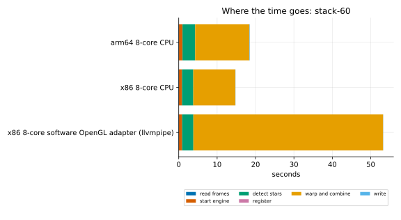
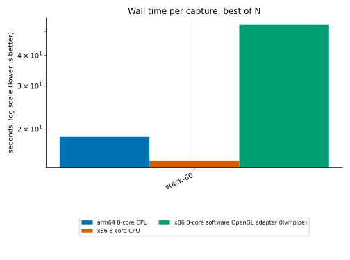
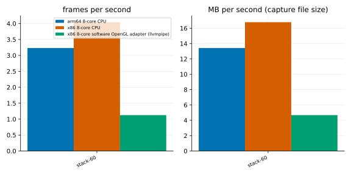
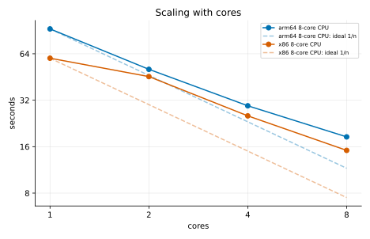
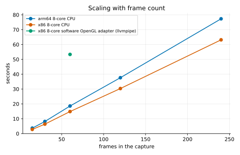
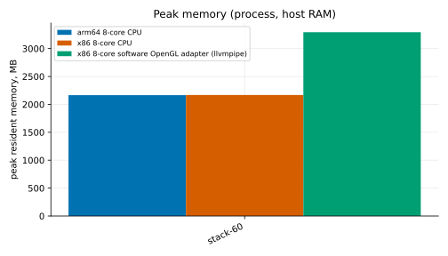

# Performance and benchmarks

This page shows how fast `valerian stack` is, where the time goes, how it changes with
the hardware, the number of frames and the number of cores, and what the GPU kernels
do on their own. Everything here was produced by one script that you can run yourself on
your own machine (see [Reproduce these numbers](#reproduce-these-numbers)), and every
graph has its data table beside it. The [GPU tutorial](../tutorials/gpu.md) shows how to
read `valerian bench`; this page is the measurements.

**What counts as a number on this page.** Each figure is the best of several runs of the
same command, on a machine that was otherwise idle while it ran. The script measures how
much CPU the rest of the machine used during each run, and a run that shared the machine
with more than half a core of other work is left out, not averaged in. The table under
[How it was measured](#how-it-was-measured) says which machines, which build and how many
runs.

## Headline numbers

The figures below are best-of-N seconds for stacking sixty Seestar frames with `valerian stack`.

* **On the processor, about 15 to 19 seconds**: 14.8 s on the x86 server and 18.6 s on the Arm server, 4.0 and 3.2
  frames a second. About three quarters of that is the warp and combine step (11.0 s of 14.8 s on x86); finding the
  stars is 2.9 s.
* **The time grows in a straight line with the frame count**: 0.19 s per frame at 15 frames and 0.26 s at 240 on x86 (the
  last two points repeat the same files, see the method). Memory followed the frame count when these runs were made
  (2.2 GB for sixty frames); since version 0.4.0 it follows the `--memory` budget instead, see the dated
  measurement under Memory.
* **Cores:** 4.0 times faster on 8 threads than on one on x86 (4 cores with 2 threads each) and 5.0 times on 8
  Arm cores.
* **The software adapter is for testing, not for speed**: 3.6 times slower than the processor on x86 (through
  OpenGL llvmpipe, see the machines below), and it needs 1.5 times the memory.

### Apple silicon

From a separate run, not from the script on this page: `valerian bench` on an Apple M1 (Scaleway Mac mini,
2026-10-21). The kernels were faster than the processor code by 2.2 times for the stack plane and 2.6 times for the
warp, 1.0 to 1.2 times for the combiners, and 0.7 times (slower) for calibration. The
[GPU tutorial](../tutorials/gpu.md) has the table.

### Not measured yet

The A100 timings of `valerian stack` and `valerian bench` are pending. This build of Valerian cannot choose a GPU,
and the first GPU of the shared server was in use by another job, so a run there would not be a fair
figure; the [GPU tutorial](../tutorials/gpu.md) has an earlier A100 run, taken on a shared machine and labelled as such.
The `valerian bench` figures are pending for the same reason.

## How it was measured

<!-- bench:method:begin -->
| Machine | CPU | Cores | RAM GB | GPU | Build | Commit | Date | Best of | Load |
|---|---|---|---|---|---|---|---|---|---|
| arm64 8-core | Neoverse-N1 (8 cores, 1 thread each) | 8 | 15.2 | - | valerian 0.3.0 | be42b75 | 2026-10-21 13:33 | 3 | 30 runs, 3 left out as loaded |
| x86 8-core | AMD EPYC-Milan Processor | 8 | 30.6 | - | valerian 0.3.0 | be42b75 | 2026-10-21 12:43 | 3 | 30 runs, 0 left out as loaded |
<!-- bench:method:end -->

**The machines.**

* **x86**: a Hetzner CCX33 virtual server, AMD EPYC-Milan, 8 vCPUs that are 4 cores with 2 threads each, 30 GB of
  memory, Debian 12, Rust 1.99.1. Its CI runners were stopped for the timing runs, and the script waited for
  the machine to be quiet; the table above records how many runs were left out.
* **arm64**: a Hetzner CAX31 virtual server, Ampere Altra (Neoverse-N1), 8 cores, 15 GB of memory, Debian 12,
  Rust 1.99.1. It was shared with a CI runner, so the script waited for quiet windows and left out any run
  that shared the machine with more than half a core of other work.


* **End to end** is the wall-clock time of `valerian stack FRAMES -o out.fits --backend
  cpu|gpu`, from starting the process to its exit, including reading the frames and
  writing the FITS file. The data is the sixty Seestar S50 subframes of IC 5070 (one-shot
  colour, 10 s raw mosaics, 238 MB in all), demosaiced and stacked with the default
  settings.
* **Stages** are taken from when the program prints its progress lines: reading the
  frames; starting the compute engine (the GPU device, when there is one); finding the
  stars in every frame; choosing the reference and registering the others; the warp and
  the combine; writing. `valerian stack` has no per-stage timer of its own, so these are
  differences between the times at which the lines appear.
* **Throughput** is the frames divided by the end-to-end time, and the size of the frame
  files (in units of 10^6 bytes) divided by the same time.
* **Memory** is the process's peak resident set (the kernel's `ru_maxrss`). The numbers in the
  table below were taken when a stack kept all its frames in memory, so they grew with the frame
  count; see the dated measurement under Memory for the current behaviour. For a GPU run the
  video memory is the most `nvidia-smi` showed in use above the level before the run.
* **Scaling with frames** uses the first quarter, the first half and all of the sixty
  frames, then the same sixty listed twice and four times under new names. The last two
  repeat pixel data, so they show how the time grows with the number of frames, not how
  well stars register across a longer session.
* **CPU** runs use `--backend cpu`. **GPU** runs use `--backend gpu`. **Software adapter** runs use `--backend gpu` with only Mesa's llvmpipe visible, which runs the GPU code on the processor. It exists to test the GPU path where there is no GPU, not to be fast. On the x86 server the adapter that was used was llvmpipe through OpenGL (the Vulkan driver file was not found by the script, which has since been fixed to look for it); a Vulkan lavapipe row is shown where there is one.
* **`valerian bench`** times calibration, the registration warp and the three combiners
  on made-up 4096 x 3072 frames, 20 in the combine, median of five runs, on the CPU and
  on the adapter.

## Where the time goes



<!-- bench:stages:begin -->
Capture: `stack-60`.

| Run (s) | read frames | start engine | detect stars | register | warp and combine | write | total |
|---|---|---|---|---|---|---|---|
| arm64 8-core CPU | 0.06 | 0.92 | 3.29 | 0.00 | 14.13 | 0.10 | 18.57 |
| x86 8-core CPU | 0.05 | 0.81 | 2.92 | 0.00 | 10.97 | 0.04 | 14.84 |
| x86 8-core software OpenGL adapter (llvmpipe) | 0.05 | 0.84 | 2.91 | 0.00 | 49.41 | 0.04 | 53.34 |
<!-- bench:stages:end -->

## CPU, GPU and platform



<!-- bench:platforms:begin -->
| Capture (s) | arm64 8-core CPU | x86 8-core CPU | x86 8-core software OpenGL adapter (llvmpipe) |
|---|---|---|---|
| stack-60 | 18.57 | 14.84 | 53.34 |
<!-- bench:platforms:end -->

## Throughput



<!-- bench:throughput:begin -->
| Capture (frames/s / MB/s) | arm64 8-core CPU | x86 8-core CPU | x86 8-core software OpenGL adapter (llvmpipe) |
|---|---|---|---|
| stack-60 | 3 / 13 | 4 / 17 | 1 / 5 |
<!-- bench:throughput:end -->

## Scaling with cores



<!-- bench:cores:begin -->
| Cores: seconds (speed-up over 1 core) | arm64 8-core CPU | x86 8-core CPU |
|---|---|---|
| 1 | 92.75 (1.0x) | 59.90 (1.0x) |
| 2 | 50.74 (1.8x) | 45.53 (1.3x) |
| 4 | 29.45 (3.1x) | 25.34 (2.4x) |
| 8 | 18.51 (5.0x) | 15.13 (4.0x) |
<!-- bench:cores:end -->

## Scaling with the number of frames



<!-- bench:frames:begin -->
| Frames (s) | arm64 8-core CPU | x86 8-core CPU | x86 8-core software OpenGL adapter (llvmpipe) |
|---|---|---|---|
| 15 | 3.66 | 2.80 | - |
| 30 | 8.15 | 6.36 | - |
| 60 | 18.57 | 14.84 | 53.34 |
| 120 | 37.65 | 30.34 | - |
| 240 | 77.32 | 63.16 | - |
<!-- bench:frames:end -->

## The GPU kernels on their own

No `valerian bench` figures are included yet: see "Not measured yet" above. The [GPU tutorial](../tutorials/gpu.md)
explains how to read `valerian bench` and has the figures taken on an A100 (a shared machine, labelled as such)
and on an Apple M1.

## Memory



<!-- bench:memory:begin -->
| Capture (MB) | arm64 8-core CPU | x86 8-core CPU | x86 8-core software OpenGL adapter (llvmpipe) |
|---|---|---|---|
| stack-60 | 2165 | 2168 | 3293 |
<!-- bench:memory:end -->

### Memory now: 2026-10-25 measurement

The table above is from before the stack was streamed (version 0.4.0). A stack now stages the
registered frames in memory only while they fit in `--memory` (4096 MiB by default); past that it
combines a band of rows at a time from a staging file, so the peak follows the budget and not the
number of frames. Measured with `valerian stack --backend cpu` (version 0.4.1 plus this change) on
Seestar S50 raw sub-frames of one target (IC 1318, 10 s exposures, 1080 by 1920 pixels), peak
resident set from `ru_maxrss`, one run each, on a shared 24-core build server that was heavily loaded
(load average 54 to 93, so the times are not benchmarks; the memory is not affected by load):

| Frames | Default `--memory` (4096 MiB) | `--memory 1024` |
|---|---|---|
| 40 | 2099 MiB (staged in memory) | not run |
| 100 | 3621 MiB (staged in memory) | 1423 MiB |
| 344 | 2618 MiB (streamed, 8.0 GiB staged on disk) | 1548 MiB |

Below the budget the peak still grows with the frame count (40 to 100 frames above). Above it the
peak stops growing: 344 frames needed less than 100 did at the default. Give `--memory` a smaller
value to cap a large stack, as in the last column. `--science-report` is the exception: it holds
every frame and ignores `--memory`.

## Reproduce these numbers

You need a built `valerian`, a folder of captures, Python 3 and, for the graphs,
matplotlib. The harness is in `tools/bench`; it does not change anything outside the
folder you give it and `/tmp`.

```sh
cargo build --release -p valerian-cli
python3 -m venv bench-venv && bench-venv/bin/pip install matplotlib

# 1. time the stacks; one JSON file per machine
python3 tools/bench/bench.py --bin target/release/valerian --lights /path/to/fits-frames \
  --out results/mybox.json --label mybox --modes cpu --reps 3 \
  --threads 1,2,4,8 --scaling --kernels

# 2. draw the graphs and fill in the tables of this page
bench-venv/bin/python tools/bench/plot.py results/*.json \
  --out docs/book/src/images/perf --page docs/book/src/user-guide/benchmarks.md
```

* `--modes` takes `cpu`, `gpu` and `sw` (the software adapter), comma separated;
  `--kernels` also runs `valerian bench` for the `gpu` and `sw` modes.
* `--lights` is a folder of FITS frames; any set of raw or calibrated lights will do. The
  numbers on this page used the IC 5070 frames of [tutorial 4](../tutorials/stack.md).
* The script waits for the machine to be quiet before each run, and waits for the load
  average to be under 8 before a GPU run. Do not time on a machine that is busy with
  something else: the figures will be wrong in a way no repeat can fix.
* Valerian does not yet choose between several GPUs, so on a machine with more than one
  the GPU runs use whichever the driver lists first.
* Send results from your machine through the issue tracker with the JSON file; it
  records the CPU, core count, build and load, and nothing about you or your files.

Graphs and tables are regenerated from the JSON, so a result can be checked or
redrawn without running anything again.
