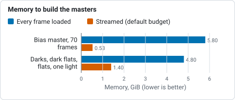

# How calibration works

For a numbered walk-through on real data, with the settings and troubleshooting, see
[Tutorial 2: Calibrate](../tutorials/calibrate.md).

A raw frame from a camera is not a picture of the sky. Each pixel carries a
fixed electronic offset (the *bias*), a signal that grows with time even in the
dark (the *dark current*), and a sensitivity that varies across the sensor and
through dust and vignetting (the *flat field*). Calibration undoes all three:

```text
calibrated = (light - bias - k * dark) / flat
```

Valerian builds the three masters from your calibration frames and applies
them. This page says what it does and what it does not do yet. The functions
live in `valerian_core::calibrate` (frames already in memory) and
`valerian_core::streaming` (frames read from files); the command is
`valerian calibrate`.

## Masters

* **Master bias**: the rejected mean of the bias frames.
* **Master dark**: the rejected mean of the dark frames. Given a master bias,
  the bias is subtracted first, so the master holds only dark current and can
  be scaled to another exposure time (the header says `BIASSUB = T`). Without a
  bias it holds bias plus dark current, and can only be subtracted as it is,
  from lights of the same exposure and temperature.
* **Master flat**: each flat has a master dark flat (or a master bias, if you
  took none) subtracted, is scaled to a common level by its median so that a
  lamp that drifts does not look like noise, and the frames are combined and
  normalised to a mean of one. For one-shot-colour cameras the normalisation is
  either global, which keeps the colour balance the flat records, or per
  colour, which corrects vignetting and dust only.

## Memory: masters are streamed

Rejection works one pixel position at a time: the samples at a position never
depend on any other position. So a master does not need every frame in memory.
`valerian calibrate` reads a band of rows from every file, combines the band
with the chosen rejection, keeps the result and moves on to the next band. The
master is bit for bit the one you would get with every frame loaded, and the
memory used follows `--memory` (in MiB, default 1024) and not the number of
frames. One row of each frame is the least it can work with, so the budget is
a target for the band, not a hard cap: the finished masters, the light being
calibrated and the pixel map are held on top of it.

The one number that needs a whole frame is a flat's level (the median that
brings the flats to a common brightness). It is found first, reading the flats
one at a time.

Measured on a 24-core machine without a GPU, at the commit this page was
written for: a bias master of 70 frames of 4656 by 3520 pixels (16-bit, 31 MB
each) took 5.8 GiB of memory when every frame was loaded, and 0.53 GiB with the
default budget and 0.41 GiB with `--memory 256`, in the same time (4 to 5
seconds), with an identical result. Ten darks, thirty dark flats and thirty
flats with the pixel map and one light: 4.8 GiB before, 1.4 GiB now, 19 s
before and 11 s now.



*Memory of two calibration jobs with every frame loaded and with the frames streamed, from the paragraph above.*

## Rejection

Combining uses per-pixel rejection of outliers (cosmic rays, hot pixels that
flicker, satellite trails), implemented once for masters and for the final
stack:

| Scheme | Use it for |
|---|---|
| Winsorised sigma clipping | Fewer than about 15 frames. A single bright outlier cannot be caught by plain sigma clipping with so few frames, because it inflates the deviation it is judged by. |
| Sigma clipping | 15 to 30 frames. |
| Linear fit clipping | More than about 30 frames, and stacks whose level varies. |
| Min/max | A crude fallback. |

`Rejection::auto` picks one from the number of frames. Each result also records
how many samples every input frame lost to rejection, which is the quickest way
to find a frame that is bad as a whole.

## Dark scaling

By default the dark is subtracted as it is. If your darks and lights differ in
exposure, scaling can be turned on: *exposure* multiplies the dark by the ratio
of the exposure times, and *optimise* fits the multiplier to the light itself
from its hot pixels, which also copes with a temperature difference. Scaling
needs a bias-subtracted dark and is refused otherwise.

## Hot and cold pixels

A pixel map is built from the master dark: every pixel is compared with the
median of its eight same-colour neighbours (two pixels away on a Bayer
sensor), so slow gradients such as amp glow do not trip it, and flagged if it
is more than a chosen number of robust sigmas above (hot) or below (cold). Dead
pixels are added from the flat. Flagged pixels are replaced by the median of
their unflagged neighbours after calibration.

How many pixels the map flags depends on the sensor. On the ASI1600MM used for
testing, about one pixel in a hundred is warm in a five-minute dark, and dark
subtraction already handles those; asking only for the extreme ones (40 sigma)
leaves 0.06 % to be repaired.

The limits are `--hot-sigma` (default 40) and `--cold-sigma` (default 12), in robust
sigmas of the difference between a pixel and the median of its neighbours in the
master dark. Lower `--hot-sigma` to repair more pixels, each replaced by a median of its
neighbours; raise it to repair fewer. `--cold-sigma` works the same way for pixels
below their neighbours. With `--auto-cosmetic` (no dark) the hot limit used is the
smaller of `--hot-sigma` and 8.

A light frame can also be checked on its own, without a dark. A pixel is
flagged only when its neighbours do not share the excess, which is what keeps
the core of an undersampled star from being mistaken for a hot pixel. This is a
heuristic; a master dark is better.

## One-shot colour

Calibration works on the raw mosaic, then the frame is demosaiced
(Malvar-He-Cutler, or bilinear) into red, green and blue planes. The Bayer
pattern comes from `BAYERPAT`, shifted by `XBAYROFF` and `YBAYROFF`, and is
applied to the array as stored in the file.

A flat is normally divided by its overall mean. On a one-shot colour sensor the
flat then also carries the colour response of the filter array, so the corrected
light has its colour balance changed. `--flat-per-channel` divides each Bayer colour
by its own mean instead, so the flat corrects vignetting and dust and leaves the
colour balance to the colour calibration step. It has no effect on a mono sensor,
whose flat has no Bayer pattern.

## Not done yet

* Scaled dark flats: the dark flat must match the flat's exposure.
* Streaming the lights: the lights are calibrated one at a time already, and a plain stack is
  streamed too (see [How stacking works](stacking.md)).
* Calibration on the GPU is there (`--backend gpu`) but is slower than the CPU for one
  frame at a time, because of the copies across the bus; see [The GPU
  kernels](gpu.md).
