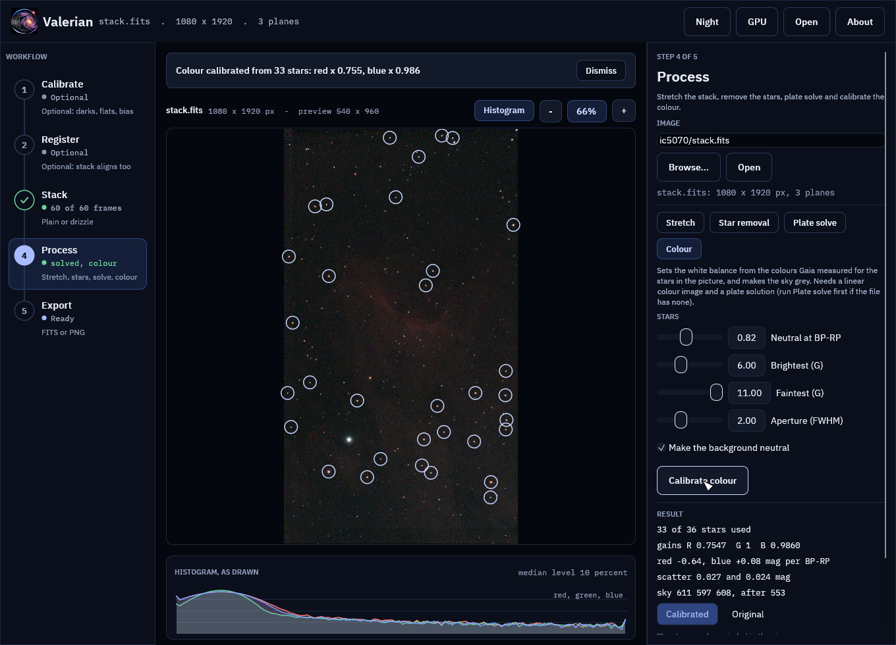
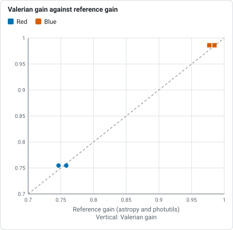

# How colour calibration works

For a numbered walk-through on real data, with the settings and troubleshooting, see
[Tutorial 9: Photometric colour calibration](../tutorials/photometric-colour.md).

A colour camera's red, green and blue do not see the sky the way a viewer
expects, and the balance of a stack depends on the sensor, the filter and the
sky. The stars say what the balance should be: Gaia measured a colour (BP-RP)
for every bright star. Photometric colour calibration measures the stars in the
picture in each colour, compares them with Gaia, and sets the white balance so
that stars come out the colour they really are. The code is
`valerian_core::photocal`; the command is `valerian photocal`.

## The method

1. **Stars.** The plate solution (the image's WCS, from
   [plate solving](plate-solving.md)) places the Gaia stars in the frame. Stars
   of G 6 to 11 with a BP-RP of 0.3 to 2.5 are used by default: brighter ones
   saturate, and the colour of very red stars is not a straight line. Each is
   tied to a star detected in the image (within 3 pixels), and a star with
   another detected star in or near its aperture is dropped.
2. **Photometry.** Every star is measured in red, green and blue through the
   same circular aperture, twice the median FWHM in radius, with the sky taken
   from a clipped median of an annulus around it. Stars with a signal-to-noise
   under 15 in any colour, or a non-positive flux, are dropped.
3. **Fit.** For red and for blue, `-2.5 log10(F / F_green)` is fitted against
   BP-RP as a straight line. The fit starts from the Theil-Sen line (the median
   of the pairwise slopes), which a few wild stars cannot move, and is then
   refined by least squares with 3-sigma clipping. A star that is off in either
   colour is dropped from both.
4. **Balance.** The reference colour, BP-RP 0.82 (a G2V star like the Sun), is
   set as neutral: each channel's gain makes the line's value at that colour
   equal to green's. Green's gain is 1, so the brightness of the picture stays
   where it was.
5. **Background.** The sky level of each plane, after the gain, is brought to the
   mean of the three, so the background is neutral grey and the light pollution
   does not tint the picture.

The two slopes are the camera's colour response, and double as a check: red must
brighten against green as BP-RP rises, and blue must dim. If either has the
wrong sign a warning says the planes may not be red, green, blue in that order,
or the image is not linear.

Do it on the linear image, after [background extraction](background.md) and
before [stretching](stretching.md): the colour of a star is a ratio of
fluxes, and a stretch breaks that. A stretched image is refused.

## On the command line

```sh
valerian solve stack.fits -o solved.fits
valerian photocal solved.fits -o balanced.fits
```

The input is never changed. Without `-o` the result is only printed:

```
36 Gaia stars measured, 33 used; aperture radius 5.1 px; neutral at BP-RP 0.82
  red against green: slope -0.635 mag per BP-RP, scatter 0.027 mag, gain 0.7547 +/- 0.0032
 blue against green: slope +0.080 mag per BP-RP, scatter 0.024 mag, gain 0.9860 +/- 0.0037
sky before 610.73 597.25 608.32, after 552.64 552.64 552.64 (offsets -91.74 44.61 47.13)
```

The gains and offsets go into the header as `PCCGAINR`, `PCCGAING`,
`PCCGAINB` and `PCCOFFR`, `PCCOFFG`, `PCCOFFB`, with a `HISTORY` line. An image
with no WCS is solved first from the header's position and scale; give
`--wcs other.fits` to take the solution from another file (a solved copy made
earlier, say). `--reference-colour` moves the neutral point (a bluer value gives
a warmer picture), `--min-mag`, `--max-mag`, `--colour-min`, `--colour-max`,
`--aperture`, `--min-snr` and `--min-stars` change the star selection,
`--no-neutralise` leaves the sky levels alone, and `--stars-out` writes every
star measured to a CSV file.

## In the desktop app

Open an image, choose **Colour**, and press **Calibrate colour**. The image
needs three planes and a plate solution, either its own or the one the Plate
solve tool found.

The panel shows the gains, the slopes and the scatter, and the stars used are
circled in the viewer. **Calibrated** and **Original** switch the picture, and
**Save calibrated** writes the full-size result.



**Original** in the panel shows the picture before the calibration, for comparison.

The screenshots are of a synthetic field (`valerian_core::testutil::colour_scene`)
whose red and blue are out of balance by a known amount, because image data is
never committed.

## The catalogue

The colours come from the catalogue file. Version 2 of the format (written by
`scripts/build_catalogue.py` since this feature) adds a BP-RP byte to every
star; a version 1 file still solves but has no colours, so it cannot calibrate.
`gaia-dr3-g11.vcat` carries 1,247,240 stars to G = 11, 10.0 MB, under the same
licence as before, CC BY-NC 3.0 IGO (Gaia DR3, ESA/Gaia/DPAC; non-commercial use, see
[Credits and trademarks](../credits.md)).

## Measured

On the Seestar S50 stack of IC 5070 (10 s subs, 60 stacked, a light-pollution
filter, 1080 by 1920), 36 Gaia stars are measured and 33 kept, in 0.3 s. Red
needs a gain of 0.755 and blue 0.986. `scripts/compare_python_photocal.py` repeats
the measurement with different code: the WCS read by astropy, Gaia fetched from
the archive to G = 13, stars centred by centre of mass and the FWHM measured by
a Gaussian fit, photutils aperture and annulus photometry, and an outlier-clipped
fit.

| Stars | Count | astropy and photutils gain (R, B) | Valerian gain (R, B) |
|---|---|---|---|
| The same, G < 11 | 34 | 0.7583, 0.9850 | 0.7547, 0.9860 |
| Deeper, G < 13 | 143 | 0.7465, 0.9771 | 0.7547, 0.9860 |



*Red and blue gains from Valerian against astropy and photutils, on 34 stars and on 143 deeper ones, from the table above: the dashed line is equality.*

The gains agree to 0.5 % on the same stars and to 1.1 % with the deeper set,
which is about the scatter of the fit. Measured the same way, the calibrated
image's line value at BP-RP 0.82 is +0.004 mag in red and -0.001 mag in blue (0
is neutral), and the sky medians of the three planes agree to 0.05 ADU (552.59,
552.63, 552.64).

Synthetic fields with known gains check the recovery to 3 %, that a calibrated
image calibrates to gains of 1, that the neutral point moves the balance the
right way, that planes in the wrong order are warned about, and that stars with
the wrong colour are rejected.

## What it cannot do

* It needs a plate solution and enough stars (15 by default) of G < 11 in the
  field; a narrow field wants a deeper catalogue.
* The line is straight in BP-RP, which holds over ordinary stars. Emission
  nebulae have no star colour and do not enter the fit, so a nebula's colours are
  whatever the balance makes them.
* Gaia's colours include interstellar reddening, which is what the camera sees
  too; the balance is of the light as it arrives, not corrected for dust.
* It does not know the sensor's spectral response beyond the two slopes it
  measures, and a narrow-band or dual-band filter makes the slopes small. The
  Seestar's light-pollution filter gives a blue slope of only +0.08.
