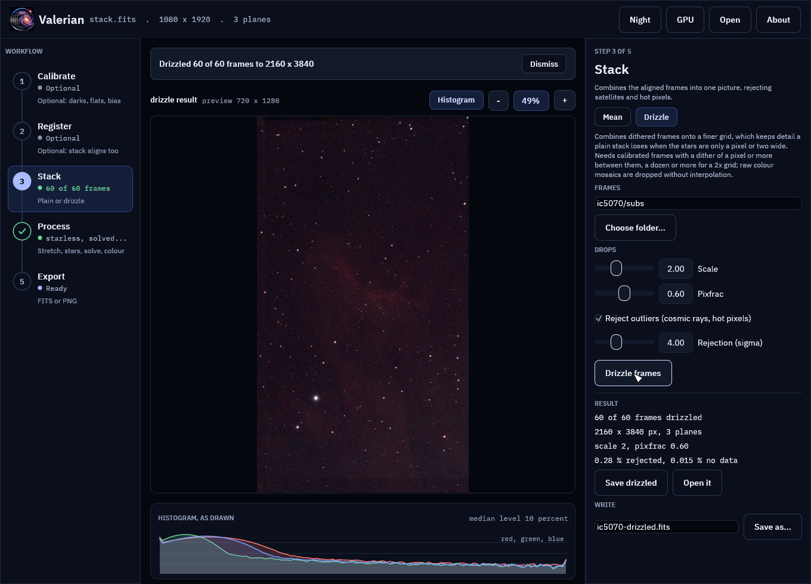
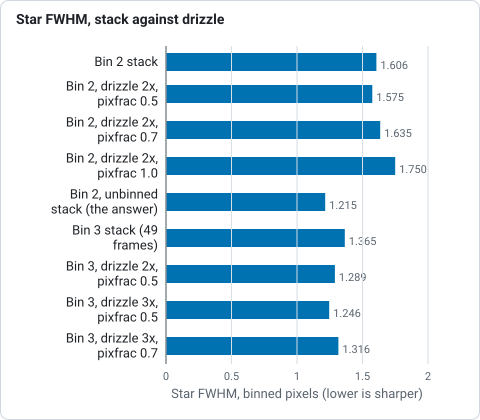
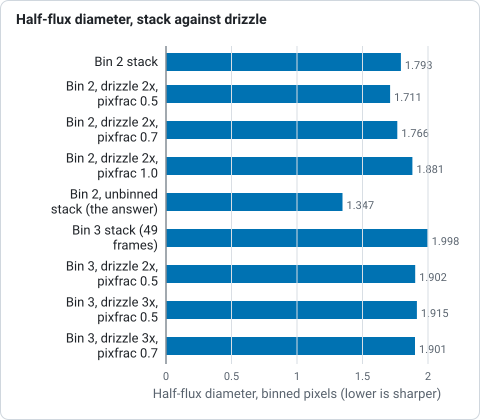

# How drizzle works

For a numbered walk-through on real data, with the settings and troubleshooting, see
[Tutorial 10: Drizzle](../tutorials/drizzle.md).

A sensor whose pixels are larger than the star images on it is *undersampled*:
a star that falls on one pixel and a star that falls between two look different,
and no single frame can say where inside the pixel the light came from. If the
telescope is nudged between frames (*dithered*) each frame samples the sky at
different places, and together they hold detail that a plain stack throws away.
Drizzle (Fruchter and Hook, 2002) puts it back. The code is
`valerian_core::drizzle`; the command is `valerian drizzle`.

## The method

Every input pixel is shrunk to a smaller square, a *drop* whose side is
`pixfrac` times the pixel's. The drop is mapped through the frame's registration
onto an output grid `scale` times finer, and its value is spread over the output
pixels it overlaps in proportion to the area of the overlap. The output pixel is
the weighted mean of what landed on it:

```
I_out = sum(a * w * f) / sum(a * w)
```

where `a` is the overlap area, `w` the frame's weight and `f` the input value.
It is the surface brightness of the input, so the output has the units of the
input and a star holds `scale` squared as many pixels. In the order it runs:

1. **Register.** The frames are registered to a reference exactly as for
   [stacking](stacking.md) (`stack::register_frames`). A raw colour mosaic is
   registered through a demosaiced copy.
2. **Normalise and weight.** Each frame's sky is matched to the reference and its
   transparency scaled, and frames are weighted by noise and star width, as in a
   stack.
3. **Drizzle.** Every frame is dropped onto the output grid. A raw Bayer mosaic
   is dropped *as a mosaic*: each pixel goes only to the plane of its own colour,
   so nothing is interpolated, and a one-shot-colour camera, whose red and blue
   are sampled every second pixel, gains the most.
4. **Reject.** The first result is read back around the place of every input
   pixel, and a pixel more than `--reject` sigma of the frame's noise outside the
   range of what is there (plus a twentieth of the local signal, because a star
   core is sharper than the read-back) is left out of a second drizzle. This
   removes cosmic rays, satellite trails and the hot pixels that the dither drags
   to different places in different frames.

A `pixfrac` of 1 with a scale of 1 is plain shift-and-add. A smaller drop is
sharper but leaves gaps unless enough frames land on each output pixel; the
weight map (`--weight-map`) shows the coverage and the result counts the output
pixels no drop reached (NaN). The noise of neighbouring output pixels is
correlated, because one input pixel feeds several of them, so look at noise after
binning the result back to the input grid.

## On the command line

```sh
valerian calibrate lights/ --bias bias/ --dark dark/ --flat flat/ -o cal/
valerian drizzle cal/ -o drizzled.fits --scale 2 --pixfrac 0.6
```

The frames are calibrated ones (raw colour mosaics are fine: do not give
`valerian calibrate` a `--debayer`). The result is `--scale` times as wide and as
tall, with a header recording `DRIZSCL`, `DRIZPIXF` and `DRIZREJ`; any WCS is
removed, so solve the drizzled image afterwards. `--no-reject` skips the second
pass, `--reference`, `--weights`, `--normalisation`, `--model`, `--min-stars`,
`--max-fwhm-ratio` (leave out frames softer than this multiple of the reference's
FWHM; default no limit) and the star detection options are those of
`valerian stack`, and `--report` writes the
per-frame table.

```
60 of 60 frames drizzled to 2160 x 3840 (scale 2, pixfrac 0.6), reference frame 47 (...), 0.28 % of the input samples rejected, 0.015 % of the output without data, 11.0s
```

Plan on a dither of a pixel or more between frames and a dozen or more of them
for a 2x grid. With fewer, use a larger `--pixfrac` or a smaller `--scale`.

## In the desktop app

The **Drizzle** tool works on a folder, not on the open image, so it is usable
with nothing open. Type the folder of calibrated frames or choose it with **Choose folder...**, set the scale, pixfrac
and rejection, and press **Drizzle frames**; the run goes on in the background.

The result is shown, reduced and stretched, in the viewer, with its size, the
fraction rejected and the fraction of the output no drop reached. **Save
drizzled** writes the FITS file and **Open it** makes it the open image, to
stretch or solve.



The screenshots are of a synthetic undersampled field
(Gaussian stars 1.6 pixels wide, sixteen dithers), because image data is never
committed.

## Measured

**What it can do: synthetic frames with a known sky.** The tests drizzle dithered
frames of stars with a known flux and position:

| Test | Result |
|---|---|
| Flux in a star, drizzled at 2x, against the true flux | within 0.3 % |
| Two stars 2.0 pixels apart (each 1.4 FWHM): the valley between them as a fraction of the lower peak | 0.70 drizzled at 3x, 0.82 plain stack (bicubic) |
| Star FWHM, in input pixels, of a 1.53 pixel star | drizzle 1.79; stacks with bilinear 1.92, bicubic 1.73, Lanczos-3 1.72 |
| A cosmic ray of 6000 counts in one frame | gone from the second pass (less than 60 left, against 150 or more without rejection) |
| Raw RGGB mosaics, three colours of known brightness | each plane's star flux within 6 % |

**What it does on real data.** Good amateur data is hardly undersampled (a
star 2.3 pixels wide is sampled), so the test makes it so: the real frames are
binned (`scripts/make_binned_frames.py`) and the stack of the *unbinned* frames is
the answer. `scripts/compare_python_drizzle.py` then measures sixty isolated
stars in the plain stack, the drizzle and the answer with astropy and photutils
(a Gaussian fit for the FWHM and a curve of growth for the diameter that holds
half the light), all in binned pixels. Sixty raw ten-second Seestar S50 frames of
IC 5070 (the same reference frame throughout):

| Frames | Result | FWHM | Half-flux diameter |
|---|---|---|---|
| bin 2, stack | | 1.606 | 1.793 |
| bin 2 | drizzle 2x, pixfrac 0.5 | 1.575 (x1.02) | 1.711 (x1.05) |
| bin 2 | drizzle 2x, pixfrac 0.7 | 1.635 (x0.98) | 1.766 (x1.02) |
| bin 2 | drizzle 2x, pixfrac 1.0 | 1.750 (x0.92) | 1.881 (x0.95) |
| bin 2, unbinned stack | the answer | 1.215 | 1.347 |
| bin 3, stack (49 frames) | | 1.365 | 1.998 |
| bin 3 | drizzle 2x, pixfrac 0.5 | 1.289 (x1.06) | 1.902 (x1.05) |
| bin 3 | drizzle 3x, pixfrac 0.5 | 1.246 (x1.10) | 1.915 (x1.04) |
| bin 3 | drizzle 3x, pixfrac 0.7 | 1.316 (x1.04) | 1.901 (x1.05) |



*Star FWHM in binned pixels of the plain stack, the drizzle and the unbinned answer, from the table above, on sixty Seestar S50 frames.*



*Diameter holding half the light, in binned pixels, of the plain stack, the drizzle and the unbinned answer, from the table above.*

Twenty-four calibrated ASI1600MM H-alpha frames binned 5 by 5 (eighteen usable
stars) gave 1.800 for the stack and 1.780 for a 2x drizzle at pixfrac 0.5 (x1.01,
with the half-flux diameter x0.95): no gain. So the honest summary is that
drizzle sharpens an undersampled stack by a few per cent to 10 per cent in FWHM,
more the smaller the drop and the coarser the sampling, and that on data that is
sampled well it does nothing and costs noise: after binning back to the input
grid the Seestar background noise is 5.3 to 5.8 (bin 2) and 4.5 (bin 3) against
4.8 and 3.6 for the stack. What limits it here is that a
registration from star centroids is good to a few hundredths of a pixel, not the
hundredth that a deep drizzle wants, and that the frames themselves differ in
seeing (a stack picks the sharp ones with its weights; so does drizzle).

On full-size frames, the sixty raw Seestar subs (1080 by 1920) drizzle to
2160 by 3840 in 11 s and 3.1 GiB on 24 cores, where the stack takes 14 s and
2.4 GiB.

## What it cannot do

* It needs undersampled data. Frames whose stars are three pixels wide or more
  gain nothing, and drizzle costs a little noise.
* It needs a dither. Frames that land on the same sub-pixel position add no
  detail; the weight map shows it as a regular pattern of gaps with small drops.
* It does not model the optics. The registration is a similarity (or the model
  you choose) between frames, so a lens whose distortion changes across the frame
  smears the corners.
* It does not drop one colour mosaic into a different grid from the others: the
  frames must share a Bayer pattern.
* The kernel is the square drop of the original drizzle; point, Gaussian and
  Lanczos kernels are not offered.
