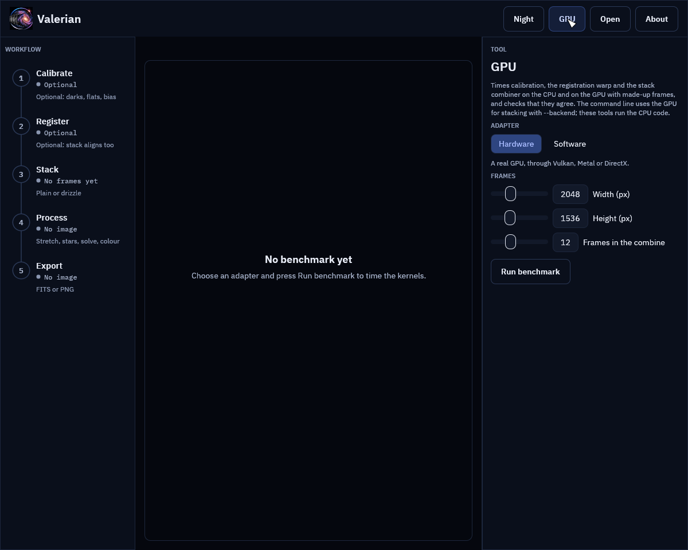
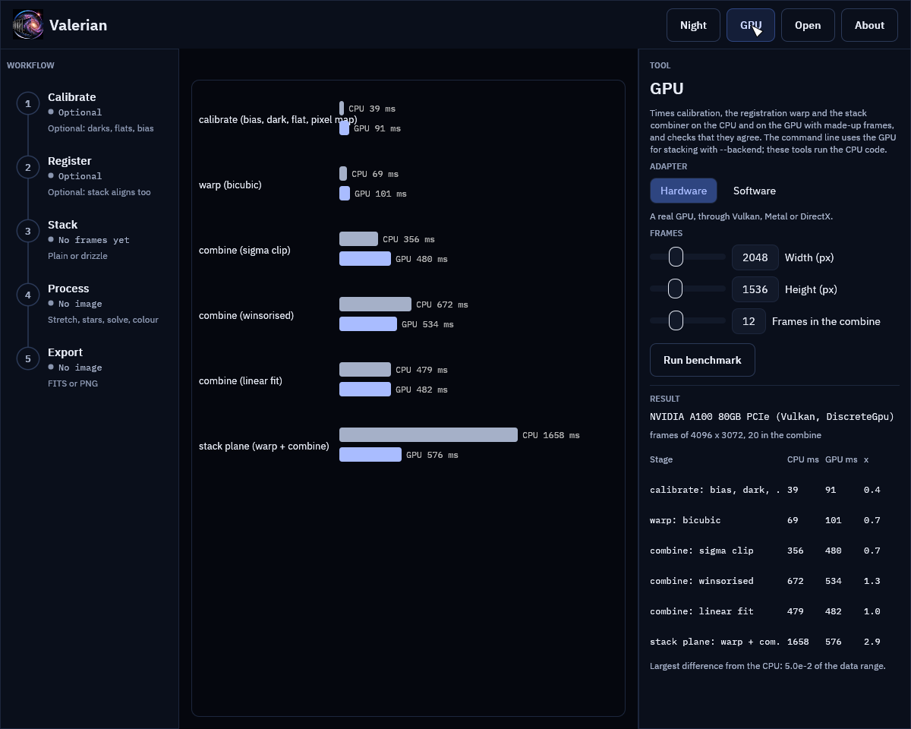
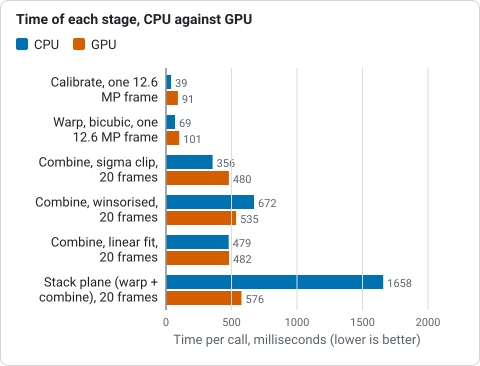

# The GPU kernels

For a numbered walk-through on real data, with the settings and troubleshooting, see
[Tutorial 11: The GPU](../tutorials/gpu.md).

Calibration, the registration warp and a stack's per-pixel combiner (the stages
whose cost grows with the number of pixels times the number of frames) can run on
a graphics card. They are WGSL compute kernels run through `wgpu` on the device
that Helia's `helia-gpu` crate opens (`valerian-gpu`), so they work on Vulkan,
Metal and DirectX with the same code, and on a software adapter (lavapipe, WARP)
for testing. The CPU code in `valerian-core` is the specification: every kernel
has a parity test against it.

## What runs where

| Stage | CPU | GPU |
|---|---|---|
| Calibration: bias, dark (scaled), flat, and the cosmetic repair of the pixel map | yes | yes |
| Registration warp (bilinear, bicubic, Lanczos-3, any transform) | yes | yes |
| Per-pixel combine: none, min/max, sigma, winsorised sigma, linear fit | yes | yes, up to 128 frames |
| A stack's warp, level match and combine of a plane in one go | yes | yes, frames kept on the device |
| Star detection, registration, drizzle, plate solving, everything else | yes | no |

Star detection and the registration fit are branchy and sequential; they stay on
the CPU. A case a kernel does not cover (more than 128 frames, a frame larger than
the device allows in one buffer) falls back to the CPU and is counted and reported.

## On the command line

`calibrate`, `register` and `stack` take `--backend auto|cpu|gpu`:

```sh
valerian stack cal/ -o stack.fits --backend gpu
```

```
compute: GPU: NVIDIA A100 80GB PCIe (Vulkan, DiscreteGpu)
...
GPU: 3 calls ran on the device
```

`gpu` uses a real GPU, or the software adapter if there is none (with a note that it is slower than the CPU), or fails. `cpu`
never opens a device. `auto` (the default) uses a real GPU only for `stack`, where
the frames stay on the device from the warp to the combine, and the CPU for
`calibrate` and `register`, where one stage alone is slower on the GPU (see
below); it never picks a software adapter, which is slower than the CPU code.

`valerian bench` times every stage on the CPU and on the GPU and checks that they
agree:

`--repeats` (default 3) is how many times each stage is timed; the table shows the
median, so a larger number steadies the figures on a busy machine.

```sh
valerian bench                          # a real GPU, 4096 x 3072, 20 frames
valerian bench --adapter software --width 1024 --height 768 --frames 12
```

```
stage                                  CPU ms    GPU ms speed-up up / kernel / down ms worst diff    > 1e-4
calibrate (bias, dark, flat, pixel map)  39.2      91.3     0.4x            4 / 5 / 81    4.24e-7     0.0e0
warp (bicubic)                           68.9     101.3     0.7x           20 / 7 / 72    4.85e-5     0.0e0
combine (sigma clip)                    355.7     480.0     0.7x         282 / 82 / 130    3.18e-4    9.9e-8
combine (winsorised)                    672.0     534.5     1.3x         258 / 122 / 95    3.16e-4    3.0e-7
combine (linear fit)                    478.6     481.5     1.0x         236 / 114 / 91    5.65e-4    2.4e-6
stack plane (warp + combine)           1657.6     576.0     2.9x         102 / 366 / 85    4.96e-2    2.0e-5
```

## In the desktop app

The **GPU** tool opens the adapter you choose, runs the same benchmark on frames of
the size you set, and shows the times as a table and a chart. The desktop app's
other tools run the CPU code; this panel is where you see what your device does.





The screenshot of the result shows the figures measured on the build server's A100 (below), so
the picture is the same on every machine.

## Measured

On the build server: a 24-core CPU that other jobs were sharing, and one of its NVIDIA A100
80 GB cards over PCIe (Vulkan), frames of 4096 by 3072 and 20 frames in the
combine. Times are the median of three runs after a warm-up; the three numbers
beside them are the average time of a GPU call spent copying to the device,
running the kernels and copying back.

| Stage | CPU | GPU | Speed-up | Copy up / kernel / copy down |
|---|---|---|---|---|
| Calibrate, one 12.6 MP frame | 39 ms | 91 ms | 0.4x | 4 / 5 / 81 ms |
| Warp, bicubic, one 12.6 MP frame | 69 ms | 101 ms | 0.7x | 20 / 7 / 72 ms |
| Combine, sigma clip, 20 frames | 356 ms | 480 ms | 0.7x | 282 / 82 / 130 ms |
| Combine, winsorised, 20 frames | 672 ms | 535 ms | 1.3x | 258 / 122 / 95 ms |
| Combine, linear fit, 20 frames | 479 ms | 482 ms | 1.0x | 236 / 114 / 91 ms |
| Stack plane (warp + combine), 20 frames | 1658 ms | 576 ms | 2.9x | 102 / 366 / 85 ms |



*Time per stage on the 24-core CPU and on the GPU, from the table above: the card wins on the full stack and loses where copying dominates.*

The kernels themselves are fast: calibration runs 5 ms on the card against 39 ms on
24 cores, the warp 7 ms against 69 ms, the combine 80 to 120 ms against 360 to
670 ms. But the data has to cross the PCIe bus both ways, and for one stage on its
own the copies cost more than the kernel saves: reading 50 MB back took 70 to 80 ms.
So a single stage is no faster on the GPU than on a 24-core CPU, and only the
winsorised combine breaks even. What does pay is keeping the frames on the card:
a stack uploads each frame once, warps and level-matches all of them into one
buffer on the device, combines them in bands, and sends back only the result, which
is 1.7 to 2.9 times faster than the CPU. That is why `--backend auto` uses the GPU
for `stack` and not for `calibrate` or `register`. The software adapter
(llvmpipe) is slower than the CPU on every stage (0.3x to 0.6x at 1024 x 768) and is
there to test the kernels, not to use.

Two further runs on real data: sixty raw Seestar S50 frames of IC 5070 (1080 by
1920, three colours after demosaicing) stack in 9.8 s on the CPU and 10.0 to 11.1 s
with `--backend gpu`, and 25 calibrated ASI1600MM frames (10 of which register,
16 MP) in 6.1 to 7.0 s and 6.0 to 6.3 s. The wall time is the same because the
star detection and the registration, which stay on the CPU, are most of it, but the
CPU time used falls from 72 s to 26 s and from 66 s to 54 s, which a busy machine
can spend on something else. The two stacks agree: at most 1.2e-3 (ASI1600) and
3.6e-3 (Seestar) of the data range apart at one pixel, and 1.7e-5 and 2.3e-5 of
the pixels differ by more than 1e-4 of the range.

## How well they agree

The parity tests (`crates/valerian-gpu/tests/parity.rs`, run on the software
adapter in CI and on the A100) check each kernel against the CPU code:

* **Warp**: all three kernels and five transforms (shifts, a rotation with scale, a
  homography); the difference is at most 5e-4 of the data range, which is what
  single-precision coordinates cost at the far edge of a 4000 pixel frame, and
  where the source has no data (NaN or infinite) so does the result.
* **Calibration**: at most 1e-5 of the range (the arithmetic is the same single
  precision), the same number of pixels repaired, on mono and on Bayer data with its
  ring spacing of two, with masters kept on the device between lights.
* **Combine**: every rejection scheme at 3, 12, 33 and 70 frames, with weights, with
  NaN where a frame has no data. The mean differs by at most 2e-5 relative where both
  use the same samples. A sample that sits exactly on a clipping limit can fall either
  way in single precision, so a pixel in a thousand at most uses a different number of
  samples. The per-frame counts of rejected samples agree to 0.2 %.
* **A whole stack**: mono and three-plane colour, Lanczos and bilinear, 9 and 40
  frames, with and without level matching, against the CPU stack.

## What it cannot do

* **Double precision.** WGSL has no 64-bit floats, so the kernels work in single
  precision where the CPU uses double in the linear-fit regression and the weighted
  mean. The differences above are the cost.
* **More than 128 frames** in one combine; the CPU does those.
* **A GPU for the whole pipeline.** Detection, registration, plate solving, drizzle,
  star removal and the rest run on the CPU.
* **Beat 24 cores on one stage.** See the measurements: the bus is the limit.
