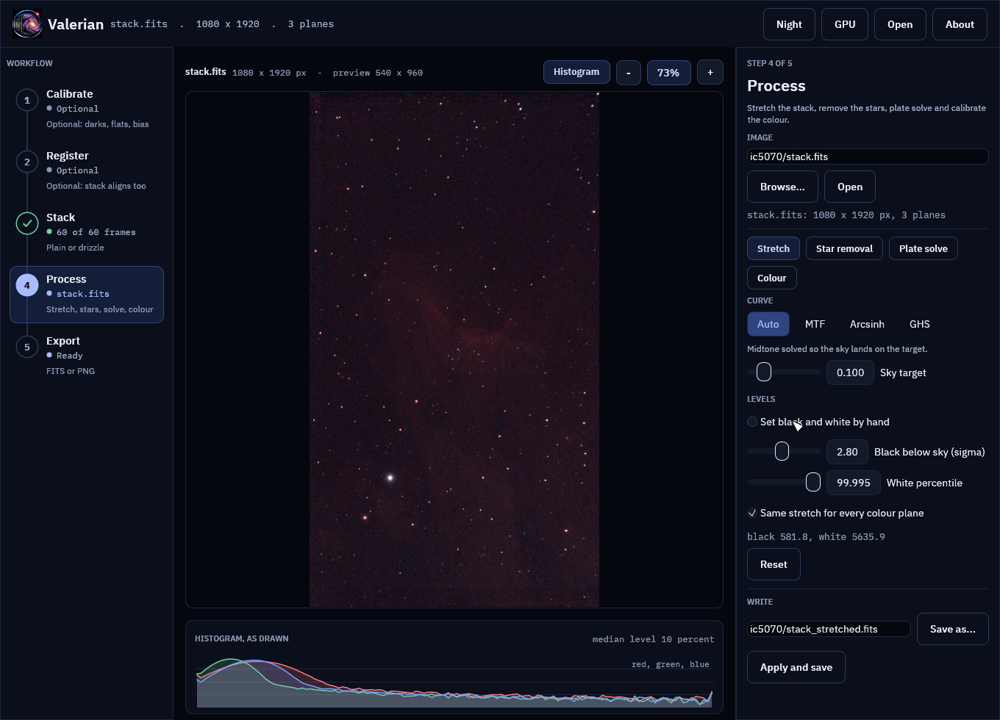
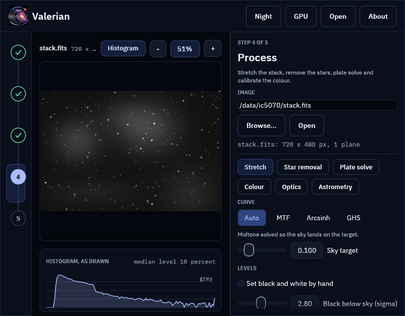
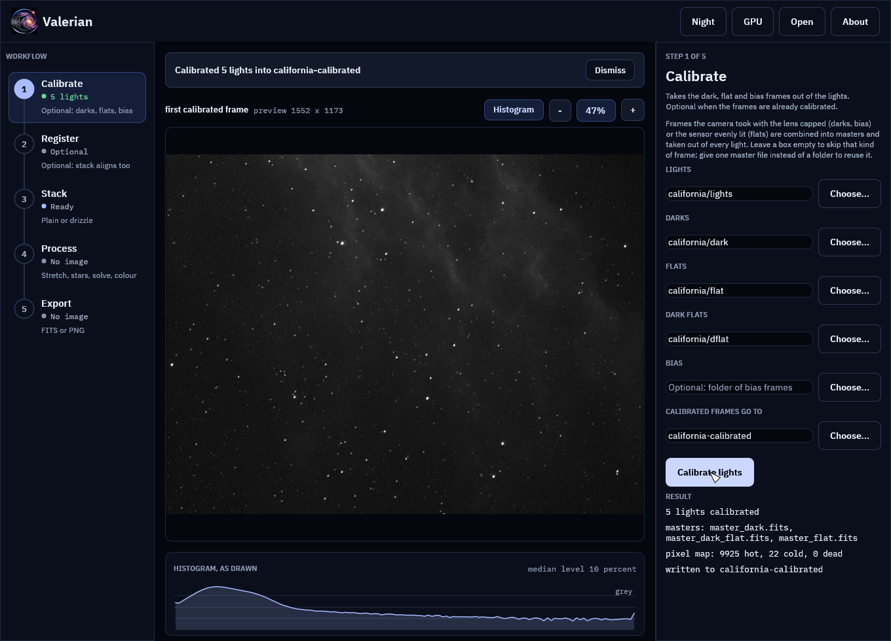
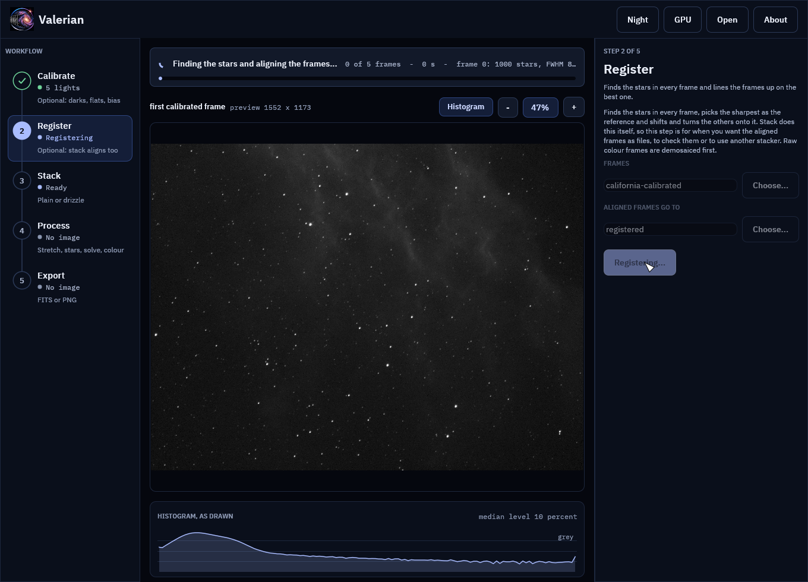
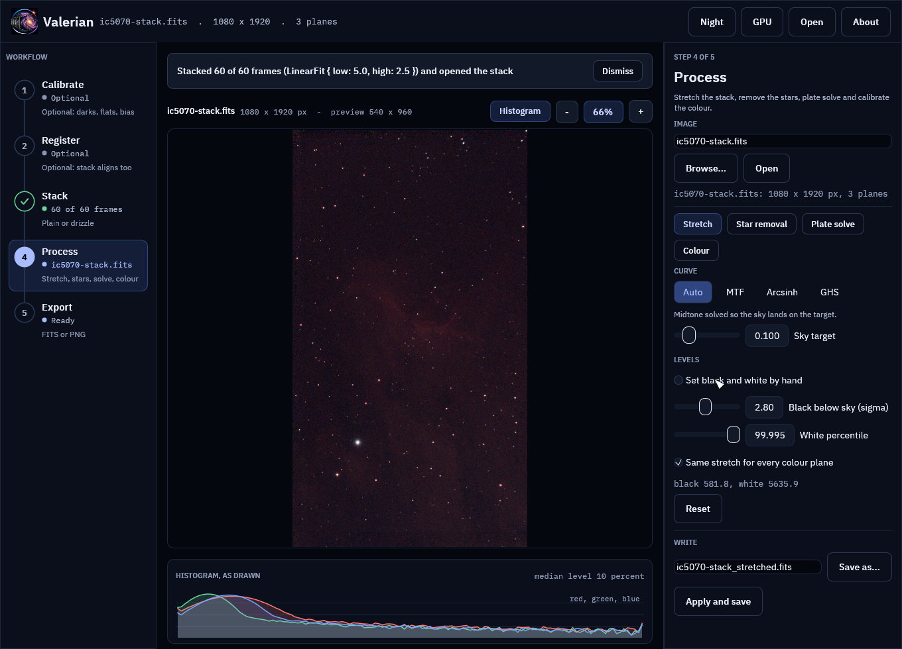
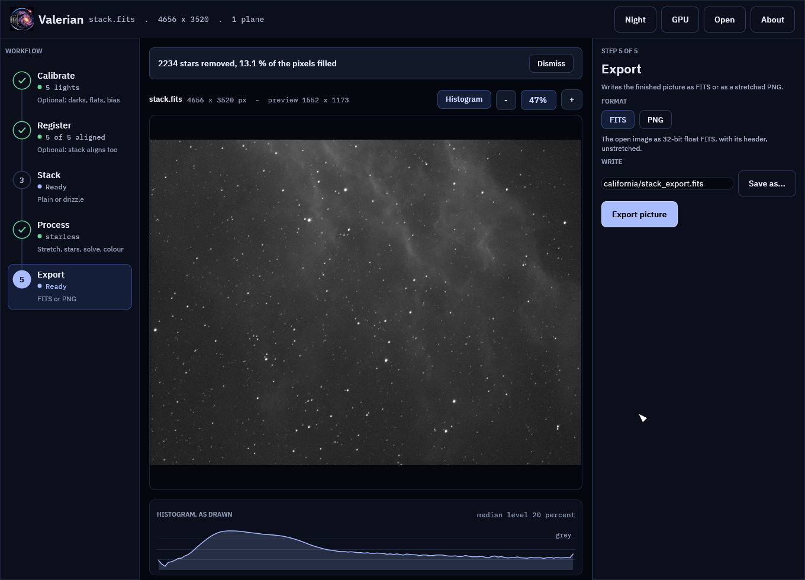
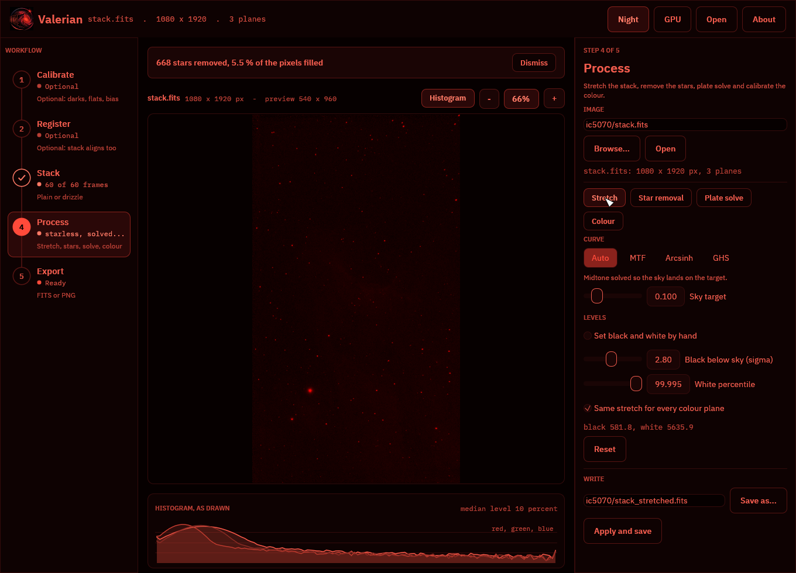
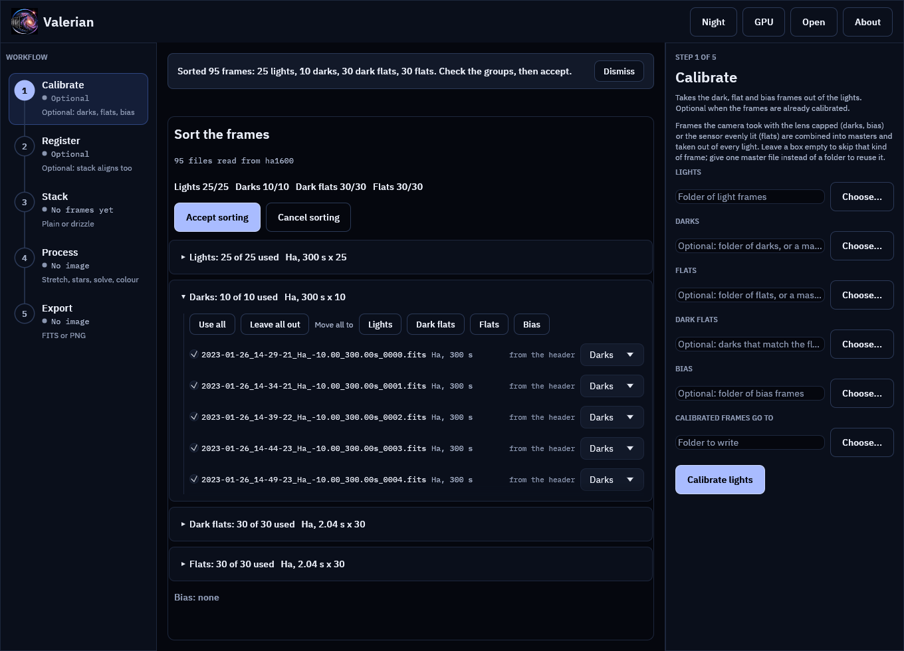

# The desktop app

`valerian-gui` does everything the command line does in one window, with the same
five steps in the same order: **Calibrate, Register, Stack, Process, Export**. It is
laid out like Helia's, in Valerian's own colours: a night sky, and an optional red
night-vision palette for use at the telescope.

The pictures on this page are the real window, drawn by the program's own tests from
real data: a monochrome H-alpha session of the California Nebula (five 300 s lights,
with darks, flats and dark flats) and a one-shot-colour Seestar session of IC 5070 (sixty
10 s frames). [A first session](walkthrough.md) runs the same two sessions on the
command line.

A whole session is walked through in [the tutorial](gui-tutorial.md), and every control is in the
[desktop app reference](../reference/gui.md).

## The window

* **Top bar**: the logo and name (click either for the About page, or press Ctrl+F1), the
  file that is open, and the buttons **Night** (the red palette, F2), **GPU** (the
  benchmark), **Open** (Ctrl+O) and **About**. A **Recent** menu lists the images opened
  lately; with no image open the middle of the window lists them too, with the folder sets
  (sessions) you worked on lately.
* **Workflow rail** (left): the five steps, numbered and joined by a line. Each shows
  where it stands (*Optional*, *Ready*, *Running*, or *Done* with a tick and what it
  produced) and a hint. Click a step to open its panel. Below 900 pixels wide the rail
  shrinks to the numbers.
* **Panel** (right): the open step's name, what it is for, and its controls. Drag its edge
  to resize it.
* **Notice strip and view** (middle): what is running or has just happened, then the
  picture with its zoom controls, then the histogram.

## The five steps

### 1. Calibrate

Names a folder of lights and, optionally, folders of darks, flats, dark flats and bias
frames (or one master file in place of a folder), and a folder for the result. **Calibrate
lights** combines each kind of calibration frame into a master, builds the pixel map and
writes every calibrated light, with the masters in a `masters` folder inside, like `valerian calibrate`
([How calibration works](calibration.md)). The viewer shows the first calibrated frame.

Leave the step alone when the frames are already calibrated, as a Seestar's are.

### 2. Register

Finds the stars in every frame, picks the sharpest as the reference and writes every frame
aligned to it, like `valerian register` ([How registration works](registration.md)). Stack
registers by itself, so this step is for when you want the aligned frames as files, to check
them or to use another program. The folder defaults to the Calibrate output.

### 3. Stack

Registers and combines a folder of frames into one picture with outlier rejection, like
`valerian stack` ([How stacking works](stacking.md)). The folder defaults to the last step's
output; the rejection is automatic unless you choose one. Raw colour frames are demosaiced
first. The stack is written as a FITS file and **opened for the Process step**, so one
button takes you from sixty raw frames to a picture you can stretch.

The **Drizzle** chip in this step combines dithered frames onto a finer grid instead; see
[How drizzle works](drizzle.md#in-the-desktop-app).

### 4. Process

Works on the open image, which is never changed: every tool edits its settings in the panel,
previews on a reduced copy, and writes a new FITS file when you ask. The chips at the top of
the panel choose the tool:

* **Stretch**: curves, levels and an automatic-stretch preview. See
  [How stretching works](stretching.md#in-the-desktop-app).
* **Star removal**: remove the stars, look at the starless image, the stars and the mask,
  reduce instead of remove, and save both layers. See
  [How star removal works](star-removal.md#in-the-desktop-app).
* **Plate solve**: find where the image points from its header or a position you type, circle
  the matched stars, and save the world coordinates. See
  [How plate solving works](plate-solving.md#in-the-desktop-app).
* **Colour**: calibrate the white balance against Gaia star colours, compare with the
  original, and save the result. See
  [How colour calibration works](colour-calibration.md#in-the-desktop-app).

To work on a file you already have, press **Open** (or Ctrl+O), type a path and press Open
in the panel, drop the file on the window, or start the program with the file name:
`valerian-gui file.fits`. The view is a reduced copy (1600 pixels on the long side); the
black and white points are measured on the full frame and the real work runs on the full
image when you apply.

### 5. Export

Writes the open image as 32-bit FITS, unstretched and with its header, or as an 8-bit PNG
drawn with the stretch chosen in Process, for sharing. The name defaults to
`<name>_export.fits` beside the image, and the extension follows the format.

## The view

The picture is first drawn from a reduced copy (1600 pixels on its long side), which is what lets a
slider move the stretch at once. Its zoom is in screen pixels per pixel of the open image (100 % is one
screen pixel to an image pixel), and once the zoom needs more detail than the reduced copy holds, the
viewer draws the real pixels from an image pyramid it builds in the background
([the zoom tutorial](../tutorials/zoom.md) explains how).

* **Scroll** over the picture to zoom about the pointer, or press **+** and **-**; press **1** for exactly 1:1.
* **Drag** to pan. A double click, or the percentage button, fits the picture to the window
  again.
* A box at the bottom left of the picture gives the **pixel under the pointer**: its image
  coordinates, the raw value of each plane, the stretched value and, for a plate-solved image, RA and
  Dec.
* The **histogram** under the picture is of what is drawn, per colour (grey for a mono
  picture), on a log scale, with the median level at the right. The **Histogram** button
  hides it.

Plate solving and colour calibration draw circles on the stars they matched or used; they
follow the zoom.

## Notices

Whatever is running is announced above the picture: a spinner, what is being done, how many
frames of how many it has done (with a bar), the seconds it has taken and the latest line the
step reported (the frame being registered, its stars and its seeing). The window stays usable
while it works. A finished step says what it did and has a **Dismiss** button; an error stays
until you dismiss it. A running step has a **Cancel** button in the notice (Esc does the same):
it stops within a frame, band or plane, keeps nothing and leaves the output folder as it was.
See [Cancelling a running step](../tutorials/cancel.md).

## Night vision

**Night** (or F2) swaps every colour for red on black, and draws the picture and the logo in
red only, which keeps dark-adapted eyes dark-adapted. The choice is remembered.

## Sorting a folder of frames

Drop a folder on the window (or press Ctrl+Shift+O). Valerian reads the headers of the FITS files
in it, sorts them into lights, darks, dark flats, flats and bias by `IMAGETYP` (then by file
and folder name), and shows a review where you can move frames between groups or leave them out.
**Accept sorting** fills the Calibrate, Register and Stack boxes. The session is then listed on
the start screen, so another night it is one click to get back to. See
[the tutorial](../tutorials/sort-and-sessions.md) and the
[reference](../reference/gui.md#sorting-dropped-frames).

## Choosing files

Every place the app reads or writes a file has a native file dialog, the operating system's own
(the common dialog on Windows, the desktop portal on Linux), so the usual places, recent
folders and bookmarks are there:

* **Open** in the top bar (or Ctrl+O) opens an image. It starts in the folder of the image
  already named and shows FITS files.
* **Choose...** beside each folder box of Calibrate, Register and Stack picks a folder, and
  **Save as...** beside each output path (Stack, Stretch, Star removal, Plate solve,
  Colour, Drizzle and Export) chooses where the result is written. It offers the name the box
  holds, starts in its folder and adds `.fits` when the name has no extension. Cancelling the
  dialog leaves the box as it was.
* **Choose catalogue...** in the Plate solve panel picks a `.vcat` star catalogue.
* **Choose folder...** in the Drizzle panel picks the folder of frames to drizzle.

The path boxes still work for typing or pasting a path, and the dialog runs beside the window,
which stays responsive while it is open.

## Shortcuts

F1 or ? lists them in the window. The main ones:

| Key | Does |
|---|---|
| Ctrl+O | Open an image |
| Ctrl+Shift+O | Choose a folder of frames to sort |
| Ctrl+Enter, F5 | Run the open step |
| Esc | Cancel the running step |
| Alt+Right, Alt+Left | Next and previous step |
| + - 0 1 | Zoom in, out, fit, 100 percent |
| F2, N | Night vision on or off |
| F1, ? | The shortcut list (Esc closes it) |
| Ctrl+F1 | The About page |

Every key says what it did in the notice above the picture. The full table is in the
[reference](../reference/gui.md#keyboard-shortcuts) and
[the tutorial](../tutorials/keyboard.md) walks through it.

## The GPU and the About page

**GPU** in the top bar opens a graphics adapter, times the calibration, warp and combine
kernels against the CPU code on frames of a size you choose, and shows how well they agree.
See [The GPU kernels](gpu.md#in-the-desktop-app). Any step on the rail leaves it.

**About** (the logo or the name, or Ctrl+F1; Esc closes) leads with the dedication, then the
version and build record (with a button that copies them for a bug report, and one that
opens the GPU adapter and adds it), the copyright, the licence, the additional terms, a link
to [12hobbies.studio](https://12hobbies.studio) under "More from Laurence Horrocks-Barlow",
and the third-party licences when the list ships beside the program.

`valerian-gui -V` prints the name and version and `valerian-gui --version` adds the notices,
both without opening a window.

Background extraction (`valerian background`) is on the [command line](quick-start.md) and is
not in the window yet. The screenshots in this manual are made by the GUI tests (see
[the source repository](https://github.com/qisback/valerian)).
