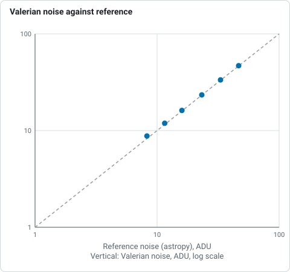
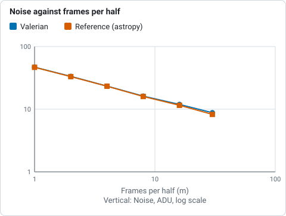

# How the integration diagnostics work

When frames are stacked, three questions are worth asking of the result: **where did the
combine throw samples away**, **how many frames and how much weight did each pixel get**, and
**how much quieter is the stack than one frame, against what the square root of the number of
frames promises**. And one about the picture itself: **what do the histograms of its channels
look like**. `valerian stack --science-report` and `valerian drizzle --science-report` answer
them with maps, a curve and histograms, and `valerian plot` draws any of them on its own. The
desktop app has them in the **Science** panel of the Stack step. For a worked example start with
[tutorial 14](../tutorials/integration.md); this page says what each output is, how it is made
and what every option and control does.

## The maps of a stack

The combine looks at each pixel's stack of values, one per frame, rejects outliers and takes the
weighted mean of the rest (see [How stacking works](stacking.md)). With the maps on, it also
records for every pixel:

| Map | File stem | What each pixel holds |
|---|---|---|
| Rejected low | `rejection_low` | how many samples were thrown out for being below the centre of the pixel's values, summed over the colour planes |
| Rejected high | `rejection_high` | how many were thrown out for being above it, summed over the colour planes |
| Pixel count | `pixel_count` | how many samples went into the mean (the frames that had data, less those rejected), first plane |
| Weight | `weight_map` | the summed weight of those samples, first plane. The weights are scaled to a mean of 1, so it is about the pixel count when the frames are alike and smaller where the heavy frames were rejected or missing |

"Centre" is the median of the values that survived the rejection, so a rejected sample is low
or high according to which side of it the sample lies. Satellite trails, cosmic rays and hot
pixels show as **high** rejections (a bright outlier); dark outliers, the shadow of a dust
speck on one frame or a cold pixel, as **low** ones. A map that is flat noise is a healthy
stack. Structure in it means something: a ridge along an edge is where the dither left few
frames, a bright patch on the high map is a gradient or a bright region the frames do not agree
on, and a bright dot is a star that moved or a satellite.

Each map is written as a PNG (reduced by block means to at most 1000 pixels on the long side,
with a colour bar from zero to the largest value and the minimum, median, mean, maximum and the
share of pixels that are zero), as a full-size 32-bit FITS file (`.fits`) and, for the
rejection and count maps, as a CSV of how many pixels hold each value (`.csv`). The rejection
maps need the CPU combiner: with `--science-report` the stack is made on the CPU even when a
graphics card is present, and says so.

## The maps of a drizzle

`valerian drizzle --science-report` writes the three maps of the output grid (first plane),
with `drizzle_` in front of their names:

| Map | File stem | What each output pixel holds |
|---|---|---|
| Weight | `drizzle_weight_map` | the summed overlap area times frame weight of the drops that reached it; low values are thinly covered |
| Pixel count | `drizzle_pixel_count` | how many input pixels (drops) reached it, saturating at 65535 |
| Rejected | `drizzle_rejected` | how many input pixels the second pass rejected as outliers, counted at the output pixel their centre falls in; all zero with `--no-reject` |

A raw Bayer mosaic is dropped into its own colour planes, so the first plane's count is of red
drops only.

## Noise against the square root of the number of frames

For `N` equal frames of independent noise, the noise of their mean falls as `1/sqrt(N)`. The
noise curve measures how closely a real stack follows that, **without a model of the noise**:

1. The registered frames (one plane each, the middle one for a colour image, on the reference
   grid, levels matched as the stack matches them) and their stack weights are taken. Only
   pixels where every frame has data are used, sampled to about 400 000.
2. For each power of two `m` up to half the frames (and the largest `m`, if the count is not a
   power of two), the first `2m` frames are split alternately into two sets. Each set's weighted
   mean is a stack of `m` frames, with the same weights as the real stack but **without the
   rejection**.
3. The difference of the two means contains twice the variance of one: the noise of an `m`-frame
   stack is the standard deviation of the difference over the square root of two. The standard
   deviation is clipped at 3 sigma (so a star the frames disagree on does not count) and divided
   by 0.9866, the standard deviation of a Gaussian truncated at 3 sigma.
4. The noise of **one frame** is the same measurement on up to eight disjoint pairs of single
   frames, averaged. The **expectation** at `m` frames is that value over `sqrt(m)`.

This does not depend on how the noise is spread between neighbouring pixels, so it is not fooled
by the correlation that resampling puts between them (which would make an estimator based on
neighbouring pixels read low), and it is the noise the stack really has at those pixels. The
table has, for each `m`: the measured noise, the expectation, their ratio, the reduction
(one frame over measured) and `sqrt(m)`. A ratio above 1 means the stack is noisier than
independent equal frames would be, because the frames are unequal (clouds raise some frames'
noise, and the weights cannot undo all of it), or because the noise is not entirely independent
between frames (a shared pattern would show as a curve that flattens). A curve that lies on the
line means the frames really are independent and alike.

The result is shown on a plot with both axes logarithmic (a straight line is a power law). It
needs at least four registered frames.

## Histograms

`histogram.png` shows one histogram per channel of the result, twice:

* **Linear:** 256 bins from the 0.01th to the 99.99th percentile of all channels, so they can be
  compared, on a logarithmic count axis (log10 of the pixels plus one). The sky is the tall
  peak; its width is the noise, and the long tail to the right is the stars and the target.
* **Stretched:** the same pixels after the automatic midtone stretch of the luminance (black point
  2.8 robust sigmas below the sky, midtone solved to put the sky at 25 per cent), applied to every
  channel alike so the colour balance is what the picture would show. A channel whose peak sits
  left of the others has a lower sky; one whose peak is cut off at 0 has pixels at or below the
  black point.

`histogram.csv` holds the counts of both (`view`, `bin_lo`, `bin_hi`, one column per channel).
`integration.json` holds, per channel, the minimum, maximum, median, robust sigma, the fractions
of pixels clipped to 0 and to 1 by the stretch and the stretched median, and the stretch used
(`black`, `white`, `midtone`).

## Files and options

`--science-report <DIR>` on `valerian stack` and `valerian drizzle` adds the section to a report
folder (with `valerian stack` it also holds the [subframe analysis](subframes.md), and the
limit options of that page apply). It writes `rejection_low` and `rejection_high` (stack) or
`drizzle_rejected` (drizzle), `pixel_count`, `weight_map`, each as `.png`, `.fits` and (for
counts) `.csv`; `noise.png` and `noise.csv` (stack); `histogram.png` and `histogram.csv`;
`integration.json` (`drizzle_integration.json` for a drizzle); and the page `report.html`, which
gathers them.

`valerian plot <kind> INPUT -o FILE.png` draws one:

| Kind | Input | Writes beside the PNG |
|---|---|---|
| `rejection-low`, `rejection-high`, `weight-map`, `count-map` | frames (stacked on the CPU with the defaults) | `.fits` of the map, `.csv` of its value counts (not for the weight map) |
| `noise` | frames | `.csv` and `.json` of the curve |
| `histogram` | one FITS image | `.csv` and `.json` |

`--threshold <SIGMA>` (5) is the star detection threshold of the registration. For a different
rejection, weights or normalisation, use `valerian stack ... --science-report`, which takes all
the stack options.

## The Science panel in the desktop app

Open the **Stack** step, choose the **Science** chip, give a folder of frames and press **Stack
for the maps**. It registers and stacks on the CPU (with progress and Cancel), and the chips
above the viewer then offer **Rejected low**, **Rejected high**, **Pixel count**, **Weight**,
**Noise** and **Histogram** next to **Subframes**; the panel says how many frames were stacked
and the noise reduction against the square root. This stack is for looking at: it is not written
to a file and does not replace the Mean stack. The frames the **Use for stacking** button left out
are left out here too.

## Checked against astropy and numpy

`scripts/compare_python_integration.py` repeats the maps and the noise curve with different code
on the 60 IC 5070 frames, for a stack made with equal weights, no level matching and 3 sigma
clipping (`valerian register`, then `valerian stack --normalisation none --weights equal
--rejection sigma --science-report`), over a band of 300 rows (astropy 8.0.2, numpy 2.5):

| Quantity | Valerian | Reference |
|---|---|---|
| rejection low map, mean per pixel (3 planes) | 0.038 | 0.038: `astropy.stats.sigma_clip` (median centre, standard deviation about it, 10 iterations), identical in 100.00 % of the pixels |
| rejection high map, mean per pixel | 1.580 | 1.580, identical in 100.00 % of the pixels |
| pixel count map, mean | 57.451 | 57.451, identical in 100.00 % of the pixels |
| noise, 1 frame, ADU | 46.84 | 46.61: two means of the first 2m frames, `sigma_clipped_stats` of their difference over the square root of two |
| 2 frames per half | 33.40 | 33.10 |
| 4 | 23.39 | 23.24 |
| 8 | 16.15 | 15.97 |
| 16 | 11.91 | 11.54 |
| 30 | 8.79 | 8.26 |

*Noise of the mean of 2m frames, Valerian against the astropy reference on log axes, from the table above: the points drift above the dashed line at 16 and 30 frames.*

*Noise of the mean of 2m frames, Valerian against the astropy reference, from the table above: they part by 6 per cent at 30 frames.*

The maps are the same counts, pixel for pixel, as an independent clipping of the same registered
frames. The noise curve agrees to 0.5 to 1.1 per cent up to 8 frames per half and reads 3 and 6
per cent higher at 16 and 30: Valerian measures the whole frame (about 400 000 sampled pixels) and
the reference a band through the middle, and the larger the stack the more a gradient or a
residual pattern in the outer parts counts against it, since the random noise has averaged
down. The frames at the large end are also the ones with the clouds.

## Limits of the method

* The noise curve measures the **mean** of the registered frames with the stack's weights, not
  the rejected stack. Rejection removes outliers without changing the noise of what is left
  much, but it does remove some samples, so the real stack is a little noisier than the curve
  suggests at pixels with many rejections.
* The count and weight maps are of the first colour plane; the rejection maps are summed over
  the planes, so a pixel can show up to three times as many rejections as frames.
* The histograms are of the pixels with data; the empty border of a stack (NaN) is left out.
