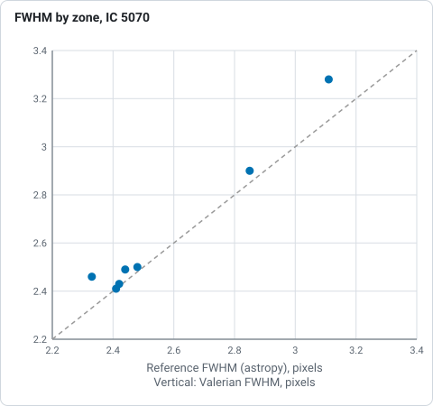
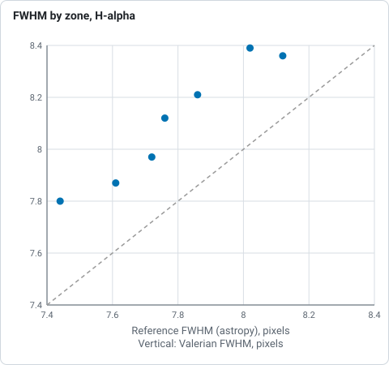

# How the optics plots work

`valerian optics` reads the stars of one image and shows what they say about the telescope:
an **aberration inspector**, **FWHM and eccentricity maps** across the field, a **tilt and
backfocus hint**, and the **radial profile of the stars with a Moffat fit**. These are the
views of PixInsight's AberrationInspector and FWHMEccentricity scripts. The desktop app has
them in the **Optics** tool of the Process step. For a worked example start with [tutorial
13](../tutorials/optics.md); this page says what each plot is, how it is made and what every
option and control does.

Use a linear image (a single calibrated frame, or a stack), not a stretched one. Raw Bayer
frames are demosaiced first. For judging the optics a stack is fine but its edges, where few
dithered frames overlap, are noisier and registered less well; the sharpest single frame has
the cleanest corners.

## The stars

The stars are detected on the luminance (the mean of the colour planes) as `valerian register`
does, at `--threshold` sigmas of the smoothed noise. A star is **kept** when it is not
saturated, has a finite size and shape, and its peak is at least `--min-snr` times the noise
(10 by default, so a faint star's noisy shape does not count). At least 30 must remain or the
command stops and says how many it found. Each kept star has a position, a FWHM, an eccentricity
(`1 - b/a`) and an orientation, from windowed second moments (see [How subframe analysis
works](subframes.md)). `field_stars.csv` lists them.

## The maps

A polynomial surface of total degree `--order` (3 by default; 1 is a tilted plane, 2 adds the
bowl of field curvature, 3 and 4 asymmetric coma-like patterns) is fitted to the FWHM of the
stars by least squares in coordinates scaled to -1..1 across the frame. Stars more than 3
robust sigmas (1.4826 MAD) from the surface are rejected and the fit is repeated, up to six
times, so a double star or a galaxy does not pull it. The surface is drawn as an interpolated
image on a 64-column grid, coloured over its 2nd to 98th percentile (viridis: dark is sharp,
bright is soft), with seven contour lines by marching squares and the measured stars as small
circles so you can see where there is data and where the surface is only extrapolated.

The eccentricity map is made the same way and adds **whiskers**: on a coarse grid of ten
columns, the stars within a radius of 0.9 cells vote with the vector `e (cos 2 theta, sin 2
theta)`; the mean vector gives the direction and size of the typical elongation, drawn as a
line through the cell centre, longest at an eccentricity of 0.35 and over. Radial whiskers point
to or from the middle of the picture; tangential ones go round it; parallel ones all along the
same direction are tracking or wind.

`fwhm_map.csv` and `eccentricity_map.csv` hold the surface at the 16 by 12 cell centres.

## The tilt and backfocus hint

The field is divided into a **centre** (within 17 per cent of the middle in each direction) and
four **corners** (the outer quarter of the width and of the height). The median FWHM and
eccentricity of each zone are taken when it holds at least 5 stars. From them:

| Number | Definition | Hint when |
|---|---|---|
| curvature | mean corner FWHM over the centre FWHM, minus 1 | above +12 per cent: corners softer, field curvature or wrong flattener spacing. Below -8 per cent: centre softer than the corners, unusual (focus set on the outer field, or an over-correcting flattener). Otherwise the field is flat. |
| tilt | (largest minus smallest corner FWHM) over the mean corner FWHM | above 10 per cent: the softest corner is named and a tilt of the sensor or focuser towards it is the likely cause. Otherwise no tilt to speak of. |
| radial elongation | mean of `e cos 2(theta - phi)` over the stars beyond half the half-diagonal, `phi` being the direction from the centre | above +0.05: the outer stars are elongated along the radius (coma or spacing); below -0.05: across it (astigmatism or spacing). |
| plane gradient | the change of FWHM across the full width and height of a plane fitted to every star | reported in `optics.json` |

Three of the four corners and the centre must have stars for a verdict. The hints are what
the pattern is **consistent with**. One image cannot say which way to move a spacer, and a
corrector with an off-centre sensor looks like a tilt, so each hint says to change one thing by
a small step and measure again. `tilt.png` is a bar chart of the five zone FWHMs.

## The aberration inspector

Nine crops of `--crop` pixels (128 by default, 32 to 512, even) are taken with their centres
half a crop from each corner, at the middle of each edge and at the middle of the image, enlarged
`--zoom` times (2; 1 to 6) by pixel replication so no pixel is invented, and stretched
identically by one automatic stretch of the whole image (black point 2.8 robust sigmas below the
sky, the midtone solved to put the sky at 25 per cent), so a soft corner is soft and not merely
dimmer. Colour images show in colour. Each panel is labelled with its place and the median FWHM,
the median eccentricity and the number of stars within one crop of its centre (three or more are
needed for the numbers). `aberration_inspector.png` is the mosaic and `optics.json` has the
numbers.

## The star profile

Up to `--psf-stars` (50) of the brightest kept stars that have no neighbour within the window
radius plus 4 pixels (unless the neighbour is fainter than 2 per cent of the star's peak) are stacked. The window
radius is three times the median FWHM, between 6 and 20 pixels. For each star the sky is the
median of an annulus just outside the window, every pixel within the window gets its distance
from the star's sub-pixel centroid, and its value above the sky is divided by the star's peak
above the sky. The pixels of all the stars are binned in 0.5 pixel rings (bins with fewer than 5
pixels are dropped) and the **median of each ring** is taken, which discards the pixels of
neighbours and cosmic rays. Two functions are fitted to the rings by Levenberg-Marquardt least
squares:

* the **Moffat** `A (1 + (r/alpha)^2)^-beta`, whose FWHM is `2 alpha sqrt(2^(1/beta) - 1)`. Beta
  describes the wings: 2.5 to 5 is typical of seeing-limited stars, a smaller beta means
  broader wings (scattered light, aberrations), and a beta that grows without limit (the fit
  then says "above 50") means the profile is Gaussian;
* the **Gaussian** `A exp(-r^2 / 2 sigma^2)`, FWHM `2.3548 sigma`, for comparison.

`psf.png` shows the pixels of every star, the median of each ring, and both curves, on a linear
and on a logarithmic axis (the logarithmic one shows the wings, which is where a Moffat
differs). `psf.csv` has the rings with both models, `optics.json` the fit parameters and the
RMS residual of each. When the Moffat's residual is no better than the Gaussian's, the stars
are Gaussian (as after a stack of resampled frames) and beta is unconstrained.

## What is written

`--report <DIR>` (default `optics-report`) holds `aberration_inspector.png`, `fwhm_map.png` and
`fwhm_map.csv`, `eccentricity_map.png` and `eccentricity_map.csv`, `field_stars.csv`, `tilt.png`,
`psf.png` and `psf.csv`, `optics.json` (the summary, the zone table, the hints, the inspector
panels and the fit) and `report.html`, the one-file page that gathers them (and any other
section written into the same folder, such as the [subframe
analysis](subframes.md)). `valerian plot aberration|fwhm-map|eccentricity-map|tilt|psf IMAGE -o
FILE.png` draws one plot with its data beside it.

| Option | What it does | Range | Default |
|---|---|---|---|
| `--report <DIR>` | folder for the report (`optics` only) | a folder | `optics-report` |
| `--threshold <SIGMA>` | star detection threshold | above 0 | 5 |
| `--min-snr <RATIO>` | smallest peak-to-noise of a measured star | above 0 | 10 |
| `--crop <PIXELS>` | side of an inspector crop | 32 to 512, even | 128 |
| `--zoom <FACTOR>` | enlargement of an inspector crop | 1 to 6 | 2 |
| `--order <DEGREE>` | degree of the map surface | 1 to 4 | 3 |
| `--psf-stars <N>` | stars stacked in the profile | 8 or more | 50 |

## The Optics tool in the desktop app

Open an image, choose the **Process** step and the **Optics** chip. **Measure the stars** runs on
a worker thread with progress and Cancel; the viewer then shows the plot chosen by the chips
(**Inspector**, **FWHM map**, **Eccentricity map**, **Corners**, **Star profile**), and the panel
gives the zone table, the Moffat and Gaussian FWHM and the hints in words.

| Control | Range | Default |
|---|---|---|
| Crop (px) | 32 to 512 | 128 |
| Zoom | 1 to 6 | 2 |
| Map degree | 1 to 4 | 3 |
| Profile stars | 8 to 200 | 50 |
| Smallest star S/N | 3 to 200 | 10 |
| Measure the stars | measures the open image and draws every plot | |
| Plot chips | which plot the viewer shows; a plot that could not be drawn (too few isolated stars for the profile) has no chip | Inspector |
| Report, Save report | folder for the report | `optics-report` beside the image |

## Checked against astropy and numpy

`scripts/compare_python_optics.py` repeats the measurements with different code on two stacks:
the 60-frame Seestar stack of IC 5070 (1080 by 1920, 329 stars kept) and the five-frame
ASI1600MM H-alpha stack (587 stars). Astropy 8.0.2 fitted a two-dimensional Gaussian plus a
constant to a 21 by 21 pixel cut-out of every star Valerian kept, and numpy fitted the same
polynomial to Valerian's star table with the same clipping.

| Quantity | IC 5070 Valerian | IC 5070 reference | H-alpha Valerian | H-alpha reference |
|---|---|---|---|---|
| median FWHM, all stars, px | 2.50 | 2.48 | 8.21 | 7.86 |
| centre | 2.41 | 2.41 | 8.39 | 8.02 |
| top-left | 2.49 | 2.44 | 7.80 | 7.44 |
| top-right | 3.28 | 3.11 | 7.97 | 7.72 |
| bottom-left | 2.43 | 2.42 | 8.12 | 7.76 |
| bottom-right | 2.90 | 2.85 | 8.36 | 8.12 |
| degree-3 surface on the 192-point grid, max difference, px | 0.0002 | | 0.0001 | |
| Moffat FWHM, px (profile of stars / `Moffat2D` per star) | 2.46 | 2.33 | 7.87 | 7.61 |
| beta (profile / `Moffat2D` per star) | above 50 | 7.1 | above 50 | 10.0 |

*FWHM in pixels of the Seestar IC 5070 stack, Valerian against astropy fits, from the table above: the zones sit just above the dashed line of equality.*

*FWHM in pixels of the ASI1600MM H-alpha stack, Valerian against astropy fits, from the table above: Valerian reads 0.24 to 0.37 higher.*

The zone FWHMs follow the Gaussian fits to 0.0 to 0.17 pixel on IC 5070 and 0.24 to 0.37 on the
H-alpha stack (up to 6 per cent; Valerian reads higher as second moments weight the wings more
than a fit does), and the difference between zones is the same in both, so what matters for a
tilt, the comparison of one zone with another, agrees. The surface is the same
polynomial to 0.0002 pixel. The Moffat of the **stacked** profile is 3 to 6 per cent wider than
the median of per-star fits, because the stars of a field differ in width and the stack of
their pixels is their blend; both say the profile is near Gaussian (beta from 7 upwards), which
is what stacks of resampled frames give.

## Limits of the method

* One image has one focus and one pointing: the hints cannot separate a tilted sensor from a
  decentred corrector, nor say which way to move a spacer. They say what to try.
* A stack, drizzle or mosaic has edges made of fewer frames; judge a corner on the sharpest
  single frame when it matters.
* The maps are smooth surfaces: they cannot show a feature smaller than the degree allows, and
  they extrapolate where there are no stars (the circles show where there are).
* Crowded or nebulous fields give fewer clean stars; lower `--min-snr` or `--threshold` to get
  more, at the cost of fainter, noisier ones.
