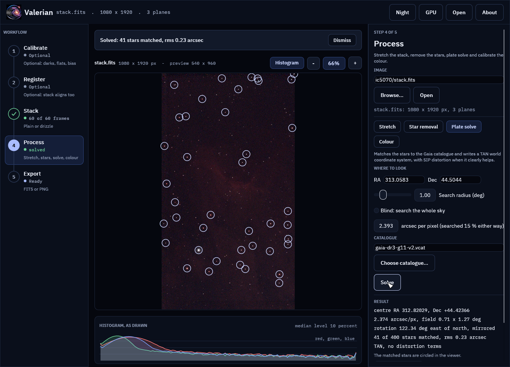
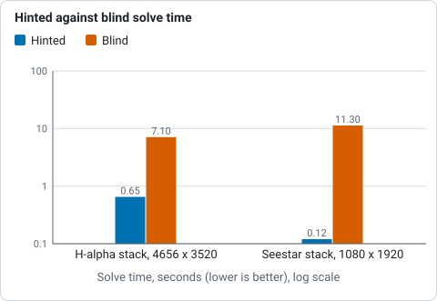

# How plate solving works

For a numbered walk-through on real data, with the settings and troubleshooting, see
[Tutorial 8: Plate solve](../tutorials/plate-solve.md).

Plate solving finds where on the sky an image points, and writes that into the
file as a *world coordinate system* (WCS): the keywords that let any astronomy
program turn a pixel into a right ascension and declination, and back.
Valerian solves with its own code, offline, against a bundled star catalogue.
The code is `valerian_core::solve`; the command is `valerian solve`.

## The method

1. **Stars.** The stars of the image are detected on the luminance.
2. **Where to look.** Where the image points is a *hint*: a position, a search
   radius and a pixel scale range. Valerian reads them from the header
   (`RA` and `DEC`, or `OBJCTRA` and `OBJCTDEC`; `FOCALLEN` and `XPIXSZ`; or a
   WCS already there), and `--ra`, `--dec`, `--radius`, `--scale` and
   `--scale-range` override them. The hint becomes a list of trial patches of
   sky, its centre first.
3. **Patterns.** For a trial, the catalogue stars of that patch are projected on
   the tangent plane and matched to the image stars with the triangle matching
   that [registration](registration.md) uses: triangles of the brightest stars
   are compared by their side ratios, which do not change with rotation, scale
   or position, and the votes give a rotation, a scale and a shift. Both parities
   are tried, because a mirrored image (a diagonal in the light path, or a camera
   that writes its rows top down) matches nothing otherwise.
4. **Refine.** A gnomonic (TAN) projection is fitted about the image centre to
   every star that matches, with a match radius that tightens each round and
   3-sigma clipping. If a polynomial for the lens distortion (SIP) clearly
   improves the fit, it is kept: at least 50 stars for order 2 and 100 for order
   3, and a residual at least a quarter lower than the plain fit's. A polynomial
   fitted to noise wanders at the corners of the frame, so it has to earn its
   place.

The solution is accepted only when at least ten stars agree (`--min-matches`).
A rotation, a scale and a shift had to be found for them, so ten stars landing
within a pixel or two of catalogue stars by chance is not something that
happens; the match count is the evidence.

Nothing is written unless a solution is accepted.

## On the command line

```sh
valerian solve stack.fits -o solved.fits
```

The input is never changed; `-o` writes a copy with the WCS in the header (and a
`HISTORY` line saying how it was found), as a 32-bit float image like the other
commands write. Without `-o` the solution is only printed:

```
looking within 1.00 deg of RA 61.1583 Dec +35.6161, scale 0.79 to 1.07 arcsec/pixel
solved: centre RA 04h04m36.1s Dec +35d36m50.7s (61.15022, +35.61408 deg)
scale 0.910 arcsec/pixel, field 1.18 x 0.89 deg, rotation -106.73 deg east of north, mirrored
38 of 400 detected stars matched, rms 0.34 arcsec (0.37 px), plain TAN
```

Give a position when the header has none: `--ra 04:04:38 --dec +35:36:58
--scale 0.93` (numbers are degrees, `hh:mm:ss` is hours for the right ascension).
With no position at all the whole sky is searched (`--blind`, or simply no
position anywhere), which needs `--scale` or `--scale-range` to size the patches
and takes longer, a few seconds to a minute depending on the scale and the
number of cores. A search at a very small scale needs too many patches and
refuses, saying so.

`--sip-order auto` (the default) keeps distortion terms only when they clearly
help, `0` forces a plain TAN and `2` to `5` forces that order.

### Mirrored, rotation and the row order

The result says "mirrored" when east is to the right of north in the file's own
row order. FITS counts rows from the bottom, but many cameras write them top
down. The Seestar S50 does, and it writes no `ROWORDER` card to say so; some
others (the ASI1600MM under N.I.N.A.) write `ROWORDER = 'TOP-DOWN'`. Their
images solve as mirrored, which is correct for the file: a program that reads
rows as the file has them, as astropy does, gets the right sky. Valerian's
previews put the first stored row at the top, which is the picture the Seestar
itself shows, and the Seestar's own header solution is mirrored in the same
way: solving a stack of M 42 with its WCS removed gave a CD determinant of the
same sign and size, and a copy with the rows reversed solved with the opposite
parity, so the solver does not hide the row order. Valerian does not flip the
rows and takes the Bayer pattern from `BAYERPAT` as written.

## In the desktop app

Open an image, choose **Plate solve** in the Process step, and the position and pixel scale are
filled from the header. Edit them if the header is missing or wrong, or tick
*Blind*. **Solve** runs in the background.

When it finishes the panel shows the centre, scale, field size, rotation, the
number of stars matched and the residual, and the matched stars are circled in
the viewer. **Save with WCS** writes a copy of the image with the solution in its
header.



The screenshot is of the real Seestar stack of [a first session](walkthrough.md), solved
against the Gaia catalogue.

## The catalogue

Solving needs a catalogue, which is a data file and not part of the program:
`gaia-dr3-g11.vcat`, every Gaia DR3 source brighter than G = 11 (1,247,240
stars, 10.0 MB, with their BP-RP colours for
[colour calibration](colour-calibration.md)). Valerian looks for it in `VALERIAN_CATALOGUE`, beside the
program, in a `data` folder beside the program, in `../share/valerian`, and (in a
build from source) in `crates/valerian-core/data`; `--catalogue` names one.

G < 11 is about 30 stars per square degree, which is plenty for a field of half a
degree or more. For a much narrower field, build a deeper catalogue:

```sh
python3 scripts/build_catalogue.py --mag 13 -o gaia-dr3-g13.vcat   # 7.4 million stars, 59 MB
valerian solve image.fits --catalogue gaia-dr3-g13.vcat
```

The script asks the ESA Gaia archive and packs the stars into the format
`valerian_core::catalogue` reads (documented at the top of the script). Positions
are at Gaia's epoch, 2016.0; proper motion is not applied, which is far below the
matching tolerance for stars this bright.

This work has made use of data from the European Space Agency (ESA) mission
Gaia (<https://www.cosmos.esa.int/gaia>), processed by the Gaia Data Processing
and Analysis Consortium (DPAC). ESA states that the data are distributed under CC BY-NC 3.0 IGO
(NonCommercial; commercial use needs ESA's authorisation), and the catalogue file is kept apart from the program (it is read at run time,
not compiled in) and carries that licence.

## Measured

On real stacks, on a 24-core machine (release build):

| Image | Hinted | Blind | Stars matched | Residual |
|---|---|---|---|---|
| ASI1600MM H-alpha stack, 4656 by 3520, 0.91 arcsec/pixel | 0.65 s | 7.1 s | 38 | 0.37 px |
| Seestar S50 colour stack of IC 5070, 1080 by 1920, 2.37 arcsec/pixel | 0.12 s | 11.3 s | 41 | 0.10 px |



*Time of a hinted and of a blind solve on two real stacks, from the table above, on a log axis.*

The blind and hinted solves give the same answer. The H-alpha solution lands
within 24 arcsec of the target the header names (the position typed into the
capture software), which is the framing. `scripts/compare_python_solve.py` checks
a solved file against an independent solve of the same stars: it reads the WCS
with astropy (which also proves the keywords are valid), detects the stars again
with `sep`, matches them to Gaia to G = 15 and refits a TAN WCS as the pipeline's
`astrometry.py` does. On the Seestar stack 188 stars match within a median 0.10
pixel and the refit differs from Valerian's WCS by at most 0.17 arcsec (0.07
pixel); on the H-alpha stack 755 stars match and the refit differs by at most
0.21 arcsec.

On synthetic fields with a known WCS the tests recover the system to better than
1.5 arcsec at the corners from stars with 0.3 pixel of centroid noise, at every
rotation, mirrored or not, with spurious detections and a tenth of the stars
missed, and they refuse a wrong position, a wrong scale and random stars.

## What it cannot do

* It needs enough catalogue stars in the field. G < 11 does not solve a field much
  narrower than half a degree; build a deeper catalogue.
* The patches are tangent planes, good to about five degrees across.
* It does not model the optics beyond the SIP polynomials, and it does not know
  proper motion, atmospheric refraction or the epoch of the image.
* Raw colour mosaics must be demosaiced first.
