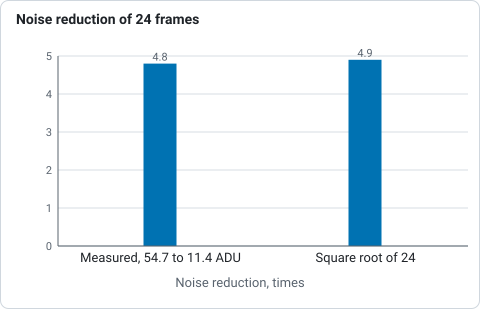

# Quick start

This is the short version of [a first session](walkthrough.md), which runs every
step on real frames with the real output and pictures. The desktop app has the
same steps in a window (see [The desktop app](gui.md)); background extraction is on the
command line.

## Install

Download a release (see [Getting started](../getting-started/install.md)) or build
from source with a current stable Rust (see
[the source repository](https://github.com/qisback/valerian)):

```sh
cargo build --release -p valerian-cli
./target/release/valerian --help
```

## Calibrate

Point `valerian calibrate` at your light frames and your calibration frames.
Each calibration argument is a file or a directory of FITS files and may be
repeated; several files are combined into a master, and a single file whose
`IMAGETYP` says it is a master is used as it is.

```sh
valerian calibrate lights/ \
    --dark darks/ --flat flats/ --dark-flat dark-flats/ \
    -o calibrated/ --masters masters/
```

Each light is written to `calibrated/` with `_cal` added to its name, as a
32-bit float FITS file in ADU. `--masters` also keeps the master frames, so the
next session can pass `--dark masters/master_dark.fits` and skip combining the
darks again. With bias frames (`--bias`) the dark is bias-subtracted and can be
scaled to other exposure times (`--scale-dark exposure`). Without a dark,
`--auto-cosmetic` repairs isolated hot and cold pixels in each light itself.
See [How calibration works](calibration.md).

For a one-shot-colour camera the lights are raw mosaics. Calibrate them as
they are and let the next step demosaic them, or add `--debayer mhc` to write
three-plane colour frames.

## Stack

```sh
valerian stack calibrated/ -o stack.fits --report report.txt --coverage coverage.fits
```

This registers every frame to the sharpest, matches their levels, weights them
and combines them with outlier rejection, then prints one line per frame:

```text
   #  frame                         stars   FWHM  ellip      sky    noise   flux x rms px weight  reject  status
   0  2023-01-25_20-43-49_Ha_-10.0   1000   8.06  0.239     77.7    59.28   1.0000  0.000   1.03   0.66%  reference
   1  2023-01-25_20-49-13_Ha_-10.0   1000   8.22  0.222     77.8    59.31   0.9974  0.438   1.00   0.56%  stacked
```

A frame that cannot be registered (a different field, too few stars) is
reported as skipped with the reason and left out. `--rejection`, `--weights`,
`--normalisation`, `--model` and `--interpolation` change the method; see the
[CLI reference](../reference/cli.md) and
[How stacking works](stacking.md). `valerian register` stops after
resampling and writes each frame on the reference grid.

## Remove the sky gradient

A stack usually has a glow under it. `valerian background` models it and takes it
out, keeping the sky at the brightness it had:

```sh
valerian background stack.fits -o flat.fits --degree 1 --save-model glow.fits
valerian background stack.fits -o flat.fits --model spline --smoothing 0.005
```

The first fits a plane (tilt only, the safest) and writes the fitted glow so you
can look at it; the second follows any smooth gradient. If a big nebula or
galaxy leaves no clear sky, the plane is reported as declined and left alone
instead of having the target subtracted; `--exclude-target` helps when the
target is large but sky remains. See
[How background extraction works](background.md).
## Stretch

A stack is linear, so it looks black. `valerian stretch` makes a copy you can
look at:

```sh
valerian stretch stack.fits -o stretched.fits --target 0.10
valerian stretch stack.fits -o ghs.fits --curve ghs --ghs-stretch 4 --ghs-b -1 --ghs-sp 0.02
```

The first puts the sky at 0.10 with a midtone curve; the second applies a
logarithmic generalised hyperbolic stretch centred on faint signal. The input is
not changed, and `valerian stretch stretched.fits --invert -o linear.fits` undoes
the stretch it recorded. See [How stretching works](stretching.md).

## Remove the stars

```sh
valerian starless stretched.fits -o starless.fits --stars-out stars.fits --preview starless.png
```

Stars are masked and filled by diffusion with noise of the local level added;
`--stars-out` keeps what was taken out and `--strength 0.5` reduces the stars
instead of removing them. See [How star removal works](star-removal.md).

## Plate solve and calibrate the colour

```sh
valerian solve flat.fits -o solved.fits
valerian photocal solved.fits -o calibrated.fits
```

`solve` finds where the image points from its header (or `--ra`, `--dec` and
`--scale`) and writes the world coordinate system; `photocal` uses it to match the
stars to Gaia colours and set the white balance, on a linear colour image before
stretching. Both need the star catalogue (`VALERIAN_CATALOGUE` or `--catalogue`).
See [How plate solving works](plate-solving.md) and
[How colour calibration works](colour-calibration.md).

## Drizzle

```sh
valerian drizzle calibrated/ -o drizzled.fits --scale 2 --pixfrac 0.6
```

For dithered, undersampled frames, instead of a plain stack. See
[How drizzle works](drizzle.md).

## Look at a file

```sh
valerian info stack.fits --stats
```

prints the main header cards, the sky level and noise of each plane, and the
number and median FWHM of the stars.

## What it costs

Measured on a 24-core machine without a GPU (Valerian's kernels run on the CPU
today): five five-minute frames of 4656 by 3520 pixels, calibrated with ten
darks, thirty flats and thirty dark flats, took 5.5 s and at most 4.8 GiB of
memory when the masters were built with every input frame in memory at once,
and about 1.4 GiB, in 11 s, now that they are streamed from disk
(`--memory`, [how calibration works](calibration.md)); stacking the five calibrated frames took 2.7 s and 0.6 GiB.

Colour: sixty raw ten-second sub-exposures from a Seestar S50 (1080 by 1920,
GRBG, no calibration frames) were demosaiced, registered (all sixty) and stacked
in 14 s and 2.7 GiB. Twenty-four of them lowered the noise from 54.7 to 11.4 ADU,
4.8 times against a square root of 24 of 4.9.



*How many times quieter a stack of 24 Seestar frames is than one frame, against the square root of 24, from the paragraph above.*

## Not yet

Mosaics, deconvolution, and background extraction in the desktop app. The [roadmap](../roadmap.md) has the order.
