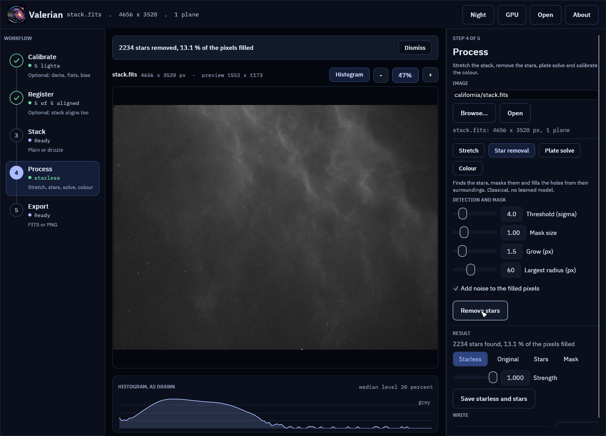
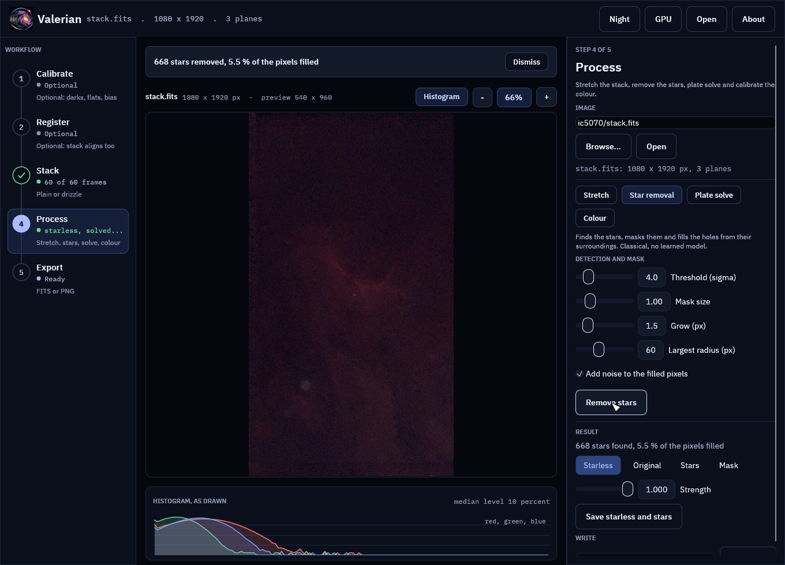
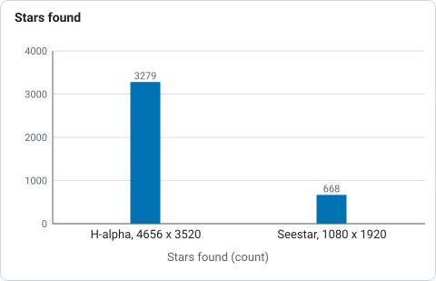
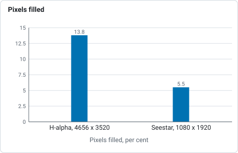
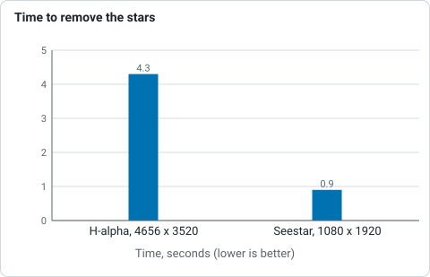

# How star removal works

For a numbered walk-through on real data, with the settings and troubleshooting, see
[Tutorial 7: Star removal](../tutorials/star-removal.md).

Star removal splits an image into two: the sky and nebulosity without stars
(the *starless* image) and the stars on their own (the *star layer*). Stretch
and colour-grade the nebula hard without the stars blooming, then add the stars
back. Valerian does this with a classical method and no learned model. A
learned model may be offered one day as an option; it would be labelled, and it
would never be the default. The code is `valerian_core::starless`; the command
is `valerian starless`.

## The method

1. **Detect.** Stars are found on the luminance with the same detector
   registration uses, with a lower threshold (4 sigma of the smoothed noise) and
   no limit on how many.
2. **Mask.** Each star gets a disc. Its radius is where a Moffat profile with the
   star's own width and peak falls to half the pixel noise. A Moffat profile is
   used, not a Gaussian, because the wings of a real star are heavier than a
   Gaussian's. The radius is then scaled (`--mask-scale`), grown (`--grow`
   pixels), kept at no less than two FWHM and at most `--max-radius`. The mask is
   the union of the discs. All colour planes share one mask.
3. **Fill.** Inside each connected piece of the mask every plane is filled by
   solving Laplace's equation with the unmasked pixels around the piece held
   fixed: harmonic, or diffusion, inpainting, solved by successive
   over-relaxation. The fill meets its surroundings without a seam and follows a
   gradient through the hole. Pieces are independent and run in parallel.
4. **Noise.** A diffusion fill is smooth, and a smooth patch in a noisy sky is
   easy to see. Unless `--no-noise` is given, Gaussian noise of the level
   measured on the unmasked pixels beside each piece is added inside it. The
   noise is seeded (`--seed`), so a run is repeatable.

Pixels outside the mask are not touched: they are bit for bit what they were.

## On the command line

```sh
valerian starless stack.fits -o starless.fits --stars-out stars.fits
valerian starless stack.fits --preview look.png
```

`--stars-out` writes what was removed: `stars = original - starless`, exactly,
so the two layers add back to the original. `--mask-out` writes the mask.
`--preview` writes a PNG of the original and the starless image side by side,
both on the automatic stretch of the original, and with it `-o` is optional.

`--strength` below 1 removes only that fraction of every star, which reduces them
instead: `0.5` leaves each star at half its brightness. The star layer then holds
the other half.

## In the desktop app

Open an image, choose **Star removal** in the Process step and press **Remove
stars**. The detection and fill run on the full image in the background, because
the detector needs the real pixel scale; the window stays usable.

When the run finishes the viewer shows the starless image, and the panel offers
the other layers: **Original**, **Stars** (the star layer on the sky level) and
**Mask**. The views share one automatic stretch, so they can be compared.



The same on the colour stack of IC 5070:



The **Strength** slider is applied after the run (`original - strength * stars`),
so moving it costs nothing and needs no new run. **Save starless and stars**
writes both layers as FITS files, by default `<name>_starless.fits` and
`<name>_stars.fits` next to the original.

The screenshots are of the real stacks of [a first session](walkthrough.md).

## Settings

| Option | What it does |
|---|---|
| `--threshold` | Detection limit in sigmas of the smoothed noise. Lower finds fainter stars and fills more of the frame. |
| `--mask-scale` | Multiplies every mask radius. Raise it if a bright star leaves a faint disc of halo. |
| `--grow` | Pixels added to every radius. |
| `--max-radius` | The largest disc. A cap keeps one saturated star from filling a quarter of the frame. |
| `--no-noise` | Leave the smooth fill. |
| `--strength` | Fraction of each star to remove. |

## Measured

On stacked data on a 24-core machine (release build): the 4656 by 3520 H-alpha
stack from the ASI1600MM (the five-minute frames of the
[stacking](stacking.md) tests) finds 3279 stars, fills 13.8 % of the pixels and
takes 4.3 seconds; a 1080 by 1920 Seestar colour stack (three planes) finds 668 stars, fills
5.5 % and takes 0.9 seconds. On a synthetic frame with known truth the fill
inside the mask is on average within 12 ADU of the true starless frame (the
noise is 6 ADU), and over 92 % of the star light is gone (the tests check both).



*Stars found by the star removal in two stacks, from the paragraph above.*



*Share of the pixels filled in two stacks, from the paragraph above.*



*Time of the star removal on a 24-core machine for two stacks, from the paragraph above.*

## What it cannot do

* It does not recreate texture that a star hides. A bright star on a nebula
  leaves a smooth patch the size of its mask, with noise added but no structure.
* Diffraction spikes and halos beyond the mask stay. A very bright star can leave
  a faint disc; a larger `--mask-scale` removes more of it.
* Stars below the detection limit stay, and so do stars within two pixels of the
  frame edge, which the detector does not look at.
* Galaxies and compact nebulae can be taken for stars if they are small and
  round. Look at the mask before relying on the result.
* Raw colour mosaics must be demosaiced first.
