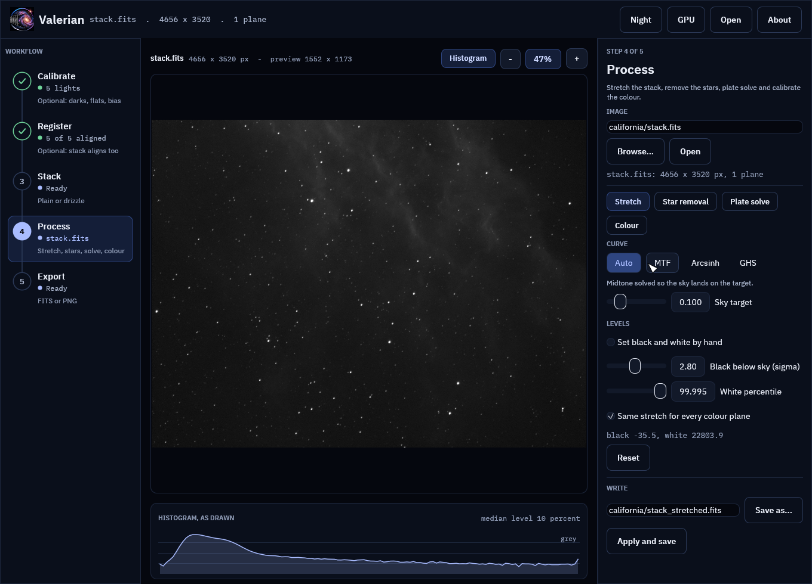
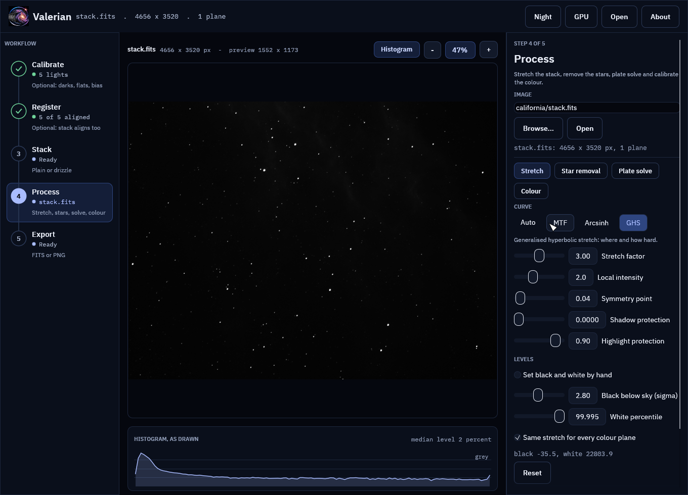

# How stretching works

For a numbered walk-through on real data, with the settings and troubleshooting, see
[Tutorial 6: Stretch](../tutorials/stretch.md).

Stacked data is *linear*: a pixel's value is proportional to the light that
fell on it. Nearly everything interesting in a deep-sky image sits in the
bottom few percent of that range, so shown as it is, the picture is black with
a handful of stars. A stretch is a curve that lifts the faint end and holds the
bright end, so the eye can read both. The functions live in
`valerian_core::stretch`; the command is `valerian stretch`.

## Two steps

1. **Levels.** A black point maps to 0 and a white point to 1; anything outside
   is clipped. By default the black point is put 2.8 robust sigmas below the sky
   (the median) and the white point at the 99.995th percentile, which leaves
   the sky just above black and keeps all but the very brightest stars from
   clipping. Set your own with `--black` and `--white`, in the image's units, or move the
   automatic ones: `--shadow-sigma` (default 2.8) is how many robust sigmas below
   the sky the black point goes, and `--white-percentile` (default 99.995) is the
   percentile of the pixels that becomes white. A larger `--shadow-sigma` lifts the
   sky further off black; a lower `--white-percentile` clips more of the brightest
   stars to white and gives the rest more room.
2. **Curve.** A curve bends `0..1` onto `0..1`, with 0 and 1 fixed and always
   rising, so no information is lost between the two ends.

The input file is never changed. The output is a new 32-bit float FITS file in
the range 0 to 1.

## The curves

| `--curve` | What it does | Parameters |
|---|---|---|
| `auto` (default) | A midtone transfer function whose midtone is solved so the sky lands at `--target`. | `--target` (default 0.10) |
| `mtf` | The midtone transfer function `((m - 1) x) / ((2m - 1) x - m)`: `m` goes to one half. Below 0.5 brightens, above darkens, 0.5 changes nothing. | `--midtone m`, or without it `--target` |
| `arcsinh` | `asinh(beta x) / asinh(beta)`: linear for small values, logarithmic above. Keeps colour well on stars. | `--beta` (default 50) |
| `ghs` | The generalised hyperbolic stretch (below). | `--ghs-stretch`, `--ghs-b`, `--ghs-sp`, `--ghs-lp`, `--ghs-hp` |

### The generalised hyperbolic stretch

The GHS adds control over *where* the
stretch acts. It is a family of curves with five parameters:

* **stretch factor** `s` (`--ghs-stretch`): overall strength. `D = e^s - 1`. Zero
  does nothing.
* **local intensity** `b` (`--ghs-b`): how tightly the stretch is focused around
  the symmetry point. `b = -1` is logarithmic, `b = 0` exponential, `b > 0`
  harmonic or hyperbolic. A logarithmic stretch has a heavy tail and lifts a
  wide range; larger `b` concentrates it near the symmetry point.
* **symmetry point** `SP` (`--ghs-sp`): the brightness (0 to 1, after the levels)
  that is stretched hardest. The curve is point-symmetric about it: the lift
  above `SP` mirrors the dip below it.
* **shadow protection** `LP` (`--ghs-lp`, at most `SP`) and **highlight
  protection** `HP` (`--ghs-hp`, at least `SP`): outside `[LP, HP]` the curve is
  a straight line that keeps the slope it has at that limit, instead of
  flattening further.

Valerian implements the definition in the GHS documentation (section 5.2 of the
process documentation at ghsastro.co.uk): the base curves for the four ranges of
`b`, the piecewise construction around `SP` with linear continuation outside
`LP` and `HP`, and the rescale to 0 and 1. The tests check the closed forms
for `b` of -2, -1, 0, 1 and 2, the point symmetry, the continuity of value and
slope at `LP`, `SP` and `HP`, and that every curve is increasing and has an
inverse.

A very hard stretch (a stretch factor above about 8 with `b >= 0`) makes the
curve reach 1 within double precision before the top of the range, so it cannot
be inverted there. Factors up to about 5 are comfortable.

## Colour

Colour planes are stretched alike by default: the levels and curve are found once,
from the mean of the planes, and applied to all of them, which keeps the colour
balance. `--unlinked` finds a separate stretch for each plane, which neutralises a
colour cast in the sky at the cost of colour accuracy in the nebula.

## Undoing it

The header of the output records the stretch (`STRETCH`, `STRBLACK`, `STRWHITE`
and the curve's parameters, and a `HISTORY` line). `valerian stretch --invert
stretched.fits -o linear.fits` reads that record and applies the inverse
curve and levels. The data that lay between the black and white points comes
back (to float32 precision); what was clipped does not. Unlinked stretches are
described in `HISTORY` lines but not recorded in a form `--invert` reads.

## How it compares with the Python pipeline

`scripts/compare_python_stretch.py` restates the pipeline's `autostretch` and
`mtf` and compares them with `valerian stretch`. On a stacked H-alpha frame
(4656 by 3520 pixels) and a colour stack the stretched images agree to a
largest difference of 1.1e-5 and 1.4e-4 on a 0 to 1 scale, and put the sky at
the same target (0.1000). The small difference is the percentile: the pipeline
interpolates between pixel values, Valerian takes the nearest rank.

On a 24-core machine with no GPU, stretching that 16-megapixel frame takes 0.6
to 1.0 seconds and 193 MiB.

## Previewing

An automatic stretch is a good first look, and you can see it before writing
anything. `valerian stretch --preview look.png linear.fits` writes the stretched
image as an 8-bit PNG (reduced to 1600 pixels on the long side, or
`--preview-size`), and with `--preview` the `-o` FITS file is optional. Give
`-o` as well to write both.

## In the desktop app

Open a linear FITS file in `valerian-gui` (Open or Ctrl+O, a typed path and Open, a
file dropped on the window, or `valerian-gui file.fits`), or stack one, and the Stretch tool
of the Process step is on the right. The first picture is the automatic stretch.

Pick a curve and move the sliders; the picture follows. The preview is made on a
reduced copy of the image, but its black and white points are measured on the
full frame and only measured again when you change the automatic-level settings,
so the preview and the file you write have the same stretch.

The same on the one-shot-colour stack of IC 5070, with the stretch shared by the three
colour planes:

The histogram under the picture is of what is drawn, so it shows what each setting does to
the sky: the automatic stretch puts its peak at the sky target.

* **Curve**: Auto (a midtone solved so the sky lands on the sky target), MTF,
  Arcsinh and GHS, with the parameters described above. Shadow and highlight
  protection are held on either side of the symmetry point.
* **Levels**: the automatic black and white points (sigma below the sky, and a
  percentile), or "Set black and white by hand", which starts from the
  measured values. The line under the controls shows the levels in use.
* **Same stretch for every colour plane** is `--unlinked` turned off.
* **Reset** returns to the automatic stretch.
* **Apply and save** stretches the full image in the background and writes a new
  FITS file (by default `<name>_stretched.fits` next to the original; edit the
  path to change it). The header records the stretch, so `valerian stretch
  --invert` undoes it. The original is never changed.

The screenshots are of the real stacks of [a first session](walkthrough.md), drawn by the
program's tests (see [the source repository](https://github.com/qisback/valerian)).

## Not done yet

* Stretching on the GPU; it runs on the CPU, in parallel over rows.
* Separate black and white points for the colour planes of a linked stretch,
  and colour-preserving stretches that act on luminance only.
* A curve plot in the panel (the histogram of what is drawn is under the picture).
