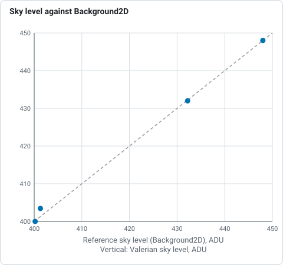
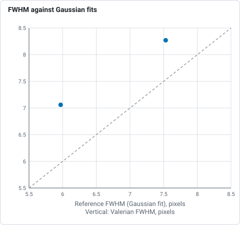

# How subframe analysis works

`valerian subframes` measures every frame of a session, plots the measurements against frame
number and against time, marks the frames that fall outside limits you set, and writes the
approve/reject table that `valerian stack --approve` reads. It is the Valerian counterpart of
the SubframeSelector process of PixInsight and of the sequence plots of Siril. The desktop app
has the same thing in the **Science** panel of the Stack step. For a worked example start with
[tutorial 12](../tutorials/subframe-analysis.md); this page says what each number is, how it
is measured and what every option and control does.

## What is measured

The frames are registered to the sharpest one exactly as `valerian register` and `valerian
stack` do it (see [How registration works](registration.md)), so every number below is the one
those commands use. Raw Bayer frames are demosaiced first.

| Quantity | Unit | How it is measured |
|---|---|---|
| **Stars** | count | Stars found by the detector at `--threshold` sigmas of the smoothed noise (at most 1000 are kept, so a count of 1000 means "at least 1000"). |
| **FWHM** | pixels | Median, over the detected stars that are not saturated, of the full width at half maximum from each star's windowed second moments (`2.355 sigma` of the equivalent Gaussian). |
| **Eccentricity** | 0 to 1 | Median, over the same stars, of `1 - b/a`, the elongation of the star profile from its second moments. A round star is 0; trailing, tilt and coma raise it. |
| **Background median** | ADU | The sky level: the median of the background model, which is built from the median of each tile of the frame after clipping stars at 3 sigma. |
| **Noise** | ADU | See below. |
| **SNR weight** | relative, median 1 | `(t / sigma)^2` where `sigma` is the noise and `t` the transparency (the flux ratio of stars shared with the reference), divided by the median of the registered frames. A frame with twice the weight of another is worth two of it in a mean. Empty for a frame that did not register, whose transparency is unknown. |
| **Registration residual** | pixels rms | Root-mean-square distance between the stars of the frame and the matching stars of the reference after the fitted transform. 0 for the reference itself. |
| **Time** | UTC | `DATE-OBS` of the header. The time plot needs it in every frame. |

### The noise estimate

The noise of a frame is the standard deviation of the difference of pixels two columns apart
(which cancels the sky, nebulosity and smooth gradients and leaves two independent noise
samples), clipped iteratively at 3 sigma so stars do not count, divided by the square root of
two and by 0.9866 (the standard deviation of a Gaussian truncated at 3 sigma, so clipping does
not bias the answer). Rows are sampled so that about a thousand are used. For a colour image
the middle plane is measured.

It is a standard deviation and not a median absolute deviation on purpose. A 12-bit camera
such as the ASI1600MM writes 16-bit files whose values are all multiples of 16; the median
absolute deviation of such data takes only values 23.7 ADU apart, so the noise of every frame of
the H-alpha session came out as 47.44 or 71.16 and a plot of it was a staircase. The standard
deviation is not quantised, and follows the real change (59.3 to 51.9 ADU through the night).

For a demosaiced colour frame the estimate is of the interpolated image, so it is lower than the
photon-and-read noise of the raw sensor; it is the same for every frame, so it ranks and trends
correctly.

## Approving and rejecting

Every frame gets a verdict and, when it fails, the reasons. A frame that did not register to
the reference is always rejected (the reason is the registration error). The rest are judged
against the limits you give; with no limits every registered frame is approved.

| Option | Rejects a frame when | Range | Default |
|---|---|---|---|
| `--max-fwhm <PIXELS>` | its FWHM is above | above 0 | no limit |
| `--max-ellipticity <E>` | its eccentricity is above | 0 to 1 | no limit |
| `--min-star-count <N>` | it has fewer stars than | count | no limit |
| `--max-noise <ADU>` | its noise is above | above 0 | no limit |
| `--min-snr-weight <W>` | its SNR weight is below (1 is the median frame) | above 0 | no limit |
| `--max-residual <PIXELS>` | its registration residual is above | above 0 | no limit |
| `--outlier-sigma <SIGMA>` | a measurement is further than this many robust sigmas from the median of the frames, in its bad direction | above 0; 3 to 4 is usual | off |

The **robust sigma** is `1.4826 x MAD`, the median absolute deviation scaled to a Gaussian's
standard deviation, so a few bad frames do not widen the spread they are judged against. The
bad direction is up for FWHM, eccentricity, noise and registration residual, down for the star
count and the SNR weight, and either way for the background. A measurement whose spread is zero
(every frame has the same star count, say) is not tested. The reason printed for each rejection
names the measurement and the distance: `FWHM 4.02 px above 3.5` or `star count 4.6 sigma from the
median`.

## Grading Seestar subs

With the optional `--grade` (off by default), raw Seestar S50 subs are also scored by a small neural network, which adds a
score and the chance of five defects to each row and rejects the frames that score too low.
See [How the Seestar sub grader works](grading.md). `--min-grade`, `--reject-defect` and
`--grader-model` set how; frames that are not S50 subs are skipped with a note.

## What is written

`--report <DIR>` (default `subframes-report`) holds:

| File | What it is |
|---|---|
| `subframes.csv` | the table, one row per frame: `index`, `name`, `time_utc`, `stars`, `fwhm_px`, `ellipticity`, `sky_adu`, `noise_adu`, `snr_weight`, `registration_rms_px`, `approved` (`yes` or `no`) and `reasons`. An unmeasured value is an empty field. With `--grade` the columns `grade_score`, `cloud_haze`, `trail`, `blur`, `dew` and `star_poor` come before `approved`. |
| `subframes.json` | the same, with the limits used and the median and robust sigma of each quantity (`fwhm`, `ellipticity`, `stars`, `sky`, `noise`, `registration_rms`), each frame as an object with `approved` and a `reasons` list. |
| `subframes_index.png` | seven panels (FWHM, eccentricity, star count, background median, noise estimate, SNR weight, registration residual) against frame number, and a summary. |
| `subframes_time.png` | the same against hours since the first frame; written when every frame has `DATE-OBS`. |
| `report.html` | one page with the plots, the table (rejected rows shaded) and links to the data. The images are inside the file, so it can be mailed or archived alone. |
| `report.json` | the list of sections of the page. Later commands that write into the same folder add their sections, so one session's outputs gather on one page. |

In the plots a blue dot is an approved frame and a red cross a rejected one, the dashed grey
line is the median and a dashed red line is a limit.

`valerian plot subframes <frames or subframes.json> -o plot.png` draws the sheet on its own,
with `--x index` or `--x time`, and writes `plot.csv` and `plot.json` beside it. Giving it a
`subframes.json` re-draws without measuring again.

## Feeding the stack

```sh
valerian subframes lights/ --report science --outlier-sigma 3
valerian stack lights/ -o stack.fits --approve science/subframes.csv
```

`--approve` takes the CSV or the JSON and leaves out every frame whose `approved` is `no`
(`false`, `0` and `rejected` also count as no in a CSV). Frames are matched by file name; a
frame the table does not name is kept, and the command says how many. Edit the `approved`
column by hand if you disagree with a verdict. `--reference` counts positions in the list that
is left after the frames are removed.

`valerian stack --science-report <DIR>` runs the same analysis on the frames of a stack, from
the numbers the stack already measured, and writes the same files. It takes the limit options
above. The limits decide the stack as well as the report: `valerian stack --max-fwhm 3.2` registers
and judges every frame, prints which are rejected and why, and combines only the rest (the
registration runs a second time on the kept frames, so the reference may change). If the limits
leave fewer than two frames the command stops with an error. The report keeps one row for every
frame, rejected ones included. Earlier builds only marked frames in the report and stacked them
all; if you relied on that, drop the limit options from `stack`.

## The Science panel in the desktop app

Open the **Stack** step and choose the **Science** chip. The plots fill the viewer; the panel
holds the controls. Every box has a hover text.

| Control | What it does | Range | Default |
|---|---|---|---|
| Frames | folder of frames to measure; **Measure frames** registers and measures them on a worker thread, with progress and Cancel | folder | the folder of the last Register or Calibrate, else the Stack folder |
| Limits (seven rows) | each row has a tick box and a value: FWHM above, Eccentricity above, Stars below, Noise above, SNR weight below, Residual above, Outliers beyond (sigma). Changing one judges the frames again at once | as the options above | only Outliers beyond, at 3.0 sigma |
| By frame, By time | the horizontal axis of the plots; By time is disabled when a frame has no `DATE-OBS` | | By frame |
| Grade with the Seestar model, Reject below, Model file | grade raw Seestar S50 subs while measuring, and reject the ones that score below the value (0 to 1, default 0.5). Changing the value judges again at once. See [How the Seestar sub grader works](grading.md) | off | 
| Frames list | one tick box per frame: tick means approved. Click to override a verdict; the plots redraw. Hover for the reasons. Changing a limit judges again and drops hand changes | | |
| **Use for stacking** | the next Mean stack leaves the rejected frames out; the Mean panel says how many, with **Use all** to undo | | |
| Report, **Save report** | folder for the plots, CSV, JSON and `report.html` | folder | `science-report` beside the frames folder |

## Checked against astropy and photutils

`scripts/compare_python_subframes.py` repeats the measurements with different code on four
monochrome frames of the ASI1600MM H-alpha session (numbers from a real run; astropy 8.0.2,
photutils 3.1.1):

| Frame | Quantity | Valerian | Reference |
|---|---|---|---|
| 3, 13, 21, 23 | time stamp | identical to the second | `astropy.time.Time(DATE-OBS)` |
| 3 | sky level | 448.00 | 448.0 (`Background2D`, sigma-clipped, median) |
| 13 | sky level | 432.00 | 432.2 |
| 21 | sky level | 403.44 | 401.3 |
| 23 | sky level | 400.00 | 400.2 |
| 3 | noise | 61.30 | 60.48 (clipped standard deviation of differences, `astropy.stats`), 59.65 (`Background2D` rms) |
| 13 | noise | 59.32 | 58.56, 57.04 |
| 21 | noise | 52.90 | 52.86, 51.53 |
| 23 | noise | 52.32 | 51.61, 51.18 |
| 3 | FWHM, px | 8.27 | 7.53 (two-dimensional Gaussian fits, `astropy.modeling`, 75 stars) |
| 13 | FWHM, px | 7.06 | 5.97 |



*Sky level in ADU of four H-alpha frames, Valerian against astropy Background2D, from the table above: the points sit on the line of equality to within 2 ADU.*


*Noise in ADU of four H-alpha frames, Valerian against two astropy estimators, from the table above: Valerian reads a little higher than both.*



*FWHM in pixels of two defocused H-alpha frames, Valerian against astropy Gaussian fits, from the table above: Valerian reads 10 and 18 per cent higher.*

The sky agrees to 2 ADU (0.5 per cent), and the noise to 1.4 per cent of an independent
estimator built the same way and to 2 to 4 per cent of `Background2D`, which has no way to
avoid structure inside its boxes. The FWHM is 10 and 18 per cent above a Gaussian fit on these
defocused frames: Valerian measures second moments in a window, which weight the wings of a
non-Gaussian profile more than a fit does, so compare FWHM between frames of one session and
not with another program's figure. (On the sharp frames of the set the reference detector found
thousands of noise peaks and its fits failed, so no FWHM comparison is made there.)

## Limits of the method

* Frames of different fields (the five panels of a mosaic, a meridian flip) cannot register to
  one reference, so all but one panel is rejected as "registration failed"; analyse each panel
  on its own.
* FWHM and eccentricity are medians over the stars detected; a crowded field or a frame with
  very few stars gives noisier values, which is why the star count is plotted beside them.
* The SNR weight assumes the transparency is the same over the field. It does not see a
  gradient or a cloud that covers part of the frame; the background plot does.
* The noise estimate treats the frame as white noise; a frame with strong banding or
  pattern noise reads high.
