# A first session

This page takes two real sessions from raw frames to a finished picture, one tool at
a time: **calibrate, register, stack, remove the sky gradient, stretch, remove the
stars, plate solve, calibrate the colour and drizzle**. Every block of terminal output
is real, from the `valerian` binary of this repository run on a 24-core Linux machine,
and every picture was written by Valerian from the frames named below.

The first session is monochrome, with the calibration frames a cooled camera makes.
The second is one-shot colour, with no calibration frames at all. Between them they
cover every command. The commands are the same wherever you run them; the timings are
that machine's and are not a promise. Every command on this page is checked against
the [command line reference](../reference/cli.md) by CI (`scripts/check_book_commands.py`).

Run `valerian --help` for the list of commands and `valerian COMMAND --help` for the
options of one.

## The two sessions

| | Monochrome | One-shot colour |
|---|---|---|
| Target | the California Nebula, H-alpha | IC 5070 (the Pelican Nebula), light-pollution filter |
| Camera, telescope | ZWO ASI1600MM Pro, Starwatcher Esprit, 840 mm | Seestar S50, 250 mm |
| Frames | 5 lights of 300 s, 10 darks, 30 flats, 30 dark flats | 60 lights of 10 s, no darks or flats |
| Size | 4656 by 3520 pixels, one plane | 1080 by 1920 pixels, raw Bayer (GRBG) |

Put each kind of frame in its own folder. The pages below use `lights/`, `darks/`,
`flats/` and `dark-flats/` for the first session and `lights/` for the second.
Every argument that takes frames takes a file or a folder of files and can be
repeated.

## Part 1: monochrome, with calibration frames

### 1. Calibrate

```sh
valerian calibrate lights/ \
    --dark darks/ --flat flats/ --dark-flat dark-flats/ \
    -o calibrated --masters masters
```

```text
compute: CPU (the GPU is slower for this command; --backend gpu forces it)
dark: combined 10 frames with Winsorised { low: 3.0, high: 3.0 } in 616.1ms
dark flat: combined 30 frames with LinearFit { low: 5.0, high: 2.5 } in 1.1s
flat: combined 30 frames with LinearFit { low: 5.0, high: 2.5 } in 2.6s
pixel map: 9925 hot, 22 cold, 0 dead
wrote masters/master_dark.fits
wrote masters/master_dark_flat.fits
wrote masters/master_flat.fits
lights/2023-01-25_20-43-49_Ha_-10.00_300.00s_0000.fits -> calibrated/2023-01-25_20-43-49_Ha_-10.00_300.00s_0000_cal.fits  dark x1.0000, 9947 pixels repaired, 130.0ms
lights/2023-01-25_20-49-13_Ha_-10.00_300.00s_0001.fits -> calibrated/2023-01-25_20-49-13_Ha_-10.00_300.00s_0001_cal.fits  dark x1.0000, 9947 pixels repaired, 129.0ms
...
```

Read it like this:

* Each set of calibration frames is combined into a **master**. Ten darks get
  *Winsorised* sigma clipping, which copes with few frames; thirty flats get linear-fit
  clipping, which copes with a flat panel whose brightness drifts (see
  [How calibration works](calibration.md#rejection)).
* **pixel map: 9925 hot, 22 cold** is the map of defective pixels built from the master
  dark: at 300 s this sensor has a lot of them. They are repaired in every light
  (**9947 pixels repaired**).
* **dark x1.0000** says the dark was subtracted as it is, because the darks and the
  lights have the same exposure.
* `--masters` kept the three master frames, so the next session can pass
  `--dark masters/master_dark.fits` and skip combining the darks again.

Each light goes to `calibrated/` with `_cal` added to its name, as 32-bit float FITS.
Calibration streams the calibration frames from disk in bands of rows, so memory follows
`--memory` and not the number of frames.

A single calibrated light, stretched for viewing (step 5 explains how), is noisy and has
few stars, as a five-minute frame at this focal length does:

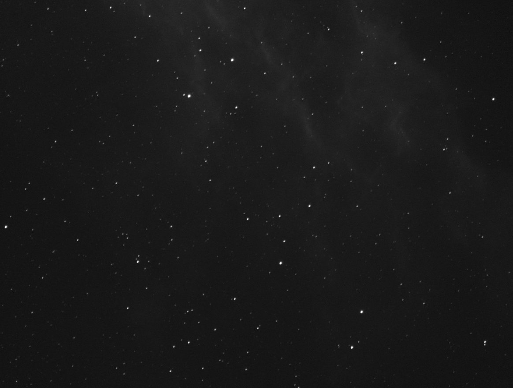

### 2. Register

```sh
valerian register calibrated/ -o registered
```

```text
read 5 frames in 56.2ms
compute: CPU (the GPU is slower for this command; --backend gpu forces it)
reference candidate frame 0: 4 of 4 other frames register
reference: frame 0 (FWHM 8.06 px)
   #  frame                         stars   FWHM  ellip      sky    noise   flux x rms px weight  reject  status
   0  2023-01-25_20-43-49_Ha_-10.0   1000   8.06  0.239     77.7    59.28   1.0000  0.000   0.00   0.00%  reference
   1  2023-01-25_20-49-13_Ha_-10.0   1000   8.22  0.222     77.8    59.31   1.0000  0.438   0.00   0.00%  stacked
...
registered 5 of 5 frames to frame 0; wrote them to registered
```

`register` finds the stars in every frame (up to a thousand), chooses the reference (the
sharpest frame that the others register to, here frame 0 with a FWHM of 8.06 pixels)
and fits a transform from each frame to it by matching triangles of stars. **rms px** is
how far the matched stars are from where the fit puts them: under half a pixel for every
frame here. Each frame is resampled onto the reference grid and written with `_reg` added
to its name. A frame that cannot be registered (a different field, clouds, too few stars)
is reported as `skipped` with the reason and left out.

You rarely need `register` on its own, because `stack` does it. It is there if you want
registered frames for another tool, or to look at them. See
[How registration works](registration.md).

### 3. Stack

```sh
valerian stack calibrated/ -o stack.fits \
    --report report.txt --coverage coverage.fits
```

```text
read 5 frames in 59.7ms
compute: GPU: NVIDIA A100 80GB PCIe (Vulkan, DiscreteGpu)
reference candidate frame 0: 4 of 4 other frames register
reference: frame 0 (FWHM 8.06 px)
frame 1: registered, 800 stars matched, rms 0.438 px, shift (7.08, 11.98), rotation -0.0009 deg, flux x0.9974
...
combining 5 frames with Winsorised { low: 3.0, high: 3.0 }, weights NoiseFwhm on GPU: NVIDIA A100 80GB PCIe (Vulkan, DiscreteGpu)
   #  frame                         stars   FWHM  ellip      sky    noise   flux x rms px weight  reject  status
   0  2023-01-25_20-43-49_Ha_-10.0   1000   8.06  0.239     77.7    59.28   1.0000  0.000   1.03   0.66%  reference
   1  2023-01-25_20-49-13_Ha_-10.0   1000   8.22  0.222     77.8    59.31   0.9974  0.438   1.00   0.56%  stacked
   2  2023-01-25_20-54-39_Ha_-10.0   1000   8.58  0.182     75.6    59.02   0.9854  0.448   0.95   0.34%  stacked
   3  2023-01-25_20-59-52_Ha_-10.0   1000   8.09  0.223     75.7    58.78   1.0033  0.436   1.04   0.46%  stacked
   4  2023-01-25_21-05-17_Ha_-10.0   1000   8.27  0.203     74.7    58.92   0.9987  0.442   0.99   0.20%  stacked
5 of 5 frames stacked with Winsorised { low: 3.0, high: 3.0 }, reference frame 0 (2023-01-25_20-43-49_Ha_-10.00_300.00s_0000_cal.fits), 1.6s
wrote stack.fits
wrote coverage.fits
wrote report.txt
```

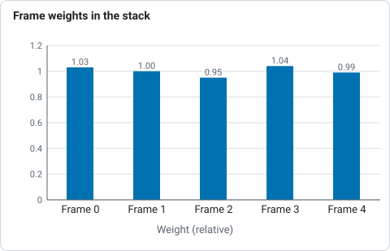

*Weights of the five H-alpha frames in the stack, from the printed table of step 3.*

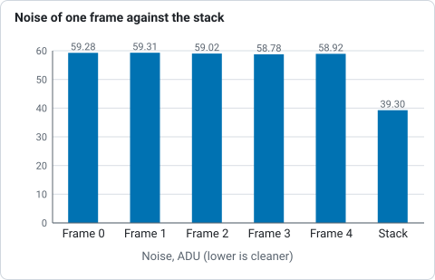

*Noise of each of the five H-alpha frames from the printed table of step 3 and of the stack from the listing of its statistics.*

The same registration, then the frames are matched in level (**sky**, **flux x**), weighted
by noise and star width (**weight**: the sharper, quieter frames count for more) and combined
with per-pixel outlier rejection (**reject** is the share of each frame's samples thrown out
as cosmic rays, satellites and the edges of a shifted frame). On a machine with a graphics
card `stack` uses it by default (`compute: GPU: ...`); `--backend cpu` forces the CPU and
the result is the same to within the GPU parity tests' tolerances (see
[The GPU kernels](gpu.md)). `--report` keeps the table in a text file and `--coverage`
writes how many frames contributed to each pixel. See [How stacking works](stacking.md).

Look at what you have:

```sh
valerian info stack.fits --stats
```

```text
stack.fits
  size: 4656 x 3520 pixels, 1 plane
  OBJECT    California Nebula Pa
  IMAGETYP  Master Light
  FILTER    Ha
  EXPTIME   300
  EXPOSURE  300
  CCD-TEMP  -10
  SET-TEMP  -10
  GAIN      139
  OFFSET    21
  XBINNING  1
  DATE-OBS  2023-01-25T20:43:49.698
  INSTRUME  ZWO ASI1600MM Pro
  TELESCOP  Starwatcher Esprit 1
  FOCALLEN  840
  NCOMBINE  5
  EXPTOTAL  1500
  plane 0: min -615.6, sky 79.8, noise 39.30, max 68116.2 ADU
  stars: 1000 (median FWHM 8.28 px, ellipticity 0.206)
```

Five five-minute lights became `EXPTOTAL 1500` seconds. The stack is linear, so it looks
almost black until it is stretched.

### 4. Remove the sky gradient

```sh
valerian background stack.fits -o flat.fits --degree 1 --save-model glow.fits
```

```text
plane 0: 889 samples of 975 tiles (110 px), 16.0% masked, residual rms 13.05, gradient removed 29.6
wrote flat.fits
wrote the background model glow.fits
```

The image is cut into 110 pixel tiles, each gives the median of its clear pixels, and a
plane (`--degree 1`) is fitted to the 889 tiles that hold only sky, rejecting the 86 that
stars or the nebula lift. The plane is subtracted and the mean level put back, so the glow
goes and the sky stays where it was. `glow.fits` is the fitted glow, to look at. This
target fills much of the frame, so a plane, the safest model, is the right choice; see
[How background extraction works](background.md) for polynomials and splines.

### 5. Look at it: stretch

```sh
valerian stretch flat.fits -o stretched.fits --preview stretched.png
```

```text
black -24.1475, white 22800.3184, Mtf { midtone: 0.04070693853135364 }
plane 0: median 82.9631 -> 0.1000
wrote stretched.fits
wrote preview stretched.png
```

The black point goes just below the sky, the white point at the 99.995th percentile, and a
midtone transfer function is solved to put the sky at 0.10. `--preview` writes the result as
a PNG you can open anywhere (add `--preview-size` for a different size) without committing to
the stretch. The FITS file records the stretch in its header, so
`valerian stretch stretched.fits --invert -o linear.fits` undoes it. For the curves, see
[How stretching works](stretching.md).

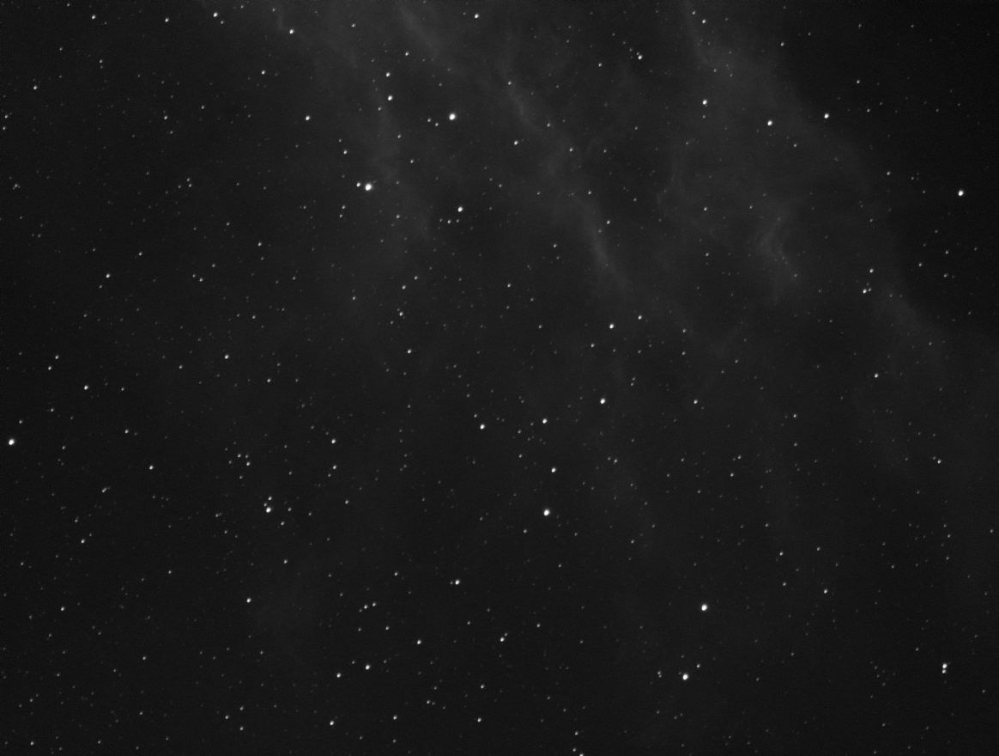

### 6. Remove the stars

```sh
valerian starless flat.fits -o starless.fits --stars-out stars.fits \
    --preview starless.png
```

```text
2224 stars found, 13.04 % of the pixels filled
wrote starless.fits
wrote stars.fits
wrote preview starless.png
```

Each star gets a mask disc sized from its brightness and width, and the masked pixels are
filled by diffusion from their surroundings with noise of the local level added. `--stars-out`
keeps what was taken out (original minus starless), which can be added back later, and
`--strength 0.5` would reduce the stars by half instead of removing them. The preview puts the
original beside the starless image, both on the same stretch:

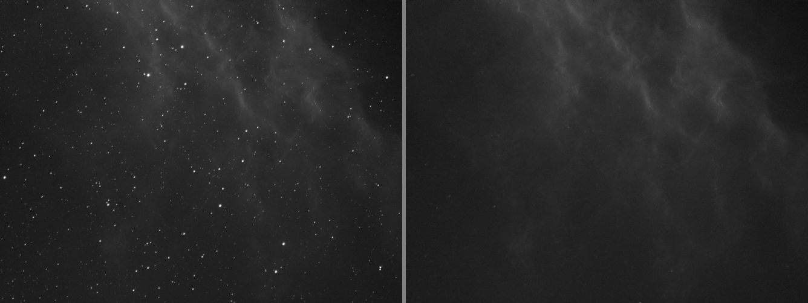

It does not recreate texture a bright star hides, and diffraction spikes and stars below the
detection limit stay. See [How star removal works](star-removal.md).

## Part 2: one-shot colour, no calibration frames

A Seestar S50 writes raw mosaics. With no darks or flats there is nothing to calibrate
against, so go straight to the stack: Valerian demosaics raw Bayer frames itself.

### 7. Stack sixty frames

```sh
valerian stack lights/ -o stack.fits --report report.txt
```

```text
read 60 frames in 82.6ms
compute: GPU: NVIDIA A100 80GB PCIe (Vulkan, DiscreteGpu)
reference candidate frame 47: 59 of 59 other frames register
reference: frame 47 (FWHM 2.16 px)
...
combining 60 frames with LinearFit { low: 5.0, high: 2.5 }, weights NoiseFwhm on GPU: NVIDIA A100 80GB PCIe (Vulkan, DiscreteGpu)
GPU: 3 calls ran on the device
   #  frame                         stars   FWHM  ellip      sky    noise   flux x rms px weight  reject  status
   0  Light_IC 5070_10.0s_LP_20260    199   2.65  0.300    662.0    54.61   0.9541  0.351   1.18   0.83%  stacked
   1  Light_IC 5070_10.0s_LP_20260    194   2.67  0.313    663.5    54.78   0.9673  0.323   1.12   0.87%  stacked
...
  59  Light_IC 5070_10.0s_LP_20260    117   3.84  0.514    640.0    52.05   1.4967  0.484   0.25   6.43%  stacked
60 of 60 frames stacked with LinearFit { low: 5.0, high: 2.5 }, reference frame 47 (Light_IC 5070_10.0s_LP_20260728-224223.fit), 9.4s
wrote stack.fits
wrote report.txt
```

With sixty frames Valerian chose linear-fit rejection (`--rejection auto`: Winsorised below
fifteen frames, sigma clipping to thirty, linear fit above). The weights run from about 2 for the
sharpest, quietest frames down to 0.14 for frame 23, which had lost half its light (it needed a flux
factor of 2.05 to match the reference), and 0.25 for frame 59, whose stars are 3.84 pixels wide and
elongated (ellipticity 0.51): a frame that tracked badly or was dimmed by cloud barely counts. Frame 47,
with the sharpest stars (2.16 pixels), is the reference.

```sh
valerian info stack.fits --stats
```

```text
stack.fits
  size: 1080 x 1920 pixels, 3 planes
  OBJECT    IC 5070
  IMAGETYP  Master Light
  FILTER    LP
  EXPTIME   10
  EXPOSURE  10
  CCD-TEMP  29.125
  GAIN      80
  XBINNING  1
  DATE-OBS  2026-07-28T21:41:58.801919
  INSTRUME  Seestar S50
  TELESCOP  S50_xxxxxxxx
  FOCALLEN  250
  NCOMBINE  60
  EXPTOTAL  600
  plane 0: min 521.4, sky 610.7, noise 12.49, max 74630.9 ADU
  stars: 518 (median FWHM 2.57 px, ellipticity 0.165)
```

Three planes now: red, green and blue. The header kept the pointing (`RA` and `DEC`) and the
optics, which the plate solver will use.

### 8. Remove the gradient

```sh
valerian background stack.fits -o flat.fits --degree 2 --save-model glow.fits
```

```text
plane 0: 1150 samples of 1258 tiles (33 px), 13.0% masked, residual rms 1.66, gradient removed 15.4
plane 1: 1173 samples of 1245 tiles (33 px), 11.7% masked, residual rms 0.65, gradient removed 8.2
plane 2: 1433 samples of 1470 tiles (33 px), 9.9% masked, residual rms 0.96, gradient removed 9.8
wrote flat.fits
wrote the background model glow.fits
```

Colour planes are fitted one by one. A light-polluted site has a different glow in each
colour, so this is where much of the colour cast goes.

### 9. Plate solve

Solving needs the star catalogue, a data file next to the program in a release (see
[Plate solving](plate-solving.md#the-catalogue)). From a source build, point
`VALERIAN_CATALOGUE` at the one in the repository:

```sh
export VALERIAN_CATALOGUE=crates/valerian-core/data/gaia-dr3-g11.vcat
valerian solve flat.fits -o solved.fits
```

```text
looking within 1.00 deg of RA 313.0583 Dec +44.5044, scale 2.03 to 2.75 arcsec/pixel
solved: centre RA 20h51m16.9s Dec +44d25m25.2s (312.82029, +44.42366 deg)
scale 2.374 arcsec/pixel, field 0.71 x 1.27 deg, rotation 122.34 deg east of north, mirrored
41 of 400 detected stars matched, rms 0.23 arcsec (0.10 px), plain TAN
wrote solved.fits
```

The position came from the header's `RA` and `DEC`, and the pixel scale from `FOCALLEN` and
`XPIXSZ` (2.9 micron pixels at 250 mm is 2.39 arcseconds per pixel, searched within 15 per cent either
way). 41 stars agree with the Gaia catalogue to a tenth of a pixel. `solved.fits` is a copy of the
image with the world coordinate system in its header; the input is never changed. With no position at all
`--scale` or `--scale-range` and `--blind` search the whole sky. See
[How plate solving works](plate-solving.md).

### 10. Calibrate the colour

```sh
valerian photocal solved.fits -o calibrated.fits --stars-out stars.csv
```

```text
36 Gaia stars measured, 33 used; aperture radius 5.1 px; neutral at BP-RP 0.82
  red against green: slope -0.635 mag per BP-RP, scatter 0.027 mag, gain 0.7547 +/- 0.0032
 blue against green: slope +0.080 mag per BP-RP, scatter 0.024 mag, gain 0.9860 +/- 0.0037
sky before 610.76 597.29 608.32, after 552.68 552.68 552.68 (offsets -91.76 44.61 47.15)
wrote the star table stars.csv
wrote calibrated.fits
```

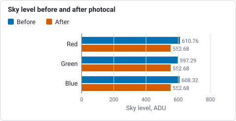

*Sky level of the three planes before and after colour calibration, from the printed output of the photocal step: the planes end level.*

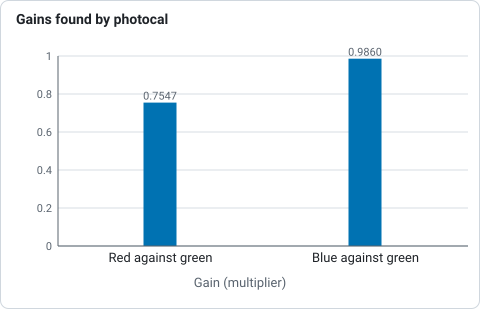

*Gains of red and blue against green from the printed output of the photocal step.*

The stars of the plate solution are matched to Gaia stars with a known colour (BP-RP), each is
measured through one aperture in red, green and blue, and a line of instrumental colour against
true colour is fitted. The gains make a star like the Sun (BP-RP 0.82) neutral: the red channel is
scaled by 0.7547 and the blue by 0.9860, with green left alone so the brightness stays. The
three planes' sky is then brought to one level, so the background is neutral grey. The gains
and offsets are written to the header as `PCCGAINR`, `PCCGAING`, `PCCGAINB` and the `PCCOFF`
cards. Do this on a linear image after background extraction and before stretching. See
[How colour calibration works](colour-calibration.md).

### 11. Stretch and remove the stars

```sh
valerian stretch calibrated.fits -o stretched.fits --preview stretched.png
valerian starless calibrated.fits -o starless.fits --preview starless.png
```

```text
black 532.4390, white 5099.4653, Mtf { midtone: 0.0385596760748138 }
plane 0: median 552.7506 -> 0.1002
plane 1: median 552.7175 -> 0.1001
plane 2: median 552.7233 -> 0.1001
wrote stretched.fits
wrote preview stretched.png
684 stars found, 5.62 % of the pixels filled
wrote starless.fits
wrote preview starless.png
```

The three planes share one stretch, so the colour balance photocal set is kept and the sky comes
out at 0.100 in all three. The sixty-frame stack, plate solved, colour calibrated and stretched:

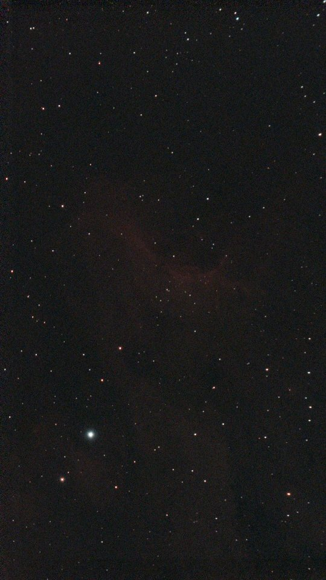

And with the stars removed:

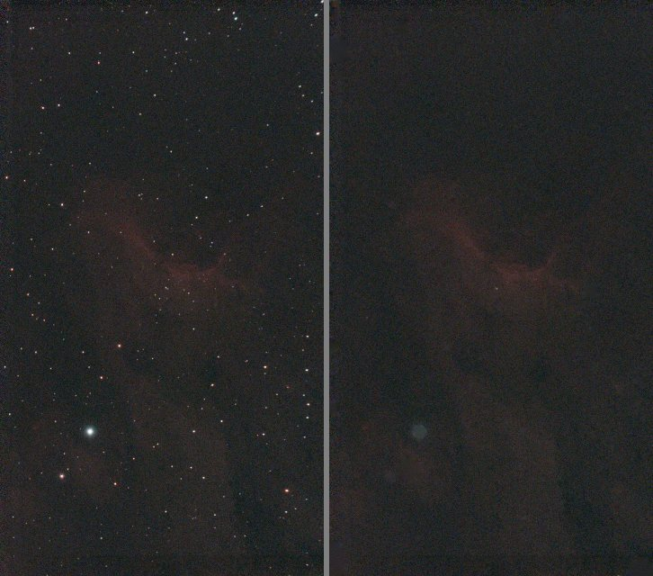

### 12. Drizzle

The Seestar's frames are dithered, its stars are only about 2.5 pixels wide and a one-shot-colour
sensor samples red and blue at every second pixel: the case drizzle is for. Instead of a plain stack, give `drizzle` the same
frames, as raw mosaics (it drops each pixel into its own colour plane without interpolating):

```sh
valerian drizzle lights/ -o drizzled.fits --scale 2 --pixfrac 0.6 \
    --report drizzle-report.txt
```

```text
read 60 frames in 88.3ms
registering through demosaiced copies of the mosaics
reference candidate frame 47: 59 of 59 other frames register
reference: frame 47 (FWHM 2.16 px)
drizzling 60 frames onto 2160 x 3840 (scale 2, pixfrac 0.6), raw Grbg mosaics dropped without interpolation
second pass: rejecting input pixels more than 4 sigma from the first result
...
60 of 60 frames drizzled to 2160 x 3840 (scale 2, pixfrac 0.6), reference frame 47 (Light_IC 5070_10.0s_LP_20260728-224223.fit), 0.28 % of the input samples rejected, 0.015 % of the output without data, 9.4s
wrote drizzled.fits
wrote drizzle-report.txt
```

The result is twice as wide and as tall (2160 by 3840), with 0.015 per cent of the output pixels
no drop reached. It is not colour calibrated yet: solve it (the drizzle removes the WCS) and run
`photocal`, as in steps 9 and 10. Stretched on its own, it looks like this:

```sh
valerian stretch drizzled.fits -o drizzled-stretched.fits --preview drizzled.png
```

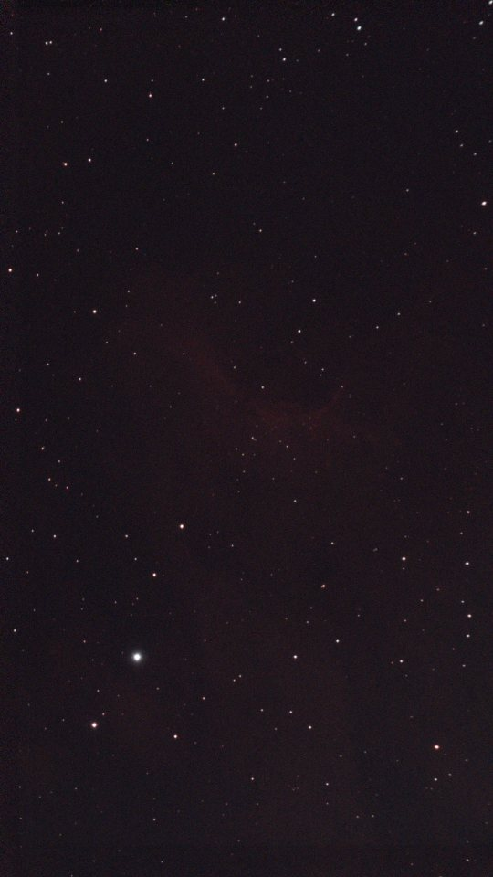

The picture here is shrunk to fit a web page, which hides the detail: open `drizzled.fits` at full
size next to `stack.fits` to compare. How much resolution drizzle gains is measured in
[How drizzle works](drizzle.md), and the nightly Python-parity job in
[the source repository](https://github.com/qisback/valerian) checks it against an independent
measurement. It needs a dither of a pixel or more between frames and a dozen or more of them; with fewer, use a larger
`--pixfrac` or a smaller `--scale`.

## The same steps in the desktop app

The desktop app (`valerian-gui`) has every step of this page on its workflow rail:
Calibrate, Register, Stack, Process (Stretch, Star removal, Plate solve and Colour) and
Export, with Drizzle beside Stack. The screenshots below are the real window working on the
frames of this page, drawn by the GUI's own tests (see
[the source repository](https://github.com/qisback/valerian)). Background
extraction (step 4) is on the command line for now.

Part 1 in the window: name the lights, darks, flats and dark flats and press **Calibrate
lights**. The viewer shows the first calibrated frame, and the panel says what was made.


**Register frames** finds the stars and aligns the frames; the notice above the picture shows
the frame it is on, with its star count and seeing, while it works.


Part 2 in the window: **Stack frames** on the folder of sixty raw Seestar frames registers,
combines and opens the stack, ready for the Process step.


The tools of the Process step work on that stack. Stretch, with the histogram of what is
drawn under the picture:


Star removal:


Plate solve, with the matched stars circled:


Colour, calibrated against Gaia star colours:


Drizzle, in the Stack step, on the same sixty frames:


[The desktop app](gui.md) describes every step, the notices, the view and the file dialogs.

## Without a telescope

If you have no data yet, the repository has a small script that writes a made-up session: a star
field that drifts a few pixels from frame to frame, with a bias level, dark current, hot pixels,
vignetting, dust, cosmic rays and one frame of poor seeing. It needs only the Python standard
library, and the same seed always gives the same files:

```sh
python3 scripts/make_synthetic_session.py demo
valerian calibrate demo/lights --dark demo/darks --flat demo/flats --dark-flat demo/dark-flats \
    -o demo/calibrated --masters demo/masters
valerian stack demo/calibrated -o demo/stack.fits --report demo/report.txt
```

```text
wrote 12 lights, 8 darks, 8 flats and 8 dark flats to demo/
```

It is a way to try the tools, not a picture of the sky. The poor-seeing frame (frame 7, FWHM 5.9
pixels against 3.4) gets a weight of 0.33 where the sharp frames get 1.1 to 1.2, which is what the
weights are for.

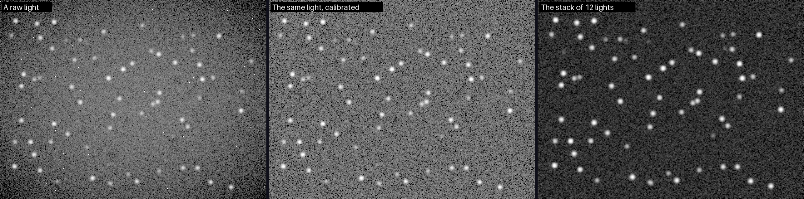

## Where next

The [quick start](quick-start.md) is the short version of this page, the
[CLI reference](../reference/cli.md) lists every option, and each tool has a page that explains the
method and its limits.
